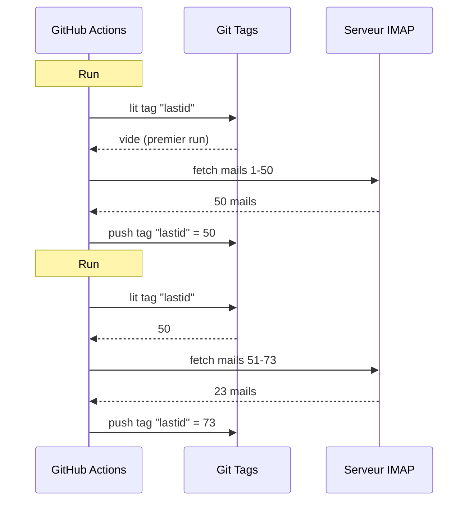

# استخدمت git كقاعدة بيانات لتشغيل بوت مجاني على GitHub Actions

لدي مجيب بريد آلي يعمل 24/7.

يقرأ رسائلي، ويفهم عما تتكلم، ويرد وحده بذكاء اصطناعي. يتذكر المحادثات السابقة. يتجاهل النشرات و`noreply@`. يحوّل لإنسان عندما يكون الأمر ساخنا أكثر من اللازم.

الkost الشهري : **0€**.

أستغني عن خادم وVPS وقاعدة بيانات. فقط GitHub Actions وحيلة مجنونة : **استخدام git كقاعدة بيانات**.

ترى إلى أين أريد الوصول ؟ لا ؟ حسنا، تمسك، فهو غبي وعبقري في آن واحد.

---

## المشكلة : GitHub Actions عديم الحالة

GitHub Actions مجاني. تستطيع إطلاق cron كل 5 دقائق، وتشغيل كودك، مجانا.

لكن هناك مشكلة : إنه **عديم الحالة**.

كل تشغيل ينطلق في آلة عذراء. لا شيء يُحفَظ بين تنفيذين. التشغيل السابق ؟ منسي. ممحو. كأنه لم يوجد أبدا.

لمجيب بريد، هذه مشكلة ضخمة. مثلا :

> "ما آخر بريد عالجته فعلا ؟"

إذا نسي البوت ذلك مع كل تشغيل، سيعيد الرد على نفس الرسائل في حلقة (كارثة)، أو سيفوّت رسائل.

يلزم حالة دائمة. وعادة، حالة دائمة = قاعدة بيانات. لكن قاعدة بيانات تعني خادما، والخادم لم يعد مجانيا.

هنا يصبح الأمر مثيرا.

---

## الحل : وسوم git كقاعدة بيانات

مستودع GitHub الخاص بك تخزين دائم فعلا. مجاني. مُصدَر. موجود دائما.

فلماذا لا نخزن الحالة فيه ؟

الفكرة : مع كل تشغيل، يقرأ البوت آخر UID بريد معالَج من **وسم git**. يعالج الرسائل الجديدة. ثم يعيد دفع الوسم مع UID الجديد.



وسم git هو قاعدة البيانات. قيمة واحدة، لكنها كل ما نحتاجه.

### قراءة الحالة

في بداية الوظيفة، نسترجع القيمة من الوسم :

```bash
git fetch origin --tags lastid || true
git show refs/tags/lastid:data/lastId > data/lastId || true
```

يعني `git show refs/tags/lastid:data/lastId` : "أعطني محتوى ملف `data/lastId` كما كان في وسم `lastid`".

بوم. لديك قيمتك، دون قاعدة بيانات.

### كتابة الحالة

في النهاية، نعيد إنشاء الوسم مع القيمة الجديدة :

```bash
git switch --orphan lastid-tmp   # فرع عذراء دون سجل
git rm -rf .                      # نفرغ كل شيء
mkdir -p data
printf "%s\n" "${LAST_ID_CONTENT}" > data/lastId

git add data/lastId
git commit -m "lastId snapshot"
git tag -f lastid                 # نجبر الوسم على هذا الـcommit
git push --force ...origin lastid # ندفع الوسم
```

ننشئ فرعا **يتيما** (دون سجل)، ونضع فقط ملف `lastId`، ونُدخل، ونسم، وندفع بالإجبار.

لماذا يتيما ؟ لعدم تراكم 10 000 commit حالة في سجل المستودع. كل تحديث يمحو سابقه. يشير الوسم دائما إلى commit واحد يحوي قيمة واحدة.

إنه نظيف. مجاني. ملتَوٍ تماما ويعمل.

---

## الحيلة الثانية : لقطة runtime

هناك مشكلة أخرى مع GitHub Actions : الـ`npm install`.

إذا كنت مع كل تشغيل (كل 5 دقائق) تنفذ `npm install` + `npm run build`، تهدر 60-90 ثانية في كل مرة. في cron متكرر، هذه دقائق حساب مهدورة للا شيء.

الحل : تجميع الكود مرة واحدة، وتخزينه في وسم git أيضا.

يفعل workflow البناء (الذي يعمل عندما تدفع على `master`) هذا :

```bash
# تجميع الكود
bun install
bun run build

# تخزين dist/ + node_modules/ في وسم "runtime"
git checkout --orphan temp-runtime
git rm -rf .
cp -r "$TMPDIR"/* .
git add dist node_modules package.json bun.lock data
git commit -m "runtime build"
git tag -f runtime
git push --force ...origin runtime
```

يحوي وسم `runtime` الكود المُجمَّع و`node_modules`. جاهز للعمل.

أما الـcron فيسحب هذا الوسم مباشرة :

```yaml
- name: Checkout runtime snapshot
  uses: actions/checkout@v4
  with:
    ref: refs/tags/runtime    # الكود المُجمَّع مسبقا، لا المصدر
    fetch-depth: 1

# لا npm install ولا build !
- name: Process emails
  run: node dist/index.js --action
```

ينطلق الـcron فورا وينفذ فقط `node dist/index.js`، دون install ولا build.

يعني لديك وسمان يقومان بعملين :
- `runtime` = الكود الجاهز للعمل (يُحدَّث عندما تدفع كودا)
- `lastid` = الحالة الدائمة (تُحدَّث مع كل تشغيل)

إنه أنيق بشكل قذر.

---

## البوت نفسه : مجيب آلي بالذكاء الاصطناعي

حسنا، حيلة git رائعة، لكن ماذا يفعل البوت بالضبط ؟

يقرأ رسائلك عبر IMAP، ويفهمها بذكاء اصطناعي (Groq + Llama 3.3 70B)، ويرد تلقائيا.

بنية بخدمات نظيفة مع حقن تبعيات (InversifyJS) :

```
App
├── ImapService      ← يقرأ الرسائل (IMAP)
├── SmtpService      ← يرسل الردود (SMTP)
├── ParserService    ← يحلل محتوى الرسائل
├── ReplyService     ← يولد رد الذكاء الاصطناعي
├── SummaryService   ← ذاكرة المحادثة
├── AccountsService  ← يدير حسابات بريد متعددة
└── ConfigService    ← إعداد / متغيرات بيئة
```

### وضعا التشغيل

يمكن للبوت العمل بطريقتين :

**وضع الاستماع** (وقت حقيقي) : اتصال IMAP دائم مع إعادة اتصال أسّية. لـVPS.

```typescript
this.imapService.on("exists", async (data) => {
  console.log(`[MAIL] بريد جديد ! الإجمالي: ${data.count}`);
  // يعالج البريد الجديد فورا
});
```

**وضع الفعل** (دفعي) : يعالج الرسائل الجديدة منذ `lastId`، ثم يُغلَق. لـcron في GitHub Actions.

```bash
node dist/index.js --action
```

وضع `--action` هو الذي يستخدم حيلة git. يقرأ `lastId`، ويعالج الجديد، ويكتب `lastId` الجديد، انتهى.

### لا ترد على الآليين

إذا رد بوتك على كل الرسائل، سيرد على النشرات والإشعارات و`noreply@`. كارثة. والأسوأ : إذا رد بوتان على بعضهما، لديك حلقة بريد لانهائية. الكابوس.

إذن ترشيح عدواني :

```typescript
export function isAutomatedSender(address) {
  const automatedPatterns = [
    "noreply", "no-reply", "donotreply",
    "mailer-daemon", "postmaster", "bounce",
    "newsletter", "notification", "marketing",
    "billing", "receipt", "promo", ...
  ];
  const local = address.split("@")[0].toLowerCase();
  return automatedPatterns.some(p => local.includes(p));
}
```

وأيضا كشف عبر ترويسات البريد :

```typescript
export function isAutomatedByHeaders(headers) {
  return (
    ["bulk", "list", "junk"].includes(headers.precedence) ||
    headers["auto-submitted"] !== "no" ||
    headers["list-unsubscribe"] !== "" ||   // النشرات لديها هذا
    /mailchimp|sendgrid|mailgun|brevo/i.test(headers["x-mailer"])
  );
}
```

هل يوجد `List-Unsubscribe` في الترويسات ؟ إنها نشرة. `Precedence: bulk` ؟ بريد جماعي. `X-Mailer: Mailchimp` ؟ ترى النوع. نتجاهل.

إنه كبوّاب ملهى ليلي : الآليون لا يمرون.

### المحفزات السحرية

يستطيع الذكاء الاصطناعي أن يقرر ألا يرد إطلاقا، أو أن يسلّم لإنسان. كيف ؟ بمحفزات خاصة في رده.

يقول له prompt النظام :

> إذا كان بريدا آليا/نشرة ← رد `<no_reply>`
> إذا كان مهما/حساسا أكثر من اللازم (قانوني ومالي...) ← رد `<manual_reply_required>`
> وإلا ← اكتب ردا حقيقيا

ويقرأ الكود ذلك :

```typescript
const aiReply = completion.choices[0].message.content.trim();
const manualTrigger = aiReply.includes(MANUAL_REPLY_TRIGGER);
const noReply = aiReply.includes(NO_REPLY_TRIGGER);

if (noReply) {
  console.log("[MAIL] قرر الذكاء الاصطناعي التجاهل. تخطٍّ.");
  return;
}

if (manualTrigger) {
  console.log("[MAIL] ساخن أكثر من اللازم، أحوّل لإنسان.");
  await this.smtpService.sendManualForward(...);
  return;
}

// وإلا نرسل رد الذكاء الاصطناعي
await this.smtpService.sendReply(...);
```

يعني للذكاء الاصطناعي حق قول "لا، هنا لا ألمس، نادِ إنسانا حقيقيا". إنها حكمة.

---

## ذاكرة المحادثة

تفصيل يغيّر كل شيء : البوت **يتذكر** المحادثات.

عندما يرد على شخص، يحفظ ملخصا للتبادل. في المرة التالية التي يكتب فيها هذا الشخص، يُحقَن الملخص في الـprompt.

التخزين : ملف JSON لكل جهة.

```
data/customers/
├── moi%40gmail.com/
│   ├── alice%40example.com.json
│   └── bob%40client.fr.json
```

والملخص نفسه يولده الذكاء الاصطناعي، الذي يدمج الملخص القديم مع الرسالة الجديدة :

```typescript
const completion = await groq.chat.completions.create({
  model: "llama-3.3-70b-versatile",
  messages: [
    { role: "system", content: "Tu es un assistant de mémoire. Merge l'ancien résumé avec le nouveau message sans perdre d'info." },
    { role: "user", content: `Résumé existant:\n${existing}\n\nNouveau message:\n${incomingContent}` }
  ],
  temperature: 0.0,  // حتمي، دون إبداع
  max_tokens: 800,
});
```

إذن يبني البوت ذاكرة مضغوطة مع الوقت. ملخص يكبر بذكاء يكفي، دون تخزين كل الرسائل.

وهذه الملفات JSON ؟ حسنا... إنها مخزنة في git أيضا، في وسم runtime. git في كل مكان.

---

## النقطة الذكية في طول الـprompt

تفصيل تقني صغير جعلني أبتسم.

للنماذج حد رموز. إذا تجاوز بريدك + الملخص + prompt الشخصية، يعيد API خطأ.

يدير الكود ذلك بـ**اقتطاع متتالٍ** + إعادة محاولة :

```typescript
try {
  // محاولة أولى بالحدود العادية
  completion = await groq.chat.completions.create({...});
} catch (error) {
  if (!this.isLengthError(error)) throw error;

  // كان خطأ طول : نعيد المحاولة بحدود أضيق
  ({ systemContent, userContent } = this.buildPromptPayload({
    ...,
    limits: {
      systemPromptChars: 2200,  // بدلا من 3000
      summaryChars: 1800,       // بدلا من 4000
      personaChars: 900,        // بدلا من 1500
      userContentChars: 2200,   // بدلا من 8000
    },
  }));
  completion = await groq.chat.completions.create({...});  // إعادة محاولة
}
```

إذا لم يمر، نقطع أقصر ونعيد المحاولة. بسيط وفعال، دون انهيار.

---

## حسنا، وعمليا، كيف يعمل ؟

التدفق الكامل لتشغيل cron :

```
1. يُحفَّز GitHub Actions (cron كل 5 دقائق)
2. سحب وسم "runtime" (كود مُجمَّع مسبقا)
3. git show refs/tags/lastid ← يسترجع آخر UID معالَج
4. node dist/index.js --action
   ├── اتصال IMAP
   ├── جلب الرسائل منذ lastId+1
   ├── لكل بريد :
   │   ├── حلل المحتوى
   │   ├── رشّح الآليين (تخطَّ إذا آلي)
   │   ├── طابِق الحساب المتلقي
   │   ├── استرجع ذاكرة المحادثة
   │   ├── ولّد رد الذكاء الاصطناعي (Groq)
   │   ├── <no_reply> ؟ تخطَّ
   │   ├── <manual_reply_required> ؟ حوّل لإنسان
   │   ├── وإلا : أرسل الرد (SMTP)
   │   └── حدّث ذاكرة المحادثة
   └── اكتب lastId الجديد
5. git push --force للوسم "lastid" بالقيمة الجديدة
```

ويبدأ من جديد بعد 5 دقائق. للأبد. مجانا.

---

**النقاط الثلاث للتذكر :**

1. **git = قاعدة بيانات مجانية**، وسم يتيم يستطيع تخزين حالتك الدائمة بين تشغيلين عديمي الحالة. `git show refs/tags/X:fichier` للقراءة، والدفع بالإجبار للكتابة. توفر قاعدة بيانات كاملة.

2. **جمّع مسبقا في وسم runtime**، بدلا من `npm install` مع كل تشغيل للـcron، خزّن الكود المُجمَّع + node_modules في وسم git. ينطلق الـcron فورا.

3. **بوت الذكاء الاصطناعي يجب أن يعرف الصمت**، المحفزان `<no_reply>` و`<manual_reply_required>` يتركان للذكاء الاصطناعي قرار عدم الرد أو التسليم. مع الترشيح ضد الآليين. وإلا أنشأت حلقة بريد لانهائية.

cron بلا خادم مع حالة دائمة وذكاء اصطناعي وذاكرة، الكل بـ0€/شهر. إنه معطوب تماما وأعشق هذا التركيب.
