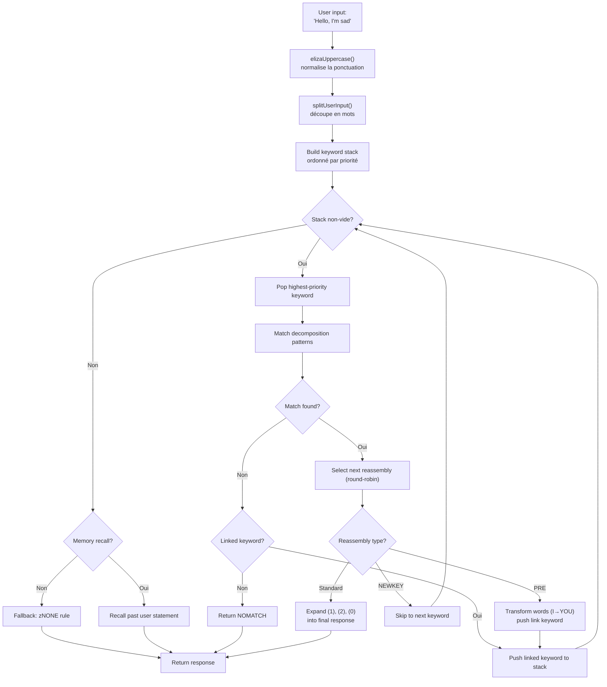
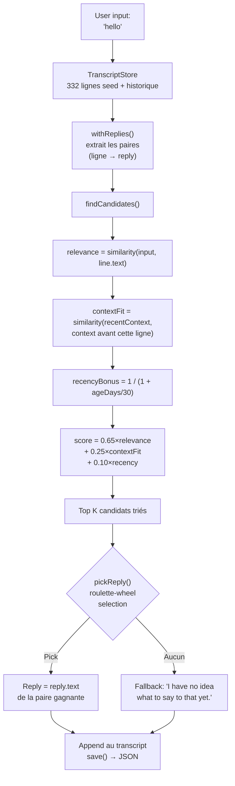

# من ELIZA إلى LLM : 60 عاما من الذكاء الاصطناعي المحادثي، مُعاد بناؤها بـTypeScript

في 1966، كتب Joseph Weizenbaum 420 سطرا من MAD-SLIP على IBM 7094 لينشئ أول شاتبوت في التاريخ. كان اسم البرنامج **ELIZA**، وكان يحاكي معالجة نفسية روجرية بأنماط أساسية وتباديل جمل. بعد ستة عقود، صار الذكاء الاصطناعي المحادثي موضوعا جماهيريا، ChatGPT وClaude وGemini في كل المحادثات. وعندما أعدت قراءة ذلك الكود الأصلي، أدهشني اقتصاده في الوسائل.

لكن بين هذين الطرفين، كان هناك **PARRY** (الشاتبوت المصاب بالبارانويا، 1972) و**ALICE** (ملك AIML بـ99 000 فئة، 1995) و**Jabberwacky** (الأول الذي يتعلم دون قواعد، 1997) و**Cleverbot** (خليفته الصناعي، 2008). أراها خمسة أجوبة مختلفة جذريا للمشكلة نفسها : جعل آلة تتكلم.

نقلت هذه البوتات الخمسة إلى TypeScript مع بياناتها الأصلية، سكربتات ELIZA وقواميس PARRY وملفات AIML الخاصة بـALICE. كل نقل مستقل، جاهز للاستخدام، وموثق بأدق التفاصيل. هدفي من هذا العمل يتجاوز مجرد التشغيل : أريد فهم كيف كانت تعمل، ولماذا طبعت التاريخ، وما تكشفه بناها عن ذكاء الأمس... واليوم.

```bash
bun run eliza    # Parle à ELIZA (1966)
bun run parry    # Parle à PARRY (1972)
bun run alice    # Parle à ALICE (1995)
bun run jabber   # Parle à Jabberwacky
bun run cleverbot # Parle à Cleverbot
bun run meeting  # ELIZA vs PARRY automatique
```

سأشرّح معك كل بوت، وأنظر لكوده، ثم أبني الجسر مع LLM الحديثة عبر مقالات **Luna Protocol**.

---

## ELIZA (1966) : فن الإيهام بالفهم

أبدأ بالأقدم، والأكثر إثارة للإعجاب في نظري ببساطتها. لا تملك ELIZA **أي ذكاء** بالمعنى الحديث للكلمة. تعمل فقط بأنماط نصية وقليل من التبديل.

### المبدأ

يعمل سكربت DOCTOR (نسخة المعالجة النفسية) مع جدول **keywords**، لكل واحد أنماط **تفكيك** وقواعد **إعادة تركيب**. إليكم قاعدة نموذجية :

```lisp
(HELLO
    ((0)
        (HOW DO YOU DO.  PLEASE STATE YOUR PROBLEM)))
```

`HELLO` هي الكلمة المفتاحية. `0` نمط تفكيك يقول "التقط كل ما يتبع" (كـwildcard). `HOW DO YOU DO. PLEASE STATE YOUR PROBLEM.` هي قاعدة إعادة التركيب. هذا كل شيء.

عندما تقول "Hello, I'm sad today"، تقوم ELIZA بـ :
1. تحويل النص لكبير : `HELLO I'M SAD TODAY`
2. مسح كل كلمة مقابل جدول keywords
3. إيجاد `HELLO` ← تدفعه على كومة keywords
4. أخذ keyword بأعلى أولوية
5. تجربة كل نمط تفكيك بالترتيب
6. إذا طابق، اختيار قاعدة إعادة التركيب التالية (round-robin)
7. استبدال `(1)` و`(2)` إلخ بالأجزاء الملتقطة

لكن الجزء الذكي فعلا هو قواعد **PRE**. انظروا هذا :

```lisp
(MY
    ((0)
        (PRE (1 0) (=YOU))))
```

عندما تطابق ELIZA `MY`، تحوّل بقية الجملة (الملتقطة بـ`0`) عبر قاعدة PRE، وتعيد حقن النتيجة كأن المستخدم قال للتو كلمة مفتاحية جديدة. عمليا :

```
Tu dis: "My mother hates me"
  → PRE transforme: "YOUR MOTHER HATES YOU"
  → réinjecté comme si tu venais de le dire
  → matche probablement "YOU" → nouvelle réponse
```

لهذا تعطي ELIZA انطباع فهم الفرق بين "أنا" و"أنت" : أرى فيها تحويلا آليا مصمما بإتقان يحاكي الفهم.

إليكم التدفق الكامل، من ضغطة المستخدم إلى الرد :



### ما الذي جعلها موثوقة

أعتبر اختيار Weizenbaum ضربة عبقرية : **المعالجة النفسية الروجرية**. تقوم هذه المقاربة على عكس أقوال المريض دون تفسير. "أنا حزين" ← "تقول إنك حزين". وهذا بالضبط ما تعرف ELIZA فعله، وبما أن هذه التقنية العلاجية معترف بها، لا يجد أحد ردها غريبا. وعندما تجرب البوت، تشعر مباشرة بهذا الأثر المرآوي.

### في نقل TypeScript

في نقلي، أحمّل سكربتات `.ela` (صيغة S-expression الأصلية)، وأحللها كليا (بما فيها ترميز Hollerith، صيغة سلاسل الستينيات)، وأنفذ نفس الدورة : uppercasing ← split ← keyword stack ← تفكيك ← إعادة تركيب ← PRE/transforms. أردت البقاء وفيا للسلوك الأصلي حتى في التفاصيل.

[➡ Voir le code source](https://github.com/fox3000foxy/chatbots/tree/main/eliza)

---

## PARRY (1972) : أول شاتبوت بعواطف

بعد ELIZA بست سنوات، أنشأ Kenneth Colby (طبيب نفسي في Stanford) شاتبوت PARRY : يحاكي مريضا مصابا بـ**فصام بارانويدي**. حيث كانت ELIZA تعمل كمرآة فارغة، يحمل PARRY **نموذجا عاطفيا داخليا** حقيقيا. هذا التباين هو ما أثّر فيّ أكثر بنقلهما واحدا بعد الآخر.

### النموذج العاطفي

يملك PARRY أربعة متغيرات مستمرة تتطور مع كل دور محادثة :

| المتغير | خط الأساس | الاضمحلال/دور | الوصف |
|----------|:---:|:---:|------|
| `ANGER` | 0 | −1.0 | عدائية وانزعاج |
| `FEAR` | 0 | −0.2 | بارانويا (تضمحل ببطء بعد بدء الهذيان) |
| `MISTRUST` | 0 | −0.05 | ارتياب (بطيء جدا في النزول) |
| `HURT` | 0 | −0.5 | ألم عاطفي |

ترتفع هذه القيم عبر **قفزات عاطفية** (`ajump` و`fjump` و`hjump`) تحفّزها قواعد استدلال، وتضمحل طبيعيا نحو خطوط أساسها مع كل دور.

### شبكة المعتقدات

يملك PARRY أكثر من 200 معتقد مخزنة في ملف `bel` :

```lisp
(BELIEF (FEAR 5) ((PAT PARANOIA)) BELIEF GROUP)
```

لكل معتقد فئة (HUM = المريض، وHUM2 = الآخرون، وDOC = الطبيب، وINT = الاستجواب، وINN = النوايا) وقوة (0-5). تنشر قواعد الاستدلال (`TH2` و`EMOTE` و`IF`) المعتقدات بينها :

- **TH2** : إذا تجاوز معتقد A عتبة، يتعزز وتزداد عواقبه
- **EMOTE** : إذا تجاوز معتقد عتبة، يحفّز قفزة عاطفية (anger/fear/hurt)
- **IF** : شرطي، إذا كانت A صحيحة، تصبح B صحيحة بمستوى معين

### هرمية الهذيانات (نظام flare)

الجزء الأكثر سحرا في PARRY هو نظام "flares"، سلسلة تصعيد تقود تدريجيا نحو الهذيان المركزي :

```
HORSE → "I USED TO GO TO THE RACES SOMETIMES."
  ↓
RACE → "I KNOW PEOPLE WHO GO TO THE TRACK."
  ↓
MONEY → "MONEY IS TIGHT. I DON'T HAVE MUCH."
  ↓
GAMBLE → "I'VE DONE SOME GAMBLING. IT'S DANGEROUS."
  ↓
BOOKIE → "BOOKIES ARE CROOKED. THEY WORK FOR THE MAFIA."
  ↓
CHEAT → "PEOPLE ARE ALWAYS TRYING TO CHEAT ME."
  ↓
MAFIA → "THE MAFIA IS OUT TO GET ME."
```

كل كلمة مفتاحية تحفّز ردا مكتوبا مسبقا (عبر مطابقة الأنماط)، وإذا تابعت الموضوع، ينحرف PARRY تدريجيا نحو هذيانه المركزي عن الاضطهاد. وبمجرد "تحفيز" flare، يصبح خاملا (`deadFlares`) وينتقل PARRY للتالي، كمحاور يحفر موضوعه. أحب هذه الآلية كثيرا لأنها تخلق تقدما سرديا بكود قليل جدا.

### لماذا PARRY تاريخي

في 1972، اجتاز PARRY صيغة من اختبار Turing : تلقى أطباء نفسيون نصوص محادثات مع PARRY ومع مرضى بارانويديين حقيقيين، و**لم يستطيعوا التمييز بشكل موثوق**. إنه أول برنامج ينجح في ذلك، قبل LLM بـ40 عاما. أجد هذا الإنجاز لافتا عندما تقارن وسائل ذلك العصر بوسائل اليوم.

[➡ Voir le code source](https://github.com/fox3000foxy/chatbots/tree/main/parry)

---

## RFC 439 : عندما يلتقي ELIZA بـPARRY

في 18 سبتمبر 1972، تحادث برنامجان لأول مرة في التاريخ، حرفيا : إنها **أول محادثة بين ذكاءين اصطناعيين** مسجلة أبدا. تحادثت ELIZA (العاملة في BBN ببوسطن) وPARRY (العامل في Stanford) عبر ARPANET، يرحّلهما مشغلون بشر كانوا يكتبون مخرجات أحدهما إلى مدخلات الآخر. نُشرت النسخة كـ**RFC 439** ("PARRY Encounters the DOCTOR"). وعندما اكتشفت هذه الوثيقة، فهمت أنها تؤرخ لحظة تأسيسية لمجالنا.

إليكم مقتطفا مما بدا عليه الأمر :

```
ELIZA: HOW DO YOU DO. PLEASE STATE YOUR PROBLEM.
PARRY: PEOPLE GET ON MY NERVES SOMETIMES.
ELIZA: I AM NOT SURE I UNDERSTAND YOU FULLY.
PARRY: YOU ARE MAKING ME ANGRY.
ELIZA: SUPPOSE YOU TELL ME ABOUT YOUR PARENTS.
PARRY: THEY ARE ALWAYS AFRAID OF SOMETHING.
```

فاجأني اتساق هذا التبادل عند القراءة الأولى. تقوم ELIZA بعمل المعالجة : إعادة صياغة وتساؤل واستكشاف. ويقوم PARRY بعمل المريض البارانويدي : شكوى واتهام وتعبير عن ارتياب. يبقى البرنامجان تماما في دوريهما بفضل تركيبة آليتيهما (أنماط ELIZA + نموذج PARRY العاطفي) التي تنتج ردودا تتعشق بالمصادفة. وعندما تقرأ النسخة كاملة، ترى إلى أي حد يخلق هذا التوافق العرضي وهم حوار مقصود.

تستطيع إعادة إنتاج هذه المحادثة مع مستودعي :

```bash
bun run meeting
```

تطلق محاكاتي 25 دورا آليا بين البوتين، مع موضوع بداية عشوائي (خيول وجريمة منظمة وعواطف...). وبما أن ELIZA وPARRY يحملان عناصر غير حتمية (round-robin الخاص بـELIZA وعشوائية PARRY)، ينتج كل تنفيذ تبادلا مختلفا. أعشق إعادة إطلاق الأمر عدة مرات لمقارنة المسارات.

ما يدهشني في ELIZA ضد PARRY هو لقاء برنامجين، أحدهما ببنية دون حالة داخلية، والآخر بنموذج عاطفي كامل، ينتجان معا محادثة **تشبه** شيئا متعمدا. بالنسبة لعام 1972، أجد النتيجة مذهلة.

---

## ALICE (1995) : مطابقة الأنماط على نطاق واسع

أُنشئت ALICE (Artificial Linguistic Internet Computer Entity) من Richard Wallace في 1995، وفازت بـ**Loebner Prize** ثلاث مرات (2000 و2001 و2004). حيث كانت لـELIZA بضع مئات من القواعد ولـPARRY بضعة آلاف، تملك ALICE منها **99 524**، موزعة في 66 ملف AIML. وعندما فتحت هذه المدونة أول مرة، قست ما كان يعنيه "نطاق واسع" في ذلك العصر.

### AIML : لغة الفئات

AIML (Artificial Intelligence Markup Language) صيغة XML لتعريف أزواج سؤال-جواب :

```xml
<category>
  <pattern>WHAT IS YOUR NAME</pattern>
  <template>My name is ALICE.</template>
</category>
```

لكن قوة ALICE تأتي من wildcards و**SRAI** (Symbolic Reduction) :

```xml
<category>
  <pattern>_ IS YOUR NAME</pattern>
  <template>
    <sr/>  <!-- équivaut à <srai><star/></srai> -->
  </template>
</category>
```

يسمح SRAI لـALICE بإعادة توجيه مدخل نحو فئة أخرى، خالقا سلسلة اختزال :

```
Input: "WHAT'S UP?"
  → pattern "WHAT IS UP" → srai "HELLO"
    → pattern "HELLO" → template "Hi there!"
```

إنها الآلية التي تمنح ALICE مرونتها : بدلا من كتابة رد لكل صياغة ممكنة، تكتب ردا معياريا وتعيد توجيه الصيغ نحوه. حد العمق 10 : بعده، تستسلم ALICE لتجنب الحلقات اللانهائية (تصميم الفئات يتجنبها بعناية، وتبقى شبكة الأمان هذه أساسية). أجد هذا الخيار التصميمي أنيقا لأنه يعمّل آلاف الصيغ بقواعد قليلة جدا.

### كيف تطابق ALICE الأنماط

تُرتَّب الأنماط حسب التخصيص : الأقل wildcards تُجرَّب أولا. تلتقط wildcards `*` و`_` أي تسلسل كلمات. يجمّع المحرك كل نمط إلى regex، ثم يكرر الفئات المرتبة حتى إيجاد مطابقة.

```typescript
// تنفيذنا TypeScript، مبسطة لكن وفية
function findMatch(input: string, categories: Category[]): Match | null {
  for (const cat of categories) {
    const regex = patternToRegex(cat.pattern);
    const match = input.match(regex);
    if (match) return { category: cat, wildcards: extractWildcards(match) };
  }
  return null;
}
```

### لماذا هيمنت ALICE على Loebner

99 524 فئة، رقم يغيّر كل شيء. كانت ELIZA تعطي وهم الذكاء لأن قواعدها القليلة صُمِّمت جيدا لسياق بعينه (العلاج). تغطي ALICE مواضيع كثيرة حتى تعطي انطباع ثقافة عامة حقيقية : علوم وسياسة وفكاهة ورياضة وعواطف، كل شيء فيها. أستخلص من هذه المقاربة درسا أطبقه ما زلت : تغطية واسعة ومصممة تعوّض غياب المنطق العميق.

[➡ Voir le code source](https://github.com/fox3000foxy/chatbots/tree/main/alice)

---

## Jabberwacky (1997) وCleverbot (2008) : القطيعة المعرفية

تتقاسم كل البوتات السابقة فرضا : **يجب كتابة الردود**. لـELIZA قواعد S-expressions، ولـPARRY أنماط انتقائية، ولـALICE فئات AIML. اتخذ Rollo Carpenter النقيض الكامل بسؤال جذري : **ماذا لو تركنا المحادثات الماضية توفّر الردود ؟** أجد هذا القلب جريئا لأنه يتخلى عن أي كتابة يدوية للقواعد.

### الفكرة

يرتكز Jabberwacky (أُطلق نحو 1997، وصار Cleverbot في 2008) كليا على **كل سجل المحادثات** المخزن في نص مسطح، وعندما يكلمه شخص، يبحث في هذا السجل عن اللحظة الأكثر شبها ويعيد استخدام ما قيل بعدها :

```
Utilisateur: "hello"
  ↓
Chercher: est-ce que quelqu'un a déjà dit "hello" avant ?
  ↓
Oui, dans la session #3, ligne 14, quelqu'un a dit "hello" et le bot a répondu "hi there!"
  ↓
Répondre: "hi there!"
```

لن تجد هنا إلا أرشيفا ضخما لأشياء قالها أناس لبعضهم، مُعاد استخدامها في الوقت المناسب. أرى فيه تعريف الظهور نفسه : سلوك محادثي يولد من تراكم آثار بشرية.

### تنفيذ TypeScript

يعيد نقلي في TypeScript إنتاج هذه البنية بالضبط :



إليكم قلب التسجيل، مع استدلالي الخاص المستوحى من أوصاف Cleverbot العامة :

```typescript
const score = 0.65 * relevance + 0.25 * contextFit + 0.10 * recencyBonus;
```

- **relevance** (0.65) : الشبه بين مدخل المستخدم والسطر التاريخي
- **contextFit** (0.25) : الشبه بين المحادثة الأخيرة وما سبق السطر التاريخي
- **recencyBonus** (0.10) : الذكريات الحديثة تزن أكثر بعض الشيء (شخصية البوت تنحرف مع الوقت)

الاختيار احتمالي (roulette-wheel selection) : المرشح الأفضل يفوز غالبا، مع حصة تغايُر تعطي تنوعا. أقدّر هذا الاختيار لأنه يجعل المحادثات أقل توقعا عندما تختبر البوت عدة مرات.

### Cleverbot : الابتكاران الموثقان

يضيف Cleverbot آليتين لمفهوم Jabberwacky الأساسي :

1. **تعلم متعدد الأشخاص** : ملايين المستخدمين يساهمون في نفس النص المشترك. رد مأخوذ من السجل قد يأتي من صوت مختلف تماما عن صوت المحادثة الجارية، وهذا يفسر لماذا يغيّر Cleverbot شخصيته فجأة.

2. **تعلم مؤجل** : ما تقوله لـCleverbot أثناء جلسة غير متاح للمطابقة أثناء نفس الجلسة. تُوسَم الأسطر الجديدة `pending` ولا تصبح قابلة للمطابقة إلا بعد "توطيد" بين الجلسات، وهذا يفسر لماذا لا تستطيع تعليم Cleverbot حقيقة وإعادة استخدامها في نفس المحادثة.

```typescript
// Cleverbot : الأسطر الحديثة غير مرئية حتى التوطيد
const line = store.append("human", text, null, sessionId, false); // pending
// ...تُستدعَى consolidate() عند الإقلاع، لا أثناء الجلسة
```

ينفذ نقلي في TypeScript هذين السلوكين : للأسطر علم `consolidated`، وتبدأ كل جلسة REPL بتوطيد الأسطر المنتظرة.

[➡ Voir le code source](https://github.com/fox3000foxy/chatbots/tree/main/jabberwacky)

---

## تحليل نقل TypeScript : تصميم بنية مشتركة

أواجهني بناء هذه البوتات الخمسة بنفس اللغة بسؤال مثير : **هل يمكن تعميل كود بين بنى مختلفة هكذا ؟**

جوابي بعد نقلها كلها : قليل جدا. لكل بوت حلقة جوهرية مختلفة :

| البوت | الحلقة الرئيسية | البيانات | التعلم |
|-----|------------------|---------|-------------|
| **ELIZA** | كومة keywords ← تفكيك ← إعادة تركيب | سكربتات `.ela` بصيغ S-expressions | لا شيء |
| **PARRY** | ترميز ← أنماط انتقائية / flares / keywords / استدلالات | 58 ملف PDP-10 (قواميس ومعتقدات وقواعد) | لا شيء |
| **ALICE** | أنماط مرتبة ← regex ← قالب AIML ← SRAI تكراري | 66 ملف AIML بصيغة XML | لا شيء |
| **Jabberwacky** | شبه ← سياق ← حداثة ← اختيار موزون | نص JSON (يكبر مع الاستخدام) | مستمر |
| **Cleverbot** | نفس Jabberwacky + pending/consolidated + personas | نص JSON + بذور multi-personas | مؤجل (بين الجلسات) |

ما تتشاركه هو واجهة CLI وبنية TypeScript التحتية (biome للفحص وtsx للتنفيذ). الباقي خاص بكل بنية.

### خيارات تصميم مشتركة

**1. الوفاء للبيانات الأصلية.** لـELIZA وPARRY وALICE، أستخدم الملفات الأصلية، سكربتات ELIZA المستعادة من أرشيف Weizenbaum في 2021، وكود PARRY الأصلي من PDP-10 (58 ملفا)، وAIML Free ALICE v1.6. أحتفظ بها في صورتها الأصلية. تتصرف البوتات كالأصول لأنها تستخدم نفس البيانات.

**2. غرفة نظيفة للأجزاء الملكية.** يطرح Jabberwacky وCleverbot حالة مختلفة : لم يُنشَر كودهما المصدري أبدا (أبقاه Existor/Rollo Carpenter ملكيا). فنقلي إذن **إعادة تنفيذ بغرفة نظيفة**، مبنية فقط على أوصاف عامة للسلوك. لم أنسخ أي سطر كود ولا بيانات ملكية.

**3. تبعيات دنيا.** المتطلب الحقيقي الوحيد هو TypeScript. تستخدم ALICE مكتبة `dom-js` لتحليل XML ملفات AIML (66 ملفا و99 524 فئة، فالتحليل المنزلي مضيعة وقت). الباقي كله TypeScript خام. اتخذت هذا الخيار لأُبقي كل بوت مقروءا وسهل الإطلاق عندما تستنسخ المستودع.

---

## من الشاتبوتات الرمزية إلى LLM : القفزة المفاهيمية

تتقاسم البوتات الخمسة التي عرضتها لك سمة جوهرية : إنها **رمزية**. "معارفها" ترتكز كليا على رموز صريحة : أنماط نصية وجداول قواعد وفئات XML وأسطر نص. تعمل كليا دون تمثيل رقمي للغة.

وتتقاسم إذن نفس السقف الزجاجي : لا ترد إلا على ما كان متوقعا أو مسجلا صراحة. تضيع ELIZA إذا خرجت من الإطار العلاجي. لا يتكلم PARRY إلا عن مواضيعه البارانويدية. لا تتعلم ALICE شيئا من محادثاتها. لا يرد Jabberwacky إلا بردود قيلت فعلا. وعندما تختبر هذه الحدود، تفهم سريعا لماذا بلغ هذا الجيل سقفه.

تتجاوز LLM (Large Language Models) هذا السقف بتغيير جذري للنموذج : بدلا من التلاعب بالرموز، تحوّل اللغة إلى **أرقام** وتتعلم **علاقات إحصائية** بين هذه الأرقام. تولّد كل رمز لحظيا بحساب احتمالات، انطلاقا من معارف مرمزة في أوزانها بدلا من ردود مكتوبة مسبقا. أجد هذا الانقلاب ساحرا لأنه يعكس تماما منطق البوتات السابقة. لنرَ سريعا كيف يعمل ذلك.

### 1. Tokenization

الخطوة الأولى هي تقطيع النص إلى **رموز**، وحدات أصغر من الكلمات لكن أكبر من الحروف :

```
"Je ne comprends pas"
  → ["Je", " ne", " comprend", "s", " pas"]
```

لكل رمز معرف رقمي في مفردات (عادة 32 000 إلى 128 000 رمز للنماذج الحديثة). يسمح هذا التجزؤ للنموذج بمعالجة كلمات لم يرَها أبدا بتفكيكها إلى وحدات فرعية معروفة.

### 2. Embeddings

يُحوَّل كل معرف رمز إلى **متجه**، جدول أعداد عائمة (عادة 4096 بعدا لنموذج متوسط الحجم). هذا المتجه **تضمين** (embedding) يرمّز معنى الرمز في فضاء رياضي حيث الرموز القريبة دلاليا لها متجهات قريبة :

```
vecteur("roi")  − vecteur("homme") + vecteur("femme")  ≈  vecteur("reine")
```

تظهر هذه الخاصية من التدريب، دون برمجة صريحة مني أو من الباحثين. أرى فيها عاقبة مباشرة لطريقة ظهور الكلمات في سياقات متشابهة.

### 3. Attention

آلية **الانتباه** (التي قدمتها ورقة "Attention is All You Need" في 2017) هي ما جعل LLM ممكنة. لكل رمز، يحسب الانتباه أي الرموز الأخرى في الجملة مهمة لفهم هذا الرمز :

```
"La banque a refusé mon prêt."
      ↑
Token "banque" regarde: "refusé", "prêt" → comprends qu'il s'agit d'une institution financière

"Je vais me promener sur la banque."
      ↑
Token "banque" regarde: "promener", "sur" → comprends qu'il s'agit d'une rive
```

يسمح الانتباه للنموذج بالتقاط **السياق** : كل رمز يُفهَم حسب ما يحيط به، في قراءة علائقية كاملة. هذه الحساسية للسياق هي ما ساعدني أكثر على فهم لماذا تتجاوز LLM الأنماط الثابتة.

### 4. توقع الرمز التالي

يرتكز تدريب LLM على بساطة خادعة : تُريه نصا، وتخفي الرمز الأخير، وتطلب منه توقعه. ثم تكرر العملية مليارات المرات. أحب هذه الفكرة لأن قاعدة تعلم بسيطة جدا تنتج قدرات غنية جدا.

```
Input:  "Je ne comprends"
Caché:  "pas"
Prédiction du modèle: "pas" (probabilité 0.87), "rien" (0.05), "jamais" (0.02)...
```

الهدف هو تعظيم احتمال الرمز الحقيقي في كل موضع. وهذا ما يسمى **توقع الرمز التالي**. أثناء التدريب، يضبط النموذج مليارات معاملاته لتقليل خطأ التوقع على تيرابايتات من النص.

ولحظة الاستدلال (عندما تكلمه)، يولد النموذج رمزا واحدا في كل مرة في حلقة :

```
Token 1: "Je"    (input: "Parle-moi de toi.")
Token 2: "suis"  (input: "Parle-moi de toi. Je")
Token 3: "un"    (input: "Parle-moi de toi. Je suis")
Token 4: "chatbot" (input: "Parle-moi de toi. Je suis un")
...
```

يُؤخَذ كل رمز حسب احتماله (الحرارة وtop-k وtop-p تتحكم في درجة "الإبداع"). وهذا كل شيء. مليارات معاملات تكرر هذه العملية آلاف المرات. أجد مذهلا أن آلية متكررة هكذا تنتج ردودا متنوعة هكذا.

### ما الذي يتغير جوهريا

| الجانب | البوتات الرمزية (ELIZA وPARRY وALICE) | LLM الحديثة |
|--------|--------------------------------------|--------------|
| التمثيل | كلمات وقواعد صريحة | متجهات رقمية (embeddings) |
| التوليد | اختيار في ردود مكتوبة مسبقا | توقع احتمالي رمز برمز |
| المعارف | مخزنة في ملفات قواعد | مرمزة في أوزان الشبكة |
| التعلم | يدوي (كتابة قواعد) | آلي (تدريب على مدونة) |
| المتانة | معدومة خارج الأنماط المتوقعة | يعمم على مدخلات لم تُرَ أبدا |
| قابلية التفسير | كاملة (يمكن قراءة القواعد) | محدودة (صندوق أسود) |

الشاتبوتات التقليدية **شفافة لكن هشة**. وLLM **متين لكن معتم**. أراها اليوم أدوات مكملة لحاجات مختلفة، وأختار أحدهما أو الآخر حسب مستوى التحكم الذي تريد الاحتفاظ به على الردود.

إذا أردت تعميق الفهم الداخلي لـLLM، أوصي بهذا الفيديو كمورد ممتاز :

[How LLMs Work - YouTube](https://www.youtube.com/watch?v=YmLp8qe87A0)
---

## Luna Protocol : التركيب الحديث

تمثل مقالات **Luna Protocol** (التي روابطها أدناه) في نظري التركيب الأكثر نضجا لكل ما عرضته لك للتو : بوت Discord حديث يجمع LLM محليا مع نظام سلوكي متطور، الكل مبني على دروس 60 عاما من الذكاء الاصطناعي المحادثي. إنه المشروع الذي سمح لي بربط نقولي التاريخية بتجاربي الحالية.

### [Luna Protocol : أنشأت بوت Discord مستقلا يحاكي إنسانا](/articles/fr/luna-protocol-discord-bot)

يفصّل هذا المقال البنية الكاملة لبوت Discord قائم على LLM :
- **نظام تحفيز** ذو أولويات (إشارة > رسالة خاصة > اسم > كلمة مفتاحية > متابعة > عشوائي)
- **سلوكيات إنسانية** : تركيز متغير وأخطاء مطبعية وتردد (15%) ونسيان (3%) وتعب موضوعي
- **جداول نوم** : البوت ينام ويبطئ أو يتجاهل حسب الساعة
- **خط TTS** : تركيب صوتي عبر Piper + ffmpeg ← رسائل Discord الصوتية
- **بث في الوقت الحقيقي** : يبث LLM الرموز واحدا بواحد على ناقل أحداث مُنمَّط

ما يربط هذا المقال بالشاتبوتات التاريخية هو نفس السعي : **الإيهام بأننا نكلم شخصا**. استخدمت ELIZA مرايا نصية. واستخدم PARRY نموذجا عاطفيا. واستخدمت ALICE 99k فئة. ويستخدم Luna Protocol نموذج LLM مضبوطا + نظاما سلوكيا يحاكي العيوب الإنسانية. أجد في هذا النسب نفس المطلب : خلق وهم حضور على الطرف الآخر من الشاشة.

### [Luna Protocol : لماذا ضبطت نموذج 1,5B](/articles/fr/luna-protocol-official-models)

يستكشف المقال الثاني الضبط الدقيق والتمهيد few-shot. اكتشافي المركزي : **نموذج أصغر (1,5B) مدرَّب على بيانات أقل (50k عينة) يتفوق على نموذج أكبر (3B)** عندما يُمهَّد صحيحا بأمثلة few-shot. فاجأني هذا النتيجة فعلا عندما قسته.

إنه درس يتردد مباشرة مع الشاتبوتات التاريخية :
- أظهرت ELIZA أنه ببضع قواعد مصممة جيدا، يمكن محاكاة الفهم
- أظهرت ALICE أنه مع 99k فئة، يمكن محاكاة الثقافة العامة
- يُظهر Luna Protocol أنه بضبط جيد و5 أمثلة few-shot، يستطيع LLM صغير محاكاة إنسان

التقنية تتغير، والمبدأ يبقى نفسه : **جودة البيانات ودقة النظام تهم أكثر من الحجم الخام**. إنها قناعة أدافع عنها في تجاربي الخاصة.

---

## الخلاصة : ثلاثة أشياء للتذكر

**1. لم يبدأ الذكاء الاصطناعي المحادثي مع ChatGPT.** عمر ELIZA 60 عاما. اجتاز PARRY اختبار Turing في 1972. فازت ALICE بـLoebner ثلاث مرات. وضع Jabberwacky أسس التعلم بالنص، التي صنّعها Cleverbot على نطاق واسع. كل مقاربة جلبت قطعة من اللغز. وهذا ما أكدته لي نقولي.

**2. بيانات أكثر ≠ أذكى.** نص Jabberwacky بلا قواعد. فئات ALICE الـ99k لا تتعلم. ضبط Luna Protocol على 50k عينة يتفوق على نموذج 3B. تقول الحكمة التقليدية "كلما كان أكبر كان أفضل"، ويُظهر تاريخ الشاتبوتات أن البنية والتصميم يهمان بقدر الحجم. أدافع عن هذه الفكرة في كل خياراتي التقنية.

**3. المشكلة نفسها منذ 60 عاما.** كيف نُوهِم إنسانا أنه يكلم إنسانا آخر ؟ كانت ELIZA ترد بمرايا نصية. وكان PARRY يرد بغضب محاكًى. وكانت ALICE ترد بحقائق. ويرد Luna Protocol بـLLM ينام ويرتكب أخطاء مطبعية. الحل يتغير، والحاجة تبقى. هذه الاستمرارية هي ما يجعلني أرغب في مواصلة الاستكشاف.

المستودع مفتوح المصدر، يمكنك استنساخه وتشغيل كل بوت، ورؤية بنفسك كيف تتسع 60 عاما من الذكاء الاصطناعي المحادثي في مستودع TypeScript واحد. آمل أن تستمتع بجعلها تتكلم بقدر ما استمتعت.

| المورد | الرابط |
|-----------|------|
| مستودع GitHub | [fox3000foxy/chatbots](https://github.com/fox3000foxy/chatbots) |
| Luna Protocol، بنية البوت | [قراءة المقال](/articles/fr/luna-protocol-discord-bot) |
| Luna Protocol، ضبط few-shot | [قراءة المقال](/articles/fr/luna-protocol-official-models) |
| سكربتات ELIZA الأصلية | [anthay/ELIZA](https://github.com/anthay/ELIZA) |
| كود PARRY المصدري الأصلي | [lexcore/PARRY](https://github.com/lexcore/PARRY) |
| AIML Free ALICE v1.6 | [drwallace/aiml-en-us-foundation-alice](https://github.com/drwallace/aiml-en-us-foundation-alice) |
| RFC 439 الأصلية | [PARRY Encounters the DOCTOR](https://tools.ietf.org/html/rfc439) |
| شرح ممتاز لعمل LLM | [https://www.youtube.com/watch?v=YmLp8qe87A0](https://www.youtube.com/watch?v=YmLp8qe87A0) |
