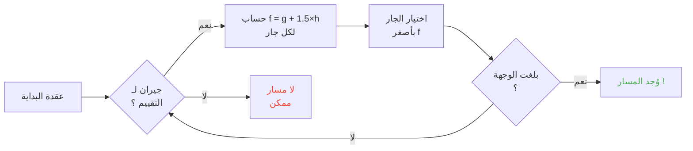

## مقدمة

قضيت ساعات أشاهد أغناما تصطدم بجدران.

وبصراحة ؟ أفضل استثمار في حياتي.

لأنه كلما شاهدت هذه الوحوش أكثر، أدركت أنها ليست عشوائية إطلاقا. كل حركة مُبرمَجة ومتوقعة، وقبل كل شيء قابلة للكسر تماما. انتهيت بالغوص في الكود المصدري لـMinecraft لأفهم بالضبط كيف يعمل إيجاد المسار، وما اكتشفته أنك تستطيع حرفيا التحكم الذهني بالوحوش. يعني، إجبارها على الذهاب حيث تريد أنت، لا حيث يقرر العشوائي.

هذا الدليل هو كل ما تعلمته بالتنقيب. الذكاء الاصطناعي وخوارزمية A* والعقوبات المخفية والاستغلالات التي تستطيع إطلاقها في البقاء. جهّز معولك.

---

## كيف يعمل ذكاء الوحوش (تشويق : إنه غبي)

### الأهداف

لكل وحش *أهداف*. إنها قائمة أفعال يستطيع فعلها ومدى رغبته في فعلها. كلما كان الرقم أصغر، كانت الأولوية أكبر، كقائمة مهام نسخة فوضى.

```java
protected void registerGoals() {
   this.goalSelector.addGoal(4, new Zombie.ZombieAttackTurtleEggGoal(this, 1.0, 3));
   this.goalSelector.addGoal(8, new LookAtPlayerGoal(this, Player.class, 8.0F));
   this.goalSelector.addGoal(8, new RandomLookAroundGoal(this));
   this.addBehaviourGoals();
}
```

رأيت زومبي يتجاهل بيضة سلحفاة ليطاردك ؟ إليكم السبب : `ZombieAttackTurtleEggGoal` أولويته 4، بينما `ZombieAttackGoal` (الهدف الذي يقول له أن يأكل وجهك) أولويته 2.

نعم، يفضل الزومبي أكلك على كسر بيضة. هذا هو الحب جميل.

الهدف الذي يهمنا فعلا هو `WaterAvoidingRandomStrollGoal`، أولوية 7. هدف "لا شيء عندي فأمشي عشوائيا". هنا يصبح كل شيء مثيرا.

### الحركة (أو "كيف أن مشيا عشوائيا له فرصة 1 من 60 للحدوث")

كل ticks (كل 0.05 ثانية)، يستدعي اللعب `canUse()` ليرى إن تكرم الوحش بالتحرك. فرصة 1 من 60 مع كل tick. تصميم غبي تماما، وأعشق ذلك.

```java
public boolean canUse() {
   if (this.mob.hasControllingPassenger()) {
      return false;
   } else {
      if (!this.forceTrigger) {
         if (this.checkNoActionTime && this.mob.getNoActionTime() >= 100) {
            return false;
         }
         if (this.mob.getRandom().nextInt(reducedTickDelay(this.interval)) != 0) {
            return false;
         }
      }
      Vec3 $$0 = this.getPosition();
      if ($$0 == null) {
         return false;
      } else {
         this.wantedX = $$0.x;
         this.wantedY = $$0.y;
         this.wantedZ = $$0.z;
         this.forceTrigger = false;
         return true;
      }
   }
}
```

إذن للتلخيص : إذا كنت راكبا على الوحش ← لا، وإذا لم يفعل الوحش شيئا منذ 5 ثوانٍ ← لا، وإذا قال العشوائي لا ← لا. يريد اللعب فعلا ألا يتحرك الوحش.

لكن عندما يتحرك، تتولى `getPosition()` :

```java
protected Vec3 getPosition() {
   if (this.mob.isInWater()) {
      Vec3 $$0 = LandRandomPos.getPos(this.mob, 15, 7);
      return $$0 == null ? super.getPosition() : $$0;
   } else {
      return this.mob.getRandom().nextFloat() >= this.probability
         ? LandRandomPos.getPos(this.mob, 10, 7)
         : super.getPosition();
   }
}
```

انظروا هذين الرقمين في النهاية : إنه نصف قطر XZ ونصف قطر Y. في الماء، يبحث الوحش أبعد (15 بدلا من 10). وإذا لم يجد أرضا، يسقط على `super.getPosition()` التي تقبل الماء. **النتيجة : تريد الوحوش الخروج من الماء.** لهذا تسبح حيواناتك كالمجنونة نحو الحافة.

تفصيل صغير لذيذ : هناك حرفيا 0.1% احتمال أن يأخذ الوحش `super.getPosition()` بدلا من `LandRandomPos`. واحد في الألف. هذا Mojang نموذجي.

### LandRandomPos : التحسين الرديء الذي يغيّر كل شيء

إنها خطوتي المفضلة. أجمل غباء تقني يجعل إيجاد المسار قابلا للاستغلال.

```java
public static Vec3 getPos(PathfinderMob $$0, int $$1, int $$2, ToDoubleFunction<BlockPos> $$3) {
   boolean $$4 = GoalUtils.mobRestricted($$0, $$1);
   return RandomPos.generateRandomPos(() -> {
      BlockPos $$4xx = RandomPos.generateRandomDirection($$0.getRandom(), $$1, $$2);
      BlockPos $$5 = generateRandomPosTowardDirection($$0, $$1, $$4, $$4xx);
      return $$5 == null ? null : movePosUpOutOfSolid($$0, $$5);
   }, $$3);
}
```

`movePosUpOutOfSolid`. الاسم يقول كل شيء. إذا كانت الموضع المختار في كتلة صلبة، يدفعها اللعب نحو الأعلى حتى تكون في الهواء.

إنه تحسين : بدلا من إضاعة الوقت في تجاهل المواضع تحت الأرض، يرفعها اللعب للسطح. ذكي ؟ نعم. لكنه يخلق انحيازا مجنونا : **تفضل الوحوش المرتفعات**.

تخيلوا. لديك كتل كثيرة تحت السطح، يولد اللعب 10 مواضع عشوائية. تلك في الكتل تُدفَع نحو الأعلى. تنتج المناطق الكثيفة (تحت تلة) مواضع صالحة أكثر من المناطق المجوفة. النتيجة : يذهب الوحش إحصائيا نحو التلة أكثر.

صدقوني، سنكسر ذلك في دقيقتين.

### الانتقاء : مسابقة أفضل كتلة

10 مواضع وفائز واحد ومسابقة نتيجة :

```java
public static Vec3 generateRandomPos(Supplier<BlockPos> $$0, ToDoubleFunction<BlockPos> $$1) {
   double $$2 = Double.NEGATIVE_INFINITY;
   BlockPos $$3 = null;
   for(int $$4 = 0; $$4 < 10; ++$$4) {
      BlockPos $$5 = (BlockPos)$$0.get();
      if ($$5 != null) {
         double $$6 = $$1.applyAsDouble($$5);
         if ($$6 > $$2) {
            $$2 = $$6;
            $$3 = $$5;
         }
      }
   }
   return $$3 != null ? Vec3.atBottomCenterOf($$3) : null;
}
```

الموضع بأفضل نتيجة يفوز. وإذا عرفنا معايير النتيجة، نستطيع جعل الموضع الذي نريده يفوز. كتزوير انتخاب.

---

## تفضيلات الوحوش (أو "لماذا تعبر بقرتك الطريق")

لكل وحش أذواق مختلفة. وهذا يغيّر كل شيء.

| الوحش | يعشق ذلك |
| --- | --- |
| **حيوانات** (أبقار وأغنام وخنازير) | العشب والضوء (هيبستر) |
| **وحوش** (زومبي وهياكل) | الظلام (edgelords) |
| **سلاحف** | الماء، وإلا الرمل، وإلا الضوء |
| **Hoglins** | `crimson_nylium` ؛ تكره `warped_fungus` |
| **Striders** | الحمم فقط. لا شيء آخر. |
| **Silverfish** | الكتل القابلة للإصابة (منطقي) |
| **Guardians** | ماء + ضوء (المتأنقون) |
| **Mooshrooms** | Mycelium + ضوء (فطر) |
| **نحل** | الهواء. نعم، تفضل الهواء. |

```java
// حيوان : ينظر للأسفل، وإذا كان عشبا، نتيجة قصوى
public float getWalkTargetValue(BlockPos $$0, LevelReader $$1) {
   return $$1.getBlockState($$0.below()).is(Blocks.GRASS_BLOCK) ? 10.0F : $$1.getPathfindingCostFromLightLevels($$0);
}

// وحش : العكس تماما
public float getWalkTargetValue(BlockPos $$0, LevelReader $$1) {
   return -$$1.getPathfindingCostFromLightLevels($$0);
}
```

يعني الوحوش حرفيا "إذا كان مضاء، نتيجة سلبية، أذهب لمكان آخر". إنها تعبس للضوء.

إذن تستطيع، حرفيا، توجيه حيواناتك بالعشب والضوء، ووحوشك بالظلام. إنه غبي وعبقري في آن واحد.

---

## خوارزمية A* في Minecraft (الصيغة السرية)

تستخدم Minecraft خوارزمية A* (A-star) لإيجاد المسار. لكن Mojang وضعت بصمتها :

```
f(n) = g(n) + 1.5 × h(n)
```

- **g(n)** = المسار المقطوع فعلا (1 لكل كتلة، و~1.41 قطريا)
- **h(n)** = المسافة بخط الطير
- **1.5** = لأن Mojang تحب القيم المجنونة بعض الشيء

عادة يستخدم A* الصيغة `f(n) = g(n) + h(n)`. أضافت MOJANG عامل 1.5. لماذا ؟ لكي تذهب الخوارزمية أسرع نحو الوجهة وتقطع فروع بحث أقل. النتيجة : المسار الموجود "جيد" لكنه ليس الأفضل دائما. إنه A* سكران بعض الشيء.



تفصيل مهم : **لا يستطيع وحش إيجاد المسار إلا على 16 كتلة** (نطاق تتبعه). إذا كانت الوجهة بعيدة أكثر من اللازم، يختار الكتلة الأقرب التي يستطيع بلوغها. وهذا يعني أنك تستطيع إنشاء monolithe خارج المدى، وسيجد الوحش المسار نحو أقرب كتلة تقربه من monolithe، مما يجعل تحركاته متوقعة تماما.

### الاستغلالان اللذان يكسران اللعبة

#### 1. تحديثات الكتل = إعادة حساب قسرية

```java
public boolean shouldRecomputePath(BlockPos $$0) {
   if (this.hasDelayedRecomputation) return false;
   if (this.path != null && !this.path.isDone() && this.path.getNodeCount() != 0) {
      Node $$1 = this.path.getEndNode();
      Vec3 $$2 = new Vec3(
         ((double)$$1.x + this.mob.getX()) / 2.0,
         ((double)$$1.y + this.mob.getY()) / 2.0,
         ((double)$$1.z + this.mob.getZ()) / 2.0
      );
      return $$0.closerToCenterThan($$2, (double)(this.path.getNodeCount() - this.path.getNextNodeIndex()));
   }
   return false;
}
```

كل تحديث كتلة قرب مسار الوحش يجبر إعادة حساب A* مع تهدئة ثانية. تضع ساعة ثانية بجانب وحش، فيعيد حساب مساره باستمرار. إنه كمكافئ وضع GPS يُصفَّر كل ثانية.

وإذا فعلت ذلك مع 50 وحشا في آن واحد ؟ مدينة لاغ. رحم الله TPS.

#### 2. عقوبات الكتل (Pathfinding Malice)

بعض الكتل تخيف الوحوش. حرفيا. لكل كتلة kost مرتبط، معرّف بتعداد :

| الكتلة / الشرط | العقوبة |
| --- | --- |
| **كتلة عسل** | +8 للعبور |
| **ثلج مسحوق** | غير قابل للعبور |
| **أبواب مغلقة** | غير قابلة للعبور |
| **نار** | +16 للعبور و+8 للمحاذاة |
| **حيوانات وقرويون** | نار = -1 (لا) |
| **صبار / توت حلو** | غير قابل للعبور ؛ المجاور = +8 |
| **ماء** | +8 للعبور أو المحاذاة |
| **ماغما** | +8 للمحاذاة (أوخ) |

الحيوانات أكثر تطرفا :

```java
protected Animal(EntityType<? extends Animal> $$0, Level $$1) {
   super($$0, $$1);
   this.setPathfindingMalus(PathType.DANGER_FIRE, 16.0F);
   this.setPathfindingMalus(PathType.DAMAGE_FIRE, -1.0F);
}
```

DAMAGE_FIRE عند -1.0F، يعني حرفيا "ممنوع". يفضل حيوان رمي نفسه في الفراغ على عبور نار. فيو.

### تمرين : مسابقة المسارات الكبرى

تخيل قرويا يجب أن يختار بين عدة مسارات.

- **مسار A** : 15 كتلة لكن 6 كتل تحاذي ماء (+8 لكل واحدة)
- **مسار B** : 18 كتلة مع كتلتي ماء (+8) وكتلة مجاورة ماء (+8)
- **مسار C** : 14 كتلة straight... لكن مع نار ← مستحيل لقروي
- **مسار D** : 16 كتلة مع كتلة مجاورة ماغما (+8) + كتلة مجاورة عسل (+8)
- **مسار E** : 25 كتلة لكن صبار في كل مكان (+8 في كل مكان) ← kost إجمالي 90.82

حساب ذهني :

- مسار A : 15 كتلة + 6×8 للماء = 15 + 48 = **63** ... لكن هناك 1.5×مسافة للإضافة. لنقم بالحسابات الحقيقية.
- مسار B : أطول لكن عقوبات أقل. kost الإجمالي = المسافة المتراكمة + العقوبات.
- مسار D : الماغما والعسل يراكمان عقوباتهما.

الفائز غالبا **مسار B** : الالتفاف مربح لأن الماء غالٍ.

القروي أساسا حاسب kost بأرجل.

### لكل وحش أذواقه

قروي : "نار ؟ لا شكرا باي"
زومبي : "نار ؟ حسنا boomer *يعبر مشتعلا*"

لديك حرفيا طرق يسلكها بعض الوحوش ولا يسلكها آخرون. تستطيع صنع طرق سريعة لقرويين يحترق فيها الزومبي.

---

## القرويون : الفوضى القصوى

حسنا، القرويون. إنه النظام الأقل فهما في Minecraft كله. لكن بمجرد إمساك الكود، تدرك أنهم آلات متوقعة بجداول مكتب.

### حساسات وذكريات

9 حساسات، تدور كل 20 ticks (ثانية). يمسح كل واحد نصف قطر حول القروي ويخزن النتيجة في الذاكرة. يرى القروي كل شيء، ويتذكر كل شيء، ويتصرف تبعا لذلك.

يعني : "هل هناك عدو ؟ عنصر على الأرض ؟ لاعب يتكلم معه ؟" يفحص كل شيء.

### الحزم (مراحل يومه)

دماغ قروي هو حزم نشاط تُفعَّل حسب الساعة :

| الحزمة | التوقيت | القروي... |
| --- | --- | --- |
| **Core** | 24/24 | يفتح أبوابا ويسبح (80% من الوقت)، ويكتسب POI |
| **Work** | 8h-15h | "سأعمل"، يمشي نحو منصبه |
| **Meet** | 15h-17h | "مشروب !"، يذهب للجرس ويدردش |
| **Rest** | 18h-6h | "يجب النوم"، يذهب للسرير |
| **Idle** | 6h-8h و17h-18h | "أتسكع"، يتجول وينجب أطفالا ويقفز على الأسرة |
| **Panic** | إصابة/عدائي | "النجدة"، هروب |

حزمة **Panic** هي الوحيدة التي تستطيع مقاطعة الباقي كله. حتى لو كان القروي نائما أو يعمل، إذا كان هناك زومبي، ذعر عام.

### اكتساب POI : الشيء الذي يسمح بـredstone اللاسلكية

```java
Set<Pair<Holder<PoiType>, BlockPos>> $$12 = (Set)$$10xx.findAllClosestFirstWithType(
   $$0, $$11, $$8x.blockPosition(), 48, PoiManager.Occupancy.HAS_SPACE
)
```

يمسح `Acquire POI` في نصف قطر 48 كتلة كل POI (نقاط اهتمام). يحتفظ بأقرب 5، ويتحقق من وجود مسار، ويكتسب أول قابل للوصول.

لكل POI عدد محدود من slots :
- **مناصب عمل** : 1 slot
- **أسرة** : 1 slot
- **أجراس** : 32 slots

النقطة المجنونة : **يُحجَز slot لحظة الاكتساب، لا عند الوصول**. يستطيع قروي قفل composter من الطرف الآخر للخريطة، دون بلوغه أبدا.

تستوعب القوة ؟

### Redstone لاسلكية. نعم، دون أسلاك.

1. تضع قرويا في عربة منجم مع مسار نحو composter
2. يكتسب composter (slot مأخوذ، ولا أحد يستطيع استخدامه بعده)
3. القروي بعيد أكثر من اللازم للنقر عليه، وتبقى bone meal
4. تنقل هذا القروي لأي مكان في العالم، فيحتفظ slot
5. عندما تريد تفعيل شيئك، تقتل القروي
6. يتحرر slot، ويكتسب قروي آخر composter، ويزيل bone meal
7. تحديث كتلة ← أي دائرة redstone تُفعَّل

صنعت حرفيا إشارة redstone لاسلكية، قابلة للنقل في العالم كله، مع صفر تحميل chunk ضروري على الطريق. تستطيع ربط ذلك بغرفة ender pearl stasis، وتُنقَل من أي مكان بقتل قروي.

استخدامي المفضل ؟ لعبة مصغرة "صائد جوائز" : تضع عدة قرويين مع composters، ويجب على اللاعب قتل القروي الصحيح لتفعيل المخرج. إنها آلية wtf تماما.

### جمود إيجاد المسار (أو "القروي الذي يتجمد للأبد")

هناك bug لذيذ أكثر من اللازم بين `Acquire POI` (الذي يرى مسارا) والتنقل الحقيقي (الذي يرفض سلوكه). يحدث عندما تكون الكتلة فوق منصب العمل غير قابلة للمشي. النتيجة :

- حزمة Core : "أريد اكتساب POI"
- التنقل : "لا أستطيع المشي هناك"
- النتيجة : يبقى القروي متجمدا، للأبد، يتصارع مع نفسه.

حرفيا قرويون متجمدون في مكانهم، قابلون للاستخدام كزينة أو "props" في بناءات. حامل درع دبابة ؟ نعم. حارس لا يتحرك ؟ نعم. مروع ؟ ربما. لكن فعال.

---

## الخلاصة

إيجاد مسار وحوش Minecraft ليس عشوائيا. إنه نظام حتمي، قائم على نتائج، ومتوقع وقابل للكسر.

**النقاط الثلاث للتذكر :**

1. **كتل تحت الأقدام = انحياز ارتفاع** : املأ أو أفرغ باطن الأرض لتوجيه الوحوش
2. **العقوبات مختلفة لكل وحش** : أنشئ طرقا يسلكها بعضها ولا يسلكها آخر
3. **تُحجَز slots الخاصة بـPOI عن بعد** : redstone لاسلكية مجانية وتنقل وكل ذلك

الكود المصدري لـMinecraft منجم ذهب لآليات ناقصة الاستغلال. قضيت ساعات أقرأ Java مفككة الترجمة وبصراحة ؟ كل سطر بيضة عيد فصح وظيفية. إلا أن هذه، تستخدمها في البقاء لصنع redstone لاسلكية مع قرويين. أفضل لعبة مؤكدة.
