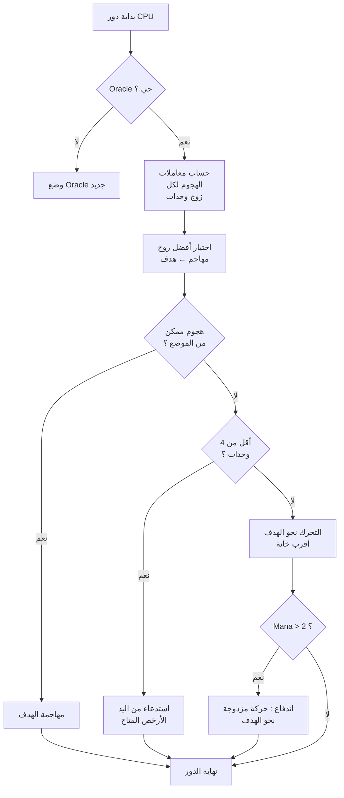

## ذكائي الاصطناعي التافه من أجل Nausicaa

هناك مشاريع تبدأ بـ"ماذا لو صنعت لعبة شطرنج بميثولوجيات ؟" وتنتهي بنظام مع ذكاء اصطناعي يقرر معلماته الفائقة الخاصة كل 5 أدوار.

Nausicaa هي ذلك. لعبة رقعة بالأدوار تبني فيها مجموعة مخلوقات ميثولوجية، وتدير mana خاصتك، وتنشر وحدات على رقعة 10x8. وهناك ذكاء اصطناعي تصيبه نوبات شخصية.

قضيت وقتا طويلا على هذا الذكاء، وما زالت النتيجة تفوتني أحيانا، وهذا ما أفضله.

## اللعبة فعلا

قبل الكلام عن الدماغ، يجب فهم الجسم :

- رقعة 10x8، ومنطقة نشر صفين لكل لاعب
- تبدأ Mana عند 1، و+1 كل دور، وحد 6. تنفق للاستدعاء والهجوم واستخدام القدرات
- الهدف : قتل Oracle الخصم

12 وحدة، بتكاليف وأنماط حركة مختلفة :

| الوحدة | Kost | الحركة | PV |
| --- | --- | --- | --- |
| Oracle | 0 | ملك (8 اتجاهات) | 1 |
| Gobelin | 1 | أمام 3 خانات | 1 |
| Harpie | 1 | ملك (8 اتجاهات) | 1 |
| Naïade | 1 | قطري | 1 |
| Griffin | 2 | قفز خانتين | 2 |
| Sirène | 2 | جانبي | 1 |
| Centaure | 2 | فارس (حرف L) | 2 |
| Archer | 3 | جانبي | 1 |
| Phénix | 3 | قطري (خانات داكنة) | 1 |
| Métamorphe | 4 | تبادل مكان | 1 |
| Voyant | 4 | لا شيء (يولد mana) | 1 |
| Titan | 6 | محدود (هجوم منطقة) | 3 |

لكل وحدة نمط هجوم خاص بها. تضرب Sirène في الأقطار الأربعة، وArcher عن بعد على 3 خانات، ويدمر Titan كل ما حوله عند الاستدعاء. باختصار، لعبة شطرنج بميثولوجيا وبناء مجموعات.

## كيف جعلت CPU يفكر

الفكرة الأساسية غبية البساطة : **لكل وحدة عدوة معامل جاذبية**. كلما كانت أخطر، أراد الذكاء الاهتمام بها أكثر.

```javascript
const UNITS_ATTRACTIVENESS = {
    "oracle": 100,
    "titan": 95,
    "shapeshifter": 90,
    "phoenix": 80,
    "siren": 70,
    "archer": 70,
    "seer": 70,
    "griffin": 60,
    "centaur": 60,
    "harpy": 50,
    "naiad": 30,
    "gobelin": 20
};
```

Oracle عند 100، منطقي، إنه شرط الفوز. Titan عند 95 لأنه يقضي على كل ما بجانبه عند الاستدعاء. Gobelin عند 20، إنه جندي مشاة، لا نبالي به.

ثم لكل زوج وحدات (واحدة حليفة وواحدة عدوة)، أحسب :

```
interet = attractivite × coeff_attract / (distance × coeff_dist)
```

باختصار : كلما كنت أخطر وأقرب، أراد الذكاء تحطيمك أكثر.

```javascript
calculateAttackCoefficient(x1, y1, x2, y2) {
    const distance = this.calculateEuclideanDistance(x1, y1, x2, y2);
    if (distance === 0) return Infinity;
    return (UNITS_ATTRACTIVENESS[unit.type] * COEFFICIENTS_IMPORTANCE["attractiveness"]) / distance;
}
```

### حيلة المعاملات المتغيرة

النقطة المهمة أن معاملات الأهمية **تتغير عشوائيا كل 5 أدوار**.

```javascript
if (this.turnCount % 5 === 0) {
    const distanceCoefficient = parseInt(Math.random() * 100);
    const attractivenessCoefficient = parseInt(Math.random() * 100);
    this.regulateImportanceCoefficients({
        distance: distanceCoefficient,
        attractiveness: attractivenessCoefficient
    });
}
```

مرة يصبح الذكاء عدوانيا جدا (جاذبية عند 95 ومسافة عند 5)، فيعبر كل شيء لقتل Oracle خاصتك. والمرة التالية يعطي الأولوية للمسافة ويعيد التموضع.

إنها مسروقة من أشباح Pac-Man، يطارد Blinky ويكمن Pinky. هنا يغيّر الذكاء "شخصيته" كل مرحلة.

**النتيجة : مستحيل توقع الذكاء على مباراة كاملة.** لا يلعب CPU نفس المباراة مرتين أبدا.

### Oracle جبان

يهرب Oracle العدو. حرفيا.

```javascript
const awayFromTarget = {
    row: Math.max(0, Math.min(7, botUnitElement.row + (botUnitElement.row - targetUnitElement.row))),
    col: Math.max(0, Math.min(9, botUnitElement.col + (botUnitElement.col - targetUnitElement.col)))
};
```

يحسب الاتجاه المعاكس للتهديد ويهرب. وإذا كان هناك جدار، يبحث عن أقرب خانة حرة في هذا الاتجاه.

تقضي 3 أدوار تقترب من Oracle، وفجأة يكون قد هرب للطرف الآخر.

### حلقة القرار

إليكم كيف يقرر الذكاء :

1. إذا لم يعد لدي Oracle (ميت)، ضع واحدا جديدا
2. حساب المعامل لكل زوج وحدة حليفة ← وحدة عدوة
3. اختيار أفضل زوج
4. إذا استطاعت الوحدة مهاجمة الهدف من موضعها ← هجوم
5. إذا كان لدي أقل من 4 وحدات ← استدعاء الأرخص المتاح من اليد
6. وإلا، التحرك نحو الهدف (خانة الحركة الأقرب للعدو)
7. إذا كان mana كافيا (> 2)، اندفاع (حركة مزدوجة) للاقتراب أكثر
8. إذا كانت الوحدة Oracle ← هروب



```javascript
async makeAction(dash=false) {
    // كل ذلك بتسلسل
    // CPU يندفع إذا كان mana كافيا
    if(botPlayer.mana > 2) {
        this.makeAction(true);
    }
}
```

### لماذا المسافة الإقليدية

أستخدم المسافة الإقليدية :

```javascript
calculateEuclideanDistance(x1, y1, x2, y2) {
    const deltaX = Math.pow(x1 - x2, 2);
    const deltaY = Math.pow(y1 - y2, 2);
    return Math.sqrt(deltaX + deltaY) * COEFFICIENTS_IMPORTANCE["distance"];
}
```

لماذا لا Manhattan ؟ لأن الوحدات لها أنماط حركة متنوعة (حرف L كالفارس وقطري، إلخ). المسافة بخط الطير تقريب أفضل للخطر.

## لماذا لا minimax

كان بإمكاني برمجة minimax تقليدي. لكن مع 12 نوع وحدات وأنماط حركة مختلفة وقدرات خاصة... تنفجر شجرة اللعب بسرعة حتى تصبح غير قابلة للعب. تقوم المقاربة الاستدلالية بخيارات ذكية دون استكشاف 10 ملايين حالة.

## ما هو الرائع

يخلق نظام الجاذبية معضلات مضحكة :

- Voyant (70) يولد mana. إذا تركته حيا، يحصل الخصم على موارد أكثر. لكن Titan (95) أخطر بعد.
- يستطيع Métamorphe (90) تبادل مكانه مع أي وحدة. يستطيع سرقة Oracle خاصتك.
- لدى Harpie (50) هجوم متفجر يقتلها أيضا. تبقى ثانوية... حتى تجد نفسها بجانب 3 من وحداتك.

يقيّم الذكاء الخطر الشامل حسب المواضع، لا فقط الإحصاءات الخام.

وهناك أيضا دالة `activateSimulation()` لاختبار سيناريوهات دون إعادة مباراة :

```javascript
activateSimulation() {
    // وضع وحدات بعينها على الرقعة
    // مفيد لتصحيح الذكاء
    this.game.board = simulation.board;
    this.game.players = simulation.players;
}
```

## ما الذي ينقص

لو كان لدي وقت أكثر :

- يتفاعل الذكاء مع الحالة الراهنة، ولا يتوقع ما سيفعله اللاعب
- لا يخطط ليده على عدة أدوار
- لدى Métamorphe وCentaure قدرات يستغلها ناقصا
- تعلم معزز : جعله يلعب ضد نفسه لضبط المعاملات

لكن للعبة متصفح يصمد. أصدقاء يخسرون ضده، إذن مُصادَق عليه.

## جرّب

متاح على [nausicaa-game.github.io](https://nausicaa-game.github.io/). تنقر "JOUER" ووضع CPU مفعّل، وتشاهد الذكاء يفعل.

نصيحة : دع الذكاء يلعب ضد نفسه. سترى مراحل عدوانية، ثم يتراجع فجأة.

الكود على [GitHub](https://github.com/nausicaa-game/nausicaa-game.github.io) في `js/cpu.js`.

**3 نقاط للتذكر :**

1. **معاملات استدلالية**، لا minimax، ولكل وحدة جاذبية
2. **معاملات تتغير كل 5 أدوار**، يبدّل الذكاء العدوانية والتحكم، على طريقة Pac-Man
3. **Oracle يهرب**، يحسب الاتجاه المعاكس للتهديد ويهرب

إذا كانت لديك أفكار لجعل الذكاء أخبث بعد، افتح issue. لدي خطط لنسخة تتعلم من هزائمها، لكن ذلك لمقال تالٍ.
