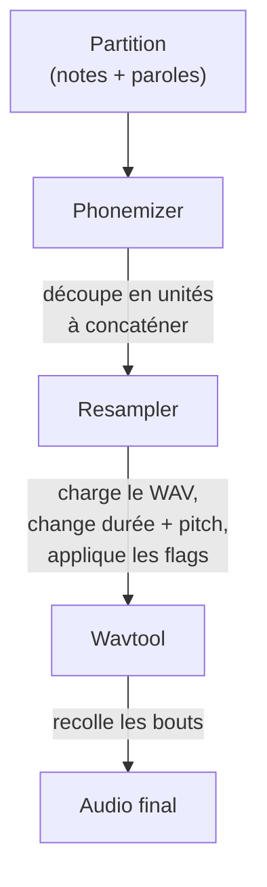

## UTAU : كيف جعل برنامج بـVisual Basic 6 الصوت الاصطناعي ديمقراطيا

أشرت إليه على صفحتي الرئيسية : أحب UTAU. إليكم لماذا.

في 2008، إذا أردت جعل صوت اصطناعي يغني، كان لديك خيار : VOCALOID. برنامج Yamaha. غالٍ وملكي، مع أصوات رسمية لم تستطع إنشاءها بنفسك.

ثم جاء رجل ياباني، Ameya/Ayame، وأصدر برنامجا في زاويته. برنامج مبرمج بـ**Visual Basic 6**. مجاني. يتيح لك إنشاء صوتك الخاص مع... ملفات WAV تسجلها بنفسك.

هذا البرنامج اسمه **UTAU** (歌う، "الغناء" باليابانية). ولعصره، كان سحرا.

لطالما وجدته ساحرا لفكرته الابتدائية أكثر من نظافته التقنية (مبدأ الترميز يبقى ذكيا فعلا، حتى لو كان التنفيذ يدمي العين) : فقد فتح التركيب الصوتي لعامة الناس. أنت وأنا وأي كان مع ميكروفون.

دعني أشرح لك لماذا كان رائعا.

---

## أولا، لماذا تركيب الغناء صعب

الصوت المغنَّى ليس نوتات. لديك الحرف الساكن الذي يهاجم، والحرف المتحرك الذي يثبت، والنفَس، والانتقالات بين الاثنين. "سا" في "سلام" هي "س" تصفر تنزلق نحو "ا" مفتوحة، وهذا الانزلاق هو ما يبدو إنسانيا أم لا.

اليوم نحل ذلك بالتعلم العميق : تدرب نموذجا على ساعات غناء فيولد الصوت (Synthesizer V وDiffSinger). لكن ذلك 2020+. في 2008، لا شيء.

يستخدم UTAU طريقة ما قبل، أقدم وأمكر : **التركيب التسلسلي**.

---

## التركيب التسلسلي : نسخ-لصق قطع صوت

الفكرة بسيطة : تسجل قطع صوت صغيرة وتلصقها معا لتكوين كلمات. "سلام" = عينة "سا" + "لا" + "م"، متسلسلة. لغز صوتي تقوده مدونة موسيقية.

إنه مبدأ YouTube Poop حيث يُعاد قص كلمات شخصية لجعلها تقول أي شيء، إلا أنه هنا مضبوط ومؤتمت.

وجاء UTAU حرفيا من هناك. قبله وُجد **"Jinriki Vocaloid"** (人力ボーカロイド، "Vocaloid اليدوي") : كان أناس يقطعون يدويا مسارات صوتية، ويستخرجون الفونيمات، ويعيدون الضبط، ويعيدون تجميع الكل في محرر صوت لمحاكاة صوت VOCALOID. يدويا. تخيل العمل.

نظر Ameya لهذا العناء وبرمج الأداة لأتمتته. في الأساس لم يكن UTAU إلا ذلك : مساعد لـVocaloid اليدوي.

---

## لماذا كان ثوريا : أنت تنشئ الصوت

إليكم ما يغيّر كل شيء.

في VOCALOID، كنت تشتري صوتا. Miku وLuka، إلخ. منشأة من محترفين، ومباعة من Yamaha. بقي الإنشاء محفوظا لـYamaha. مع UTAU، **أي كان يسجل صوته ويجعله آلة غنائية**.

وضع CV (الأبسط) هو : تسجل ~100 مقطع أساسي من اليابانية ("a" و"ka" و"sa" و"ta"...)، وتضبط نقاط القطع، وهذه voicebank خاصتك. بضع ساعات عمل.

النتيجة : انفجر النظام البيئي. آلاف voicebanks أنشأها المجتمع، أصوات معجبين وأصدقاء وشخصيات مخترعة. عالم كامل من المغنين الافتراضيين، مجاني. وجاء البرنامج مع **Defoko** (Utane Uta)، صوت افتراضي مولّد عبر محرك TTS المسمى AquesTalk، فتستطيع البدء حتى دون ميكروفون.

---

## ملف oto.ini : قلب النظام

كيف يعرف UTAU أين يقطع ويلصق الأصوات ؟ عبر ملف إعداد لكل voicebank : **`oto.ini`**. لكل WAV، يعرّف نقاط القطع (بالمللي ثانية) :

- **Offset** ← صمت يُزال في البداية
- **Preutterance** ← النقطة حيث يمر الحرف الساكن إلى المتحرك (حد "س"←"ا" في "سا")
- **Overlap** ← كم تفيض النوتة السابقة على هذه
- **Fixed region** ← الجزء الذي يجب ألا يُمطَّط على نوتة طويلة (عادة الحرف الساكن)
- **Cutoff** ← أين يُقطَع النهاية

**preutterance** هي المعامل الأذكى. المقطع له دائما طرف ساكن قبل المتحرك. ولكي تقع نوتتك على الزمن، *المتحرك* هو الذي يجب أن يقع بالضبط، لا الساكن. إذن يزيح UTAU العينة للخلف : "ا" في "سا" تهبط على الزمن، و"س" تفيض قبله فقط. كطبال يستبق ضربته ليقع الصوت صحيحا، إلا أن ذلك هنا في `.ini`.

بصريا، على عينة "ka"، تتقطع مناطق `oto.ini` هكذا :

```mermaid
flowchart LR
    A["🔇 silence<br/>(offset)"] --> B["🅺 consonne<br/>(fixed region,<br/>pas étirée)"]
    B --> C["🅰 voyelle<br/>(zone étirable)"]
    C --> D["🔇 fin coupée<br/>(cutoff)"]
    style B fill:#3b4a6b
    style C fill:#5b3b6b
```



الحد بين الساكن والمتحرك هو preutterance. المتحرك هو المنطقة التي نمددها للنوتات الطويلة ؛ والساكن يبقى سليما، وإلا دام "k" ثانيتين وبدا فظيعا.

```ini
# oto.ini (simplifié)
# fichier=alias,offset,consonant,cutoff,preutterance,overlap
_ka.wav=ka,120,80,-200,90,40
```

خمس قيم لكل صوت، على كل عيناتك، ويجمع UTAU أي كلمة نظيفا.

---

## CV وVCV وCVVC : السباق نحو الواقعية

الوضع الأساسي، **CV** (ساكن-متحرك)، هو صوت لكل مقطع. بسيط لكن آلي بعض الشيء : الوصلات بين المقاطع خام.

في 2010 اخترع المجتمع **VCV** (متحرك-ساكن-متحرك). بدلا من تسجيل "ka" وحده، تسجل "a ka"، مع ذيل المتحرك السابق. يصبح الانتقال طبيعيا لأنه *في* التسجيل، لا محسوب بعده.

التفصيل اللاذع : **لم يحصل VOCALOID على VCV قبل VOCALOID3، في 2011.** سبق البرنامج المجاني بـVB6 المبرمج من رجل وحده Yamaha بعام في واقعية الانتقالات. مجتمع معجبين أسرع من الشركة متعددة الجنسيات.

ثم جاء **CVVC** و**ARPAsing** (إنجليزية) و**VCCV**... كل طريقة تدفع الواقعية أبعد، كلها مخترعة وموثقة من المجتمع.

---

## خط الأنابيب الكامل : كيف تصبح كلمة صوتا

عندما تضع نوتة وتكتب كلاما، إليكم ما يحدث في الكواليس :



**resampler** هو القطعة الأساسية : يأخذ عينتك "ka" المسجلة بارتفاع معين ويعيد مدّها/ضبطها لمطابقة النوتة المطلوبة، بمدّ المنطقة القابلة للمد فقط والحفاظ على الساكن سليما (ومن هنا `oto.ini`).

وهو **وحدوي**. جاء UTAU مع resampler أساسي، لكن المجتمع أنتج أخرى (moresampler وTIPS...)، لكل واحد حبيباته الصوتية. كنت تغيّر محرك التركيب كإضافة. في 2008. على برنامج مجاني.

---

## الورشة تحت الغطاء (ولماذا هي محببة)

يجب أن أكون صادقا عن الحالة التقنية للبرنامج :

- **مبرمج بـVisual Basic 6.** لغة ميتة فعلا في 2008. يلزم runtime الخاص بـVB6 لتشغيله.
- **Windows فقط في الأساس** (نقل Mac، المسمى UTAU-Synth، جاء في 2011).
- **ترميز Shift-JIS إلزامي.** إذا لم تكن ملفاتك مرمزة باليابانية Shift-JIS، لا يفهم UTAU شيئا. حتى اليوم يلزم غالبا وضع PC باللغة اليابانية أو استخدام AppLocale لتشغيله.
- **واجهة متقشفة**، وتوثيق شبه 100% باليابانية في ذلك العصر.

ومع ذلك. ومع ذلك أنشأ هذا البرنامج حركة عالمية. عشرات آلاف voicebanks. أغانٍ سُمعت ملايين المرات.

أفضل مثال : **Kasane Teto**. شخصية أُنشئت في 2008 وأُطلقت كمزحة أول أبريل، متظاهرة بأنها VOCALOID. كانت مزحة. إلا أن الناس أحبوا الشخصية، وأُنشئت voicebank حقيقية لـUTAU خلفها، وصارت Teto من أشهر المغنيات الافتراضيات في العالم. في 2023 حصلت حتى على صوت Synthesizer V رسمي. شخصية وُلدت من كذبة أبريل على برنامج مجاني.

---

## لماذا ما زال مهما

UTAU هو المثال الكامل لتقنية "فقيرة" تفوز بالانفتاح.

كان VOCALOID متفوقا تقنيا، وممولا أفضل، وأكثر احترافية. لكن مغلقا. كان UTAU مُرقَّعا وقبيحا وبـVB6، لكنه ترك الجميع يشارك. إنشاء أصوات وإنشاء resamplers وإنشاء إضافات وإنشاء طرق تسجيل. قام المجتمع بالباقي.

وينجو المفهوم تماما اليوم. **OpenUtau**، خليفة حديث مفتوح المصدر، يستعيد الفكرة وينفض عنها الغبار (متعدد المنصات وUTF-8 ودعم resamplers الحديثة والذكاء الاصطناعي). ما زال التركيب التسلسلي صامدا بجانب نماذج التعلم العميق، لأنه يملك ميزة لا تملكها : تفهم بالضبط ما يحدث، وتتحكم بكل مللي ثانية.

هذا ما أعجبني دائما في UTAU. ترى بالضبط ما يحدث. ليس ذكاء اصطناعيا يبصق لك نتيجة سحرية لا تفهمها : لديك WAV خاصتك ونقاط قطعك، وأنت من يقرر كل شيء. عندما يبدو سيئا، تعرف لماذا وتستطيع التصحيح. أحب هذا النوع من التحكم.

---

**النقاط الثلاث للتذكر :**

1. **التركيب التسلسلي = لغز صوت**، يلصق UTAU عينات WAV صغيرة معا لتكوين كلمات. يعرّف `oto.ini` أين تُقطَع وتُلصَق كل صوت. تتحكم بكل شيء، حتى المللي ثانية، دون صندوق أسود.

2. **الانفتاح يهزم التقنية**، كان VOCALOID أفضل لكن مغلقا. كان UTAU مُرقَّعا لكن ترك الجميع ينشئ أصواته. فجّر المجتمع النظام البيئي، وسبق Yamaha حتى في VCV.

3. **فكرة جيدة تنجو من كودها**، VB6 وShift-JIS وWindows فقط... ومع ذلك ما زال المفهوم يعمل عبر OpenUtau. تقنية عبقرية يمكن أن تُبرمَج بأقدام.

بصراحة، لمجرد Kasane Teto المولودة من مزحة أبريل، يستحق هذا البرنامج الاحترام.
