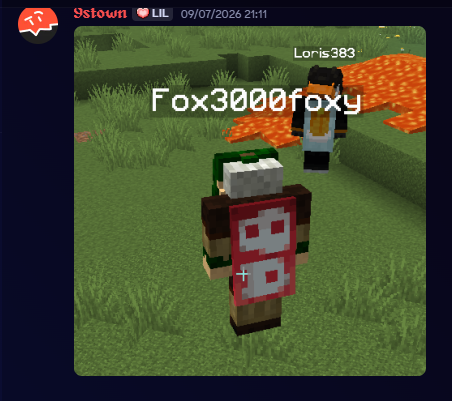
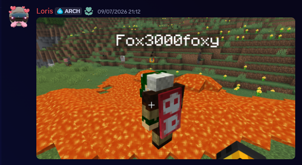
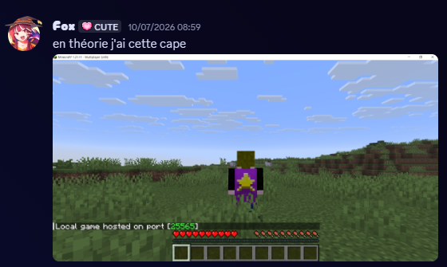
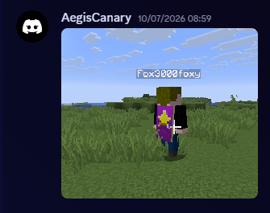

# 


Was, wenn ich dir sage, dass es eine gültige RSA-Signatur genügt - aber für das üble ** -, um deinen Freunden zu zeigen, dass du Mojangs offizielles Umhang trägst? Willkommen in`cape-mod`, ein Fabric-Exploit, das zeigt, wie Minecraft vertraut auf eine Signatur, während du nicht überprüfen, dass das Profil, zu dem sie gehört tatsächlich deins ist.

## Der Kontext: wie Minecraft Skins und Umhänge verwaltet

In Java Edition gibt es eine selten gestellte Frage: **Wer ist verantwortlich für die Anzeige des Skins und des Umhangs eines Spielers – des Clients oder Servers?**

Die Antwort ist differenziert:

| Komponente | Wer schickt ihn? | Wer laden sie herunter? |
|---|---|---|
| **Skintext** | Server sendet signierte URL | Der Kunde lädst du von`textures.minecraft.net` |
| **Umrandung** | Server sendet signierte URL | Der Kunde lädst du von`textures.minecraft.net` |
| **Eigenschaft`textures` ** | Der Server sendet den`GameProfile`seit dem Auth Mojang | Der Kunde überprüft die RSA-Signatur |

Der Schlüsselpunkt: Alles ist in einer Eigenschaft enthalten, die aufgerufen wird`textures`vom`GameProfile`Diese Eigenschaft enthält:

- Ein Payload JSON in Base64 mit URLs der Texturen

- Eine **RSA-Unterschrift** mit Mojangs Privatschlüssel

## Die Wand der RSA-Signatur

Jede Eigenschaft`textures`So sieht es aus, wenn man es entschlüsselt:
```json
{
  "timestamp": 1783666316269,
  "profileId": "d90b68bc81724329a047f1186dcd4336",
  "profileName": "akronman1",
  "signatureRequired": true,
  "textures": {
    "SKIN": {
      "url": "http://textures.minecraft.net/texture/3e6defcb7de5a0e05c75525c6cd46e4b9b416b92e0cf4baa1e0a9e212a887f3f7"
    },
    "CAPE": {
      "url": "http://textures.minecraft.net/texture/70efffaf86fe5bc089608d3cb297d3e276b9eb7a8f9f2fe6659c23a2d8b18edf"
    }
  }
}
```
Der Kunde überprüft die RSA-Signatur gegen den ** öffentlichen Schlüssel, der im Jar** (`yggdrasil_session_pubkey.der`):
```java
// Property.java (authlib)
public boolean isSignatureValid(PublicKey publicKey) {
    Signature sig = Signature.getInstance("SHA1withRSA");
    sig.initVerify(publicKey);
    sig.update(this.value.getBytes());
    return sig.verify(Base64.decodeBase64(this.signature));
}
```
Für Remote-Spieler (außer lokales Spiel) akzeptiert der Kunde nur Skins **als`secure`** – also mit gültiger Unterschrift:
```java
// SkinManager.c reateLookup () – vereinfacht
PlayerSkin skin = optional
    .filter(ps -> !isRemote || ps.secure()) // ← Remote-Spieler müssen sicher sein
    .orElse(defaultSkin);
```
Dieser Check blockiert das Spoofing in der Theorie, aber die Validierung endet hier, und genau dort beginnt der Angriff.

## Der Fehler: Unterschrift Wiederholung

Der Kunde überprüft, ob die RSA **-Signatur gültig ist**. Er versagt systematisch, dass die`profileId`Inhalt im JSON entspricht der tatsächlichen UUID des Spielers.

Mit anderen Worten: eine Immobilie`textures`** bereits vorhandenes Mojang-Konto** (z.B. eines Mojong-Mitarbeiters) kann auf jedem anderen Spieler replayt werden. Die Signatur bleibt gültig - sie wurde tatsächlich von Mojing produziert - sie kommt von einem anderen Konto.

### Wie kann ich eine echte Signatur extrahieren?

Jeb_ (UUID)`853c80ef-3c37-49fd-aa49-938b674adae6`) auf dem Mojang Studios-Cap. Seit dem Mojang-Server:
```bash
curl -s "https://sessionserver.mojang.com/session/minecraft/profile/853c80ef-3c37-49fd-aa49-938b674adae6?unsigned=false"
```
Antwort:
```json
{
  "id": "853c80ef-3c37-49fd-aa49-938b674adae6",
  "name": "jeb_",
  "properties": [
    {
      "name": "textures",
      "value": "ewogICJ0aW1lc3RhbXAiIDogMTc4MzYxOTcyNjAxMSwKICAicHJvZmlsZUlkIiA6ICI4NTNjODBl...",
      "signature": "RgIPF4d/iTDWJV..."
    }
  ]
}
```
Die`signature`dieses Feldes`value`wurde von Mojang produziert. Es ist RSA-2048 SHA-1. Es wird ** absolut** gültig, auch wenn du es auf einem anderen UUID wiederholen – weil Jeb_s Unterschrift eine Signatur von Jeb ist, und der Kunde nicht kontrolliert, für wen er bestimmt war.

## Der Code: Wie funktioniert der Mod?

Die`cape-mod`ist winzig – 65 Java-Linien. Hier ist das Herz:
```java
@Mixin(Player.class)
public class ServerPlayerMixin {
    private static final String TEXTURES_VALUE =
        "ewogICJ0aW1lc3RhbXAiIDogMTc4MzY2NjMxNjI2OSwKICAicHJvZmlsZUlkIiA6ICJkOTBi...";
    
    private static final String TEXTURES_SIGNATURE =
        "oxoAfZRLVNSfXYFMNbDKZ9XxrTHmz/k2yxzOxksXY3f6aDhY3gCyFCCtDreEWI7fpG9...";

    @Inject(method = "getGameProfile()Lcom/mojang/authlib/GameProfile;", 
            at = @At("RETURN"), cancellable = true)
    private void injectCape(CallbackInfoReturnable<GameProfile> cir) {
        Player self = (Player) (Object) this;
        if (!(self instanceof ServerPlayer serverPlayer)) return;
        MinecraftServer server = ((ServerPlayerAccessor) serverPlayer).getServer();
        if (!(server instanceof IntegratedServer)) return;

        GameProfile host = server.getSingleplayerProfile();
        GameProfile original = cir.getReturnValue();
        if (host == null || !host.name().equals(original.name())) return;

        // Ersetzt die Eigenschaft Texturen durch die Eigenschaft Jeb_
        ImmutableMultimap.Builder<String, Property> b = ImmutableMultimap.builder();
        for (Property p : original.properties().values()) {
            if (!p.name().equals("textures")) {
                b.put(p.name(), p);
            }
        }
        b.put("textures", new Property("textures", TEXTURES_VALUE, TEXTURES_SIGNATURE));
        cir.setReturnValue(new GameProfile(original.id(), original.name(), 
                                           new PropertyMap(b.build())));
    }
}
```
**Schritte**:

1. **Mixin** über`Player.getGameProfile()`– der Punkt, an dem das Profil des Spielers zurückgegeben wird

2. Prüft, ob es sich um einen lokalen Server handelt (Integrated Server)

3. Prüfe, ob es der Host ist (LAN world)

4. **Ersetzt die Eigenschaft**`textures`von Jeb_ (Hardcodiert)

5. Gibt einen neuen zurück`GameProfile`mit injizierten Texturen

Das`GameProfile`ist **geschmiedet**: es ist ein künstlich aufgebautes Profil, das nicht dem echten Spieler entspricht.`textures`**verwendet** von Jeb_ – ist die RSA-Signatur authentisch, aber auf das falsche Profil angewendet. Das Netzwerk-Paket ist legitim: Der Server sendet normalerweise das`ClientboundPlayerInfoUpdatePacket`mit diesem geänderten Profil. Das Profil wird schmiedet; das Paket bleibt legitim.

Wenn Freunde des Hosts über LAN beitreten, erhalten sie das`ClientboundPlayerInfoUpdatePacket`mit dem geänderten Profil. Der Kunde:

1. Dekodiert den payload base64

2. Prüft die RSA-Signatur → ✓ gültig (es ist wirklich die von Jeb_)

3. Markiert Skin als`secure=true`(da die Unterschrift gültig ist)

4. Verbreite den Filter`!isRemote || ps.secure()`→ ✓ pass

5. **Downloaden und zeigst du das Umhang von Jeb_**

## Ergebnis im Spiel: Umhang auf deinem Skin

Das ist das In-Game-Gesicht. Zuerst mit dem Umhang von Jeb_, der auf dem Host angezeigt wird:



Das rote/weiße Motiv des offiziellen Mojang Studios-Umhangs ist deutlich sichtbar. Das Rendering ist identisch mit dem eines echten Jeb_ mit seinem eigenen Umhang – der Kunde laden genau die gleiche Textur aus`textures.minecraft.net` .

Und in immersivem Blick, in einem echten Teil:



Der Umhang schwebt hinter dem Spieler, schwingt mit der Bewegung. Perfekt unausstehlich von einem authentischen Skin mit offiziellem Umhang.

Ein anderer Winkel, in einer Welt mit Lava und Gelände:



Und eine letzte Nahaufnahme des realen Gameplay, wo man den Umhang in Aktion sieht:



Für jemanden, der sich einem LAN anschließen würde, ohne zu wissen, dass der Host ein Mod verwendet, bleibt das Umhang visuell identisch mit einem echten Mojang-Kapsel. Genau das ist der Punkt: **Die Unterschrift ist gültig**, so dass der Kunde sie als legitim behandelt.

## Warum ist es ein Fehler (und warum es nicht eine ist)

Das ist ironisch: die Leistung funktioniert **genau, weil die Signatur gültig ist**. Es ist etwas anderes als ein kryptografischer Bypass – es ist schlimmer: ein **logischer Fehler** im Vertrauensmodell.

| Check | Ergebnis |
|---|---|
| **Signatur-Variabilität RSA** | ✓ Valide (unterzeichnet von Mojang für Jeb_) |
| **Das`profileId`Werden im payload die UUID des Hosts angezeigt?** | ✓ Nein (Jeb_s UUID ← UUid du host) |
| **Checkt der Kunde die Korrespondenz?** | ✓ **Nein. Nur die RSA-Signatur wird überprüft.** |

Minecraft vertraut ** auf die Unterschrift** anstatt auf die Identität des Trägers. Solange die Unterschrift von Mojang kommt, akzeptiert der Kunde sie. Es ist wie ein gefälschter Pass zu zeigen, der von der Regierung unterzeichnet wurde – das Siegel ist legitim, auch wenn der Pass nicht dir gehört.

## Sicherheitsaspekte

### LAN-begrenzte Reichweite

Das Mod funktioniert nur auf einem integrierten Server (LAN). Der Angreifer muss:

- Hast du eine Fabric Mod installiert

- Der Host einer LAN-Welt sein

- deine Freunde verbinden sich ohne Mod (Vanilla)

### Aber die Möglichkeiten werden größer

Theoretisch könnte man mit derselben Technik:

- **Weitere unterzeichnete Daten eingeben**: Heads, illegale Verzauberungen, bösartige Katzenkomponenten

- **Kombinieren du mit einem LAN-Tunnel** (NGROK, playit.gg, Radmin VPN) um Spieler im Internet zuzuordnen

- **Erweitern du auf andere Eigenschaften** des Profils, die von Signaturen abhängen

### Warum Mojang wahrscheinlich nicht patche

Es ist nicht nur eine "Veruntreubarkeit" im engeren Sinne – die Signatur ist gültig. Das würde Mojang dazu auffordern, das vollständige Authentifizierungsmodell zu ändern, was kompliziert ist. Im Moment ist es ein Grenzfall: Spieler LAN sollen sich vertrauen.

## Die philosophische Falle

Cape Mod ist ein ausgezeichnetes **proof of concept** von einer breiteren Wahrheit: ** Du musst immer überprüfen, wer eine Angabe unterschrieben hat und für welches Thema, bevor du ihm vertraut**.

Es ist eine Lektion in der Basis-Kryptographie. RSA unterzeichnet eine **Message**; die** Identität** des Empfängers bleibt aus der Signatur heraus. Wenn ich dir eine gültige RSA-Signatur von Mojang gebe, weißt du nur, dass Mojong * etwas* unterzeichnet hat, ohne dass der Empfänger von der einzigen Nachricht aus zuverlässig ist.

Genau das geschah mit den SSL/TLS-Zertifikaten in den 2000er Jahren, als die CAs Zertifikate unterschrieben, ohne die Domain korrekt zu überprüfen – die Signatur war gültig, aber sie galt für die falsche Domain.

## Schlussfolgerung

Cape Mod sagt etwas anderes als ein Hack im klassischen Sinne - es ist ein eleganter Betrieb eines Mangels an logischer Validierung in Minecraft. Es zeigt, dass:

1. **Eine gültige Unterschrift garantiert nicht die Identität des Trägers**
2. **In LAN ist das Vertrauen geringer** als man glaubt
3. **Eigenschaften`textures`Minecraft sind im Wesentlichen injizierten Inhalt** – es muss überprüft werden, ob sie dem Spieler entsprechen, der sie trägt

Wenn du einer LAN-Welt auf einem "unbekannten" Server (oder besser gesagt, dessen Host ein Verdächtiger ist) beitrittst, hast du schon lange vor dem Umhang ein Sicherheitsproblem. Aber es ist aufschlussreich: Minecraft nimmt an, dass jeder auf einem LAN vertraut. Das stimmt... bis zum ersten Host, der dieses Vertrauen missbraucht.

---

**Ressourcen**

- **GitHub**:[fox3000foxy/cape-mod](https://github.com/fox3000foxy/cape-mod)
- **Minecraft auth**:[Yggdrasil protocol](https://wiki.vg/Authentication)(wiki.vg)
- **RSA kryptographie**:[RFC 3447](https://tools.ietf.org/html/rfc3447)(PKCS #1)

**3 Schlüsselpunkte**

1. RSA-Signaturen bestätigen eine Nachricht anstatt eine Identität – ein Detail, das viele Systeme teuer gekostet hat.
2. Minecraft verpasst es, zu überprüfen, ob das Profil des Spielers der Signatur entspricht, die er erhält – eine logische Fehlermeldung in der Validierung, mit einer intakten Kryptographie.
3. Im LAN oder Tunnel ist alles Open Bar für einen Mod, der den integrierten Server steuert.
