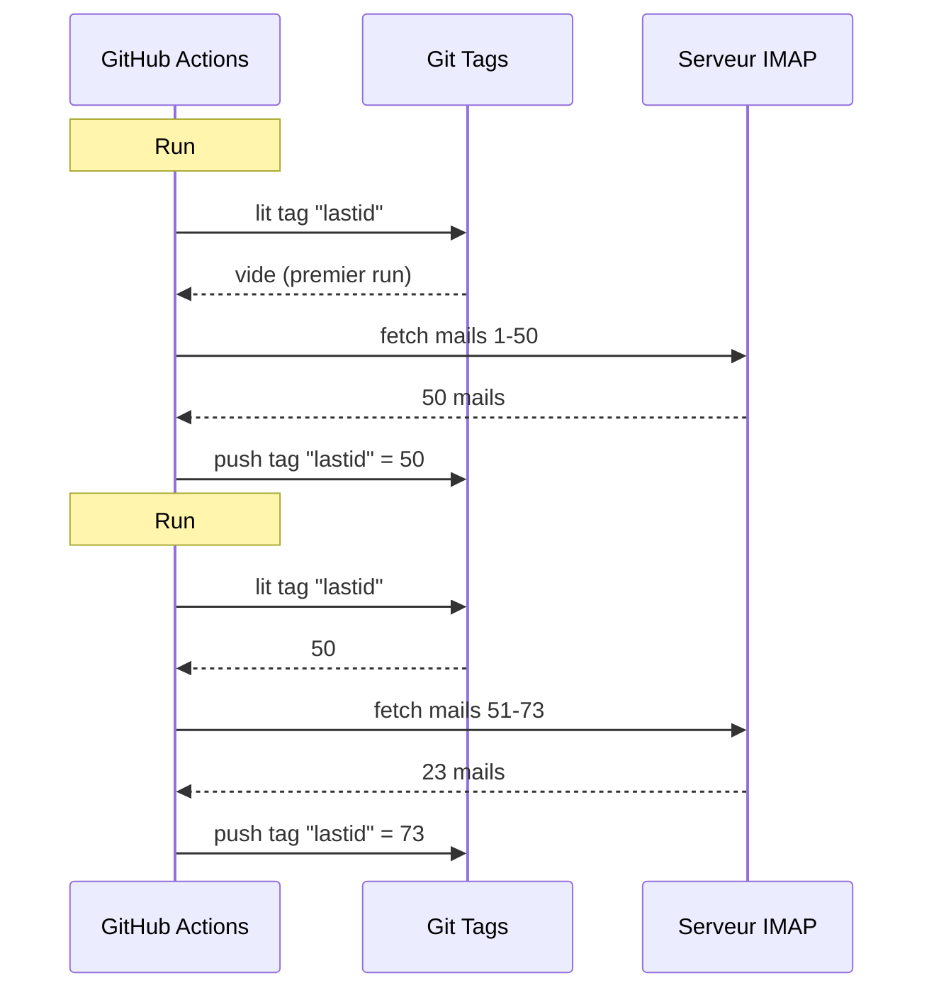

# Ich habe Git als Datenbank genutzt, um einen Gratis-Bot auf GitHub Actions laufen zu lassen

Ich habe einen automatischen Mail-Beantworter, der 24/7 läuft.

Er liest meine Mails, versteht, worum es geht, und antwortet allein mit einer KI. Er erinnert sich an frühere Gespräche. Er ignoriert Newsletter und `noreply@`. Er leitet an einen Menschen weiter, wenn es zu heikel wird.

Monatliche Kosten: **0€**.

Ich verzichte auf Server, VPS und Datenbank. Nur GitHub Actions und ein kranker Hack: **Git als Datenbank nutzen**.

Du siehst, worauf ich hinauswill? Nein? Gut, halt dich fest, es ist dämlich und genial zugleich.

---

## Das Problem: GitHub Actions ist stateless

GitHub Actions ist gratis. Du kannst alle 5 Minuten einen Cron starten, deinen Code laufen lassen, gratis.

Aber es gibt ein Problem: Es ist **stateless**.

Jeder Run startet auf einer jungfräulichen Maschine. Nichts wird zwischen zwei Ausführungen gespeichert. Der Run davor? Vergessen. Gelöscht. Als hätte er nie existiert.

Für einen Mail-Beantworter ist das ein riesiges Problem. So in der Art:

> "Was ist die letzte Mail, die ich schon bearbeitet habe ?"

Wenn der Bot das bei jedem Run vergisst, wird er entweder dieselben Mails in Schleife erneut beantworten (Katastrophe) oder Mails verpassen.

Er braucht persistenten Zustand. Und normalerweise heißt persistenter Zustand Datenbank. Aber eine Datenbank ist ein Server, und ein Server ist nicht mehr gratis.

Hier wird es interessant.

---

## Die Lösung: Git-Tags als Datenbank

Dein GitHub-Repo ist schon persistenter Speicher. Gratis. Versioniert. Immer da.

Warum also nicht den Zustand darin speichern?

Die Idee: Bei jedem Run liest der Bot die letzte bearbeitete Mail-UID aus einem **Git-Tag**. Er bearbeitet die neuen Mails. Dann pusht er den Tag mit der neuen UID erneut.



Der Git-Tag IST die Datenbank. Ein einziger Wert, aber das ist alles, was wir brauchen.

### Den State lesen

Am Jobanfang holen wir den Wert aus dem Tag:

```bash
git fetch origin --tags lastid || true
git show refs/tags/lastid:data/lastId > data/lastId || true
```

`git show refs/tags/lastid:data/lastId` heißt: "Gib mir den Inhalt der Datei `data/lastId`, wie sie im Tag `lastid` war."

Boom. Du hast deinen Wert, ohne Datenbank.

### Den State schreiben

Am Ende erstellen wir den Tag mit dem neuen Wert neu:

```bash
git switch --orphan lastid-tmp   # jungfräulicher Branch ohne Historie
git rm -rf .                      # alles leeren
mkdir -p data
printf "%s\n" "${LAST_ID_CONTENT}" > data/lastId

git add data/lastId
git commit -m "lastId snapshot"
git tag -f lastid                 # Tag auf diesen Commit forcen
git push --force ...origin lastid # Tag pushen
```

Wir erstellen einen **verwaisten** Branch (ohne Historie), legen nur die Datei `lastId` hinein, committen, taggen, force-pushen.

Warum verwaist? Um nicht 10.000 State-Commits in der Repo-Historie anzuhäufen. Jedes Update überschreibt das vorherige. Der Tag zeigt immer auf EINEN einzigen Commit, der EINEN einzigen Wert enthält.

Das ist sauber. Das ist gratis. Das ist komplett verdreht und es funktioniert.

---

## Der zweite Hack: der Runtime-Snapshot

Es gibt ein weiteres Problem mit GitHub Actions: Das `npm install`.

Wenn du bei jedem Run (alle 5 Minuten) `npm install` + `npm run build` machst, verschwendest du jedes Mal 60-90 Sekunden. Bei einem häufigen Cron sind das Minuten verschenkte Compute-Zeit für nichts.

Lösung: Den Code EINMAL vorkompilieren und auch in einem Git-Tag speichern.

Der Build-Workflow (der läuft, wenn du auf `master` pushst) macht das:

```bash
# Code kompilieren
bun install
bun run build

# dist/ + node_modules/ in einem "runtime"-Tag speichern
git checkout --orphan temp-runtime
git rm -rf .
cp -r "$TMPDIR"/* .
git add dist node_modules package.json bun.lock data
git commit -m "runtime build"
git tag -f runtime
git push --force ...origin runtime
```

Der `runtime`-Tag enthält den kompilierten Code UND die `node_modules`. Alles bereit zum Laufen.

Und der Cron checkt direkt diesen Tag aus:

```yaml
- name: Checkout runtime snapshot
  uses: actions/checkout@v4
  with:
    ref: refs/tags/runtime    # der vorgebaute Code, nicht der Source
    fetch-depth: 1

# kein npm install, kein Build !
- name: Process emails
  run: node dist/index.js --action
```

Der Cron startet augenblicklich und führt nur `node dist/index.js` aus, ohne Install oder Build.

So hast du zwei Tags, die zwei Jobs machen:
- `runtime` = der lauffertige Code (aktualisiert, wenn du Code pushst)
- `lastid` = der persistente Zustand (bei jedem Run aktualisiert)

Das ist elegant wie dreckig.

---

## Der Bot selbst: KI-Autoresponder

Gut, der Git-Hack ist cool, aber was macht der Bot genau?

Er liest deine Mails via IMAP, versteht sie mit einer KI (Groq + Llama 3.3 70B) und antwortet automatisch.

Architektur in sauberen Services mit Dependency Injection (InversifyJS):

```
App
├── ImapService      → liest die Mails (IMAP)
├── SmtpService      → schickt die Antworten (SMTP)
├── ParserService    → parst den Mailinhalt
├── ReplyService     → generiert die KI-Antwort
├── SummaryService   → Gesprächsgedächtnis
├── AccountsService  → verwaltet mehrere Mailkonten
└── ConfigService    → Config / Env-Vars
```

### Zwei Betriebsmodi

Der Bot kann auf zwei Arten laufen:

**Listener-Modus** (Echtzeit): Permanente IMAP-Verbindung mit exponentiellem Reconnect. Für einen VPS.

```typescript
this.imapService.on("exists", async (data) => {
  console.log(`[MAIL] Neue Mail ! Total: ${data.count}`);
  // bearbeitet die neue Mail sofort
});
```

**Action-Modus** (Batch): Bearbeitet die neuen Mails seit der `lastId` und schließt sich dann. Für den GitHub-Actions-Cron.

```bash
node dist/index.js --action
```

Der `--action`-Modus nutzt den Git-Hack. Er liest `lastId`, bearbeitet das Neue, schreibt die neue `lastId`, fertig.

### NICHT an Roboter antworten

Wenn dein Bot ALLE Mails beantwortet, antwortet er Newslettern, Benachrichtigungen, `noreply@`. Katastrophe. Schlimmer: Wenn sich zwei Bots gegenseitig antworten, hast du eine endlose Mailschleife. Der Albtraum.

Also aggressives Filtern:

```typescript
export function isAutomatedSender(address) {
  const automatedPatterns = [
    "noreply", "no-reply", "donotreply",
    "mailer-daemon", "postmaster", "bounce",
    "newsletter", "notification", "marketing",
    "billing", "receipt", "promo", ...
  ];
  const local = address.split("@")[0].toLowerCase();
  return automatedPatterns.some(p => local.includes(p));
}
```

Und auch Erkennung via Mailheader:

```typescript
export function isAutomatedByHeaders(headers) {
  return (
    ["bulk", "list", "junk"].includes(headers.precedence) ||
    headers["auto-submitted"] !== "no" ||
    headers["list-unsubscribe"] !== "" ||   // Newsletter haben das
    /mailchimp|sendgrid|mailgun|brevo/i.test(headers["x-mailer"])
  );
}
```

`List-Unsubscribe` in den Headern? Das ist ein Newsletter. `Precedence: bulk`? Massenmailing. `X-Mailer: Mailchimp`? Du siehst, worauf ich hinauswill. Wir ignorieren.

Das ist wie ein Club-Türsteher: Roboter kommen nicht rein.

### Die magischen Trigger

Die KI kann entscheiden, gar nicht zu antworten oder an einen Menschen zu übergeben. Wie? Mit speziellen Triggern in ihrer Antwort.

Der Systemprompt sagt ihr:

> Wenn es eine automatische Mail/ein Newsletter ist → antworte `<no_reply>`
> Wenn es zu wichtig/sensibel ist (rechtlich, finanziell...) → antworte `<manual_reply_required>`
> Sonst → schreibe eine echte Antwort

Und der Code liest das:

```typescript
const aiReply = completion.choices[0].message.content.trim();
const manualTrigger = aiReply.includes(MANUAL_REPLY_TRIGGER);
const noReply = aiReply.includes(NO_REPLY_TRIGGER);

if (noReply) {
  console.log("[MAIL] Die KI hat entschieden zu ignorieren. Skip.");
  return;
}

if (manualTrigger) {
  console.log("[MAIL] Zu heikel, ich leite an einen Menschen weiter.");
  await this.smtpService.sendManualForward(...);
  return;
}

// sonst schicken wir die KI-Antwort
await this.smtpService.sendReply(...);
```

So hat die KI das Recht zu sagen "nein, da fasse ich nicht an, ruf einen echten Menschen". Das ist Weisheit.

---

## Das Gesprächsgedächtnis

Ein Detail, das alles ändert: Der Bot **erinnert sich** an Gespräche.

Wenn er jemandem antwortet, speichert er eine Zusammenfassung des Austauschs. Wenn diese Person das nächste Mal schreibt, wird die Zusammenfassung wieder in den Prompt injiziert.

Speicherung: Eine JSON-Datei pro Kontakt.

```
data/customers/
├── moi%40gmail.com/
│   ├── alice%40example.com.json
│   └── bob%40client.fr.json
```

Und die Zusammenfassung wird selbst von der KI generiert, die die alte Zusammenfassung mit der neuen Nachricht mergt:

```typescript
const completion = await groq.chat.completions.create({
  model: "llama-3.3-70b-versatile",
  messages: [
    { role: "system", content: "Du bist ein Gedächtnisassistent. Merge die alte Zusammenfassung mit der neuen Nachricht, ohne Info zu verlieren." },
    { role: "user", content: `Existierende Zusammenfassung:\n${existing}\n\nNeue Nachricht:\n${incomingContent}` }
  ],
  temperature: 0.0,  // deterministisch, keine Kreativität
  max_tokens: 800,
});
```

Der Bot baut also über die Zeit ein komprimiertes Gedächtnis auf. Eine Zusammenfassung, die intelligent wächst, reicht, ohne alle Mails zu speichern.

Und diese JSON-Dateien? Tja... sie liegen auch in Git, im Runtime-Tag. Git überall.

---

## Der schlaue Punkt mit der Promptlänge

Kleines technisches Detail, das mich zum Schmunzeln brachte.

Modelle haben ein Tokenlimit. Wenn deine Mail + die Zusammenfassung + der Persona-Prompt darüber hinausgehen, gibt die API einen Fehler zurück.

Der Code handhabt das mit **Kaskadentrunkierung** + Retry:

```typescript
try {
  // erster Versuch mit normalen Limits
  completion = await groq.chat.completions.create({...});
} catch (error) {
  if (!this.isLengthError(error)) throw error;

  // es war ein Längenfehler : wir versuchen es mit engeren Limits erneut
  ({ systemContent, userContent } = this.buildPromptPayload({
    ...,
    limits: {
      systemPromptChars: 2200,  // statt 3000
      summaryChars: 1800,       // statt 4000
      personaChars: 900,        // statt 1500
      userContentChars: 2200,   // statt 8000
    },
  }));
  completion = await groq.chat.completions.create({...});  // Retry
}
```

Wenn es nicht durchgeht, schneiden wir kürzer und versuchen es erneut. Simpel, effektiv, kein Crash.

---

## Gut, und konkret, wie läuft das?

Der komplette Flow eines Cron-Runs:

```
1. GitHub Actions löst aus (Cron alle 5 Min)
2. Checkout des "runtime"-Tags (vorgebauter Code)
3. git show refs/tags/lastid → holt die letzte bearbeitete UID
4. node dist/index.js --action
   ├── IMAP-Verbindung
   ├── Fetch der Mails seit lastId+1
   ├── für jede Mail :
   │   ├── Inhalt parsen
   │   ├── Roboter filtern (skip wenn automated)
   │   ├── Empfängerkonto matchen
   │   ├── Gesprächsgedächtnis holen
   │   ├── KI-Antwort generieren (Groq)
   │   ├── <no_reply> ? skip
   │   ├── <manual_reply_required> ? Weiterleitung Mensch
   │   ├── sonst : Antwort schicken (SMTP)
   │   └── Gesprächsgedächtnis updaten
   └── neue lastId schreiben
5. git push --force Tag "lastid" mit neuem Wert
```

Und das beginnt in 5 Minuten von Neuem. Für immer. Gratis.

---

**Die 3 Punkte zum Mitnehmen :**

1. **Git = gratis Datenbank**, ein verwaister Tag kann deinen persistenten Zustand zwischen zwei stateless Runs speichern. `git show refs/tags/X:datei` zum Lesen, Force-Push zum Schreiben. Du sparst eine komplette DB.

2. **Pre-Compile in einen Runtime-Tag**, statt `npm install` bei jedem Cron-Run, speichere den kompilierten Code + node_modules in einem Git-Tag. Der Cron startet augenblicklich.

3. **Ein KI-Bot muss schweigen können**, die Trigger `<no_reply>` und `<manual_reply_required>` lassen die KI entscheiden, nicht zu antworten oder zu übergeben. Plus Anti-Roboter-Filterung. Sonst erzeugst du eine endlose Mailschleife.

Serverless-Cron mit persistentem Zustand, KI, Gedächtnis, alles für 0€/Monat. Das ist komplett kaputt und ich liebe dieses Setup.
