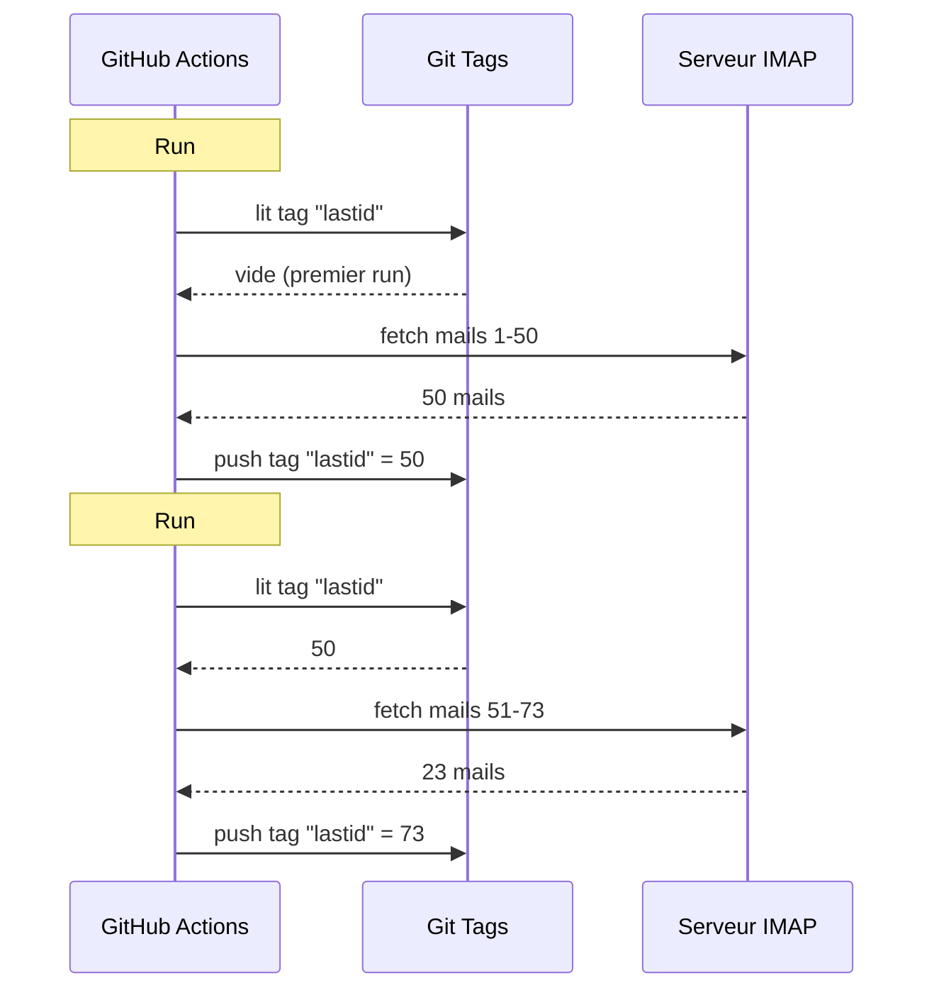

# 

Ich habe einen automatischen E-Mail-E-Mail, der 24/7 dreht.

Er liest meine E-Mails, versteht, was das bedeutet, und beantwortet mit einer KI allein. Er erinnert sich an frühere Gespräche.`noreply@`Er forward für einen Menschen, wenn es zu heiß ist.

Monatliche Kosten: **0€**.

Ich laufe nicht auf Server, VPS und Datenbank. Nur GitHub Aktionen und ein Hack von Patienten: ** verwenden git als Datenbank**.

- Nein, halt dich fest, das ist dumm und gleichzeitig toll.

---

## Das Problem: GitHub Aktionen ist stateless

GitHub Aktionen ist kostenlos, du kannst alle fünf Minuten eine Cron starten, deinen Code umsonst drehen.

Aber es gibt ein Problem: es ist **stateless**.

Jede Run startet in einer leeren Maschine. Zwischen zwei Hinrichtungen ist nichts gespeichert. Der Run davor? Vergessen. Ausgelöscht. Als ob er jemals existiert hätte.

Für einen E-Mail-Beantworter ist das ein großes Problem.

> "Was ist die letzte E-Mail, die ich je bearbeitet habe?"

Wenn der Bot das bei jedem Run vergisst, wird er entweder die gleichen Mails in der Schleife (Katastrophen) wiederholen oder E-Mails verpassen.

Es braucht einen dauerhaften Zustand, und normalerweise ist es persistent = Datenbank, aber eine Datenbank ist ein Server, und ein Server ist kostenloser.

Das wird interessant.

---

## Die Lösung: git tags als Datenbank

Dein GitHub Repo ist schon immer da.

Warum speicherst du dann nicht den Staat?

Die Idee: Bei jeder run liest der Bot die neueste UID E-Mail, die mit einem **git tag** behandelt wird. Er verarbeitet die neuen Mails. Dann re-push tagiert er mit der neuen IDU.

Der Tag git IST die Datenbank, nur ein Wert, aber das ist alles, was wir brauchen.

### State lesen

Am Anfang des Jobs wird der Wert vom Tag zurückgewonnen:
```bash
git fetch origin --tags lastid || true
git show refs/tags/lastid:data/lastId > data/lastId || true
```
`git show refs/tags/lastid:data/lastId`Das heißt: "Gib mir den Inhalt der Datei`data/lastId`wie er in der Tagged`lastid` ".

Du hast deinen Wert, ohne Datenbank.

### Status schreiben

Am Ende wird der Tag mit dem neuen Wert neu erstellt:
```bash
git switch --orphan lastid-tmp   # branche vierge sans historique
git rm -rf .                      # on vide tout
mkdir -p data
printf "%s\n" "${LAST_ID_CONTENT}" > data/lastId

git add data/lastId
git commit -m "lastId snapshot"
git tag -f lastid                 # force le tag sur ce commit
git push --force ...origin lastid # push le tag
```
Wir erstellen einen Zweig ** verwaiste** (ohne Historie), wir setzen nur die Datei`lastId`Wir markieren, wir brechen Push.

Warum verwaist? Um 10.000 commits von state in der Repo-Historie nicht zu sammeln. Jedes Update überschreibt den vorherigen. Tag zeigt immer auf EINEM, der nur einen Wert enthält.

Es ist sauber, es ist umsonst, es funktioniert total verrückt.

---

## Der zweite Hack: der runtime snapshot

Es gibt noch ein Problem mit GitHub Actions:`npm install` .

Wenn du bei jeder Run (alle 5 Minuten)`npm install` + `npm run build`Du verschwendest 60-90 Sekunden, und bei einem häufigen Cron sind es Minuten mit verschwendeten Daten.

Lösung: Vorkompilieren du den Code EIN Mal, und speicherst du ihn in einem Git-Tag.

Der Build-Workflow (der dreht, wenn du push auf`master`) macht dies:
```bash
# Code kompilieren
bun install
bun run build

# speichert dist/ + node_modules/ in einem "runtime" Tag
git checkout --orphan temp-runtime
git rm -rf .
cp -r "$TMPDIR"/* .
git add dist node_modules package.json bun.lock data
git commit -m "runtime build"
git tag -f runtime
git push --force ...origin runtime
```
Das Tag`runtime`enthält den kompilierten Code UND`node_modules`Alles bereit zum Drehen.

Und der Cron, er, checkt direkt dieses Tag:
```yaml
- name: Checkout runtime snapshot
  uses: actions/checkout@v4
  with:
    ref: refs/tags/runtime    # le code pré-build, pas le source
    fetch-depth: 1

# Keine npm install, kein Build!
- name: Process emails
  run: node dist/index.js --action
```
Cron startet sofort und führt gerade aus`node dist/index.js`, ohne Installation oder Build.

Du hast zwei Stichworte, die zwei Jobs machen:

- `runtime`= der Code, der gedreht werden kann (aktualisiert, wenn du Code push)

- `lastid`= Dauerzustand (bei jedem Run aktualisiert)

Es ist elegant wie ein Dreckskerl.

---

## Der Bot selbst: selbstbeantworter IA

Okay, Hack Git ist cool, aber was genau macht der Bot?

Er liest deine E-Mails über IMAP, enthält sie mit einer IA (Groq + Llama 3.3 70B) und antwortet automatisch.

Eigene Architektur mit Abhängigkeits-Injektion (InversifyJS):
```
App
├── ImapService      → lit les mails (IMAP)
├── SmtpService      → envoie les réponses (SMTP)
├── ParserService    → parse le contenu des mails
├── ReplyService     → génère la réponse IA
├── SummaryService   → mémoire de conversation
├── AccountsService  → gère plusieurs comptes email
└── ConfigService    → config / env vars
```
### Zwei Arbeitsweisen

Der Bot kann auf zwei Arten drehen:

**Listen-Mode** (Echtzeit): Dauerhafte IMAP-Verbindung mit exponentiellem Reconnect. Für einen VPS.
```typescript
this.imapService.on("exists", async (data) => {
  console.log(`[MAIL] Nouveau mail ! Total: ${data.count}`);
  // bearbeitet die neue Mail sofort
});
```
**Action-Mode** (Batch): verarbeitet neue E-Mails von der`lastId`- Dann schließt er sich.
```bash
node dist/index.js --action
```
Der Modus`–action`Er ist derjenige, der den Hack Git benutzt.`lastId`, behandelt, was neu ist, schreibt das neue`lastId`Ende.

### Roboter NICHT beantworten

Wenn dein Bot auf ALLE E-Mails antwortet, wird er auf Newsletter, Benachrichtigungen,`noreply@`Schlimmer: Wenn zwei Bots einander antworten, hast du eine unendliche Mailschleife.

Also aggressive Filterung:
```typescript
export function isAutomatedSender(address) {
  const automatedPatterns = [
    "noreply", "no-reply", "donotreply",
    "mailer-daemon", "postmaster", "bounce",
    "newsletter", "notification", "marketing",
    "billing", "receipt", "promo", ...
  ];
  const local = address.split("@")[0].toLowerCase();
  return automatedPatterns.some(p => local.includes(p));
}
```
Und auch Erkennung über die E-Mail-Header:
```typescript
export function isAutomatedByHeaders(headers) {
  return (
    ["bulk", "list", "junk"].includes(headers.precedence) ||
    headers["auto-submitted"] !== "no" ||
    headers["list-unsubscribe"] !== "" || // Newsletter haben das.
    /mailchimp|sendgrid|mailgun|brevo/i.test(headers["x-mailer"])
  );
}
```
`List-Unsubscribe`- Das ist ein Newsletter.`Precedence: bulk`- Massa-Mailing.`X-Mailer: Mailchimp`- Siehst du, was das ist?

Es ist wie ein Nachtclub-Tröster: Roboter kommen nicht durch.

### Magische Trigger

Die KI kann entscheiden, ob sie überhaupt nicht antworten oder einen Menschen in die Hand nehmen will.

Das schnelle System sagt zu ihm:

> Wenn es sich um eine automatische E-Mail/Newsletter → Antworten`<no_reply>`
> Wenn es zu wichtig/empfindlich (gesetzlich, finanziell...) → Antworten`<manual_reply_required>`
> Sonst → schreibst du eine echte Antwort

Und der Code liest:
```typescript
const aiReply = completion.choices[0].message.content.trim();
const manualTrigger = aiReply.includes(MANUAL_REPLY_TRIGGER);
const noReply = aiReply.includes(NO_REPLY_TRIGGER);

if (noReply) {
  console.log("[MAIL] L'IA a décidé d'ignorer. Skip.");
  return;
}

if (manualTrigger) {
  console.log("[MAIL] Trop chaud, je forward à un humain.");
  await this.smtpService.sendManualForward(...);
  return;
}

// sonst senden wir die Antwort IA
await this.smtpService.sendReply(...);
```
Die KI hat das Recht zu sagen: "Nein, ich fühle mich nicht wie ein echter Mensch."

---

## Das Gesprächsgedächtnis

Ein Detail, das alles verändert: der Bot ** erinnert sich** an Gespräche.

Wenn er jemand antwortet, speichert er eine Zusammenfassung des Austausches. Das nächste Mal, wenn diese Person schreibt, wird die Zusammenfassung in den schnellen wieder eingeschickt.

Speichern: eine JSON-Datei durch Kontakt.
```
data/customers/
├── moi%40gmail.com/
│   ├── alice%40example.com.json
│   └── bob%40client.fr.json
```
Und die Zusammenfassung wird selbst von der KI generiert, die die alte Zusammenfassung mit der neuen Nachricht säubert:
```typescript
const completion = await groq.chat.completions.create({
  model: "llama-3.3-70b-versatile",
  messages: [
    { role: "system", content: "Tu es un assistant de mémoire. Merge l'ancien résumé avec le nouveau message sans perdre d'info." },
    { role: "user", content: `Résumé existant:\n${existing}\n\nNouveau message:\n${incomingContent}` }
  ],
  temperature: 0.0, // Deterministisch, keine Kreativität
  max_tokens: 800,
});
```
Der Bot baut also im Laufe der Zeit komprimierte Speicher auf, eine Zusammenfassung, die intelligent größer wird, ohne alle E-Mails zu speichern.

Und diese JSON-Dateien?

---

## Der böse Punkt mit der Länge des Schnellen

Kleine technische Details, die mich zum Lächeln gebracht haben.

Vorlagen haben eine Token-Begrenzung. Wenn deine Mail + Zusammenfassung + die schnelle Person übertrifft, gibt die API einen Fehler zurück.

Der Code verwaltet dies mit einer **Stacks-Tronkatur** + retry:
```typescript
try {
  // erste Prüfung mit normalen Grenzwerten
  completion = await groq.chat.completions.create({...});
} catch (error) {
  if (!this.isLengthError(error)) throw error;

  // Es war ein Fehler der Länge: wir re-trust mit engeren Grenzen
  ({ systemContent, userContent } = this.buildPromptPayload({
    ...,
    limits: {
      systemPromptChars: 2200, // anstatt3000
      summaryChars: 1800, // anstatt4000
      personaChars: 900, // anstatt1500
      userContentChars: 2200, // anstatt8000
    },
  }));
  completion = await groq.chat.completions.create({...}); // retry
}
```
Wenn das nicht passiert, schneiden wir es kürzer und fangen wieder an.

---

## Also, was ist eigentlich los?

Der vollständige flow eines Cron Run:
```
1. GitHub Actions se déclenche (cron toutes les 5 min)
2. Checkout du tag "runtime" (code pré-build)
3. git show refs/tags/lastid → récupère le dernier UID traité
4. node dist/index.js --action
   ├── connexion IMAP
   ├── fetch des mails depuis lastId+1
   ├── pour chaque mail :
   │   ├── parse le contenu
   │   ├── filtre les robots (skip si automated)
   │   ├── match le compte destinataire
   │   ├── récupère la mémoire de conversation
   │   ├── génère la réponse IA (Groq)
   │   ├── <no_reply> ? skip
   │   ├── <manual_reply_required> ? forward humain
   │   ├── sinon : envoie la réponse (SMTP)
   │   └── update la mémoire de conversation
   └── écrit le nouveau lastId
5. git push --force tag "lastid" avec la nouvelle valeur
```
Und es beginnt in fünf Minuten, für immer.

---

**Die 3 Punkte, die zu berücksichtigen sind:**

1. **Git = kostenlose Datenbank** – Ein verwaister Tag kann deinen dauerhaften Zustand zwischen zwei stateless Runs speichern.`git show refs/tags/X:fichier`Du sparst eine komplette DB.
2. **Vorkompiliert in einem runtime-Tag** – Statt`npm install`speichert bei jedem Lauf des Cron den kompilierten + node_modules-Code in einem git-Tag. Der Cron startet sofort.
3. **Ein Bot muss still sein** – Trigger`<no_reply>`und`<manual_reply_required>`Die KI lässt sich nicht beantworten oder die Hand stecken, und die Anti-Roboter-Filterung.

Cron-Server mit dauerhaftem Zustand, IA, Speicher, alles bei 0€/Monat. Es ist total sauer und ich liebe diese Montage.
