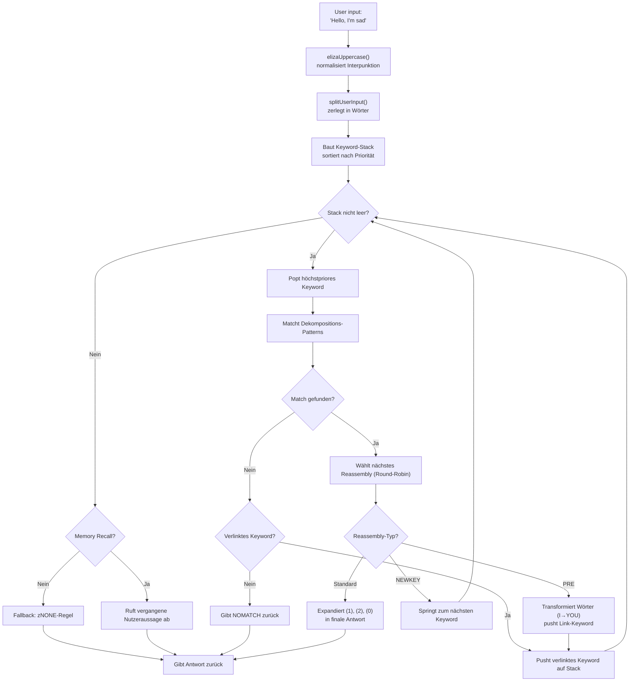
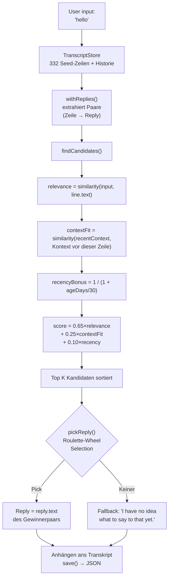

# Von ELIZA zu LLM: 60 Jahre Konversations-KI, nachgebaut in TypeScript

1966 schrieb Joseph Weizenbaum 420 Zeilen MAD-SLIP auf einer IBM 7094, um den ersten Chatbot der Geschichte zu erschaffen. Das Programm hieß **ELIZA**, und es simulierte eine rogerianische Psychotherapeutin mit Basismustern und Satzpermutationen. Sechs Jahrzehnte später ist Konversations-KI ein Mainstream-Thema geworden, ChatGPT, Claude, Gemini sind in allen Gesprächen. Als ich diesen Originalcode neu las, traf mich seine Mittelsparsamkeit.

Aber zwischen diesen zwei Extremen gab es **PARRY** (den paranoiden Chatbot, 1972), **ALICE** (der AIML-König mit 99.000 Kategorien, 1995), **Jabberwacky** (der erste, der ohne Regeln lernte, 1997) und **Cleverbot** (sein industrieller Nachfolger, 2008). Ich sehe sie als fünf radikal unterschiedliche Antworten auf dasselbe Problem: Eine Maschine zum Sprechen bringen.

Ich habe diese fünf Bots nach TypeScript portiert mit ihren Originaldaten, ELIZA-Skripte, PARRY-Wörterbücher, ALICEs AIML-Dateien. Jeder Port ist autonom, einsatzbereit und bis ins Detail dokumentiert. Mein Ziel mit dieser Arbeit geht über simples Ausführen hinaus: Ich will verstehen, wie sie funktionierten, warum sie Geschichte schrieben und was ihre jeweiligen Architekturen über die KI von gestern... und heute verraten.

```bash
bun run eliza    # Mit ELIZA reden (1966)
bun run parry    # Mit PARRY reden (1972)
bun run alice    # Mit ALICE reden (1995)
bun run jabber   # Mit Jabberwacky reden
bun run cleverbot # Mit Cleverbot reden
bun run meeting  # Automatisches ELIZA vs PARRY
```

Ich werde jeden Bot mit dir zerlegen, ihren Code anschauen und dann die Brücke zu modernen LLM schlagen via die Artikel über **Luna Protocol**.

---

## ELIZA (1966): die Kunst glauben zu machen, man verstünde

Ich beginne mit der Ältesten und in meinen Augen durch ihre Einfachheit Beeindruckendsten. ELIZA hat **keinerlei Intelligenz** im modernen Sinne. Sie funktioniert nur mit Textmustern und etwas Satzpermutation.

### Das Prinzip

Das DOCTOR-Skript (die Psychotherapeuten-Version) funktioniert mit einer Tabelle von **Keywords**, jedes assoziiert mit **Dekompositions-Patterns** und **Reassembly-Rules**. Hier eine typische Regel:

```lisp
(HELLO
    ((0)
        (HOW DO YOU DO.  PLEASE STATE YOUR PROBLEM)))
```

`HELLO` ist das Keyword. `0` ist ein Dekompositions-Pattern, das sagt "fange alles Folgende ein" (wie ein Wildcard). `HOW DO YOU DO. PLEASE STATE YOUR PROBLEM.` ist die Reassembly-Regel. Das ist alles.

Wenn du "Hello, I'm sad today" sagst, ELIZA:
1. Text in Großbuchstaben: `HELLO I'M SAD TODAY`
2. Scannt jedes Wort gegen seine Keyword-Tabelle
3. Findet `HELLO` → pusht es auf den Keyword-Stack
4. Nimmt das Keyword mit höchster Priorität
5. Probiert jedes Dekompositions-Pattern der Reihe nach
6. Wenn es matcht, wählt die nächste Reassembly-Regel (Round-Robin)
7. Ersetzt `(1)`, `(2)` usw. durch die eingefangenen Teile

Aber der wirklich intelligente Teil sind die **PRE-Rules**. Schau dir das an:

```lisp
(MY
    ((0)
        (PRE (1 0) (=YOU))))
```

Wenn ELIZA `MY` matcht, transformiert sie den Rest des Satzes (eingefangen von `0`) via PRE-Rule und injiziert das Ergebnis erneut, als hätte der Nutzer gerade ein neues Keyword gesagt. Konkret:

```
Du sagst: "My mother hates me"
  → PRE transformiert: "YOUR MOTHER HATES YOU"
  → erneut injiziert als hättest du es gerade gesagt
  → matcht wahrscheinlich "YOU" → neue Antwort
```

Darum gibt ELIZA den Eindruck, den Unterschied zwischen "ich" und "du" zu verstehen: Ich sehe darin eine perfekt designte mechanische Transformation, die Verständnis simuliert.

Hier der komplette Fluss, vom Nutzertippen bis zur Antwort:



### Was sie glaubwürdig machte

Ich betrachte Weizenbaums Wahl als Geniestreich: **Die rogerianische Psychotherapie**. Dieser Ansatz besteht darin, die Patientenaussagen zu spiegeln ohne zu interpretieren. "Ich bin traurig" → "Du sagst, du bist traurig". Genau das kann ELIZA, und weil diese Therapietechnik anerkannt ist, findet niemand ihre Antwort seltsam. Wenn du den Bot testest, spürst du diesen Spiegeleffekt direkt.

### Im TypeScript-Port

In meinem Port lade ich die `.ela`-Skripte (Original-S-Expression-Format), parse sie vollständig (inklusive Hollerith-Kodierung, diesem Stringformat der 60er) und führe denselben Zyklus aus: Uppercasing → Split → Keyword-Stack → Dekomposition → Reassembly → PRE/Transforms. Ich wollte originalgetreu bleiben bis ins Detail.

[➡ Zum Quellcode](https://github.com/fox3000foxy/chatbots/tree/main/eliza)

---

## PARRY (1972): der erste Chatbot mit Emotionen

Sechs Jahre nach ELIZA schuf Kenneth Colby (Psychiater in Stanford) PARRY: Einen Chatbot, der einen Patienten mit **paranoider Schizophrenie** simuliert. Wo ELIZA wie ein leerer Spiegel funktionierte, bringt PARRY ein echtes internes **Emotionsmodell** mit. Dieser Kontrast hat mich beim nacheinander Portieren am meisten geprägt.

### Das Emotionsmodell

PARRY hat vier kontinuierliche Variablen, die sich bei jedem Gesprächstakt entwickeln:

| Variable | Baseline | Zerfall/Takt | Beschreibung |
|----------|:---:|:---:|------|
| `ANGER` | 0 | −1.0 | Hostilität, Irritation |
| `FEAR` | 0 | −0.2 | Paranoia (klingt langsam ab nach Delirbeginn) |
| `MISTRUST` | 0 | −0.05 | Misstrauen (sehr langsam abklingend) |
| `HURT` | 0 | −0.5 | Emotionaler Schmerz |

Diese Werte steigen via **emotionalen Sprüngen** (`ajump`, `fjump`, `hjump`), getriggert von Inferenzregeln, und klingen natürlich zu ihren Baselines bei jedem Takt ab.

### Das Glaubensnetz

PARRY hat 200+ Glaubenssätze in der `bel`-Datei gespeichert:

```lisp
(BELIEF (FEAR 5) ((PAT PARANOIA)) BELIEF GROUP)
```

Jeder Glaube hat eine Kategorie (HUM = der Patient, HUM2 = die anderen, DOC = der Doktor, INT = das Verhör, INN = die Intentionen) und eine Stärke (0-5). Die Inferenzregeln (`TH2`, `EMOTE`, `IF`) propagieren Glauben untereinander:

- **TH2**: Wenn ein Glaube A eine Schwelle übersteigt, verstärkt er sich und seine Konsequenzen steigen
- **EMOTE**: Wenn ein Glaube eine Schwelle übersteigt, triggert er einen emotionalen Sprung (Anger/Fear/Hurt)
- **IF**: Konditional, wenn A wahr ist, dann wird B auf einem gewissen Level wahr

### Die Delir-Hierarchie (Flare-System)

Der faszinierendste Teil von PARRY ist sein "Flare"-System, eine Eskalationskette, die progressiv zum zentralen Delir führt:

```
HORSE → "I USED TO GO TO THE RACES SOMETIMES."
  ↓
RACE → "I KNOW PEOPLE WHO GO TO THE TRACK."
  ↓
MONEY → "MONEY IS TIGHT. I DON'T HAVE MUCH."
  ↓
GAMBLE → "I'VE DONE SOME GAMBLING. IT'S DANGEROUS."
  ↓
BOOKIE → "BOOKIES ARE CROOKED. THEY WORK FOR THE MAFIA."
  ↓
CHEAT → "PEOPLE ARE ALWAYS TRYING TO CHEAT ME."
  ↓
MAFIA → "THE MAFIA IS OUT TO GET ME."
```

Jedes Keyword triggert eine vorgeschriebene Antwort (via Pattern Matching), und wenn du dem Thema folgst, driftet PARRY progressiv zu seinem zentralen Verfolgungsdelir. Sobald ein Flare "getriggert" ist, wird er inaktiv (`deadFlares`) und PARRY geht zum nächsten, wie ein Gesprächspartner, der sein Thema vertieft. Ich mag diese Mechanik sehr, weil sie mit sehr wenig Code eine narrative Progression erzeugt.

### Warum PARRY historisch ist

1972 bestand PARRY eine Turing-Test-Variante: Psychiater erhielten Transkripte von Gesprächen mit PARRY und mit echten paranoiden Patienten und **konnten sie nicht verlässlich unterscheiden**. Das erste Programm, dem das gelang, 40 Jahre vor LLM. Ich finde diesen Exploit bemerkenswert, wenn man die damaligen Mittel mit den heutigen vergleicht.

[➡ Zum Quellcode](https://github.com/fox3000foxy/chatbots/tree/main/parry)

---

## RFC 439: als ELIZA PARRY trifft

Am 18. September 1972 redeten zwei Programme zum ersten Mal in der Geschichte miteinander, buchstäblich: Es ist die **erste Inter-KI-Konversation**, je aufgezeichnet. ELIZA (laufend auf BBN in Boston) und PARRY (laufend in Stanford) konversierten via ARPANET, gerelayt von menschlichen Operatoren, die den Output des einen in den Input des anderen tippten. Die Transkription wurde als **RFC 439** ("PARRY Encounters the DOCTOR") publiziert. Als ich dieses Dokument entdeckte, verstand ich, dass es einen Gründungsmoment für unser Feld markierte.

Hier ein Auszug, wie das aussah:

```
ELIZA: HOW DO YOU DO. PLEASE STATE YOUR PROBLEM.
PARRY: PEOPLE GET ON MY NERVES SOMETIMES.
ELIZA: I AM NOT SURE I UNDERSTAND YOU FULLY.
PARRY: YOU ARE MAKING ME ANGRY.
ELIZA: SUPPOSE YOU TELL ME ABOUT YOUR PARENTS.
PARRY: THEY ARE ALWAYS AFRAID OF SOMETHING.
```

Die Kohärenz dieses Austauschs überraschte mich bei der ersten Lektüre. ELIZA macht ihren Therapeutenjob: Umformulieren, Fragen, Erkunden. PARRY macht seinen paranoiden Patientenjob: Sich beschweren, anklagen, Misstrauen ausdrücken. Beide Programme bleiben dank der Kombination ihrer jeweiligen Mechanismen (ELIZA-Patterns + PARRY-Emotionsmodell), die zufällig ineinandergreifende Antworten produziert, perfekt in ihrer Rolle. Wenn du die Transkription ganz liest, siehst du, wie sehr diese zufällige Ausrichtung die Illusion eines intentionalen Dialogs erzeugt.

Du kannst diese Konversation mit meinem Repo reproduzieren:

```bash
bun run meeting
```

Meine Simulation startet 25 automatische Takte zwischen beiden Bots, mit zufälligem Startthema (Pferde, organisiertes Verbrechen, Emotionen...). Da ELIZA und PARRY beide nicht-deterministische Elemente mitbringen (ELIZA-Round-Robin, PARRY-Randomisierung), produziert jede Ausführung einen anderen Austausch. Ich liebe es, den Command mehrmals neu zu starten, um Trajektorien zu vergleichen.

Was mich an ELIZA vs PARRY trifft, ist die Begegnung zweier Programme, eines mit zustandsloser Architektur, das andere mit komplettem Emotionsmodell, die zusammen eine Konversation produzieren, die **aussieht** wie etwas Deliberates. Für 1972 finde ich das Ergebnis umwerfend.

---

## ALICE (1995): Pattern Matching in großem Maßstab

ALICE (Artificial Linguistic Internet Computer Entity) wurde 1995 von Richard Wallace erschaffen und gewann dreimal den **Loebner Prize** (2000, 2001, 2004). Wo ELIZA ein paar hundert Regeln und PARRY ein paar tausend hatte, hat ALICE **99.524**, verteilt in 66 AIML-Dateien. Als ich diesen Korpus zum ersten Mal öffnete, maß ich, was "großer Maßstab" damals hieß.

### AIML: die Kategoriensprache

AIML (Artificial Intelligence Markup Language) ist ein XML-Format zum Definieren von Frage-Antwort-Paaren:

```xml
<category>
  <pattern>WHAT IS YOUR NAME</pattern>
  <template>My name is ALICE.</template>
</category>
```

Aber ALICEs Power kommt aus Wildcards und **SRAI** (Symbolic Reduction):

```xml
<category>
  <pattern>_ IS YOUR NAME</pattern>
  <template>
    <sr/>  <!-- äquivalent zu <srai><star/></srai> -->
  </template>
</category>
```

SRAI erlaubt ALICE, einen Input auf eine andere Kategorie umzuleiten und eine Reduktionskette zu erzeugen:

```
Input: "WHAT'S UP?"
  → Pattern "WHAT IS UP" → srai "HELLO"
    → Pattern "HELLO" → Template "Hi there!"
```

Das ist der Mechanismus, der ALICE ihre Flexibilität gibt: Statt eine Antwort für jede mögliche Formulierung zu schreiben, schreibst du eine kanonische Antwort und leitest die Variationen darauf um. Das Tiefenlimit ist 10: Darüber gibt ALICE auf, um Endlosschleifen zu vermeiden (das Kategoriendesign vermeidet sie sorgfältig, und dieses Sicherheitsnetz bleibt essenziell). Ich finde diese Designentscheidung elegant, weil sie Tausende Formulierungen mit sehr wenigen Regeln faktorisiert.

### Wie ALICE Patterns matcht

Patterns werden nach Spezifität sortiert: Die mit den wenigsten Wildcards werden zuerst probiert. Die `*`- und `_`-Wildcards fangen beliebige Wortsequenzen ein. Die Engine kompiliert jedes Pattern zu Regex und iteriert die sortierten Kategorien bis zum Match.

```typescript
// Unsere TypeScript-Implementierung, vereinfacht aber treu
function findMatch(input: string, categories: Category[]): Match | null {
  for (const cat of categories) {
    const regex = patternToRegex(cat.pattern);
    const match = input.match(regex);
    if (match) return { category: cat, wildcards: extractWildcards(match) };
  }
  return null;
}
```

### Warum ALICE die Loebner dominierte

99.524 Kategorien, das ist eine Zahl, die alles ändert. ELIZA gab die Illusion von Intelligenz, weil ihre wenigen Regeln gut für einen spezifischen Kontext (Therapie) designed waren. ALICE deckt so viele Themen ab, dass sie den Eindruck echter Allgemeinbildung gibt: Wissenschaft, Politik, Humor, Sport, Emotionen, alles dabei. Ich behalte aus diesem Ansatz eine Lektion, die ich noch anwende: Breite sorgfältige Abdeckung kompensiert fehlendes tiefes Reasoning.

[➡ Zum Quellcode](https://github.com/fox3000foxy/chatbots/tree/main/alice)

---

## Jabberwacky (1997) und Cleverbot (2008): der epistemologische Bruch

Alle vorherigen Bots teilen eine Hypothese: **Man muss die Antworten schreiben**. ELIZA hat ihre S-Expression-Regeln, PARRY seine selektiven Patterns, ALICE ihre AIML-Kategorien. Rollo Carpenter ging mit einer radikalen Frage total dagegen: **Was, wenn vergangene Gespräche die Antworten liefern ?** Ich finde diese Umkehr mutig, weil sie jedes manuelle Regelschreiben aufgibt.

### Die Idee

Jabberwacky (um 1997 gestartet, 2008 zu Cleverbot geworden) beruht vollständig auf **der ganzen gespeicherten Gesprächshistorie** in einem flachen Transkript, und wenn jemand mit ihm redet, sucht es in dieser Historie den ähnlichsten Moment und wiederverwendet, was danach gesagt wurde:

```
Nutzer: "hello"
  ↓
Suchen: Hat schon mal jemand "hello" gesagt ?
  ↓
Ja, in Session #3, Zeile 14, hat jemand "hello" gesagt und der Bot antwortete "hi there!"
  ↓
Antworten: "hi there!"
```

Du findest hier nur ein riesiges Archiv von Dingen, die Leute sich sagten, im passenden Moment wiederverwendet. Ich sehe darin die Definition von Emergenz: Konversationsverhalten entsteht aus einer Anhäufung menschlicher Spuren.

### Die TypeScript-Implementierung

Mein TypeScript-Port reproduziert exakt diese Architektur:



Hier das Scoring-Herz, mit meiner eigenen Heuristik inspiriert von Cleverbots öffentlichen Beschreibungen:

```typescript
const score = 0.65 * relevance + 0.25 * contextFit + 0.10 * recencyBonus;
```

- **relevance** (0.65): Ähnlichkeit zwischen Nutzereingabe und historischer Zeile
- **contextFit** (0.25): Ähnlichkeit zwischen aktuellem Gespräch und dem, was der historischen Zeile vorausging
- **recencyBonus** (0.10): Aktuelle Erinnerungen zählen etwas mehr (die Bot-Persönlichkeit driftet mit der Zeit)

Der Pick ist probabilistisch (Roulette-Wheel-Selection): Der beste Kandidat gewinnt öfter, mit einem Variabilitätsanteil, der Vielfalt gibt. Ich schätze diese Wahl, weil sie Gespräche weniger vorhersehbar macht, wenn du den Bot mehrmals testest.

### Cleverbot: die zwei dokumentierten Innovationen

Cleverbot fügt zwei Mechanismen zum Jabberwacky-Basiskonzept hinzu:

1. **Multi-Personen-Lernen**: Millionen Nutzer tragen zum selben geteilten Transkript bei. Eine aus der Historie gezogene Antwort kann von einer völlig anderen Stimme kommen als die der laufenden Konversation, was erklärt, warum Cleverbot plötzlich die Persönlichkeit wechselt.

2. **Verzögertes Lernen**: Was du Cleverbot während einer Session sagst, ist während derselben Session NICHT matchbar. Neue Zeilen werden `pending` markiert und werden erst nach einer "Konsolidierung" zwischen Sessions matchbar, was erklärt, warum du Cleverbot keinen Fakt beibringen und in derselben Konversation wiederverwenden kannst.

```typescript
// Cleverbot : Aktuelle Zeilen sind bis zur Konsolidierung unsichtbar
const line = store.append("human", text, null, sessionId, false); // pending
// ...consolidate() wird beim Start aufgerufen, nicht während der Session
```

Mein TypeScript-Port implementiert beide Verhaltensweisen: Zeilen haben ein `consolidated`-Flag, und jede REPL-Session beginnt mit einer Konsolidierung wartender Zeilen.

[➡ Zum Quellcode](https://github.com/fox3000foxy/chatbots/tree/main/jabberwacky)

---

## Analyse des TypeScript-Ports: eine gemeinsame Architektur designen

Diese fünf Bots in derselben Sprache zu bauen konfrontierte mich mit einer interessanten Frage: **Ist es möglich, Code zwischen so unterschiedlichen Architekturen zu faktorisieren ?**

Meine Antwort nach dem Portieren aller: Sehr wenig. Jeder Bot hat eine unterschiedliche fundamentale Schleife:

| Bot | Hauptschleife | Daten | Lernen |
|-----|------------------|---------|-------------|
| **ELIZA** | Keyword-Stack → Dekomposition → Reassembly | `.ela`-Skripte in S-Expressions | Keines |
| **PARRY** | Tokenisierung → selektive Patterns / Flares / Keywords / Inferenzen | 58 PDP-10-Dateien (Wörterbücher, Glauben, Regeln) | Keines |
| **ALICE** | Sortierte Patterns → Regex → AIML-Template → rekursives SRAI | 66 XML-AIML-Dateien | Keines |
| **Jabberwacky** | Ähnlichkeit → Kontext → Recency → gewichteter Pick | JSON-Transkript (wächst mit Nutzung) | Kontinuierlich |
| **Cleverbot** | Wie Jabberwacky + pending/consolidated + Personas | JSON-Transkript + Multi-Persona-Seeds | Verzögert (zwischen Sessions) |

Was sie teilen, ist das CLI-Interface und die TypeScript-Infrastruktur (Biome für Lint, tsx für Ausführung). Der Rest ist architekturspezifisch.

### Gemeinsame Designentscheidungen

**1. Treue zu den Originaldaten.** Für ELIZA, PARRY und ALICE nutze ich die Originaldateien, ELIZA-Skripte 2021 in den Weizenbaum-Archiven wiedergefunden, originaler PARRY-PDP-10-Code (58 Dateien), AIML Free ALICE v1.6. Ich bewahre sie in ihrer Originalform. Die Bots verhalten sich wie die Originale, weil sie dieselben Daten nutzen.

**2. Clean-Room für proprietäre Teile.** Jabberwacky und Cleverbot stellen einen anderen Fall: Ihr Quellcode wurde nie publiziert (Existor/Rollo Carpenter hielt ihn proprietär). Meine Ports sind also **Clean-Room-Reimplementierungen**, nur aus öffentlichen Verhaltensbeschreibungen gebaut. Ich habe keine Codezeile und keine proprietären Daten kopiert.

**3. Minimale Abhängigkeiten.** Die einzige echte Voraussetzung ist TypeScript. ALICE nutzt `dom-js`, um das XML der AIML-Dateien zu parsen (66 Dateien, 99.524 Kategorien, hausgemachtes XML-Parsing wäre Zeitverschwendung). Alles andere ist Vanilla-TypeScript. Ich traf diese Wahl, um jeden Bot lesbar und leicht startbar zu halten, wenn du das Repo klonst.

---

## Von symbolischen Chatbots zu LLM: der konzeptuelle Sprung

Die fünf Bots, die ich dir gerade vorgestellt habe, teilen ein fundamentales Merkmal: Sie sind **symbolisch**. Ihr "Wissen" beruht vollständig auf expliziten Symbolen: Textmuster, Regeltabellen, XML-Kategorien, Transkriptzeilen. Sie funktionieren ganz ohne numerische Sprachrepräsentation.

Sie teilen also dieselbe Glasdecke: Sie antworten nur auf explizit Vorgesehenes oder Aufgezeichnetes. ELIZA ist verloren, wenn du den Therapierahmen verlässt. PARRY redet nur über seine paranoiden Themen. ALICE lernt nichts aus ihren Gesprächen. Jabberwacky antwortet nur mit schon ausgesprochenen Repliken. Wenn du diese Grenzen testest, verstehst du schnell, warum diese Generation cappte.

LLM (Large Language Models) durchbrechen diese Decke mit radikalem Paradigmenwechsel: Statt Symbole zu manipulieren, konvertieren sie Sprache zu **Zahlen** und lernen **statistische Beziehungen** zwischen diesen Zahlen. Sie generieren jeden Token on the fly durch Wahrscheinlichkeitsberechnung, aus in ihren Gewichten kodiertem Wissen statt vorgeschriebener Antworten. Ich finde diesen Wechsel faszinierend, weil er die Logik der vorherigen Bots komplett umkehrt. Schauen wir kurz, wie das funktioniert.

### 1. Tokenisierung

Der erste Schritt ist, Text in **Tokens** zu zerschneiden, Einheiten kleiner als Wörter, aber größer als Zeichen:

```
"Ich verstehe nicht"
  → ["Ich", " verstehe", " nicht"]
```

Jeder Token hat eine numerische ID in einem Vokabular (typischerweise 32.000 bis 128.000 Tokens für aktuelle Modelle). Diese Fragmentierung erlaubt dem Modell, nie gesehene Wörter zu handhaben, indem es sie in bekannte Subwörter zerlegt.

### 2. Embeddings

Jede Token-ID wird in einen **Vektor** konvertiert, ein Float-Array (typischerweise 4096 Dimensionen für ein mittelgroßes Modell). Dieser Vektor ist ein **Embedding**, das die Tokenbedeutung in einem mathematischen Raum kodiert, wo semantisch nahe Tokens nahe Vektoren haben:

```
Vektor("König")  − Vektor("Mann") + Vektor("Frau")  ≈  Vektor("Königin")
```

Diese Eigenschaft emergiert aus dem Training, ohne explizite Programmierung von mir oder den Forschern. Ich sehe darin eine direkte Folge davon, wie Wörter in ähnlichen Kontexten erscheinen.

### 3. Attention

Der **Attention**-Mechanismus (2017 vom Paper "Attention is All You Need" eingeführt) machte LLM erst möglich. Für jeden Token berechnet Attention, welche anderen Tokens im Satz wichtig sind, um diesen zu verstehen:

```
"Die Bank hat meinen Kredit abgelehnt."
       ↑
Token "Bank" schaut: "abgelehnt", "Kredit" → versteht dass es ein Finanzinstitut ist

"Ich gehe auf der Bank spazieren."
       ↑
Token "Bank" schaut: "spazieren", "auf" → versteht dass es eine Sitzbank ist
```

Attention erlaubt dem Modell, **Kontext** zu erfassen: Jeder Token wird je nach umgebenden verstanden, in voll relationaler Lesart. Diese Kontextsensibilität half mir am meisten zu verstehen, warum LLM fixe Patterns übertreffen.

### 4. Next-Token-Prediction

LLM-Training beruht auf trügerischer Einfachheit: Du zeigst ihm einen Text, versteckst den letzten Token und bittest ihn, ihn vorherzusagen. Dann wiederholst du das milliardenfach. Ich mag diese Idee, weil eine sehr simple Lernregel sehr reiche Fähigkeiten produziert.

```
Input:  "Ich verstehe"
Versteckt:  "nicht"
Modellvorhersage: "nicht" (Wahrscheinlichkeit 0.87), "nichts" (0.05), "nie" (0.02)...
```

Das Ziel ist, die Wahrscheinlichkeit des wahren Tokens an jeder Position zu maximieren. Das nennt man **Next-Token-Prediction**. Während des Trainings justiert das Modell seine Milliarden Parameter, um den Vorhersagefehler über Terabytes Text zu minimieren.

Zum Inference-Zeitpunkt (wenn du mit ihm redest) generiert das Modell einen Token nach dem anderen in Schleife:

```
Token 1: "Ich"    (Input: "Erzähl mir von dir.")
Token 2: "bin"  (Input: "Erzähl mir von dir. Ich")
Token 3: "ein"    (Input: "Erzähl mir von dir. Ich bin")
Token 4: "Chatbot" (Input: "Erzähl mir von dir. Ich bin ein")
...
```

Jeder Token wird nach seiner Wahrscheinlichkeit gesampelt (Temperatur, Top-k, Top-p kontrollieren den "Kreativitäts"-Grad). Und das ist alles. Milliarden Parameter, die diese Operation tausendfach wiederholen. Ich finde es schwindelerregend, dass ein so repetitiver Mechanismus so variierte Antworten produziert.

### Was sich fundamental ändert

| Aspekt | Symbolische Bots (ELIZA, PARRY, ALICE) | Moderne LLM |
|--------|--------------------------------------|--------------|
| Repräsentation | Explizite Wörter und Regeln | Numerische Vektoren (Embeddings) |
| Generierung | Selektion aus vorgeschriebenen Antworten | Probabilistische Token-für-Token-Prediction |
| Wissen | In Regeldateien gespeichert | In Netzgewichten kodiert |
| Lernen | Manuell (Regelschreiben) | Automatisch (Korpus-Training) |
| Robustheit | Null außerhalb vorgesehener Muster | Generalisiert auf nie gesehene Inputs |
| Interpretierbarkeit | Perfekt (Regeln lesbar) | Begrenzt (Blackbox) |

Klassische Chatbots sind **transparent aber fragil**. Ein LLM ist **robust aber opak**. Ich sehe sie heute als komplementäre Tools für verschiedene Bedürfnisse, und ich wähle das eine oder andere je nach Kontrolllevel, das du über Antworten behalten willst.

Wenn du die LLM-Innereien vertiefen willst, empfehle ich dir dieses Video als exzellente Ressource:

[How LLMs Work, YouTube](https://www.youtube.com/watch?v=YmLp8qe87A0)
---

## Luna Protocol: die moderne Synthese

Die Artikel über **Luna Protocol** (Links unten) repräsentieren in meinen Augen die vollendetste Synthese all dessen, was ich dir gerade gezeigt habe: Ein moderner Discord-Bot, der ein lokales LLM mit sophistiziertem Verhaltenssystem kombiniert, gebaut auf den Lehren von 60 Jahren Konversations-KI. Das Projekt erlaubte mir, meine historischen Ports mit meinen aktuellen Experimenten zu verbinden.

### [Luna Protocol: Ich habe einen autonomen Discord-Bot gebaut](/articles/de/luna-protocol-discord-bot)

Dieser Artikel detailliert die komplette Architektur eines LLM-basierten Discord-Bots:
- **Prioritäres Triggersystem** (Mention > DM > Name > Keyword > Follow-up > Random)
- **Menschliche Verhaltensweisen**: Variable Konzentration, Tippfehler, Zögern (15%), Vergessen (3%), Themenmüdigkeit
- **Schlafzeiten**: Der Bot schläft, verlangsamt oder ignoriert je nach Uhrzeit
- **TTS-Pipeline**: Sprachsynthese via Piper + ffmpeg → Discord-Sprachnachrichten
- **Echtzeit-Streaming**: Das LLM emittiert Tokens eines nach dem anderen auf einem typisierten Eventbus

Was diesen Artikel mit den historischen Chatbots verbindet, ist dieselbe Suche: **Glauben machen, man rede mit einer Person**. ELIZA nutzte Textspiegel. PARRY nutzte ein Emotionsmodell. ALICE nutzte 99k Kategorien. Luna Protocol nutzt ein feingetuntes LLM + ein Verhaltenssystem, das menschliche Imperfektionen simuliert. Ich finde in dieser Filiation dieselbe Anforderung wieder: Die Illusion einer Präsenz auf der anderen Bildschirmseite erzeugen.

### [Luna Protocol: warum ich ein 1,5B-Modell feingetunt habe](/articles/de/luna-protocol-official-models)

Der zweite Artikel erkundet Fine-Tuning und Few-Shot-Priming. Meine zentrale Entdeckung: **Ein kleineres Modell (1,5B) trainiert auf weniger Daten (50k Samples) übertrifft ein größeres Modell (3B)**, wenn man es mit Few-Shot-Beispielen korrekt anstößt. Ich war wirklich überrascht von diesem Ergebnis, als ich es maß.

Eine Lektion, die direkt mit den historischen Chatbots resoniert:
- ELIZA zeigte, dass man mit wenigen gut designten Regeln Verständnis simulieren kann
- ALICE zeigte, dass man mit 99k Kategorien Allgemeinbildung simulieren kann
- Luna Protocol zeigt, dass ein kleines LLM mit gutem Fine-Tuning und 5 Few-Shot-Beispielen einen Menschen simulieren kann

Die Technik ändert sich, das Prinzip bleibt: **Datenqualität und Systempräzision zählen mehr als rohe Größe**. Eine Überzeugung, die ich in meinen eigenen Experimenten verteidige.

---

## Fazit: drei Dinge zum Mitnehmen

**1. Konversations-KI begann nicht mit ChatGPT.** ELIZA ist 60 Jahre alt. PARRY bestand den Turing-Test 1972. ALICE gewann Loebner dreimal. Jabberwacky legte die Transkript-Lernbasics, die Cleverbot in großem Maßstab industrialisierte. Jeder Ansatz brachte ein Puzzleteil. Das bestätigten mir meine Ports.

**2. Mehr Daten ≠ intelligenter.** Jabberwackys Transkript hat keine Regeln. ALICEs 99k Kategorien lernen nicht. Luna Protocols Fine-Tuning auf 50k Samples übertrifft das 3B-Modell. Die konventionelle Weisheit sagt "größer ist besser", die Chatbot-Geschichte zeigt, dass Architektur und Design so viel zählen wie Größe. Ich verteidige diese Idee in jeder meiner technischen Entscheidungen.

**3. Das Problem ist seit 60 Jahren dasselbe.** Wie lässt man einen Menschen glauben, er rede mit einem anderen Menschen? ELIZA antwortete mit Textspiegeln. PARRY mit simulierter Wut. ALICE mit Fakten. Luna Protocol mit einem LLM, das schläft und Tippfehler macht. Die Lösung ändert sich, das Bedürfnis bleibt. Diese Kontinuität gibt mir Lust weiter zu erkunden.

Das Repo ist Open Source, du kannst es klonen, jeden Bot starten und selbst sehen, wie 60 Jahre Konversations-KI in ein einziges TypeScript-Repo passen. Ich hoffe, du hast so viel Spaß wie ich, sie zum Sprechen zu bringen.

| Ressource | Link |
|-----------|------|
| GitHub-Repo | [fox3000foxy/chatbots](https://github.com/fox3000foxy/chatbots) |
| Luna Protocol, Bot-Architektur | [Artikel lesen](/articles/de/luna-protocol-discord-bot) |
| Luna Protocol, Fine-Tuning Few-Shot | [Artikel lesen](/articles/de/luna-protocol-official-models) |
| Originale ELIZA-Skripte | [anthay/ELIZA](https://github.com/anthay/ELIZA) |
| Originaler PARRY-Quellcode | [lexcore/PARRY](https://github.com/lexcore/PARRY) |
| AIML Free ALICE v1.6 | [drwallace/aiml-en-us-foundation-alice](https://github.com/drwallace/aiml-en-us-foundation-alice) |
| Originale RFC 439 | [PARRY Encounters the DOCTOR](https://tools.ietf.org/html/rfc439) |
| Exzellente Erklärung wie LLM funktionieren | [https://www.youtube.com/watch?v=YmLp8qe87A0](https://www.youtube.com/watch?v=YmLp8qe87A0) |
