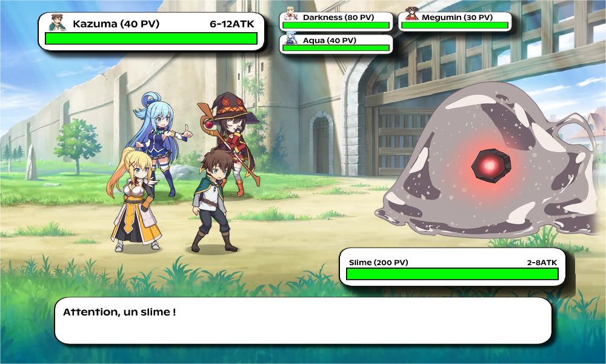
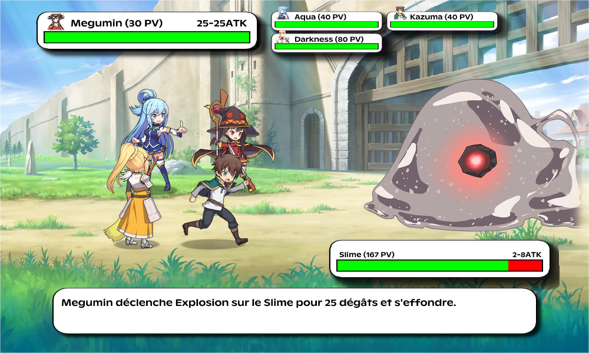
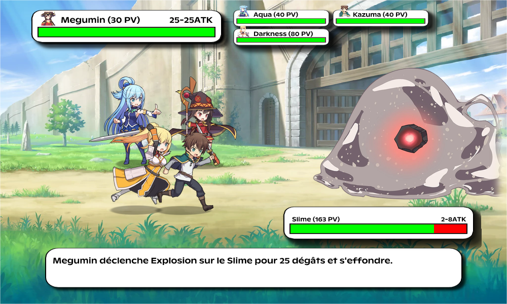
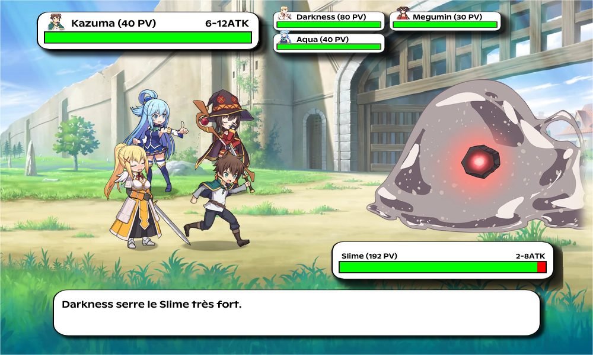
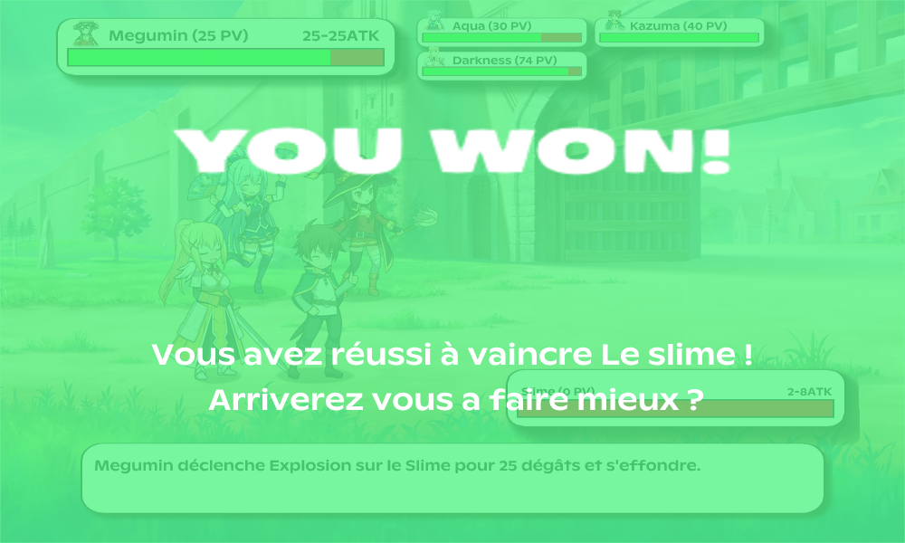
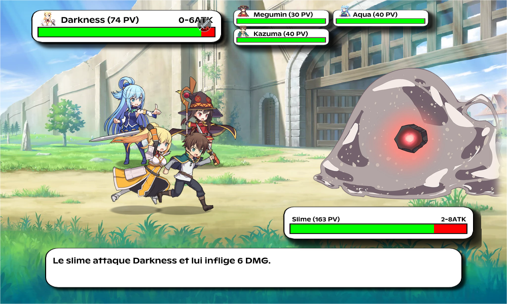
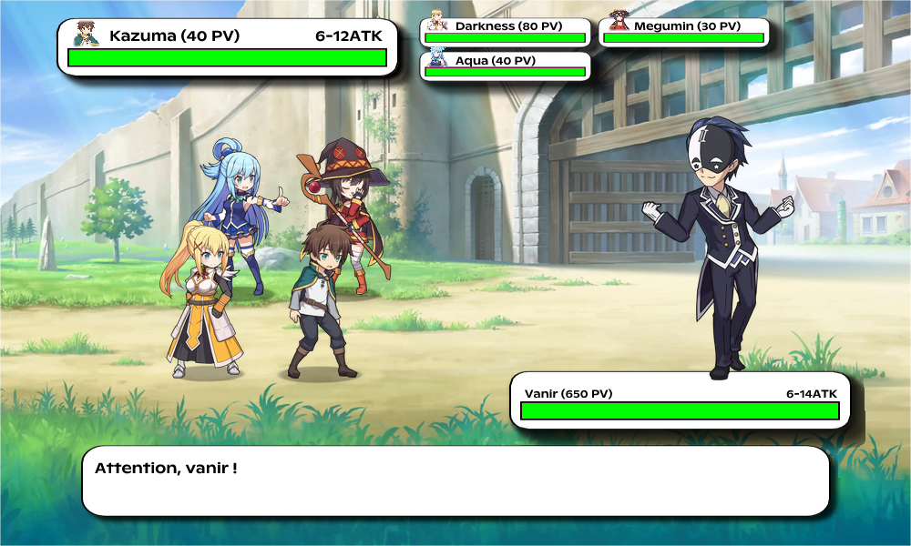
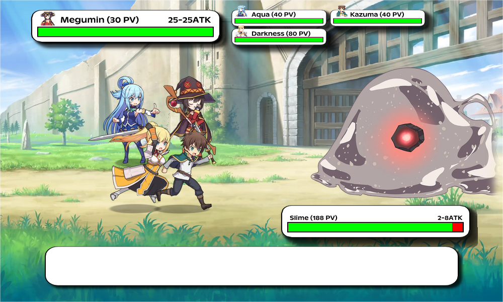

# Ich habe ein Wochenende damit verbracht, konosuba-rpg-Code zu lesen, und das habe ich gefunden

Ich pflege dieses Projekt seit einer Weile, aber seinen eigenen Code mit ausgeruhtem Kopf neu zu lesen ist immer lehrreich. konosuba-rpg ist ein rundenbasiertes Discord-RPG, bei dem jede Aktion on the fly ein WebP-Bild generiert. Ein echtes komponiertes Bild, mit Sprites, Lebensbalken, Kampfnachrichten, allem.

Der Stack: TypeScript, Hono, Vercel, Cloudflare Workers, Supabase. Vollständig gratis Hosting. Und der Discord-Bot funktioniert ohne persistenten Server. Dieser Post erklärt, wie das alles zusammenhält.


---

## Das Basisdesign: die URL als Spielzustand

Das Erste, was auffällt: Es gibt keinerlei serverseitigen Zustand fürs Gameplay. Der komplette Zustand eines Kampfs steckt in der URL.

```
/konosuba-rpg/fr/abc123/ATK/DEF/ATK/HUG?monster=Vanir&difficulty=hard
```

Jedes Segment nach dem Seed ist eine gespielte Aktion. Der Server empfängt diese URL, startet von vorn, spielt alle Aktionen der Reihe nach erneut und gibt ein Bild des Kampfs genau in diesem Moment zurück. Keine Session, kein RAM-Zustand an einen Nutzer gebunden.

Discord funktioniert über interaktive Buttons, wenn der Spieler "Angreifen" drückt, schickt Discord dem Server die `custom_id` des Buttons. Diese custom_id enthält die komprimierte Kampf-URL mit der neu hinzugefügten Aktion. Der Server berechnet alles von null neu und gibt das aktualisierte Bild zurück.

```typescript
// processUrl.ts
const VALID_MOVES_SET = new Set(["ATK", "DEF", "HUG", "HEA", "SPE", "USE"]);
// Außerhalb der Funktion vorkompiliert, nicht bei jedem Aufruf neu erstellt

export default function processUrl(url: string): [Random, string[], string, string | null, string | null] {
  const urlParts = url.split("/");
  const moves: string[] = [];
  for (const part of urlParts) {
    if (VALID_MOVES_SET.has(part.toUpperCase())) moves.push(part.toUpperCase());
  }
  // Seed = 6. Segment, gehasht auf 8096 Werte
  const seedStr = (urlParts[5] || "").toLowerCase();
  let seed = 0;
  for (let i = 0; i < seedStr.length; i++) {
    seed = (seed + seedStr.charCodeAt(i)) % 8096;
  }
  return [new Random(seed), moves, seedStr, monster, difficulty];
}
```

Das außerhalb der Funktion vorkompilierte `Set` ist ein Detail, vermeidet aber, die Struktur bei jeder Invocation in einem Edge-Kontext neu zu bauen, wo Module re-evaluiert werden können.

### Der RNG: modifiziertes RC4

Der Zufallsgenerator ist eine als PRNG zweckentfremdete RC4-Implementierung (Stream-Verschlüsselungsalgorithmus).

```typescript
export class Random {
  private S: number[]; // Tabelle mit 256 Einträgen
  private i: number;
  private j: number;

  constructor(seed?: number) {
    this.S = Array.from({ length: 256 }, (_, i) => i);
    let j = 0;
    let workingSeed = seed || Date.now();
    for (let i = 0; i < 256; i++) {
      j = (j + this.S[i] + (workingSeed & 0xff)) & 0xff;
      // S[i] und S[j] tauschen
      [this.S[i], this.S[j]] = [this.S[j], this.S[i]];
      workingSeed >>>= 8;
    }
  }

  next(): number { /* ... */ }
  randint(min: number, max: number): number { /* ... */ }
  choice(array: T[]): T { /* ... */ }
}
```

Warum RC4? Weil es ein deterministischer PRNG mit korrekter Verteilung und vernünftiger Seed-Kollisionsresistenz ist. Gleicher Seed = gleiche Zahlenfolge = jedes Mal derselbe Kampf. Das erlaubt, jeden Kampf über seine URL zu "replayen", und garantiert, dass zwei verschiedene Server (Vercel + Cloudflare) für dieselbe URL exakt dasselbe Ergebnis produzieren.

---

## Das Problem des 100-Zeichen-Limits von Discord

Discord setzt ein 100-Zeichen-Limit auf die `custom_id` der Buttons. Nach einigen Dutzend Aktionen sprengt eine Kampf-URL dieses Limit locker.

Zwei Mechanismen beantworten das.

### 1. RLE-Kompression der Aktionen

Die Aktionen werden mit einem einzigen Zeichen kodiert (`a`=Attack, `d`=Defend, `h`=Hug...) und per Run-Length-Encoding komprimiert:

```typescript
// movesUtils.ts
export function compressMoves(moves: string): string {
  // "aaaaaadddh" → "a6d3h"
  let result = "";
  let count = 1;
  for (let i = 1; i <= actions.length; i++) {
    if (actions[i] === actions[i - 1]) {
      count++;
    } else {
      result += actions[i - 1] + (count > 1 ? String(count) : "");
      count = 1;
    }
  }
  return head + result;
}
```

Simpel, aber wenn der Spieler Attacke x10 spammt, geht das von `aaaaaaaaaa` (10 Zeichen) auf `a10` (3 Zeichen). Die "Angreifen x4"- und "Angreifen x10"-Buttons in der UI existieren genau dafür, den Kampf beschleunigen und gleichzeitig den Payload gut komprimieren.

### 2. Session-Tokens, wenn die Kompression nicht reicht

Wenn der komprimierte Payload zu lang bleibt, wird er mit einem kurzen Token in der DB gespeichert:

```typescript
// gameSessionService.ts
const TOKEN_PREFIX = "gs.";
const TOKEN_SIZE = 10; // "gs.aBcDeFgHiJ"

export async function encodeGameplayButtons(buttons: RawButton[]): Promise {
  // Gruppiert Payloads nach battle_key, fügt batchweise in Supabase ein
  // Ersetzt die custom_id durch "gs.{token}:{userId}"
}

export async function decodeGameplayPayloadWithStatus(encodedPayload: string, userID: string) {
  if (!encodedPayload.startsWith(TOKEN_PREFIX)) {
    return { payload: encodedPayload }; // Kein Lookup wenn unnötig
  }
  // Lookup zuerst im Speicher, dann Supabase wenn fehlend
  const cached = tokenToSession.get(token) || await loadTokenRowByToken(token);
  // Prüft Ownership, TTL (7 Tage), und turn_version (verhindert Replay eines alten Zustands)
}
```

Die Sessions haben 7 Tage TTL und automatisches Pruning alle 10 Minuten. Die `turnVersion`-Prüfung verhindert, einen veralteten Zustand zu replayen, wenn der Spieler in der Partie vorangeschritten ist, ein diskreter Schutz gegen versehentliches "Zurückgehen".

Die zwei speicherresidenten Maps (`tokenToSession`, `latestTurnByBattle`) nutzen dasselbe `globalThis as unknown as GameSessionGlobals`-Pattern wie die Bildcaches, aus denselben Gründen, die wir weiter unten sehen.

---

## Die Bildrender-Pipeline



Die Route `/konosuba-rpg/:lang/*` gibt kein JSON zurück. Sie gibt ein on demand generiertes WebP-Bild zurück.

Die Pipeline ist in 3 komponierte Layer organisiert:

```
Background (board + frame)
    +
Characters layer (Spieler- + Mob-Sprites, fixe Positionen)
    +
UI overlay (HP-Balken, Nachrichten, Char-Icons via Satori → SVG → PNG)
    ↓
Photon.watermark() × 2
    ↓
WebP output
```

**Background**: Zwei fixe Bilder (das Brett und der Rahmen), aus dem Dateisystem geladen und einmal komponiert.

**Characters layer**: Die Sprites werden nach berechneten Koordinaten positioniert. Tote Spieler werden ausgeschlossen (`activeSlots = slots.filter(s => playerHp[s.i] > 0)`). Die Gegnersprites werden horizontal gespiegelt mit einem Custom-`flipX`, einer Pixel-für-Pixel-Schleife statt einer externen Abhängigkeit.

```typescript
function flipX(img: Photon.PhotonImage): Photon.PhotonImage {
  const w = img.get_width(), h = img.get_height();
  const raw = img.get_raw_pixels();
  const flipped = new Uint8Array(raw.length);
  for (let y = 0; y < h; y++) {
    for (let x = 0; x < w; x++) {
      const src = (y * w + x) * 4;
      const dst = (y * w + (w - 1 - x)) * 4;
      flipped[dst] = raw[src]; flipped[dst+1] = raw[src+1];
      flipped[dst+2] = raw[src+2]; flipped[dst+3] = raw[src+3];
    }
  }
  return new Photon.PhotonImage(flipped, w, h);
}
```

**UI overlay**: Das ist der schwere Teil. Das Interface-JSX (Lebensbalken, Texte, Icons) wird React-artig mit Satori beschrieben, in SVG gerendert, von `@cf-wasm/resvg` in PNG konvertiert und dann in Photon für die finale Komposition importiert. Satori + resvg sind zwei speziell für Cloudflare Workers kompilierte WASM-Module mit dem `edge-light`-Flag.







---

## Das Cache-System, der am meisten ausgearbeitete Teil

Es gibt 5 unterschiedliche Cache-Level. Jeder zielt auf eine andere Granularität der Pipeline.

```typescript
// renderImage.ts, alle auf globalThis
G.__imageCache  ??= {} as Record; // Roassets
G.__base64Cache ??= {} as Record;       // Base64 der Assets (für Satori)
G.__fontCache   ??= {} as Record; // Fonts
G.__photonCache    ??= new LRUCache(40, freePhoton);
G.__layerCache     ??= new LRUCache(12, freePhoton);
G.__uiPhotonCache  ??= new LRUCache(30, freePhoton);
G.__renderOutputCache ??= new LRUCache(120);
```

Das `??=`-Pattern auf `globalThis`: JavaScript-Module in Edge-Workern können zwischen Requests auf manchen Konfigurationen re-evaluiert werden. Caches auf `globalThis` mit `??=` zu speichern garantiert, dass sie diese Re-Evaluierungen überleben, ohne neu erstellt zu werden.

### Die WASM-Eviction

Die Photon-Bildcaches (`photonCache`, `layerCache`, `uiPhotonCache`) nutzen einen Eviction-Callback:

```typescript
function freePhoton(_key: string, img: Photon.PhotonImage): void {
  try { img.free(); } catch { /* schon freigegeben */ }
}

new LRUCache(40, freePhoton)
```

`Photon.PhotonImage` ist ein WASM-Objekt mit allokiertem Speicher auf linearer WASM-Seite, außerhalb des JavaScript-GC. Dieser Speicher bleibt allokiert, bis `.free()` explizit aufgerufen wird. Die LRU-Eviction triggert `.free()` automatisch, das ist nach JavaScript portiertes RAII.

### Die Cache-Schlüssel sind absichtlich lossy

```typescript
function buildCharactersKey(playerImages: string[][], playerHp: number[], creatureImages: string[], creatureHp: number): string {
  const players = playerImages.map((imgs, i) => `${imgs[0]}:${playerHp[i] > 0 ? 1 : 0}`).join("|");
  return `chars::${players}::${creatureImages[0]}:${creatureHp > 0 ? 1 : 0}`;
}
```

Der Characters-Layer-Schlüssel kodiert nicht den exakten HP-Wert, nur `1` (lebend) oder `0` (tot). Weil das Sprite eines Spielers bei 40 HP und eines bei 15 HP identisch ist. Ein Cache-Hit überlebt also jeden Schaden, solange niemand fällt.

Der UI-Schlüssel dagegen kodiert die exakten HP (der Lebensbalken ändert sich bei jedem Treffer) und einen Hash der Nachrichten:

```typescript
function hashString(value: string): string {
  let hash = 0;
  for (let i = 0; i < value.length; i++) {
    hash = (Math.imul(31, hash) + value.charCodeAt(i)) | 0; // signierte 32-bit Ganzzahl
  }
  return hash.toString(16);
}
```

`Math.imul` erzwingt die Multiplikation in 32-bit Ganzzahlen, was Float64-Konvertierungen vermeidet und einen stabilen Polynomial-Hash gibt. Das vermeidet, dafür eine externe Abhängigkeit hinzuzufügen.

### Die Base64-Konvertierung ohne Stack Overflow

```typescript
function getBase64Cached(key: string, buf: ArrayBuffer): string {
  if (base64Cache[key]) return base64Cache[key];
  const bytes = new Uint8Array(buf);
  const chunkSize = 0x8000; // 32768 Bytes
  let binary = "";
  for (let i = 0; i < bytes.length; i += chunkSize) {
    binary += String.fromCharCode(...bytes.subarray(i, Math.min(i + chunkSize, bytes.length)));
  }
  const b64 = btoa(binary);
  base64Cache[key] = b64;
  return b64;
}
```

`String.fromCharCode(...largeArray)` kann bei großen Bildern einen Stack Overflow provozieren, weil die Argumente über den Call Stack übergeben werden. Das Chunking per 32Ko vermeidet das. Das Ergebnis wird gecacht, die Base64-Konvertierung desselben Bilds passiert nur einmal pro Worker-Instanz.

---

## STRIPPER.md, Audit sequenzieller Awaits

Es gibt eine `STRIPPER.md`-Datei im Repo, die ein Parallelisierungsaudit der `await` dokumentiert. Einige Beispiele dessen, was dort festgehalten ist:

- Das Laden des Spielerprofils machte 3 Supabase-Queries in Serie (Progression, Run-Zusammenfassung, Achievements). Sie wurden auf `Promise.all` umgestellt, keine Abhängigkeit dazwischen.
- Die Verteilung der Kampfend-Belohnungen (Accessoires + Consumables) war sequenziell. Ebenso parallelisiert.
- Die Erstellung der Session-Tokens für die Buttons passierte Gruppe für Gruppe. Unabhängige Gruppen werden jetzt parallel erstellt.

```typescript
// progressionService.ts, vorher (sequenziell)
await grantAccessoryDropRewards(...);
await grantConsumableDropRewards(...);

// nachher
await Promise.all([
  grantAccessoryDropRewards(...),
  grantConsumableDropRewards(...),
]);
```

Nichts Revolutionäres, aber in einem Serverless-Kontext, wo jede Millisekunde Antwortzeit fakturiert wird (oder zum Cold Start beiträgt), zählt das.

---

## Der Discord-Bot ohne persistenten Server



Oft missverstandener Punkt: Ein Discord-Bot braucht nicht unbedingt eine persistente WebSocket-Verbindung. Discord bietet eine Alternative: Die **Interactions Endpoint URL**. Du gibst Discord eine HTTPS-URL, und Discord schickt dir einen POST für jede Interaktion (Slash Command, Button, Autocomplete).

```typescript
// interactions.ts
export async function handleInteractions(c: Context) {
  const body = await c.req.text();
  const isVerified = await verifySignature(c, body); // Ed25519
  if (!isVerified) return c.text("Invalid signature", 401);

  const interaction: Interaction = JSON.parse(body);
  if (interaction.type === 1) return c.json({ type: 1 }); // Discord-Ping
  if (interaction.type === 2) return handleSlashCommand(...);
  if (interaction.type === 3) return handleButtonInteraction(...);
  if (interaction.type === 4) return handleAutocomplete(...);
}
```

Discord schickt einen POST, der Handler läuft 50-200ms auf einer Vercel-Funktion oder einem Cloudflare Worker, antwortet, und fertig. Keine permanent zu pflegende Verbindung, kein anzulassender Server. Die Gesamtheit des Discord-Bots ist auf dem gratis Vercel-Tier gehostet.

Die Ed25519-Verifizierung (`verifyKey` aus `discord-interactions`) ist Pflicht, Discord schickt eine Signatur in den Headern, die du validieren musst, sonst weist es den Endpoint zurück.

### Die Spezialanimation, der einzige intentionale Await

```typescript
// handleSpecialButton.ts
await new Promise(resolve => setTimeout(resolve, 3000)); // 3 Sekunden
await fetch(`${DISCORD_API_URL}/webhooks/${interaction.application_id}/${interaction.token}/messages/@original`, {
  method: "PATCH",
  // ...
});
```

Diese freiwillige 3-Sekunden-Verzögerung ist in STRIPPER.md als intentional dokumentiert. Megumins Spezialattacke (Explosion) hat eine Animation auf Discord-Seite, die Nachricht wird zuerst mit einem Zwischenvisual aktualisiert, dann 3 Sekunden später mit dem Ergebnis modifiziert. Das ist der einzige Fall, wo eine Vercel-Funktion freiwillig länger läuft als nötig.



---

## Die Deploybarkeit auf zwei Plattformen

Dieselbe Codebase läuft auf Vercel (Node.js) und auf Cloudflare Workers (V8-Isolates) ohne Änderung:

```typescript
// worker.ts, Cloudflare-Entrypoint
export default {
  fetch(request: Request, env: WorkerBindings): Promise {
    syncBindingsToProcessEnv(env); // injiziert CF-Secrets in process.env
    return app.fetch(request, env, ctx);
  }
};

// index.ts, Vercel/Node-Entrypoint
const isVercelRuntime = process.env.VERCEL === "1";
if (!isVercelRuntime) { start(); }
```

Der Hauptunterschied: Die statischen Assets. Auf Vercel werden sie aus dem Dateisystem gelesen (`/var/task/assets/`). Auf Cloudflare Workers laufen sie über ein `ASSETS`-Binding (statische CF-Assets) mit Fallback auf einen HTTPS-Mirror (`fox3000foxy.com/konosuba-rpg/assets`). Das `getAssetBytes` in `assetLoader.ts` handhabt beide Pfade, indem es zuerst das Dateisystem versucht, dann Fetch.

Die WASM (`@cf-wasm/photon/edge-light`, `@cf-wasm/resvg`) haben separate Builds für jede Runtime. Das `edge-light`-Flag im Paketnamen bezeichnet den Cloudflare-Workers-kompatiblen Build, der `new WebAssembly.Module()` zur Runtime nicht erlaubt, das WASM muss präkompiliert sein.

---

## Die Progression: XP, Levels, Affinität



Die Metaprogression beruht auf Supabase Free Tier. Das Schema umfasst eine `players`-Tabelle (globale XP, Level, Gold), `character_progress` (XP/Level/Affinität pro Char für Darkness, Aqua, Megumin), `runs` (Kampfhistorie), `inventory_items`, `daily_quests_progress`, `achievements_unlocked`, `game_sessions`.

Das Progressionsmodell ist simpel:

```typescript
// characterService.ts
export function computeLevelFromXp(xp: number): number {
  return Math.floor(xp / 100) + 1; // 100 XP pro Level
}

export function getLevelFactor(level: number): number {
  return 1 + 0.2 * (level - 1); // +20% Stats pro Level
}

export function getAffinityFactor(affinity: number): number {
  const stars = Math.floor(affinity / 20); // 20 Punkte pro Stern, 5 Sterne max
  return 1.2 ** stars; // exponentielle Progression
}
```

Diese Faktoren werden auf die Charstats zu Beginn jedes `processGame` angewendet. Kazuma folgt dem globalen Spielerlevel, die drei anderen haben jeweils eigene XP/Level. Die Affinität (gewonnen durch Einsammeln char-gebundener Drops) multipliziert seine Stats unabhängig.



Das Dropsystem nutzt nach Schwierigkeit gewichtete Loot-Tabellen:

```typescript
const LOOT_TABLE_BY_DIFFICULTY: Record = {
  [MonsterDifficulty.Easy]: {
    baseRolls: 2, bonusRollChance: 0.1, maxBonusRolls: 2,
    rarityWeights: [
      { rarity: Rarity.Bronze, weight: 68 },
      { rarity: Rarity.Silver, weight: 25 },
      { rarity: Rarity.Gold,   weight: 6  },
      { rarity: Rarity.Epic,   weight: 1  },
    ],
  },
  // ...bis Legendary
};
```

---

## Die Tests

Drei Suiten: Unit, Perf und Leaks.

Der Leak-Test ist besonders direkt:

```typescript
// leaks.spec.ts
it('does not show strong heap growth across repeated runs', async () => {
  global.gc();
  const before = heapUsedMb();

  for (let i = 0; i < 1200; i++) {
    await processGame(new Random(), ['ATK', 'DEF', 'HUG', 'ATK', 'DEF'], 'Dragon', Lang.English);
  }

  global.gc();
  const after = heapUsedMb();
  expect(after - before).toBeLessThan(20); // max 20MB Heap-Wachstum
});
```

1200 Iterationen von `processGame`, forcierter GC davor und danach, Heap-Delta < 20MB. Wenn dieser Test passt, leakt `processGame` nicht. Der Render-Test (`renderImage.spec.ts`) prüft eher die Ausführungszeit unter einer praktischen Schwelle.

Es gibt auch ein `bench.ts`-Skript, um die komplette Pipeline zu profilen:

```
RENDER_PERF=1 npx tsx bench.ts --runs=20 --warmup=3 --monster=Dragon
```

Mit `RENDER_PERF=1` loggt der `withPerf`-Wrapper in jedem Service die Timings:

```typescript
export async function withPerf(scope: string, label: string, work: () => Promise): Promise {
  const perf = createPerfLogger(scope);
  if (!perf.enabled) return work(); // null Overhead wenn deaktiviert
  perf.mark(`${label}:start`);
  try { return await work(); }
  finally { perf.done(`${label}:done`); }
}
```

`createPerfLogger` gibt No-Ops zurück, wenn `DEV_MODE` und `RENDER_PERF` nicht auf `1` stehen. Kein Overhead in Produktion.

---

## Was der Betrieb kostet

- **Vercel Free Tier**: 100GB Bandwidth, 1M Serverless-Invocations pro Monat. Das Bildrendering zählt als eine Invocation.
- **Cloudflare Workers Free Tier**: 100K Requests/Tag, 10ms CPU-Time pro Request (das Rendering kann das auf Workers überschreiten, daher Vercel als primär).
- **Supabase Free Tier**: 500MB DB, 5GB Bandwidth. Ausreichend für Tausende Spieler.

Das gesamte Backend läuft bis zu signifikantem Volumen zu null Kosten. Der einzige Reibungspunkt ist das CPU-Limit von Cloudflare Workers, das Bildrendering ist wegen WASM CPU-intensiv, daher die Strategie Vercel als primär und Workers als Failover-CDN.

---

## Die 3 Dinge, die es wert sind, behalten zu werden

1. **Die URL als Spielzustand** ist nicht nur ein netter Trick, es ist eine von Discord auferlegte Bedingung (Buttons haben ein 100-Zeichen-Limit), die eine stateless Architektur mit RLE-Kompression + Session-Token als Fallback erzwungen hat. Die Bedingung hat das Design diktiert.

2. **Der WASM-Cache mit expliziter Eviction**: `PhotonImage` allozieren außerhalb des JavaScript-Heaps und werden ohne `.free()` nie GCt. `freePhoton` an die LRU-Eviction zu hängen ist RAII in JavaScript. Diskret im Code, aber ohne das würde der Worker in Produktion leaken.

3. **Ein serverless Discord-Bot ohne WebSocket**: Weniger bekannt als der WebSocket-Gateway-Ansatz, aber für einen Bot, der stateless verarbeitet (jede Interaktion ist unabhängig), ist der Interactions Endpoint strikt überlegen, kein Reconnect, kein Heartbeat, kein zu pflegender Prozess. Discord handhabt die Verfügbarkeit auf ihrer Infraseite.

---

*Repo: [fox3000foxy/konosuba-rpg](https://github.com/fox3000foxy/konosuba-rpg)*

*Custom Source-available-Lizenz, keine Redistribution, free to use.*
