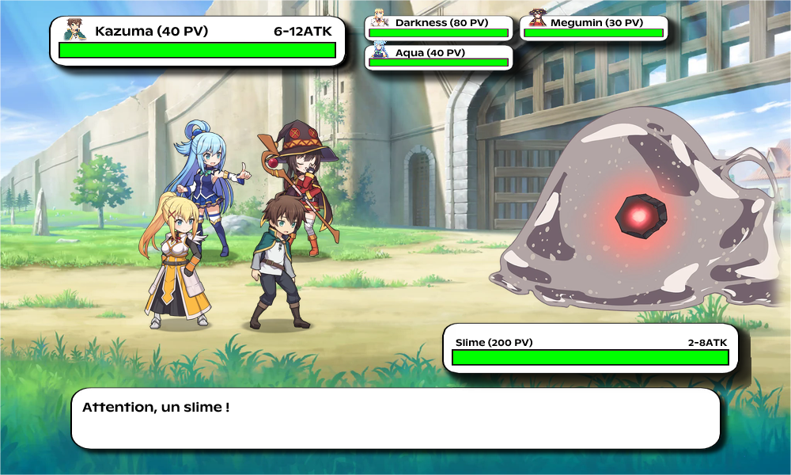
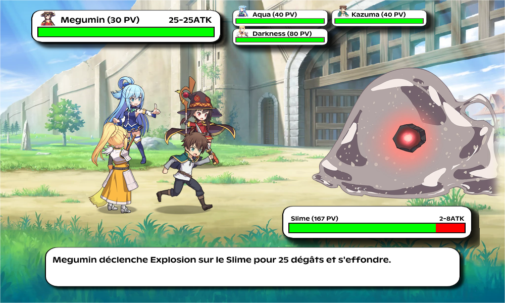
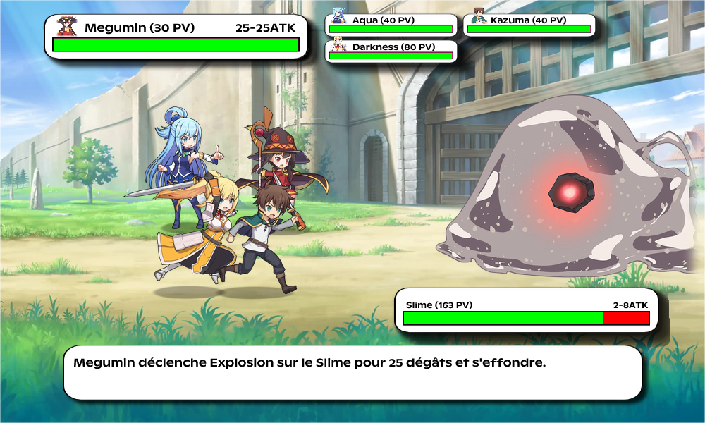
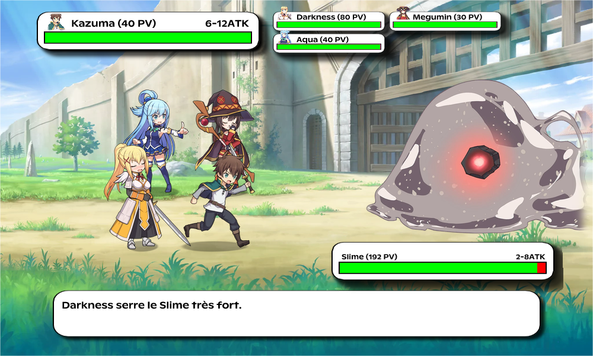
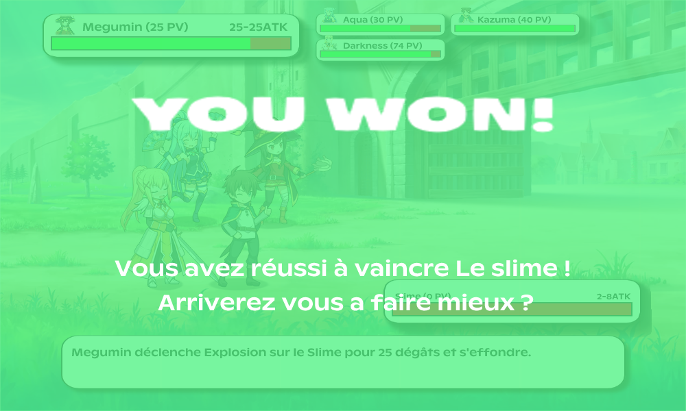
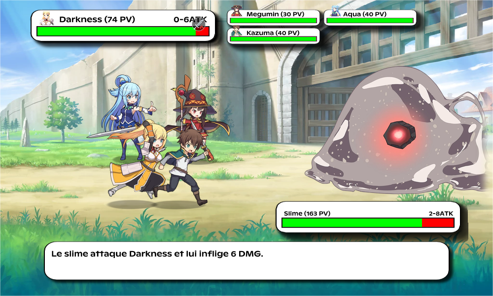
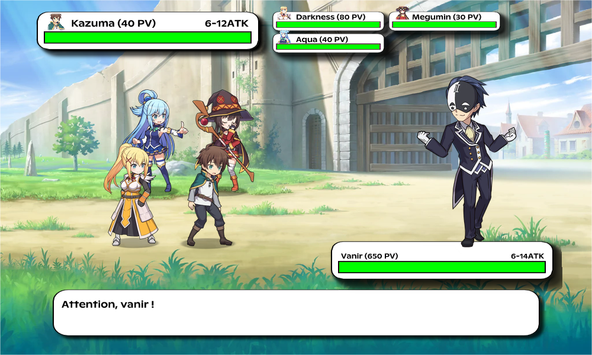
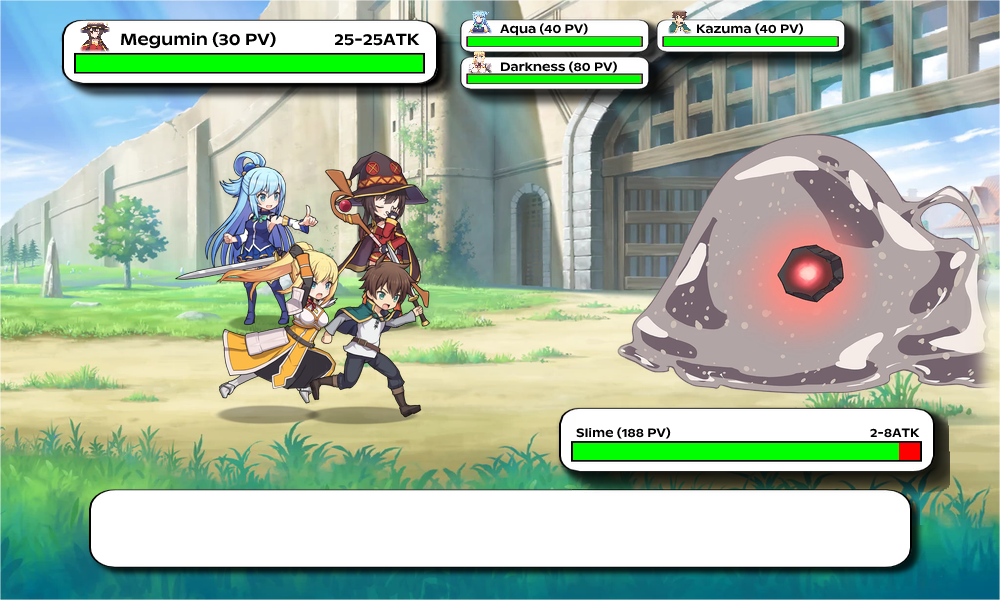

# 

Ich halte dieses Projekt schon seit einer Weile aufrecht, aber ich lese seinen eigenen ausgeruhten Kopfcode nach. konosuba-rpg ist ein RPG-Turm-Tour Discord, wo jede Aktion ein WebP-Bild im Flug erzeugt. Es ist ein wahres Bild, das mit Sprites, Lebensstäben, Kampfbotschaften – alles zusammengesetzt ist.

Stack: TypScript, Hono, Vercel, Cloudflare Workers, Supabase. Kostenlose Unterkunft. Der Discord-Bot funktioniert ohne permanenten Server. Dieser Beitrag erklärt, wie das alles zusammenhält.


---

## Das grundlegende Design: die URL als Spielstatus

Das erste, was trifft: Es gibt keinen Server-Seiten-Status für das Gameplay. Der vollständige Status eines Kampfes hält in der URL.
```
/konosuba-rpg/fr/abc123/ATK/DEF/ATK/HUG?monster=Vanir&difficulty=hard
```
Jedes Segment nach dem seed ist eine gespielte Aktion. Der Server erhält diese URL, beginnt vom Anfang, spielt alle Aktionen in der Reihenfolge und gibt ein Schlachtbild zu diesem Zeitpunkt zurück. Keine Sitzung, kein RAM-Status, der mit einem Benutzer verbunden ist.

Discord arbeitet über interaktive Schaltflächen – wenn der Spieler "Angreifen" drückt, sendet Discord das`custom_id`Dieses custom_id enthält die komprimierte URL des Kampfes mit der neuen Aktion. Der Server berechnet alles neu und gibt das aktualisierte Bild zurück.
```typescript
// processUrl.ts
const VALID_MOVES_SET = new Set(["ATK", "DEF", "HUG", "HEA", "SPE", "USE"]);
// Vorkompiliert aus Funktion – nicht für jeden Aufruf neu erstellt

export default function processUrl(url: string): [Random, string[], string, string | null, string | null] {
  const urlParts = url.split("/");
  const moves: string[] = [];
  for (const part of urlParts) {
    if (VALID_MOVES_SET.has(part.toUpperCase())) moves.push(part.toUpperCase());
  }
  // seed = 6. Segment, gehackt auf8096 Werte
  const seedStr = (urlParts[5] || "").toLowerCase();
  let seed = 0;
  for (let i = 0; i < seedStr.length; i++) {
    seed = (seed + seedStr.charCodeAt(i)) % 8096;
  }
  return [new Random(seed), moves, seedStr, monster, difficulty];
}
```
Das`Set`außerhalb der Funktion vorkompiliert ist es ein Detail, aber es verhindert, dass die Struktur bei jeder Invokation in einem edge Kontext, in dem Module neu bewertet werden können neu aufgebaut wird.

### RNG: Geänderte RC4

Der Zufallsgenerator ist eine RC4-Implementierung (Stream-Verschlüsselungsalgorithmus) in PRNG.
```typescript
export class Random {
  private S: number[]; // Tabelle256 Einträge
  private i: number;
  private j: number;

  constructor(seed?: number) {
    this.S = Array.from({ length: 256 }, (_, i) => i);
    let j = 0;
    let workingSeed = seed || Date.now();
    for (let i = 0; i < 256; i++) {
      j = (j + this.S[i] + (workingSeed & 0xff)) & 0xff;
      // Swap S [i] und S [j]
      [this.S[i], this.S[j]] = [this.S[j], this.S[i]];
      workingSeed >>>= 8;
    }
  }

  next(): number { /* ... */ }
  randint(min: number, max: number): number { /* ... */ }
  choice(array: T[]): T { /* ... */ }
}
```
Warum RC4? Weil es ein deterministischer PRNG mit einer korrekten Verteilung und einem angemessenen Widerstand gegen Seed Kollisionen ist. Auch seed = gleiche Sequenz von Zahlen = gleiche Kampf jedes Mal. Dies ermöglicht es, jeden Kampf "zu wiederholen," indem er seine URL behält, und garantiert, dass zwei verschiedene Server (Vercel + Cloudflare) genau das gleiche Ergebnis für die gleiche URL erzeugen.

---

## Das Problem der Grenze von 100 Zeichen Discord

Discord schreibt eine Grenze von 100 Zeichen auf`custom_id`Nach ein paar Dutzend Aktionen überschreitet eine Kampf-URL diese Grenze.

Zwei Mechanismen reagieren darauf.

### 1. RLE-Kompression der Aktien

Die Aktionen werden mit einem einzigen Zeichen (`a`=attack,`d`=defend,`h`=hug... und durch run-length encoding komprimiert:
```typescript
// movesUtils.ts
export function compressMoves(moves: string): string {
  // "a UTAadddh" → "a6 d3 h"
  let result = "";
  let count = 1;
  for (let i = 1; i <= actions.length; i++) {
    if (actions[i] === actions[i - 1]) {
      count++;
    } else {
      result += actions[i - 1] + (count > 1 ? String(count) : "");
      count = 1;
    }
  }
  return head + result;
}
```
Einfach, aber wenn der Spam-Spieler x10 Angriff geht es vorbei`aaaaaaaaaa`10 Panzer`a10`(3 Panzer). Die Tasten "Angreifen x4" und "Anlegen x10" in der U.S. existieren gerade dafür – den Kampf beschleunigen und den payload gut komprimieren.

### 2. Session tokens, wenn Komprimierung nicht mehr ausreicht

Wenn der komprimierte payload zu lang bleibt, wird er als Basis mit einem kurzen Token gespeichert:
```typescript
// gameSessionService.ts
const TOKEN_PREFIX = "gs.";
const TOKEN_SIZE = 10; // " gs.aBcDeFgHiJ "

export async function encodeGameplayButtons(buttons: RawButton[]): Promise {
  // Gruppe paylads per battle_key, fügt in die Supabase in Batch ein
  // Ersetzt Custom_id durch "gs.{token}:{userId}"
}

export async function decodeGameplayPayloadWithStatus(encodedPayload: string, userID: string) {
  if (!encodedPayload.startsWith(TOKEN_PREFIX)) {
    return { payload: encodedPayload }; // Kein Lookup, wenn nicht nötig
  }
  // Lookup zuerst im Speicher, dann Supabase wenn fehlt
  const cached = tokenToSession.get(token) || await loadTokenRowByToken(token);
  // Prüft ownership, TTL (7 Tage) und turn_version (nicht wieder einen alten Zustand spielen)
}
```
Die Sitzungen haben eine 7-Tage-TTL und ein automatisches Pruning alle 10 Minuten.`turnVersion`verhindert, dass ein veralteter Zustand wieder gespielt wird, wenn der Spieler in der Spielrunde vorrückt – ein diskreter Schutz vor versehentlichem "Rückwärtsgang."

Beide Maps in Erinnerung (`tokenToSession` , `latestTurnByBattle`) verwenden die gleichen Pattern`globalThis as unknown as GameSessionGlobals`Das ist die Bildablage, aus denselben Gründen, die wir unten sehen.

---

## Die Bildwiedergabe-Pipeline



Die Straße`/konosuba-rpg/:lang/*`gibt kein JSON zurück. Es gibt ein generiertes WebP-Image zurück.

Die Pipeline ist in 3 Layer-Komositäten organisiert:
```
Background (board + frame)
    +
Characters layer (sprites joueurs + mob, positions fixes)
    +
UI overlay (barres HP, messages, icônes persos via Satori → SVG → PNG)
    ↓
Photon.watermark() × 2
    ↓
WebP output
```
**Background**: zwei feste Bilder (Platte und Rahmen), die von der Dateisystem geladen und einmal komponiert werden.

**Characters layer**: Sprites werden nach errechneten Koordinaten positioniert.`activeSlots = slots.filter(s => playerHp [s.i] > 0)`). Die feindlichen Sprite werden horizontal mit einem`flipX`custom – eine Pixelschleife pro Pixel statt eine externe Abhängigkeit.
```typescript
function flipX(img: Photon.PhotonImage): Photon.PhotonImage {
  const w = img.get_width(), h = img.get_height();
  const raw = img.get_raw_pixels();
  const flipped = new Uint8Array(raw.length);
  for (let y = 0; y < h; y++) {
    for (let x = 0; x < w; x++) {
      const src = (y * w + x) * 4;
      const dst = (y * w + (w - 1 - x)) * 4;
      flipped[dst] = raw[src]; flipped[dst+1] = raw[src+1];
      flipped[dst+2] = raw[src+2]; flipped[dst+3] = raw[src+3];
    }
  }
  return new Photon.PhotonImage(flipped, w, h);
}
```
**I.E. overlay**: das ist der schwere Teil. Das JSX der Schnittstelle (Lebensbalken, Texte, Symbole) wird in React-like mit Satori beschrieben, in SVG, in PNG umgewandelt von`@cf-wasm/resvg`, dann in Photon für die endgültige Komposition importiert. Satori + resvg sind zwei WASM-Module speziell für Cloudflare Workers mit dem flag kompiliert`edge-light` .







---

## Das Cache-System - der am meisten bearbeitete Teil

Es gibt fünf verschiedene Abdeckstufen, die alle auf eine andere Granarität als die Pipeline abzielen.
```typescript
// renderImage.ts– alle auf globalThis
G.__imageCache  ??= {} as Record; // assets, roh
G.__base64Cache ??= {} as Record; // Base64 der Assets (für Satori)
G.__fontCache   ??= {} as Record; // Schriftarten
G.__photonCache    ??= new LRUCache(40, freePhoton);
G.__layerCache     ??= new LRUCache(12, freePhoton);
G.__uiPhotonCache  ??= new LRUCache(30, freePhoton);
G.__renderOutputCache ??= new LRUCache(120);
```
Die Pfoten`??=`über`globalThis`: JavaScript-Module in edge-Workers können zwischen Abfragen in einigen Konfigurationen neu bewertet werden.`globalThis`mit`??=`gewährleistet, dass sie diese Neubewertungen überleben, ohne neu erstellt zu werden.

### WASM-Evition

Photon-Bildverstecke (`photonCache` , `layerCache` , `uiPhotonCache`) verwenden einen Ausweich-Callback:
```typescript
function freePhoton(_key: string, img: Photon.PhotonImage): void {
  try { img.free(); } catch { /* déjà libéré */ }
}

new LRUCache(40, freePhoton)
```
`Photon.PhotonImage`ist ein WASM-Objekt mit einem linearen WASM -Speicher, der außerhalb des JavaScript-GC steht. Dieser Speicher bleibt so lange zugewiesen, wie`.free()`Die Ektition des LRU trigger`.free()`automatisch – es ist ein JavaScript-Träger mit RAI.

### Die Schlüssel sind absichtlich lossy
```typescript
function buildCharactersKey(playerImages: string[][], playerHp: number[], creatureImages: string[], creatureHp: number): string {
  const players = playerImages.map((imgs, i) => `${imgs[0]}:${playerHp[i] > 0 ? 1 : 0}`).join("|");
  return `chars::${players}::${creatureImages[0]}:${creatureHp > 0 ? 1 : 0}`;
}
```
Der Schlüssel zum Layer-Characters verschlüsselt nicht den genauen Wert der HP – gerade`1`(lebend) oder`0`Weil der Sprite eines 40-HP-Spielers und ein 15-HP Spieler identisch ist. Ein Cache-Hit überlebt also jeden Schaden, solange niemand fällt.

Der I.E.-Schlüssel hingegen encode die genauen HPs (die Lebensleiste ändert sich bei jedem Schlag) und ein Hash der Nachrichten:
```typescript
function hashString(value: string): string {
  let hash = 0;
  for (let i = 0; i < value.length; i++) {
    hash = (Math.imul(31, hash) + value.charCodeAt(i)) | 0; // Ganz32-bit unterzeichnet
  }
  return hash.toString(16);
}
```
`Math.imul`treibt die gesamte 32-Bit-Vervielfachung, wodurch Float64-Konvertierungen vermieden werden und ein stabiler polynomischer Hash entsteht, womit es vermieden wird, eine externe Abhängigkeit dafür hinzuzufügen.

### Die base64-Konvertierung ohne stack overflow
```typescript
function getBase64Cached(key: string, buf: ArrayBuffer): string {
  if (base64Cache[key]) return base64Cache[key];
  const bytes = new Uint8Array(buf);
  const chunkSize = 0x8000; // 32768 Byte
  let binary = "";
  for (let i = 0; i < bytes.length; i += chunkSize) {
    binary += String.fromCharCode(...bytes.subarray(i, Math.min(i + chunkSize, bytes.length)));
  }
  const b64 = btoa(binary);
  base64Cache[key] = b64;
  return b64;
}
```
`String.fromCharCode(...largeArray)`kann einen Stack-overflow auf großen Bildern verursachen, weil die Argumente auf dem call stack übergeben wurden. Der Chunking von 32Ko vermeidet dies. Das Ergebnis wird in den Cache gesetzt – die Umwandlung von base64 eines Bildes wird nur einmal pro Instanz von worker vorgenommen.

---

## STRIPPER.md – Prüfung der Sequenzarbeiten

Es gibt eine Datei`STRIPPER.md`in der repo, die eine Parallelisierungsprüfung der`await`. Einige Beispiele für das , was darin steht:

- Das Laden des Spielers Profil machte 3 Supabase Anfragen in Serie (Fortschritt, Run-Zusammenfassung, Schach) und sie wurden in`Promise.all`– keine Abhängigkeit zwischen ihnen.
- Die Verteilung der Kampfende-Belohnungen (Zubehör + Verbrauchsmaterial) war sequenziell. Gleichgültig.
- Die Erstellung von Tokens für die Tasten wurde in Gruppengruppen organisiert. Unabhängige Gruppen werden jetzt parallel erstellt.
```typescript
// progressionService.ts– vorne (sechskant)
await grantAccessoryDropRewards(...);
await grantConsumableDropRewards(...);

// nach
await Promise.all([
  grantAccessoryDropRewards(...),
  grantConsumableDropRewards(...),
]);
```
Nichts revolutionäres, aber in einem serverless Kontext, in dem jede Millisekunde der Antwortzeit berechnet wird (oder zum cold start beiträgt), zählt das.

---

## Der Discord-Bot ohne permanenten Server



Häufig missverstandener Punkt: Ein Discord-Bot benötigt nicht unbedingt eine dauerhafte WebSocket-Verbindung. Discord bietet eine Alternative: die **Interactions Endpoint URL**. Du gibst Discord eine HTTPS-URL an, und Discord schickt dir für jede Interaktion eine POST (slash command, button, selbstkomplete).
```typescript
// interactions.ts
export async function handleInteractions(c: Context) {
  const body = await c.req.text();
  const isVerified = await verifySignature(c, body); // Ed25519
  if (!isVerified) return c.text("Invalid signature", 401);

  const interaction: Interaction = JSON.parse(body);
  if (interaction.type === 1) return c.json({ type: 1 }); // Ping Discord
  if (interaction.type === 2) return handleSlashCommand(...);
  if (interaction.type === 3) return handleButtonInteraction(...);
  if (interaction.type === 4) return handleAutocomplete(...);
}
```
Discord sendet ein POST, der Handler dreht 50-200ms auf eine Vercel-Funktion oder Cloudflare Worker, reagiert, und es ist vorbei. Keine dauerhafte Verbindung zu halten, kein Server zu halten eingeschaltet. Der gesamte Discord Bot wird auf dem Freetier Vercell gehostet.

Die Ed2551 (`verifyKey`seit`discord-interactions`) ist obligatorisch – Discord sendet eine Signatur in die Headers, die du bestätigen müssen, sonst lehnt er den Endpoint ab.

### Die besondere Animation – der einzige absichtliche Versuch
```typescript
// handleSpecialButton.ts
await new Promise(resolve => setTimeout(resolve, 3000)); // 3 Sekunden
await fetch(`${DISCORD_API_URL}/webhooks/${interaction.application_id}/${interaction.token}/messages/@original`, {
  method: "PATCH",
  // 
});
```
Diese freiwillige 3-Sekunden-Zeit wird in STRIPPER.md als absichtlich dokumentiert. Megumins Spezialangriff (Explosion) hat eine Discord-Seitenanimation – die Nachricht wird zunächst mit einem Zwischenbild aktualisiert und dann 3 Sekunden später mit dem Ergebnis geändert. Dies ist der einzige Fall, wenn eine Vercel-Funktion freiwillig länger als nötig läuft.



---

## Die Verbreitung auf zwei Plattformen

Der gleiche Basiscode wird ohne Änderungen auf Vercel (Node.js) und Cloudflare Workers (V8 isolates) gedreht:
```typescript
// worker.ts– entrypoint Cloudflare
export default {
  fetch(request: Request, env: WorkerBindings): Promise {
    syncBindingsToProcessEnv(env); // Injektion von CF-Geheimnissen inprocess.env
    return app.fetch(request, env, ctx);
  }
};

// index.ts– entrypoint Vercel/Node
const isVercelRuntime = process.env.VERCEL === "1";
if (!isVercelRuntime) { start(); }
```
Der Hauptunterschied: die statischen Assets. Auf Vercel werden sie aus dem Filesystem gelesen (`/var/task/assets/`). Auf Cloudflare Workers laufen sie über ein `ASSETS`-Binding (statische CF-Assets) mit Fallback auf einen HTTPS-Mirror (`fox3000foxy.com/konosuba-rpg/assets`). `getAssetBytes` in `assetLoader.ts` unterstützt beide Pfade, indem es zuerst das Filesystem versucht und dann fetch nutzt.

WASM (`@cf-wasm/photon/edge-light` , `@cf-wasm/resvg`) haben für jedes Runtime getrennte Builds.`edge-light`Im Paketnamen bezeichnet der Cloudflare Workers-kompatible Build, der nicht erlaubt`new WebAssembly.Module()`runtime – WASM muss vorkompiliert werden.

---

## Progression: XP, Ebenen, Affinität



Die Meta-Progression basiert auf Supabase freetier.`players`(Gesamt-XP, Niveau, gold),`character_progress`(XP/Perso-Nippelung/Perser-Niiance für Darkness, Aqua, Megumin)`runs`(Geschichte der Kämpfe),`inventory_items` , `daily_quests_progress` , `achievements_unlocked` , `game_sessions` .

Das Fortschrittsmodell ist einfach:
```typescript
// characterService.ts
export function computeLevelFromXp(xp: number): number {
  return Math.floor(xp / 100) + 1; // 100 XP nach Ebenen
}

export function getLevelFactor(level: number): number {
  return 1 + 0.2 * (level - 1); // + 20% Statistiken nach Ebenen
}

export function getAffinityFactor(affinity: number): number {
  const stars = Math.floor(affinity / 20); // 20 Sternpunkte,5 Sterne max
  return 1.2 ** stars; // exponentielle Progression
}
```
Diese Faktoren werden auf die Statistiken der Perser zu Beginn jedes jeden`processGame`Kazuma folgt dem Gesamtniveau des Spielers, die anderen drei haben jeweils ihre eigene XP/Ebene. Die Affinität (erworben durch die Sammlung von Drops, die mit einem persönlichen verbunden sind) multipliziert ihre Statistiken unabhängig.



Das Drop-System verwendet problemgewichtete Tabellenloots:
```typescript
const LOOT_TABLE_BY_DIFFICULTY: Record = {
  [MonsterDifficulty.Easy]: {
    baseRolls: 2, bonusRollChance: 0.1, maxBonusRolls: 2,
    rarityWeights: [
      { rarity: Rarity.Bronze, weight: 68 },
      { rarity: Rarity.Silver, weight: 25 },
      { rarity: Rarity.Gold,   weight: 6  },
      { rarity: Rarity.Epic,   weight: 1  },
    ],
  },
  // ...bis Legendary
};
```
---

## Tests

Drei Suiten: Einheit, Perf und Leaks.

Der Leak Test ist besonders direkt:
```typescript
// leaks.spec.ts
it('does not show strong heap growth across repeated runs', async () => {
  global.gc();
  const before = heapUsedMb();

  for (let i = 0; i < 1200; i++) {
    await processGame(new Random(), ['ATK', 'DEF', 'HUG', 'ATK', 'DEF'], 'Dragon', Lang.English);
  }

  global.gc();
  const after = heapUsedMb();
  expect(after - before).toBeLessThan(20); // max. 20 MB Wachstum heap
});
```
1200 Iterationen von`processGame`, GC vor und nach gezwungen, Delta heap < 20MB. Wenn dieser Test bestanden hat,`processGame`nicht ausweichen.`renderImage.spec.ts`) die Ausführungszeit unter einem praktischen Schwellenwert überprüft.

Es gibt auch ein Skript`bench.ts`zum Profilieren der kompletten Pipeline:
```
RENDER_PERF=1 npx tsx bench.ts --runs=20 --warmup=3 --monster=Dragon
```
Mit`RENDER_PERF=1`wrapper`withPerf`in jedem Service logg die Timings:
```typescript
export async function withPerf(scope: string, label: string, work: () => Promise): Promise {
  const perf = createPerfLogger(scope);
  if (!perf.enabled) return work(); // zero overhead wenn deaktiviert
  perf.mark(`${label}:start`);
  try { return await work(); }
  finally { perf.done(`${label}:done`); }
}
```
`createPerfLogger`gibt No-ops zurück, wenn`DEV_MODE`und`RENDER_PERF`nicht`1`Kein Overhead in Produktion.

---

## Was es kostet, sich zu drehen

- **Vercel freetier**: 100GB Bandwidth, 1M serverless Anrufe pro Monat. Das Bild zurückgeben zählt als Beschwörung.
- **Cloudflare Workers freetier**: 100K Abfragen/Tag, 10ms CPU time pro Anfrage (er kann das auf Workers übertreffen, wodurch Vercel im Primärbereich).
- **Supabase freetier**: 500MB Basis, 5GB Bandwidth. Reicht für Tausende von Spielern.

Der gesamte Backend dreht sich zu Nullkosten bis zu einem signifikanten Volumen. Der einzige Reibpunkt ist die CPU-Grenze von Cloudflare Workers – das Bild zu machen ist CPU -intensiv wegen WASM, daher die Strategie von Vercel als Primär und Workers als CDN von failover.

---

## Die drei Dinge, die es wert sind, festgehalten zu werden

1. **Die URL als Spielstatus** ist nicht nur ein netter Tipp – es ist eine von Discord auferlegte Belastung (die Tasten haben eine Grenze von 100 Panzern), die eine stateless-Architektur mit Kompression RLE + token-Sitzung als Fallback gezwungen hat.
2. **WASM-Cache mit ausdrücklicher Veröffentlichung**:`PhotonImage`locken aus dem JavaScript Heap und werden nie GC'd ohne`.free()`. Verbinden`freePhoton`Das ist im Code diskret, aber sonst würde der Worker in die Produktion fliehen.
3. **Ein Discord serverless Bot ohne WebSocket**: Es ist weniger bekannt als der WebSoget gateway Ansatz, aber für einen Bot, der die stateless-Behandlung macht (jede Interaktion ist unabhängig), ist die Endpoint-Interactions streng überlegen – keine Wiederverbindung, kein Heartbeat, kein Prozess, der beibehalten werden soll. Discord verwaltet die Verfügbarkeit auf der unteren Seite.

---

*Repo:[fox3000foxy/konosuba-rpg](https://github.com/fox3000foxy/konosuba-rpg) *

*Source-available custom – keine Umverteilung, gratis to use.*
