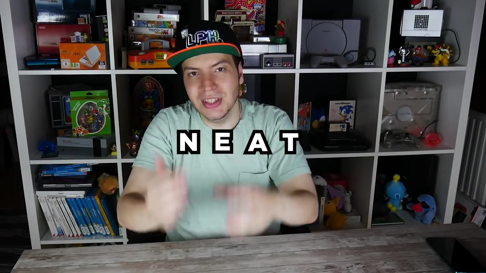
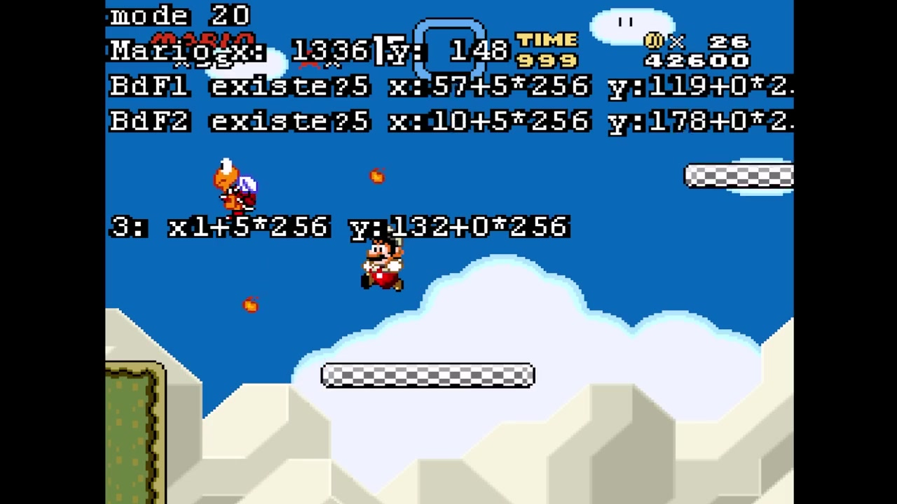
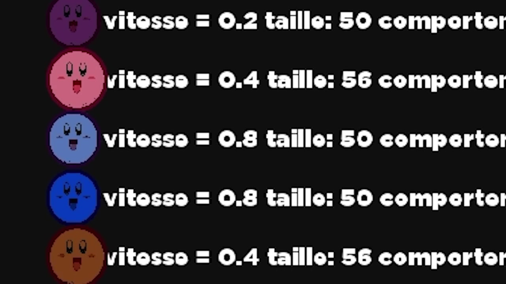
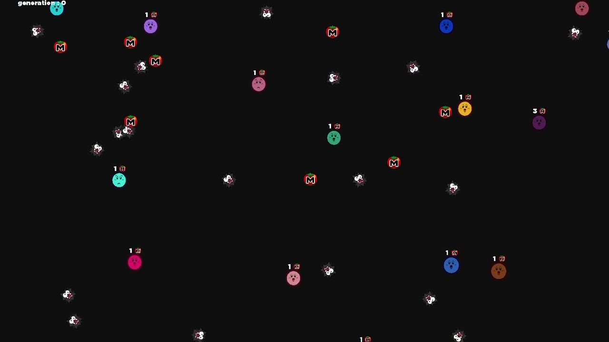
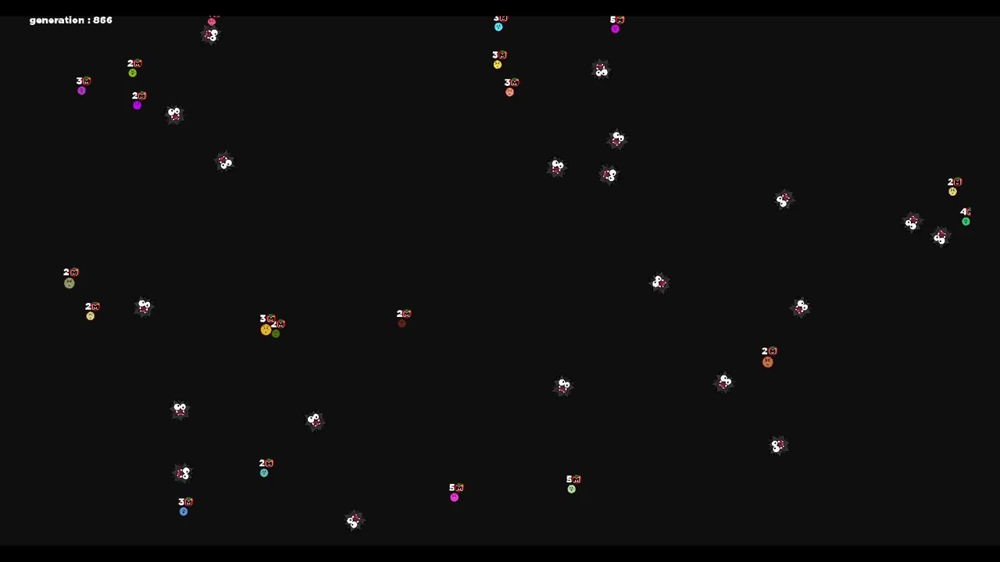
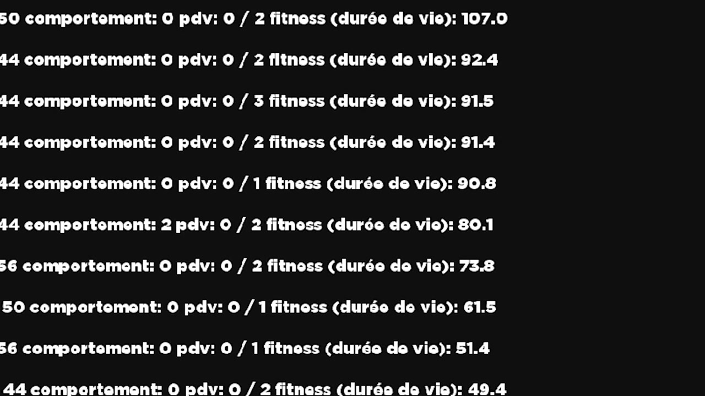
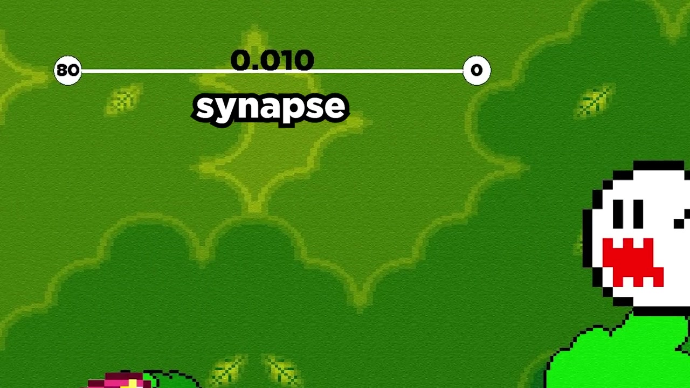
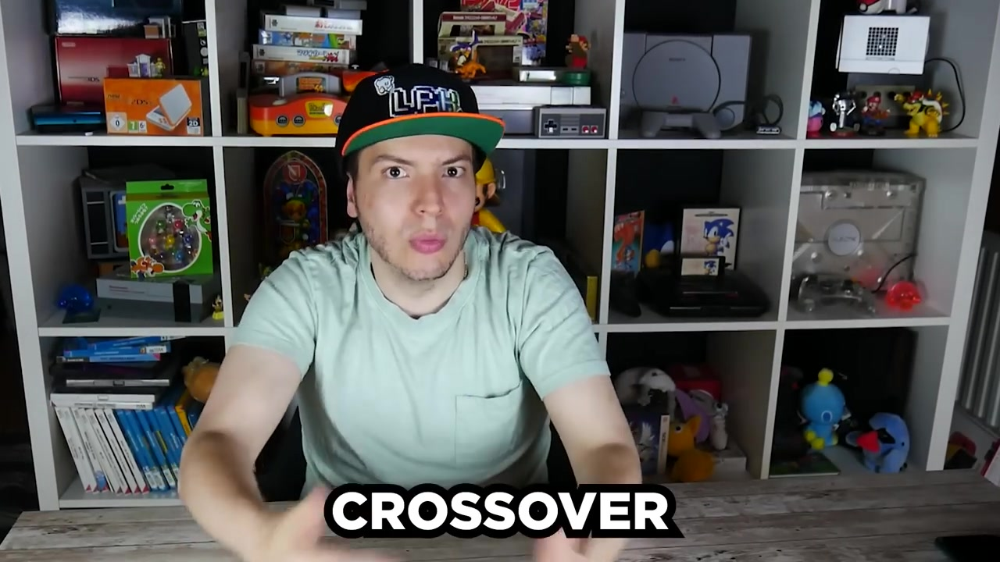
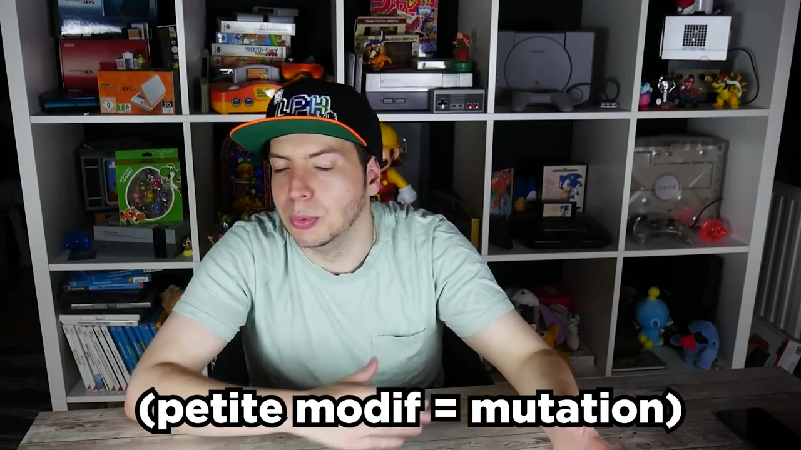
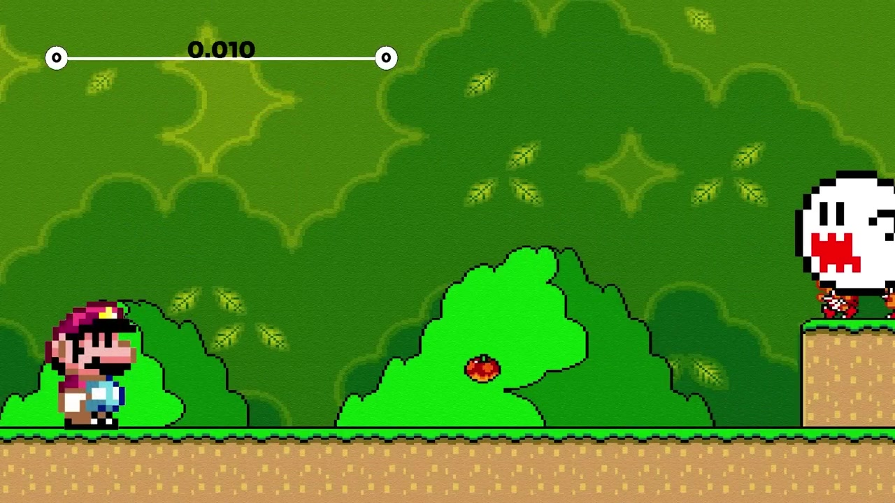

# 

Laupok hat eine künstliche Intelligenz geschaffen, die **Super Mario World** auf völlig autonome Weise spielt. du beginnt von Null: kein vordefiniertes Skript, kein aufgezeichnetes Frame. Die KI lernt allein durch zufällige Mutationen und natürliche Auswahl, die Spielebenen zu beenden. Das Projekt dreht sich um **BizHawk**, einen Multiplattform-Emulator, über ein Lua-Skript von ca. **4200 Zeilen**.

Das Faszinierende an diesem Projekt ist, dass es auf biologischen Konzepten beruht, die auf der Informatik angewendet werden: die **Theorie der Darwin-Evolution**, die **Kunst neuronalen Netze** und vor allem ein spezifischer Algorithmus, genannt **NEAT** (NeuroEvolution of Augmenting Topologies). Die KI kennt das Spiel am Anfang nicht. du testet zufällige Aktionen, scheitert Tausende Male und allmählich versteht sie, wie man vorankommt, springen und überleben kann.

In diesem Artikel werden wir das alles verschlüsseln - Konzept nach Konzept, Code-Linie nach Codezeile.



---

## Das Setup: BizHawk, Lua und Super Mario World

### Der Emulator BizHawk

BizHawk ist ein Open Source Emulator, der eine Tonne Konsolen unterstützt – NES, SNES, Genesis, PS1, Game Boy und viele andere. Seine Besonderheit ist, dass er es ermöglicht, parallel zum Spiel **Lua-Skripte** zu starten. Diese Skripts haben Zugriff auf das **Live-Speicher** (RAM) der Emulation, was bedeutet, dass sie alle Daten des Spiels in Echtzeit lesen – und bearbeiten können.

Konkret bedeutet das, dass wir:

- Liest du Mario Position in der Ebene

- Wissen, welche Sprites (Feinde, Items) auf dem Bildschirm sind

- Den Zustand jedes Tiles (Blocks) um Mario kennen

- Controller – drücke jede Schaltfläche

Genau das brauchen wir, um eine KI zu spielen.

### Die Speicheradressen von Super Mario World

In der Super Mario World RAM werden alle Daten an einer bestimmten Adresse gespeichert. Es ist ein wenig wie ein Viertel: Jede Adresse entspricht einem "Haus," das Informationen enthält.

| Anschrift | Angaben |
|---------|--------|
| `0x94` - `0x95` | Position X von Mario (16 Bit, Little-endian) |
| `0x96` - `0x97` | Position Y von Mario |
| `0x14C8` + `i` | Sprit-Status`i`(>7 = lebend) |
| `0xE4` + `i` | Untere X-Position des Sprites`i` |
| `0x14E0` + `i` | Position X hoch des Sprites`i` |
| `0xD8` + `i` | Position Y untere Sprite`i` |
| `0x14D4` + `i` | Position Y hoch des Sprite`i` |
| `0x170B` + `i` | Extended-Sprite-Typ`i` |
| `0x0100` | Spielstand (12 = fertiges Niveau) |
| `0x13D4` | Aktive Pause |
| `0x0071` | Marios Todesanimation (9 = tot) |
| `0x1C800` +... | Tabelle der Ebenen |

Die Position der Sprites verwendet zwei Bytes: ein "Byte" unten und ein "oben," weil die Position über 255 Pixel liegen kann.`bas + haut × 256` .

Für die Tiles ist es komplexer: die Grundadresse ist`0x1C800`, und man berechnet das Offset auf der Grundlage der Koordinaten`x`und`y`Weltweit mit 16 Pixeln pro Til.



---

## Grundlagen: Genetische Algorithmen und Neuronennetze

Bevor wir in den Kodex eintauchen, müssen wir zwei grundlegende Konzepte verstehen, ohne sie hat der Rest keinen Sinn.

### Genetische Algorithmen

Ein genetischer Algorithmus ist eine Simulation der **Evolutionstheorie**. Die zentrale Idee: Es entsteht eine **Population** von Individuen, die jeweils mit etwas anderen Merkmalen (den "Genen") gekennzeichnet sind. du wirst in einer Umgebung "leben" lassen. Diejenigen, die am besten auskommen, überleben und sich wiederholen.

Laupok zeigt dies mit einer Analogie von **Kirby**:

- Kirby-Population erscheint auf einem Grundstück mit Pik und Tomaten

- Die Pik-Sache entfernt Lebenspunkte, die Tomaten geben wieder

- Jedes Kirby hat Gene: Größe, Geschwindigkeit, Lebenspunkte, Verhalten (Fliehen, Suche nach Tomaten, überallhin)



- Nach 15 Sekunden schauen wir, wer am längsten überlebt hat.
- Die besten Kirbys reproduzieren sich mit anderen: Babys erben die Hälfte der Gene des besten und der Hälfte des "Spiritus"
- Babys werden zufällige **Mutationen** (ein wenig größer, etwas schneller...)
- Die alten Kirby werden durch die neuen ersetzt
- Wir heben wieder auf.

Nach 180 Generationen (~15 Stunden) steigen die Kirbys von 15 Sekunden Überleben auf **15 Minuten**. Sie sind klein geworden (reduzierte Kollisionszone), schnell und fliehen ständig vor der Gefahr.







Der entscheidende Punkt: ** wir definieren die Lösung nicht**. ** findet sie allein**. Und genau das macht sie für Probleme stark, bei denen man nicht weiß, welche Kombination von Parametern optimal wäre.

### Die Netze künstlicher Neuronen

Ein Netz von Neuronen ist ein vereinfachtes mathematisches Modell des menschlichen Gehirns. Es besteht aus:

- **Eingangsdaten** (Eingänge): Was das Netz "besteht"

- **Ausgangsdaten** (Outputs): Was das Netz "entscheidet"

- **Verbindungen** (Gewicht): Jede Verbindung hat ein **Gewicht**, das das Signal verstärkt oder vermindert

Das Prinzip ist einfach: Jedes Eingangsneuron sendet seinen Wert. Es wird mit dem Gewicht der Verbindung multipliziert und dann den anderen Signalen hinzugefügt. Wenn das Ergebnis einen bestimmten Schwellenwert (die **Aktivierungsfunktion**) überschreitet, aktiviert sich das Ausgangsneurone.

In Laupok Analogie mit Mario und der Mausspitze:

- Das Eingangs-Neurone = die Entfernung zwischen Mario und der Spitze

- Das Gewicht der Verbindung = die Empfindlichkeit von Mario

- Das Ausgangsneuron = Mario schreit oder nicht

Je näher das Ende ist, desto höher der Eingangswert. Wenn das Gewicht hoch ist, ist das Signal am Ausgang stark, und Mario würde schreien. Durch die Änderung des Gewichts wird die Empfindlichkeit von Mario verändert.



Im echten Netzwerk von KI-Neurone ist es die gleiche Logik, aber in einem massiven Maßstab:

- **99 Eingangsneuronen** (11×9 Tiles aus Mario-Ansicht)

- **8 Ausgangs-Neutronen** (A, B, X, Y, Hoch, unten, links, rechts)

- Versteckte **neurones** (hidden) zwischen den beiden

- Hunderte von Verbindungen mit unterschiedlichen Gewichten

---

## NEAT: Der Algorithmus, der alles verändert

### Das Problem der klassischen genetischen Algorithmen

Wenn man einen genetischen Algorithmus mit einem neuronalen Netzwerk naiv kombiniert, hat man ein Problem: man schafft 100 völlig unterschiedliche Neuronennetze und kann sie nicht vergleichen. Jeder hat seine eigenen Neurone, seine Verbindungen, seine eigenen Gewichte.

Hier wird **NEAT** – NeuroEvolution of Augmenting Topologies eingegriffen. Erfunden von **Kenneth Stanley** und **Risto Miikkulainen** im Jahr 2002, ist es ein Algorithmus, der dieses Problem genau löst.

### Arten

Der erste Schlüsselmechanismus von NEAT sind die ** Arten**. Wenn ein Neuronennetz zu verschieden wird, wird es in eine andere Spezies eingestuft. Die Ähnlichkeit wird durch drei Parameter berechnet:

1. **Excess** (`EXCES_COEF = 0.50`): Anzahl der Verbindungen, die nicht mit zwei Netzen in Beziehung stehen (unterschiedliche Innovationen)
2. **Teil**: ähnlich, aber für Verbindungen in der Mitte
3. **Weight difference** (`POIDSDIFF_COEF = 0.92`): die durchschnittliche Gewichtsdifferenz zwischen den Verbindungen, die dieselbe Innovation teilen

Die Ergebnisformel:
```
score = (EXCES_COEF × disjoint) / max(nbConnexions1 + nbConnexions2, 1)
      + POIDSDIFF_COEF × diffPoids
```
Wenn dieser Wert unter`DIFF_LIMITE`(1.0), beide Netzwerke sind in derselben Art, sonst erschaffen wir eine neue Spezies.

### Innovationen

Es ist das Genie von NEAT. Jedes Mal, wenn eine Verbindung entsteht, erhält sie eine einmalige und globale** Innovationsnummer. Diese Nummer folgt dem Neuronennetz, auch wenn sie sich wiederholt.

Wenn ein Baby von crossover erbt wird, erbt es Innovationen seiner Eltern. Wenn zwei Netzwerke dieselbe Innovation teilen, bedeutet das, dass sie eine Verbindung haben, die von demselben Vorfahren kommt. Das ermöglicht es, Netzwerke unterschiedlicher Größe zu vergleichen.

### Der Crossover

Wenn zwei Neuronennetze sich wiederholen, funktioniert das **crossover** wie folgt:



1. Das leistungsfähigste Netz wird zum "beherrschenden Eltern"
2. Das Baby erbt alle Verbindungen des Dominanten
3. Für jede Verbindung, die dieselbe Innovation teilt, kann der andere Elternteil sie ersetzen (50% Chance)
4. Nur aktive Verbindungen des nicht-dominanten Elternteils können ersetzen

Das sorgt dafür, dass das Baby immer so gut ist wie der beste Elternteil.

### Veränderungen

Nach dem Crossover wird das Baby mit konfigurierbaren Wahrscheinlichkeiten verändert:



| Mutation | Wahrscheinlichkeit | Wirkung |
|----------|------------|-------|
| Reset Gewicht Verbindung | 25% | Das Gewicht ist vollständig randomisiert |
| Gewichtsmutation | 95% | Das Gewicht variiert um ±0.80 |
| Verbindung hinzufügen | 85% | Neue Verbindung zwischen zwei Neuronen, die noch nicht miteinander verbunden sind |
| Neuron-Zusatz | 39% | Zwischen zwei vernetzten Neuronen wird ein verstecktes Neuron eingefügt. |

Die Anzahl der Neuronen wird erhöht, was das Netzwerk zu ** vergrößern** ermöglicht. Zunächst gibt es nur Eingänge und Ausgänge. Allmählich erscheinen versteckte Neurone, wodurch das Netzwerk immer komplexer wird.

---

## Der Code: walkthrough complete

### Konstanten

Das Skript beginnt mit einem Block von Konstanten, die die ganze Einstellung definieren:
```lua
-- Vue de Mario autour de lui
TAILLE_TILE = 16
TAILLE_VUE_W = TAILLE_TILE * 11  -- 176 pixels en largeur
TAILLE_VUE_H = TAILLE_TILE * 9   -- 144 pixels en hauteur
NB_TILE_W = TAILLE_VUE_W / TAILLE_TILE  -- 11 tiles
NB_TILE_H = TAILLE_VUE_H / TAILLE_TILE  -- 9 tiles

-- Réseau de neurones
NB_INPUT = NB_TILE_W * NB_TILE_H  -- 99 inputs (tiles visibles)
NB_OUTPUT = 8  -- A, B, X, Y, Haut, Bas, Gauche, Droite
NB_INDIVIDU_POPULATION = 100  -- individus par population
NB_NEURONE_MAX = 100000  -- limite de neurones cachés

-- Fitness
FITNESS_LEVEL_FINI = 1000000  -- valeur quand le niveau est terminé
NB_FRAME_RESET_BASE = 33  -- frames sans progrès avant reset
NB_FRAME_RESET_PROGRES = 300  -- frames si progrès détecté

-- Espèces
EXCES_COEF = 0.50
POIDSDIFF_COEF = 0.92
DIFF_LIMITE = 1.00

-- Mutations
CHANCE_MUTATION_RESET_CONNEXION = 0.25
POIDS_CONNEXION_MUTATION_AJOUT = 0.80
CHANCE_MUTATION_POIDS = 0.95
CHANCE_MUTATION_CONNEXION = 0.85
CHANCE_MUTATION_NEURONE = 0.39
```
Das`NB_INPUT`ist 99, weil die Ansicht von Mario macht 11×9 Tiles. Jeder Tile ist ein Eingangsneuron. Wenn der Tile leer ist, ist er 0. Wenn es ein Block ist, wird er 1 sein. Wenn er ein Feind ist, dann ist er -1 wert.

Die 8 Ausgänge entsprechen den Tasten des SNES Controllers: A, B, X, Y, Oben, unten, links, rechts. Start, Select, L und R werden ausgeschlossen, um seine Entscheidungen auf das Wesentliche zu beschränken.

### Datenstrukturen

Das Skript definiert drei Hauptstrukturen:
```lua
function newNeurone()
    local neurone = {}
    neurone.valeur = 0    -- valeur actuelle du neurone
    neurone.id = 0        -- identifiant unique
    neurone.type = ""     -- "input", "output", ou "hidden"
    return neurone
end

function newConnexion()
    local connexion = {}
    connexion.entree = 0     -- ID du neurone source
    connexion.sortie = 0     -- ID du neurone destination
    connexion.actif = true   -- peut être désactivé si un neurone caché est inséré
    connexion.poids = 0      -- poids de la connexion
    connexion.innovation = 0 -- numéro d'innovation unique
    connexion.allume = false -- pour l'affichage : true si le signal passe
    return connexion
end

function newReseau()
    local reseau = {
        nbNeurone = 0,        -- nombre de neurones cachés
        fitness = 1,          -- performance (distance parcourue)
        idEspeceParent = 0,   -- à quelle espèce il appartient
        lesNeurones = {},     -- tableau de neurones
        lesConnexions = {}    -- tableau de connexions
    }
    -- Initialisation avec les inputs
    for j = 1, NB_INPUT, 1 do
        ajouterNeurone(reseau, j, "input", 1)
    end
    -- Puis les outputs
    for j = NB_INPUT + 1, NB_INPUT + NB_OUTPUT, 1 do
        ajouterNeurone(reseau, j, "output", 0)
    end
    return reseau
end
```
Zuerst enthält jedes Netzwerk nur Inputs und Outputs: keine versteckten Neuronen, keine Verbindung. Der Algorithmus entscheidet, ob es nötig ist.

### Veränderungen im Detail

#### Gewichtsveränderungen
```lua
function mutationPoidsConnexions(unReseau)
    for i = 1, #unReseau.lesConnexions, 1 do
        if unReseau.lesConnexions[i].actif then
            if math.random() < CHANCE_MUTATION_RESET_CONNEXION then
                -- 25% : reset total du poids
                unReseau.lesConnexions[i].poids = genererPoids()
            else
                -- 75% : variation de ±0.80
                if math.random() >= 0.5 then
                    unReseau.lesConnexions[i].poids =
                        unReseau.lesConnexions[i].poids - POIDS_CONNEXION_MUTATION_AJOUT
                else
                    unReseau.lesConnexions[i].poids =
                        unReseau.lesConnexions[i].poids + POIDS_CONNEXION_MUTATION_AJOUT
                end
            end
        end
    end
end
```
Das Ausgangsgewicht ist immer 1 oder -1 (`genererPoids()`Die Veränderung von ±0.80 kann zwischen negativen und positiven Werten schwanken, was das Netzverhalten grundlegend verändert.

#### Verbindung hinzufügen
```lua
function mutationAjouterConnexion(unReseau)
    local liste = {}
    -- Randomisation de la liste des neurones
    for i, v in ipairs(unReseau.lesNeurones) do
        local pos = math.random(1, #liste+1)
        table.insert(liste, pos, v)
    end

    local traitement = false
    for i = 1, #liste, 1 do
        for j = 1, #liste, 1 do
            if i ~= j then
                local n1 = liste[i]
                local n2 = liste[j]
                -- Connexion valide : input→output, hidden→hidden, hidden→output
                if (n1.type == "input" and n2.type == "output") or
                   (n1.type == "hidden" and n2.type == "hidden") or
                   (n1.type == "hidden" and n2.type == "output") then
                    -- Vérifier qu'il n'y a pas déjà une connexion
                    local dejaConnexion = false
                    for k = 1, #unReseau.lesConnexions, 1 do
                        if unReseau.lesConnexions[k].entree == n1.id
                            and unReseau.lesConnexions[k].sortie == n2.id then
                            dejaConnexion = true
                            break
                        end
                    end
                    if dejaConnexion == false then
                        traitement = true
                        ajouterConnexion(unReseau, n1.id, n2.id)
                    end
                end
            end
            if traitement then break end
        end
        if traitement then break end
    end
end
```
Man kann kein Output mit einem Input verbinden (das würde einen Zyklus erzeugen), und man kann zwei bereits miteinander verbundene Neuronen nicht verbinden. Die Randomisierung garantiert, dass man jedes Mal verschiedene Möglichkeiten erkundet.

#### Hinzufügen von Neuron

Das ist die interessanteste Mutation:
```lua
function mutationAjouterNeurone(unReseau)
    if #unReseau.lesConnexions == 0 then return nil end
    if unReseau.nbNeurone == NB_NEURONE_MAX then return nil end

    -- Randomisation des connexions
    local listeRandom = {}
    for i = 1, #unReseau.lesConnexions, 1 do
        local pos = math.random(1, #listeRandom+1)
        table.insert(listeRandom, pos, i)
    end

    for i = 1, #listeRandom, 1 do
        if unReseau.lesConnexions[listeRandom[i]].actif then
            -- Désactiver la connexion existante
            unReseau.lesConnexions[listeRandom[i]].actif = false
            unReseau.nbNeurone = unReseau.nbNeurone + 1
            local indice = unReseau.nbNeurone + NB_INPUT + NB_OUTPUT

            -- Créer le neurone caché
            ajouterNeurone(unReseau, indice, "hidden", 1)

            -- Connecter l'entrée au neurone caché
            ajouterConnexion(unReseau,
                unReseau.lesConnexions[listeRandom[i]].entree,
                indice, genererPoids())

            -- Connecter le neurone caché à la sortie
            ajouterConnexion(unReseau,
                indice,
                unReseau.lesConnexions[listeRandom[i]].sortie,
                genererPoids())
            break
        end
    end
end
```
Der Mechanismus: Es wird eine bestehende Verbindung genommen, es wird **deaktiviert**, und es wird ein in der Mitte verstecktes Neuron eingefügt. Die ursprüngliche Verbindung wird durch zwei neue Verbindungen ersetzt: Eingabe→versteckt und versteckt→out. Es ist, als würde man einen Draht "schneiden," um einen Schalter zu "verbinden."

Dies macht NEAT "augmenting topologies": das **-Netzwerk wird mit der Zeit erweitert**. Es beginnt einfach und wird komplex nur, wenn es notwendig ist.

### Der FeedForward

Es ist die Funktion, die Signale durch das Netzwerk verbreitet:
```lua
function feedForward(unReseau)
    -- Reset des neurones de sortie
    for i = 1, #unReseau.lesConnexions, 1 do
        if unReseau.lesConnexions[i].actif then
            unReseau.lesNeurones[unReseau.lesConnexions[i].sortie].valeur = 0
            unReseau.lesNeurones[unReseau.lesConnexions[i].sortie].allume = false
        end
    end

    -- Propagation
    for i = 1, #unReseau.lesConnexions, 1 do
        if unReseau.lesConnexions[i].actif then
            local avantTraitement = unReseau.lesNeurones[unReseau.lesConnexions[i].sortie].valeur
            unReseau.lesNeurones[unReseau.lesConnexions[i].sortie].valeur =
                unReseau.lesNeurones[unReseau.lesConnexions[i].entree].valeur *
                unReseau.lesConnexions[i].poids +
                unReseau.lesNeurones[unReseau.lesConnexions[i].sortie].valeur

            if avantTraitement ~= unReseau.lesNeurones[unReseau.lesConnexions[i].sortie].valeur then
                unReseau.lesConnexions[i].allume = true
            else
                unReseau.lesConnexions[i].allume = false
            end
        end
    end
end
```
Jede aktive Verbindung sendet`valeur_entrée × poids`zum Ausgangsneuron. Der Wert ist **akkumuliert** (additiert).`allume`ist nur für die visuelle Anzeige des Netzwerks.

### Spielspeicher lesen

Funktion`getLesInputs()`ist die, die die Welt von Super Mario World in Daten übersetzt, die von dem Netzwerk verstanden werden:
```lua
function getLesInputs()
    local lesInputs = {}
    -- Initialisation à 0 (gris = rien)
    for i = 1, NB_TILE_W, 1 do
        for j = 1, NB_TILE_H, 1 do
            lesInputs[getIndiceLesInputs(i, j)] = 0
        end
    end

    -- Les sprites (ennemis) = -1 (noir)
    local lesSprites = getLesSprites()
    for i = 1, #lesSprites, 1 do
        local input = convertirPositionPourInput(getLesSprites()[i])
        if input.x > 0 and input.x < (TAILLE_VUE_W / TAILLE_TILE) + 1 then
            lesInputs[getIndiceLesInputs(input.x, input.y)] = -1
        end
    end

    -- Les tiles (blocs) = valeur de la tile (blanc si > 0)
    local lesTiles = getLesTiles()
    for i = 1, NB_TILE_W, 1 do
        for j = 1, NB_TILE_H, 1 do
            local indice = getIndiceLesInputs(i, j)
            if lesTiles[indice] ~= 0 then
                lesInputs[indice] = lesTiles[indice]
            end
        end
    end

    return lesInputs
end
```
Das Input-Raster ist eine Mario-zentrierte Ansicht: 11 Tile in der Breite, 9 in der Höhe. Jeder Tile ist wert:

- **0** (grau): nichts

- **1** (weiß) - fest

- **-1** (schwarz): feindlicher

Die Feinde werden aus zwei Listen in der RAM gelesen: normale Sprite (`0x14C8` - `0x14F8`) und extended sprites (`0x170B` - `0x173B`) Für jeden lebenden Sprite (Status > 7) wird die Position in Tiles gegenüber Mario berechnet und -1 in das entsprechende Feld gesetzt.

### Fitness: Wie die KI weiß, ob sie Fortschritte macht
```lua
function majReseau(unReseau, marioBase)
    local mario = getPositionMario()

    if not niveauFini and memory.readbyte(0x0100) == 12 then
        -- Niveau terminé !
        unReseau.fitness = FITNESS_LEVEL_FINI
        niveauFini = true
    elseif marioBase.x < mario.x then
        -- Mario avance vers la droite
        unReseau.fitness = unReseau.fitness + (mario.x - marioBase.x)
        marioBase.x = mario.x
    end

    -- Mise à jour des inputs
    local lesInputs = getLesInputs()
    for i = 1, NB_INPUT, 1 do
        unReseau.lesNeurones[i].valeur = lesInputs[i]
    end
end
```
Die Fitness ist einfach: es ist die **Entfernung nach rechts**. Wenn Mario 10 Pixel vorrückt, erhöht sich der Fitness um 10. Wenn Marario zurückfällt, passiert nichts (keine Strafe). Ist die Ebene abgeschlossen (Adresse)`0x0100`= = 12), wird das Fitness-Studio 1 000 000.

Es ist absichtlich einfach. Nur die Entwicklung nach rechts zählt: Feinde zu töten bringt nichts, zu sterben kostet nichts.

### Das intelligente Reset

Wenn Mario sich 33 Frames nicht bewegt, dann wird das Niveau wieder erreicht und auf das nächste Individuum übergegangen. Aber wenn Mario Fortschritte gemacht hat (ihre aktuelle Fitness unterscheidet sich von der am Anfang), warten wir 300 Frames – das gibt dem Netzwerk die Chance, zu "verstehen," was er gut gemacht hat.
```lua
if fitnessAvant == laPopulation[idPopulation].fitness
   and memory.readbyte(0x13D4) == 0 then
    nbFrameStop = nbFrameStop + 1
    local nbFrameReset = NB_FRAME_RESET_BASE
    if fitnessInit ~= laPopulation[idPopulation].fitness
       and memory.readbyte(0x0071) ~= 9 then
        nbFrameReset = NB_FRAME_RESET_PROGRES
    end
    if nbFrameStop > nbFrameReset then
        nbFrameStop = 0
        lancerNiveau()
        idPopulation = idPopulation + 1
        -- ...
    end
end
```
Die Bedingung`memory.readbyte(0x0071) ~= 9`Vergewissern du sich, dass Mario nicht in der Todesanimation ist.

### Die Hauptschleife

Die Schleife dreht sich bei 30 fps (die normale Geschwindigkeit von Super Mario World):
```lua
while true do
    local fitnessAvant = laPopulation[idPopulation].fitness

    -- Affichage (réseau, infos)
    if forms.ischecked(estAccelere) then
        emu.limitframerate(false)  -- accélérer
    else
        emu.limitframerate(true)   -- 30 fps
    end

    -- Les 3 fonctions vitales
    majReseau(laPopulation[idPopulation], marioBase)
    feedForward(laPopulation[idPopulation])
    appliquerLesBoutons(laPopulation[idPopulation])

    emu.frameadvance()
    nbFrame = nbFrame + 1

    -- Reset si pas de progrès
    -- ...
    -- Nouvelle génération si tous les individus testés
    -- ...
end
```
Die drei lebenswichtigen Funktionen sind:`majReseau` , `feedForward`und`appliquerLesBoutons`Wenn wir nur eine deaktivieren, bleibt Mario stehen.

### Der Crossover
```lua
function crossover(unReseau1, unReseau2)
    local leReseau = newReseau()
    local leBon = unReseau1
    local leNul = unReseau2

    if leBon.fitness < leNul.fitness then
        leBon = unReseau2
        leNul = unReseau1
    end

    leReseau = copier(leBon)

    for i = 1, #leReseau.lesConnexions, 1 do
        for j = 1, #leNul.lesConnexions, 1 do
            if leReseau.lesConnexions[i].innovation == leNul.lesConnexions[j].innovation
               and leNul.lesConnexions[j].actif then
                if math.random() > 0.5 then
                    leReseau.lesConnexions[i] = leNul.lesConnexions[j]
                end
            end
        end
    end
    leReseau.fitness = 1
    return leReseau
end
```
Das Baby erbt den besten Elternteil. Für jede Verbindung, die dieselbe Innovation teilt, hat der andere Elternteil 50% Chance, sie zu ersetzen – aber **nur wenn die Verbindung aktiv ist**. Dies ist ein wichtiger Patch: Ohne diese konnte man nutzlose versteckte Neuronen erstellen.

### Auswahl nach Arten
```lua
function nouvelleGeneration(laPopulation, lesEspeces)
    local laNouvellePopulation = newPopulation()
    local nbIndividuACreer = NB_INDIVIDU_POPULATION

    -- Calcul fitness moyenne par espèce
    for i = 1, #lesEspeces, 1 do
        lesEspeces[i].fitnessMoyenne = 0
        for j = 1, #lesEspeces[i].lesReseaux, 1 do
            lesEspeces[i].fitnessMoyenne =
                lesEspeces[i].fitnessMoyenne + lesEspeces[i].lesReseaux[j].fitness
        end
        lesEspeces[i].fitnessMoyenne =
            lesEspeces[i].fitnessMoyenne / #lesEspeces[i].lesReseaux
    end

    -- Chaque espèce crée un nombre d'enfants proportionnel à sa fitness moyenne
    for i = 1, #lesEspeces, 1 do
        local nbEnfant = math.ceil(
            #lesEspeces[i].lesReseaux *
            lesEspeces[i].fitnessMoyenne / fitnessMoyenneGlobal)

        for j = 1, nbEnfant, 1 do
            local unReseau = crossover(
                choisirParent(lesEspeces[i].lesReseaux),
                choisirParent(lesEspeces[i].lesReseaux))
            mutation(unReseau)
            laNouvellePopulation[indiceNouvelleEspece] = copier(unReseau)
        end
    end
end
```
Die Idee: Eine Art mit einem durchschnittlichen Fitness-Wert von 10.000 hat das Recht, viel mehr Kinder zu erschaffen als eine Art mit einer durchschnittlichen Sportart von 1. Es ist die **natürliche Wahl** in Aktion.

Das`choisirParent`verwendet eine Roulette-Auswahl: Je mehr Fitness ein Individuum hat, desto wahrscheinlicher ist es, als Elternteil ausgewählt zu werden.

### Sicherung und Laden

Die Populationen werden in Dateien gespeichert`.pop`:
```lua
function sauvegarderUnReseau(unReseau, fichier)
    io.write(unReseau.nbNeurone .. "\n")
    io.write(#unReseau.lesConnexions .. "\n")
    io.write(unReseau.fitness .. "\n")
    for i = 1, unReseau.nbNeurone, 1 do
        local indice = NB_INPUT + NB_OUTPUT + i
        io.write(unReseau.lesNeurones[indice].id .. "\n")
    end
    for i = 1, #unReseau.lesConnexions, 1 do
        local actif = 1
        if unReseau.lesConnexions[i].actif ~= true then actif = 0 end
        io.write(actif .. "\n" ..
            unReseau.lesConnexions[i].entree .. "\n" ..
            unReseau.lesConnexions[i].sortie .. "\n" ..
            unReseau.lesConnexions[i].poids .. "\n" ..
            unReseau.lesConnexions[i].innovation .. "\n")
    end
end
```
Der Schutz schließt auch das beste Individuum aller früheren Bevölkerungen ein. Wenn das Beste der alten Bevölkerung besser ist als das Beste des Neuen, wird der Alte als Basis übernommen. Es ist eine Form des **Elitismus: man verliert nie das Beste.

### Das Netz zeichnet

Laupok hat einen Netz-Visualisierungs-Neutronen-Überdruck-Überprint des Spiels hinzugefügt:
```lua
function dessinerUnReseau(unReseau)
    -- Inputs : grille 11×9 autour de Mario
    for i = 1, NB_TILE_W, 1 do
        for j = 1, NB_TILE_H, 1 do
            local xT = ENCRAGE_X_INPUT + (i - 1) * TAILLE_INPUT
            local yT = ENCRAGE_Y_INPUT + (j - 1) * TAILLE_INPUT
            local couleurFond = "gray"
            if unReseau.lesNeurones[getIndiceLesInputs(i, j)].valeur < 0 then
                couleurFond = "black"   -- ennemi
            elseif unReseau.lesNeurones[getIndiceLesInputs(i, j)].valeur > 0 then
                couleurFond = "white"   -- bloc
            end
            gui.drawRectangle(xT, yT, TAILLE_INPUT, TAILLE_INPUT, "black", couleurFond)
        end
    end

    -- Outputs : 8 boutons
    for i = 1, NB_OUTPUT, 1 do
        local xT = ENCRAGE_X_OUTPUT
        local yT = ENCRAGE_Y_OUTPUT + ESPACE_Y_OUTPUT * (i - 1)
        if sigmoid(unReseau.lesNeurones[i + NB_INPUT].valeur) then
            gui.drawRectangle(xT, yT, TAILLE_OUTPUT_W, TAILLE_OUTPUT_H, "white", "white")
        else
            gui.drawRectangle(xT, yT, TAILLE_OUTPUT_W, TAILLE_OUTPUT_H, "white", "black")
        end
    end

    -- Connexions
    for i = 1, #unReseau.lesConnexions, 1 do
        if unReseau.lesConnexions[i].actif then
            local alpha = 25
            if unReseau.lesConnexions[i].allume then alpha = 255 end
            local couleur = forms.createcolor(255, 255, 255, alpha)
            gui.drawLine(
                lesPositions[unReseau.lesConnexions[i].entree].x,
                lesPositions[lesConnexions[i].entree].y,
                lesPositions[unReseau.lesConnexions[i].sortie].x,
                lesPositions[lesConnexions[i].sortie].y,
                couleur)
        end
    end
end
```
Das ist sehr nützlich, um zu verstehen, was das Netzwerk tut. Aktive Verbindungen sind weiß, Inaktivierte sind halbtransparent. Inputs sind ein Gitter von weißen/schwarzen/grauern Feldern. Outputs zeigen, welche Tasten gedrückt sind.

---

## Ergebnisse

### Was die KI gelernt hat

Im Laufe der Hinrichtung Stunden (und Tage) entdeckte die KI selbst:

1. **Nach rechts vorrücken**: das grundlegendste Verhalten, das aber die rechte Maustaste gedrückt halten muss
2. **Über Feinde speichern**: durch Anschluss eines "Feind" Inputs an die Schaltfläche A oder B
3. **Bekämpfung von Hindernissen**: Einige Netze haben gelernt, vorübergehend zurückzufallen, um Fortschritte zu erzielen
4. **Levels beenden**: Die beste Person konnte die erste Ebene von Super Mario World beenden



### Beschränkungen

Das Projekt hat seine Grenzen:

- **Einzige Ebene**: Die KI wird auf einer bestimmten Ebene ausgebildet.
- **Trainingszeiten**: Es dauert zig Stunden, um zufriedenstellende Ergebnisse zu erzielen
- **Kein Verständnis**: Die KI versteht nicht, was sie tut. du optimiert eine Fitnessfunktion (gewanderte Entfernung) durch zufällige Mutationen
- **T-bagging**: Laupok stellt fest, dass Mario eher vor Ort springen will, wenn er einen Feind sieht, nur weil es die Fitness erhöht (er geht ein wenig springt)

---

## Wie man das Experiment wiederholt

Laupok hat alles geteilt. Hier sind die Schritte:

1. **BizHawk** herunterladen auf [tasvideos.org](https://tasvideos.org/BizHawk)(Abschnitt Download)
2. **Erhalten du eine US-ROM von Super Mario World** (Privatkopie deiner eigenen Patrone)
3. **Lua-Skript herunterladen** von [Pastebin](https://pastebin.com/Jcvdqhqm)– umbenennen in`mario.lua`
4. **Skript in denselben Ordner wie die ROM einfügen**
5. **BizHawk starten**, ROM öffnen
6. **In der Lua-Konsole**:`dofile("mario.lua")`oder über das Skript-Menü > Open Script
7. **Einen State**-Status am Anfang der Ebene speichern (Savestate-Menü > Save State) und ihn benennen`debut.state`
8. **Skript neu starten** – es funktioniert

Das Skript enthält ein Formular mit Optionen:

- **Beschleunigen**: Deaktiviert die 30 fps Grenze, um schneller zu gehen

- **Netzwerk anzeigen**: zeigt das Netzwerk von Neuronen im Überdruck

- **Info anzeigen**: Zeigt eine Stirnband mit Erzeugung, Fitness, Anzahl der Arten

- **Pause**: stoppt die Ausführung

- **Speichern/Charger**: hält die aktuelle Bevölkerung in einer Datei`.pop`

---

## Quellen und Referenzen

| Ressourcen | Zusammenhang |
|-----------|------|
| Hauptvideo von Laupok | [j'ai créé une IA qui joue à mario toute seule](https://www.youtube.com/watch?v=F63GNXGHVwM) |
| Video code review + setup | [comment setup l'ia + code source review](https://www.youtube.com/watch?v=u5xCl1bSe6o) |
| Vollständiger Quellcode | [Pastebin Jcvdqhqm](https://pastebin.com/Jcvdqhqm) |
| Originalartikel von NEAT | Stanley & Miikkulainen, "Evolving Neual Networks through Augmenting Topologies," 2002 |
| N8Programs Tutorial | [NEAT implementation walkthrough](https://n8programs.github.io/)(JavaScript, aber die Konzepte sind identisch) |
| 16blings (Inspiration von Laupok) | [AI plays Super Mario World](https://www.youtube.com/watch?v=qv6IFaOz3bA) |
| BizHawk | [tasvideos.org/BizHawk](https://tasvideos.org/BizHawk) |
| Super Mario World Speicher | [SMW Central - RAM Map](https://www.smwcentral.net/?p=section&a=details&id=21702) |

---

## Schlussfolgerung

Was Laupok tat, war, einen akademischen Algorithmus (NEAT, 2002), es in Lua für einen Emulator (BizHawk) neu zu schreiben und es auf Super Mario World anzuwenden. Das Ergebnis: eine IA, die von Null lernt, das Spiel zu spielen, ohne vorherige Kenntnisse, nur durch zufällige Mutationen und natürliche Auswahl.

Es ist ein wunderbares Beispiel für die Macht genetischer Algorithmen. Das Rezept besteht aus drei Zutaten: natürliche Auswahl, ein wenig Lua, und viel Geduld. Keine deep learning, keine GPU, keine massiven Trainingsdaten.

Der Code wird kommentiert, geteilt, und Laupok hat zwei erläuternde Videos gemacht - eins für die großen Konzepte, eins zum Code. Wenn du dich für das Thema interessierst, tauche ein.
