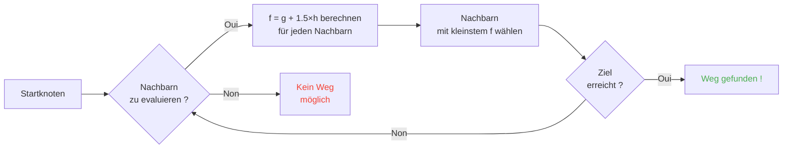

## Einleitung

Ich habe Stunden damit verbracht, Schafen zuzuschauen, wie sie gegen Mauern rennen.

Und ehrlich? Die beste Investition meines Lebens.

Denn je mehr du diese Mobs anschaust, desto mehr realisierst du, dass nichts zufällig ist. Jede Bewegung ist codiert, vorhersehbar und vor allem komplett kaputtbar. Ich bin am Ende in den Minecraft-Quellcode eingetaucht, um exakt zu kapieren, wie Pathfinding funktioniert, und was ich entdeckt habe, ist, dass du die Mobs buchstäblich mind-controlen kannst. So in der Art, sie zwingen, dahin zu gehen, wo DU willst, nicht wohin der Zufall entscheidet.

Dieser Guide ist alles, was ich beim Wühlen gelernt habe. Die KI, der A*-Algorithmus, die versteckten Mali, die Exploits, die du in Survival zünden kannst. Mach deine Spitzhacke bereit.

---

## Wie die Mob-KI funktioniert (Spoiler: sie ist dämlich)

### Die Goals

Jeder Mob hat *Goals*. Das ist eine Liste von Aktionen, die er machen KANN, und wie sehr er LUST darauf hat. Je kleiner die Zahl, desto prioritärer, wie eine Todo-Liste in Chaos-Version.

```java
protected void registerGoals() {
   this.goalSelector.addGoal(4, new Zombie.ZombieAttackTurtleEggGoal(this, 1.0, 3));
   this.goalSelector.addGoal(8, new LookAtPlayerGoal(this, Player.class, 8.0F));
   this.goalSelector.addGoal(8, new RandomLookAroundGoal(this));
   this.addBehaviourGoals();
}
```

Hast du schon mal einen Zombie gesehen, der ein Schildkrötenei ignoriert, um dich zu jagen? Darum: `ZombieAttackTurtleEggGoal` hat Priorität 4, während `ZombieAttackGoal` (das Goal, das ihm sagt, dir die Fresse zu fressen) auf Priorität 2 liegt.

Ja, ein Zombie frisst dich lieber, als ein Ei zu zerbrechen. Schön ist die Liebe.

Das Goal, das uns wirklich interessiert, ist `WaterAvoidingRandomStrollGoal`, Priorität 7. Das "ich habe nichts zu tun, also laufe ich planlos"-Goal. Dort wird alles interessant.

### Die Bewegung (oder "wie ein Random March 1 zu 60 Chance hat")

Jeden Tick (alle 0.05 Sekunden) ruft das Spiel `canUse()` auf, um zu sehen, ob der Mob sich zu bewegen geruht. 1 zu 60 Chance bei jedem Tick. Komplett dämliches Design, und ich liebe es.

```java
public boolean canUse() {
   if (this.mob.hasControllingPassenger()) {
      return false;
   } else {
      if (!this.forceTrigger) {
         if (this.checkNoActionTime && this.mob.getNoActionTime() >= 100) {
            return false;
         }
         if (this.mob.getRandom().nextInt(reducedTickDelay(this.interval)) != 0) {
            return false;
         }
      }
      Vec3 $$0 = this.getPosition();
      if ($$0 == null) {
         return false;
      } else {
         this.wantedX = $$0.x;
         this.wantedY = $$0.y;
         this.wantedZ = $$0.z;
         this.forceTrigger = false;
         return true;
      }
   }
}
```

Also zusammengefasst: Wenn du auf dem Mob reitest -> nein, wenn der Mob seit 5 Sekunden nichts getan hat -> nein, wenn der Zufall nein sagt -> nein. Das Spiel will WIRKLICH nicht, dass der Mob sich bewegt.

Aber wenn er sich bewegt, übernimmt `getPosition()`:

```java
protected Vec3 getPosition() {
   if (this.mob.isInWater()) {
      Vec3 $$0 = LandRandomPos.getPos(this.mob, 15, 7);
      return $$0 == null ? super.getPosition() : $$0;
   } else {
      return this.mob.getRandom().nextFloat() >= this.probability
         ? LandRandomPos.getPos(this.mob, 10, 7)
         : super.getPosition();
   }
}
```

Schau dir diese zwei Zahlen am Ende an: Das ist der XZ-Radius und der Y-Radius. Im Wasser sucht der Mob weiter (15 statt 10). Wenn er kein Land findet, fällt er auf `super.getPosition()` zurück, das Wasser akzeptiert. **Ergebnis: Mobs WOLLEN aus dem Wasser raus.** Deshalb schwimmen deine Tiere wie Irre zum Ufer.

Kleines knackiges Detail: Es gibt buchstäblich 0.1% Chance, dass der Mob `super.getPosition()` statt `LandRandomPos` nimmt. Eins zu tausend. Typisch Mojang.

### LandRandomPos: die kaputte Optimierung, die alles ändert

Das ist MEIN Lieblingsschritt. Die schönste technische Dummheit, die Pathfinding ausnutzbar macht.

```java
public static Vec3 getPos(PathfinderMob $$0, int $$1, int $$2, ToDoubleFunction<BlockPos> $$3) {
   boolean $$4 = GoalUtils.mobRestricted($$0, $$1);
   return RandomPos.generateRandomPos(() -> {
      BlockPos $$4xx = RandomPos.generateRandomDirection($$0.getRandom(), $$1, $$2);
      BlockPos $$5 = generateRandomPosTowardDirection($$0, $$1, $$4, $$4xx);
      return $$5 == null ? null : movePosUpOutOfSolid($$0, $$5);
   }, $$3);
}
```

`movePosUpOutOfSolid`. Der Name sagt alles. Wenn die gewählte Position in einem soliden Block liegt, schiebt das Spiel sie nach oben, bis sie in der Luft ist.

Das ist eine Optimierung: Statt Zeit zu verlieren, Positionen unter der Erde zu ignorieren, hebt das Spiel sie an die Oberfläche. Clever? Ja. Aber es erzeugt einen wahnsinnigen Bias: **Mobs bevorzugen Höhen**.

Stell dir vor. Du hast viele Blöcke unter der Oberfläche, das Spiel generiert 10 Zufallspositionen. Die in Blöcken werden nach oben geschoben. Dichte Zonen (unter einem Hügel) produzieren mehr gültige Positionen als hohle Zonen. Ergebnis: Der Mob geht statistisch öfter zum Hügel.

Vertrau mir, das brechen wir in 2 Minuten.

### Die Auswahl: der Wettbewerb um den besten Block

10 Positionen, ein einziger Gewinner, ein Score-Wettbewerb:

```java
public static Vec3 generateRandomPos(Supplier<BlockPos> $$0, ToDoubleFunction<BlockPos> $$1) {
   double $$2 = Double.NEGATIVE_INFINITY;
   BlockPos $$3 = null;
   for(int $$4 = 0; $$4 < 10; ++$$4) {
      BlockPos $$5 = (BlockPos)$$0.get();
      if ($$5 != null) {
         double $$6 = $$1.applyAsDouble($$5);
         if ($$6 > $$2) {
            $$2 = $$6;
            $$3 = $$5;
         }
      }
   }
   return $$3 != null ? Vec3.atBottomCenterOf($$3) : null;
}
```

Die Position mit dem besten Score GEWINNT. Und wenn man die Score-Kriterien kennt, kann man die gewünschte Position gewinnen lassen. Wie eine Wahl fälschen.

---

## Die Mob-Vorlieben (oder "warum deine Kuh die Straße überquert")

Jeder Mob hat andere Geschmäcker. Und das ändert alles.

| Mob | Mag das |
| --- | --- |
| **Tiere** (Kühe, Schafe, Schweine) | Gras und Licht (Hipster) |
| **Monster** (Zombies, Skelette) | Dunkel (Edgelords) |
| **Schildkröten** | Wasser, sonst Sand, sonst Licht |
| **Hoglins** | `crimson_nylium`; hassen `warped_fungus` |
| **Strider** | Nur Lava. NICHTS anderes. |
| **Silverfish** | Befallbare Blöcke (logisch) |
| **Guardians** | Wasser + Licht (die Snobs) |
| **Mooshrooms** | Myzel + Licht (Pilze) |
| **Bienen** | Luft. Ja, sie bevorzugen LUFT. |

```java
// Tier : schaut nach unten, wenn Gras, Max-Score
public float getWalkTargetValue(BlockPos $$0, LevelReader $$1) {
   return $$1.getBlockState($$0.below()).is(Blocks.GRASS_BLOCK) ? 10.0F : $$1.getPathfindingCostFromLightLevels($$0);
}

// Monster : genau umgekehrt
public float getWalkTargetValue(BlockPos $$0, LevelReader $$1) {
   return -$$1.getPathfindingCostFromLightLevels($$0);
}
```

So Monster sind buchstäblich "wenn beleuchtet, negativer Score, ich gehe woanders hin". Sie machen bei Licht DAS GESICHT.

Du kannst also buchstäblich deine Tiere mit Gras und Licht führen und deine Monster mit Dunkel. Dämlich und genial zugleich.

---

## Der A*-Algorithmus in Minecraft (die Geheimformel)

Minecraft nutzt den A*-Algorithmus (A-star) für Pathfinding. Aber Mojang hat seine Note draufgesetzt:

```
f(n) = g(n) + 1.5 × h(n)
```

- **g(n)** = der schon gelaufene Weg (1 pro Block, ~1.41 diagonal)
- **h(n)** = die Luftliniendistanz
- **1.5** = weil Mojang etwas kaputte Werte mag

Normalerweise nutzt A* `f(n) = g(n) + h(n)`. MOJANG HAT EINEN 1.5-FAKTOR HINZUGEFÜGT. Warum? Damit der Algo schneller zum Ziel geht und weniger Suchzweige schneidet. Ergebnis: Der gefundene Weg ist "gut", aber nicht immer der beste. Ein leicht besoffenes A*.



Wichtiges Detail: **Ein Mob kann nur über 16 Blöcke pathfinden** (seine *Follow Range*). Wenn das Ziel zu weit ist, wählt er den nächsten Block, den er erreichen KANN. Das heißt, du kannst einen Monolithen außerhalb der Reichweite erschaffen, und der Mob pathfindet zum nächsten Block, der ihn dem Monolithen näher bringt, was seine Bewegungen komplett vorhersehbar macht.

### Die zwei Exploits, die das Spiel brechen

#### 1. Block-Updates = erzwungene Neuberechnung

```java
public boolean shouldRecomputePath(BlockPos $$0) {
   if (this.hasDelayedRecomputation) return false;
   if (this.path != null && !this.path.isDone() && this.path.getNodeCount() != 0) {
      Node $$1 = this.path.getEndNode();
      Vec3 $$2 = new Vec3(
         ((double)$$1.x + this.mob.getX()) / 2.0,
         ((double)$$1.y + this.mob.getY()) / 2.0,
         ((double)$$1.z + this.mob.getZ()) / 2.0
      );
      return $$0.closerToCenterThan($$2, (double)(this.path.getNodeCount() - this.path.getNextNodeIndex()));
   }
   return false;
}
```

Jedes Block-Update nahe dem Mobweg erzwingt eine A*-Neuberechnung mit 1-Sekunde-Cooldown. Du stellst eine 1-Sekunde-Uhr neben einen Mob, und er berechnet seinen Weg STÄNDIG neu. Das Äquivalent eines GPS, das sich jede Sekunde resettet.

Und wenn du das mit 50 Mobs gleichzeitig machst? Lag City. RIP TPS.

#### 2. Die Block-Mali (Pathfinding Malice)

Manche Blöcke machen Mobs Angst. Buchstäblich. Jeder Block hat assoziierte Kosten, definiert von einer Enumeration:

| Block / Bedingung | Malus |
| --- | --- |
| **Honigblock** | +8 zu durchqueren |
| **Pulverschnee** | Unpassierbar |
| **Geschlossene Türen** | Unpassierbar |
| **Feuer** | +16 zu durchqueren, +8 zu umgehen |
| **Tiere und Dorfbewohner** | Feuer = -1 (NOPE) |
| **Kaktus / Süßbeere** | Unpassierbar; angrenzend = +8 |
| **Wasser** | +8 zu durchqueren oder umgehen |
| **Magma** | +8 zu umgehen (aua) |

Tiere sind noch extremer:

```java
protected Animal(EntityType<? extends Animal> $$0, Level $$1) {
   super($$0, $$1);
   this.setPathfindingMalus(PathType.DANGER_FIRE, 16.0F);
   this.setPathfindingMalus(PathType.DAMAGE_FIRE, -1.0F);
}
```

DAMAGE_FIRE auf -1.0F ist buchstäblich "verboten". Ein Tier wirft sich lieber in die Leere, als durch Feuer zu gehen. Puh.

### Übung: der große Wegewettbewerb

Stell dir einen Dorfbewohner vor, der zwischen mehreren Wegen wählen muss.

- **Weg A**: 15 Blöcke aber 6 Blöcke längs Wasser (+8 jedes)
- **Weg B**: 18 Blöcke mit 2 Wasserblöcken (+8) und 1 angrenzendem Wasserblock (+8)
- **Weg C**: 14 Blöcke geradeaus... aber mit Feuer -> UNPASSIERBAR für einen Dorfbewohner
- **Weg D**: 16 Blöcke mit 1 angrenzendem Magmablock (+8) + 1 angrenzendem Honigblock (+8)
- **Weg E**: 25 Blöcke aber überall Kakteen (+8 überall) -> 90.82 Gesamtkosten

Kopfrechnen:

- Weg A: 15 Blöcke + 6×8 für Wasser = 15 + 48 = **63** ... aber da kommt noch 1.5×Distanz dazu. Machen wir die echten Rechnungen.
- Weg B: länger aber weniger Mali. Totalkosten = kumulierte Distanz + Mali.
- Weg D: Magma und Honig stacken ihre Mali.

Der Gewinner ist oft **Weg B**: Der Umweg rentiert sich, weil Wasser TEUER ist.

Ein Dorfbewohner ist im Wesentlichen ein Kostenrechner mit Beinen.

### Jeder Mob hat seine Geschmäcker

Ein Dorfbewohner: "Feuer? NEIN DANKE TSCHÜSS"
Ein Zombie: "Feuer? OK Boomer *läuft brennend durch*"

Du hast buchstäblich Routen, die manche Mobs nehmen und andere nicht. Du kannst Dorfbewohner-Autobahnen bauen, wo Zombies verbrennen.

---

## Die Dorfbewohner: das ultimative Chaos

Ok, Dorfbewohner. Das am wenigsten verstandene System in ganz Minecraft. Aber sobald du den Code geknackt hast, realisierst du, dass es vorhersehbare Maschinen mit Bürozeiten sind.

### Sensoren und Gedächtnisse

9 Sensoren, die alle 20 Ticks laufen (1 Sekunde). Jeder scannt einen Radius um den Dorfbewohner und speichert das Ergebnis im Gedächtnis. Der Dorfbewohner sieht alles, erinnert sich an alles und handelt danach.

So in der Art: "Gibt es einen Feind? Ein Item am Boden? Einen Spieler zum Reden ?" Er checkt ALLES.

### Die Packages (seine Tagesphasen)

Das Gehirn eines Dorfbewohners sind Aktivitätspackages, die je nach Uhrzeit aktiv werden:

| Package | Uhrzeit | Der Dorfbewohner... |
| --- | --- | --- |
| **Core** | 24/7 | Öffnet Türen, schwimmt (80% der Zeit), und ERWIRBT POI |
| **Work** | 8-15h | "Ich gehe arbeiten", läuft zu seiner Station |
| **Meet** | 15-17h | "Apero !" , geht zur Glocke, plaudert |
| **Rest** | 18-6h | "Muss schlafen", geht ins Bett |
| **Idle** | 6-8h, 17-18h | "Ich gammel", spaziert, macht Babys, springt auf Betten |
| **Panic** | Verletzung/Hostil | "HILFE", FLUCHT |

Das **Panic**-Package ist das einzige, das ALLE anderen unterbrechen kann. Selbst wenn der Dorfbewohner schläft oder arbeitet, wenn ein Zombie da ist, GENERELLE PANIK.

### Acquire POI: das Ding, das drahtlose Redstone ermöglicht

```java
Set<Pair<Holder<PoiType>, BlockPos>> $$12 = (Set)$$10xx.findAllClosestFirstWithType(
   $$0, $$11, $$8x.blockPosition(), 48, PoiManager.Occupancy.HAS_SPACE
)
```

`Acquire POI` scannt in 48 Block Radius alle POI (Points of Interest). Es behält die 5 nächsten, prüft, ob ein Weg existiert, und erwirbt den ersten erreichbaren.

Jeder POI hat eine begrenzte Slotzahl:
- **Arbeitsstationen**: 1 Slot
- **Betten**: 1 Slot
- **Glocken**: 32 Slots

Der WAHNSINNSPUNKT: **Der Slot wird zum Erwerbszeitpunkt reserviert, NICHT bei Ankunft**. Ein Dorfbewohner kann einen Komposter vom anderen Kartenende verriegeln, ohne ihn je zu erreichen.

Du kapierst die Power?

### Drahtlose Redstone. Ja, DRAHTLOS.

1. Du steckst einen Dorfbewohner in ein Minecart mit einem Weg zu einem Komposter
2. Er erwirbt den Komposter (Slot belegt, niemand kann ihn mehr nutzen)
3. Der Dorfbewohner ist zu weit, um drauf zu klicken, das Bone Meal bleibt
4. Du FÄHRST diesen Dorfbewohner irgendwo in der Welt rum, er behält den Slot
5. Wenn du dein Ding aktivieren willst, T Ö T E S T du den Dorfbewohner
6. Der Slot wird frei, ein anderer Dorfbewohner erwirbt den Komposter, nimmt das Bone Meal raus
7. BLOCK UPDATE -> beliebiger Redstoneschaltkreis aktiviert

Du hast buchstäblich ein drahtloses Redstonesignal erschaffen, übertragbar in der ganzen Welt, mit null Chunk Load nötig auf dem Weg. Du kannst das an eine Ender-Pearl-Stasis-Kammer hängen, dich von überall teleportieren lassen, indem du einen Dorfbewohner killst.

Meine Lieblingsnutzung? Ein "Bounty Hunter"-Minispiel: Du stellst mehrere Dorfbewohner mit Kompostern auf, der Spieler muss DEN RICHTIGEN Dorfbewohner killen, um den Ausgang zu aktivieren. Komplett wtf als Mechanik.

### Der Pathfinding-Deadlock (oder "der Dorfbewohner, der für immer freezt")

Es gibt einen ZU guten Bug zwischen `Acquire POI` (das einen Weg sieht) und der echten Navigation (die sich weigert, ihn zu nehmen). Passiert, wenn der Block über der Arbeitsstation nicht begehbar ist. Ergebnis:

- Core-Package: "Ich will den POI erwerben"
- Navigation: "Ich kann da nicht laufen"
- Ergebnis: Der Dorfbewohner bleibt EINGEFROREN, für immer, im Kampf mit sich selbst.

Buchstäblich in Place gefrorene Dorfbewohner, nutzbar als Deko oder als "Props" in Builds. Ein Rüstungsständer-Tank? Ja. Eine Wache, die sich nicht bewegt? Ja. Makaber? Vllt. Aber effektiv.

---

## Fazit

Mob-Pathfinding in Minecraft ist kein Zufall. Es ist ein deterministisches, score-basiertes, vorhersehbares UND kaputtbares System.

**Die drei Punkte zum Mitnehmen :**

1. **Blöcke unter den Füßen = Höhenbias**: Fülle den Untergrund oder leere ihn, um Mobs zu führen
2. **Die Mali sind je Mob verschieden**: Erstelle Routen, die manche nehmen und andere nicht
3. **POI-Slots werden aus der Ferne reserviert**: Gratis drahtlose Redstone, Teleportation, das alles

Der Minecraft-Quellcode ist eine Goldmine untergenutzter Mechaniken. Ich habe Stunden damit verbracht, dekompiliertes Java zu lesen, und ehrlich? Jede Zeile ist ein funktionierendes Easter Egg. Nur dass du die in Survival nutzt, um drahtlose Redstone mit Dorfbewohnern zu machen. Bestes Spiel bestätigt.
