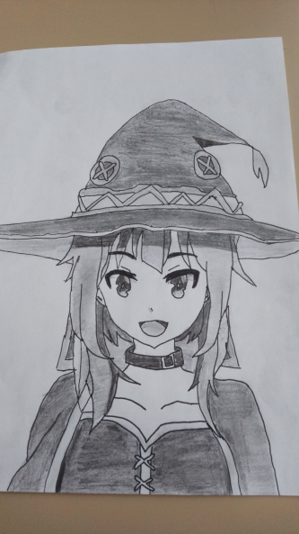
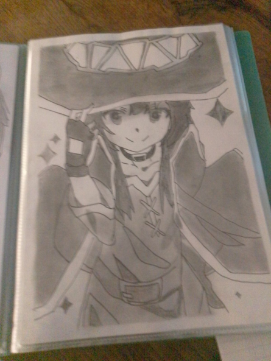

# 

Ich wollte diesen Blog schon lange schreiben, aber ich hielt mich immer zurück:/

Vielleicht, weil ich mein Leben teilen möchte, aber nicht meine persönlichen Informationen?

## Der Kodex

Meine Leidenschaften sind vielfältig: Ich liebe es, zu kodieren, wie du wahrscheinlich auf dem Rest dieses Blogs bemerkt haben. Es gibt etwas zutiefst zufriedenstellend, um Dinge von Null zu bauen, Probleme zu lösen und zu sehen, wie seine Schöpfung zum Leben wird. Ob es ein kleines Online-Befehlswerkzeug oder eine komplette Web-Anwendung ist, der Prozess wird nie demotiert.

Ich habe eine besondere Liebe zu **open source** – teilen bedeutet Liebe, und ich schätze die Idee, dass jemand anderes meinen Code nützlich finden kann. [mon GitHub](https://github.com/fox3000foxy)und du kannst sie auf der [page Projets](/projects) .

## Das Zeichnen

Aber der Code ist nicht meine einzige Leidenschaft - ich liebe es auch zu zeichnen! Hier sind einige meiner Zeichnungen:

<table style="width:100%;border-collapse:collapse;margin-top:1rem;">

  <tr>

    <td style="padding:0.5rem;"></td>

    <td style="padding:0.5rem;"></td>

    <td style="padding:0.5rem;"></td>

  </tr>

  <tr>

    <td style="padding:0.5rem;"></td>

    <td style="padding:0.5rem;"></td>

    <td style="padding:0.5rem;"></td>

  </tr>

  <tr>

    <td style="padding:0.5rem;"></td>

    <td style="padding:0.5rem;"></td>

    <td style="padding:0.5rem;"></td>

  </tr>

</table>

## Automatisieren Alles, was sich bewegt

Ich habe auch eine Leidenschaft für Automatisierung. Spielen mit GitHub Aktionen und Workflows ist eines der besten Gefühle, die ich je erlebt habe. Sobald ich einen manuellen Prozess durch ein Skript oder eine Pipeline ersetzen kann, tue ich es – ohne mich zu fragen.

Ich habe auch vor kurzem begonnen, meine Commits mit einem SSH-Schlüssel zu unterschreiben, und ich habe ein Skript für das, was du findest können,[ce gist](https://gist.github.com/fox3000foxy/95500d129cd4bf5c173c323d2492569a) .

## Die Alten Technologien entdecken

Ich liebe es, alte Technologien wie UTAU zu entdecken - ich finde das Konzept ziemlich faszinierend. Es gibt etwas Besonderes zu verstehen, wie Menschen Dinge vor der modernen Ära der KI und Cloud Computing aufgebaut haben.

## Die Vtuber

Ich liebe auch die Vtubers und möchte eines Tages eins werden, aber ich bin jetzt etwas schüchtern.

## Die Musik

Mein Haupthobby ist es, Musik zu hören, zu kodieren, nichts Besseres als einen Flow-Zustand mit der richtigen Playlist zu betreten. Ich mag es jetzt auch, zu gehen, ich weiß nicht, warum ✓.

## Suchen du Konturlösungen

Ich finde auch gerne Umgehungslösungen, um für Dinge zu bezahlen – oder zumindest über die abgehauenen Wege nachzudenken. [Nibi](https://github.com/Let-s-Learn-Japanese-Together/Nibi)war eine meiner letzten Kreationen, wo ich kostenlose Lösungen für das Management von Befehlen, Datenbankverwaltung und Dämonen gefunden habe. Es ist die Herausforderung, die zählt, viel mehr als die Einsparungen!

## Warum Dieser Blog

Ich wollte, dass dieser Blog ein Ort ist, an dem ich meine Fortschritte, Gedanken und alles teilen kann, was ich teilen möchte, so dass du weißt, wie ich denke, und über meine Leidenschaften schreiben, schien mir der perfekte Weg zu beginnen.

Danke fürs Lesen!
