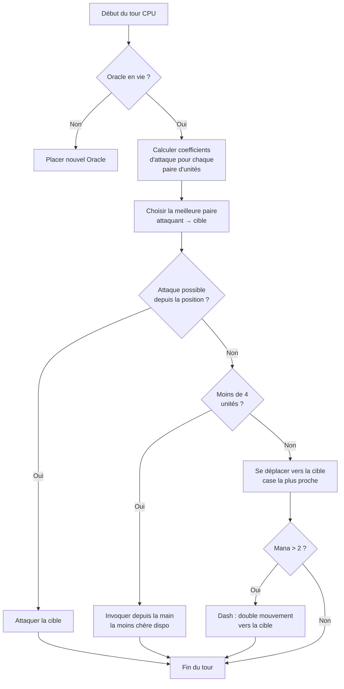

## Meine bescheuerte KI für Nausicaa

Es gibt Projekte, die mit "was, wenn ich Schach mit Mythologien machen würde ?" anfangen und mit einem System enden, das eine KI enthält, die alle 5 Züge ihre eigenen Hyper-Parameter entscheidet.

Nausicaa ist genau das. Ein rundenbasiertes Brettspiel, in dem du dein Deck mythologischer Kreaturen baust, dein Mana verwaltest, Einheiten auf einem 10x8-Brett entfaltest. Und es gibt eine KI, die Persönlichkeitskrisen hat.

Ich habe viel Zeit in diese KI gesteckt, und das Ergebnis entwischt mir manchmal noch, und das mag ich am liebsten.

## Das Spiel in echt

Bevor wir über das Gehirn reden, muss man den Körper verstehen:

- 10x8-Brett, Entfaltungszone von 2 Reihen pro Spieler
- Mana startet bei 1, +1 pro Zug, max 6. Du gibst aus, um zu beschwören, anzugreifen, Fähigkeiten zu nutzen
- Ziel: das gegnerische Orakel killen

12 Einheiten, unterschiedliche Kosten und Bewegungsmuster:

| Unit | Kosten | Bewegung | LP |
| --- | --- | --- | --- |
| Oracle | 0 | König (8 Richtungen) | 1 |
| Goblin | 1 | Vorwärts 3 Felder | 1 |
| Harpyie | 1 | König (8 Richtungen) | 1 |
| Najade | 1 | Diagonale | 1 |
| Greif | 2 | Sprung 2 Felder | 2 |
| Sirene | 2 | Lateral | 1 |
| Zentaur | 2 | Springer (in L) | 2 |
| Bogenschütze | 3 | Lateral | 1 |
| Phönix | 3 | Diagonale (dunkle Felder) | 1 |
| Metamorph | 4 | Platztausch | 1 |
| Seher | 4 | Keiner (generiert Mana) | 1 |
| Titan | 6 | Begrenzt (Zonenangriff) | 3 |

Jede Einheit hat ihr eigenes Angriffsmuster. Die Sirene schlägt in die 4 Diagonalen, der Bogenschütze auf Distanz über 3 Felder, der Titan zerstört bei der Beschwörung alles drumherum. Kurz gesagt, ein Schachspiel mit Mythologie und Deckbuilding.

## Wie ich die CPU zum Nachdenken gebracht habe

Die Grundidee ist dämlich einfach: **Jede gegnerische Einheit hat einen Attraktivitätskoeffizienten**. Je gefährlicher sie ist, desto mehr will die KI sich um sie kümmern.

```javascript
const UNITS_ATTRACTIVENESS = {
    "oracle": 100,
    "titan": 95,
    "shapeshifter": 90,
    "phoenix": 80,
    "siren": 70,
    "archer": 70,
    "seer": 70,
    "griffin": 60,
    "centaur": 60,
    "harpy": 50,
    "naiad": 30,
    "gobelin": 20
};
```

Orakel bei 100, logisch, es ist die Win Condition. Titan bei 95, weil er bei der Beschwörung alles daneben one-shottet. Goblin bei 20, das ist ein Fußsoldat, der ist uns egal.

Dann berechne ich für jedes Einheitenpaar (eine verbündete, eine gegnerische):

```
interet = attractivite × coeff_attract / (distance × coeff_dist)
```

Grob gesagt: Je gefährlicher und näher du bist, desto mehr will die KI dich zerlegen.

```javascript
calculateAttackCoefficient(x1, y1, x2, y2) {
    const distance = this.calculateEuclideanDistance(x1, y1, x2, y2);
    if (distance === 0) return Infinity;
    return (UNITS_ATTRACTIVENESS[unit.type] * COEFFICIENTS_IMPORTANCE["attractiveness"]) / distance;
}
```

### Der Trick mit den wechselnden Koeffizienten

Der wichtige Punkt ist, dass die Wichtigkeitskoeffizienten **sich alle 5 Züge zufällig ändern**.

```javascript
if (this.turnCount % 5 === 0) {
    const distanceCoefficient = parseInt(Math.random() * 100);
    const attractivenessCoefficient = parseInt(Math.random() * 100);
    this.regulateImportanceCoefficients({
        distance: distanceCoefficient,
        attractiveness: attractivenessCoefficient
    });
}
```

Einmal wird die KI hyperaggressiv (Attraktivität bei 95, Distanz bei 5), sie rennt durch alles, um dein Orakel zu killen. Das nächste Mal priorisiert sie die Distanz und positioniert sich neu.

Das ist von den Pac-Man-Geistern geklaut, Blinky jagt, Pinky lauert auf. Hier wechselt die KI alle Phasen ihre "Persönlichkeit".

**Ergebnis: Unmöglich, die KI über eine ganze Partie vorherzusagen.** Die CPU macht nie zweimal dasselbe Match.

### Das Orakel ist ein Feigling

Das gegnerische Orakel haut ab. Buchstäblich.

```javascript
const awayFromTarget = {
    row: Math.max(0, Math.min(7, botUnitElement.row + (botUnitElement.row - targetUnitElement.row))),
    col: Math.max(0, Math.min(9, botUnitElement.col + (botUnitElement.col - targetUnitElement.col)))
};
```

Es berechnet die Richtung entgegengesetzt zur Bedrohung und haut ab. Wenn da eine Mauer ist, sucht es das nächste freie Feld in dieser Richtung.

Du brauchst 3 Züge, um dich dem Orakel zu nähern, und zack ist es schon ans andere Ende abgehauen.

### Die Entscheidungsschleife

So entscheidet die KI:

1. Wenn ich kein Orakel mehr habe (tot), ein neues platzieren
2. Den Koeffizienten für jedes Paar verbündete Einheit → gegnerische Einheit berechnen
3. Das beste Paar wählen
4. Wenn die Einheit das Ziel von ihrer Position angreifen kann → Angriff
5. Wenn ich weniger als 4 Einheiten habe → die billigste verfügbare aus der Hand beschwören
6. Sonst sich zum Ziel bewegen (Bewegungsfeld am nächsten zum Gegner)
7. Wenn genug Mana (> 2), Dash (Doppelbewegung), um noch näher zu kommen
8. Wenn die Einheit das Orakel ist → abhauen



```javascript
async makeAction(dash=false) {
    // alles der Reihe nach
    // die CPU dasht, wenn sie genug Mana hat
    if(botPlayer.mana > 2) {
        this.makeAction(true);
    }
}
```

### Warum die euklidische Distanz

Ich nutze die euklidische Distanz:

```javascript
calculateEuclideanDistance(x1, y1, x2, y2) {
    const deltaX = Math.pow(x1 - x2, 2);
    const deltaY = Math.pow(y1 - y2, 2);
    return Math.sqrt(deltaX + deltaY) * COEFFICIENTS_IMPORTANCE["distance"];
}
```

Warum nicht Manhattan? Weil die Einheiten abwechslungsreiche Bewegungsmuster haben (L wie der Springer, Diagonale usw.). Die Luftliniendistanz ist eine bessere Annäherung an die Gefahr.

## Warum kein Minimax

Ich hätte einen klassischen Minimax coden können. Aber mit 12 Einheitentypen, unterschiedlichen Bewegungsmustern, Spezialfähigkeiten... explodiert der Spielbaum so schnell, dass es unspielbar wird. Der heuristische Ansatz trifft intelligente Entscheidungen, ohne 10 Millionen Zustände zu erkunden.

## Was cool ist

Das Attraktivitätssystem erzeugt witzige Dilemmas:

- Der Seher (70) generiert Mana. Wenn du ihn leben lässt, hat der Gegner mehr Ressourcen. Aber der Titan (95) ist noch gefährlicher.
- Der Metamorph (90) kann seinen Platz mit einer beliebigen Einheit tauschen. Er kann dein Orakel klauen.
- Die Harpyie (50) hat einen explosiven Angriff, der sie auch tötet. Sie bleibt nebensächlich... bis sie neben 3 deiner Einheiten steht.

Die KI bewertet die globale Gefahr nach den Positionen, nicht nur nach den rohen Stats.

Es gibt auch eine `activateSimulation()`-Funktion, um Szenarien zu testen, ohne eine Partie neu zu machen:

```javascript
activateSimulation() {
    // Spezifische Einheiten auf dem Brett platzieren
    // Nützlich, um die KI zu debuggen
    this.game.board = simulation.board;
    this.game.players = simulation.players;
}
```

## Was fehlt

Wenn ich mehr Zeit hätte:

- Die KI reagiert auf den aktuellen Zustand, sie sagt nicht vorher, was der Spieler tun wird
- Sie plant ihre Hand nicht über mehrere Züge
- Der Metamorph und der Zentaur haben Fähigkeiten, die sie unter-nutzt
- Reinforcement Learning: sie gegen sich selbst spielen lassen, um die Koeffizienten anzupassen

Aber für ein Browserspiel hält es stand. Kumpels schaffen es, dagegen zu verlieren, also ist es validiert.

## Teste

Verfügbar auf [nausicaa-game.github.io](https://nausicaa-game.github.io/). Du klickst auf "JOUER", CPU-Modus ON, und du schaust der KI zu.

Tipp: Lass die KI gegen sich selbst spielen. Du wirst aggressive Phasen sehen, dann pfft zieht sie sich zurück.

Der Code ist auf [GitHub](https://github.com/nausicaa-game/nausicaa-game.github.io) in `js/cpu.js`.

**3 Punkte zum Mitnehmen :**

1. **Heuristische Koeffizienten**, kein Minimax, jede Einheit hat eine Attraktivität
2. **Koeffizienten, die sich alle 5 Züge ändern**, die KI wechselt Aggressivität und Kontrolle, nach Art von Pac-Man
3. **Das Orakel haut ab**, es berechnet die Richtung entgegengesetzt zur Bedrohung und verzieht sich

Wenn du Ideen hast, um die KI noch fieser zu machen, öffne ein Issue. Ich habe Pläne für eine Version, die aus ihren Niederlagen lernt, aber das kommt in einen nächsten Artikel.
