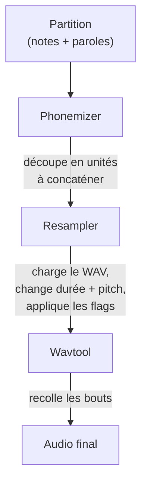

## UTAU: Wie eine Software in Visual Basic 6 synthetische Stimme demokratisiert hat

Ich hatte es auf meiner Hauptseite angerissen: Ich mag UTAU. Hier warum.

2008, wenn du eine synthetische Stimme singen lassen wolltest, hattest du eine Option: VOCALOID. Die Software von Yamaha. Teuer, proprietär, mit offiziellen Stimmen, die du nicht selbst erstellen konntest.

Und dann kam ein japanischer Typ, Ameya/Ayame, der in seiner Ecke ein Programm rausbrachte. Eine Software codiert in **Visual Basic 6**. Gratis. Die dich deine eigene Stimme erstellen ließ mit... WAV-Dateien, die du selbst aufgenommen hast.

Diese Software heißt **UTAU** (歌う, "singen" auf Japanisch). Und für ihre Zeit war das Magie.

Ich fand sie schon immer faszinierend mehr für ihre Ausgangsidee als für ihre technische Sauberkeit (das Kodierungsprinzip bleibt wirklich clever, auch wenn die Implementierung in den Augen wehtut): Sie hat die Sprachsynthese für die breite Öffentlichkeit geöffnet. Du, ich, jeder mit einem Mikro.

Lass mich dir erklären, warum das genial war.

---

## Erstens, warum Gesangssynthese mühsam ist

Eine gesungene Stimme, das sind keine Noten. Du hast den Konsonanten, der angreift, den Vokal, der hält, den Atem, die Übergänge zwischen beiden. Das "sa" von "salut" ist ein zischendes "s", das zu einem offenen "a" gleitet, und es ist dieses Gleiten, das menschlich klingt oder nicht.

Heute regelt man das mit Deep Learning: Du trainierst ein Modell auf Stunden von Gesang und es generiert die Stimme (Synthesizer V, DiffSinger). Aber das ist 2020+. 2008 gab es gar nichts.

UTAU nutzt die ältere, ältere und schlauere Methode: Die **konkatinative Synthese**.

---

## Die konkatinative Synthese: Copy-Paste von Stimmfetzen

Die Idee ist strohdumm: Du nimmst kleine Stimmfetzen auf und klebst sie zusammen, um Wörter zu formen. "salut" = Sample "sa" + "lu" + "to", aneinandergereiht. Ein Klangpuzzle, von einer Partitur gesteuert.

Das ist das Prinzip der YouTube Poops, wo man die Wörter eines Charakters zerschneidet, um ihn irgendwas sagen zu lassen, nur dass es hier sauber und automatisiert ist.

Und UTAU kommt buchstäblich von dort. Vor ihm existierte der **"Jinriki Vocaloid"** (人力ボーカロイド, "manueller Vocaloid"): Leute schnitten von Hand Gesangsspuren zurecht, extrahierten die Phoneme, pitchten neu und bauten alles in einem Audioeditor wieder zusammen, um eine VOCALOID-Stimme zu imitieren. Von Hand. Stell dir die Arbeit vor.

Ameya sah sich diese Plackerei an und codete das Tool, um sie zu automatisieren. Anfangs war UTAU nur das: Ein Assistent für manuellen Vocaloid.

---

## Warum es revolutionär war: DU erschaffst die Stimme

Das ändert alles.

Bei VOCALOID kauftest du eine Stimme. Miku, Luka usw. Von Profis erstellt, von Yamaha verkauft. Die Schöpfung blieb Yamaha vorbehalten. Mit UTAU **nimmt jeder seine Stimme auf und macht daraus ein singendes Instrument**.

Der CV-Modus (der einfachste) ist: Du nimmst die ~100 Basissilben des Japanischen auf ("a", "ka", "sa", "ta"...), konfigurierst die Schnittpunkte, und fertig ist deine Voicebank. Ein paar Stunden Arbeit.

Ergebnis: Das Ökosystem explodierte. Tausende von der Community erstellte Voicebanks, Fan-Stimmen, von Kumpels, von erfundenen Charakteren. Ein ganzes Universum virtueller Sänger, gratis. Und die Software kam mit **Defoko** (Utane Uta), einer Standardstimme generiert über die AquesTalk-TTS-Engine, also konntest du sogar ohne Mikro anfangen.

---

## Das oto.ini: das Herz des Systems

Woher weiß UTAU, wo es die Sounds schneiden und kleben muss? Über eine Config-Datei pro Voicebank: Das **`oto.ini`**. Für jedes WAV definiert es die Schnittpunkte (in Millisekunden):

- **Offset** → Stille am Anfang weg
- **Preutterance** → Der Punkt, wo der Konsonant zum Vokal wird (die "s"→"a"-Grenze in "sa")
- **Overlap** → Wie viel die vorherige Note in diese überlappt
- **Fixed region** → Der Teil, der auf einer langen Note NICHT gedehnt werden darf (typischerweise der Konsonant)
- **Cutoff** → Wo das Ende abgeschnitten wird

Die **Preutterance** ist der schlauste Param. Eine Silbe hat immer ein Stück Konsonant vor dem Vokal. Damit deine Note auf den Takt fällt, muss der *Vokal* genau fallen, nicht der Konsonant. Also verschiebt UTAU das Sample nach hinten: Das "a" von "sa" landet auf dem Takt, das "s" läuft knapp vorher über. Wie ein Schlagzeuger, der seinen Schlag antizipiert, damit der Sound genau sitzt, nur dass das hier in einer `.ini` ist.

Visuell schneiden sich auf einem "ka"-Sample die Zonen des `oto.ini` so:

```mermaid
flowchart LR
    A["🔇 silence<br/>(offset)"] --> B["🅺 consonne<br/>(fixed region,<br/>pas étirée)"]
    B --> C["🅰 voyelle<br/>(zone étirable)"]
    C --> D["🔇 fin coupée<br/>(cutoff)"]
    style B fill:#3b4a6b
    style C fill:#5b3b6b
```



Die Grenze zwischen Konsonant und Vokal, das ist die Preutterance. Der Vokal ist die Zone, die man für lange Noten dehnt; der Konsonant bleibt intakt, sonst würde dein "k" zwei Sekunden dauern und schrecklich klingen.

```ini
# oto.ini (vereinfacht)
# datei=alias,offset,consonant,cutoff,preutterance,overlap
_ka.wav=ka,120,80,-200,90,40
```

Fünf Werte pro Sound, auf all deinen Samples, und UTAU baut jedes Wort sauber zusammen.

---

## CV, VCV, CVVC: das Rennen zum Realismus

Der Basismodus, **CV** (Konsonant-Vokal), ist ein Sound pro Silbe. Einfach, aber etwas roboterhaft: Die Fugen zwischen Silben sind roh.

2010 erfindet die Community **VCV** (Vokal-Konsonant-Vokal). Statt "ka" allein aufzunehmen, nimmst du "a ka" auf, mit dem Schwanz des vorherigen Vokals. Der Übergang wird natürlich, weil er *in* der Aufnahme steckt, nicht nachträglich berechnet.

Das pikante Detail: **VOCALOID hatte VCV erst mit VOCALOID3, 2011.** Die Freeware in VB6, von einem einzelnen Typen codiert, war Yamaha ein Jahr voraus beim Realismus der Übergänge. Eine Fan-Community schneller als der Multikonzern.

Dann kamen **CVVC**, **ARPAsing** (Englisch), **VCCV**... jede Methode trieb den Realismus weiter, alle von der Community erfunden und dokumentiert.

---

## Die komplette Pipeline: Wie ein Wort zu Sound wird

Wenn du eine Note platzierst und einen Liedtext tippst, passiert hinter den Kulissen Folgendes:



Der **Resampler** ist das Herzstück: Er nimmt dein "ka"-Sample, aufgenommen in einer gegebenen Tonhöhe, und dehnt/pitcht es neu, um zur gewünschten Note zu passen, indem er nur die dehnbare Zone dehnt und den Konsonanten intakt hält (daher das `oto.ini`).

Und er ist **modular**. UTAU kam mit einem Basis-Resampler, aber die Community hat andere geboren (moresampler, TIPS...), jeder mit seiner Klangkörnung. Du wechseltest die Synthese-Engine wie ein Plugin. 2008. Auf einer Freeware.

---

## Die Baustelle unter der Haube (und warum sie liebenswert ist)

Ich muss ehrlich zum technischen Zustand der Software sein:

- **Codiert in Visual Basic 6.** Eine schon 2008 tote Sprache. Man braucht die VB6-Runtime, um es laufen zu lassen.
- **Anfangs nur Windows** (der Mac-Port, UTAU-Synth, kam 2011).
- **Shift-JIS-Kodierung Pflicht.** Wenn deine Dateien nicht in japanischem Shift-JIS kodiert sind, versteht UTAU gar nichts. Noch heute muss man seinen PC oft auf japanisches Locale stellen oder AppLocale nutzen, um es zu starten.
- **Nüchternes Interface**, damals fast 100 % japanische Dokumentation.

Und trotzdem. Trotzdem hat diese Software eine weltweite Bewegung geschaffen. Zehntausende Voicebanks. Songs, millionenfach gehört.

Das beste Beispiel: **Kasane Teto**. Ein 2008 erstellter Charakter, rausgehauen als Aprilscherz am 1. April, der sich als VOCALOID ausgab. Es war ein Witz. Nur dass die Leute den Charakter liebten, dahinter wurde eine echte UTAU-Voicebank erstellt, und Teto wurde eine der berühmtesten virtuellen Sängerinnen der Welt. 2023 bekam sie sogar eine offizielle Synthesizer-V-Stimme. Ein Charakter geboren aus einem Aprilscherz auf einer Gratissoftware.

---

## Warum das immer noch zählt

UTAU ist das perfekte Beispiel einer "armen" Techno, die durch Offenheit gewinnt.

VOCALOID war technisch überlegen, besser finanziert, professioneller. Aber geschlossen. UTAU war gebastelt, hässlich, in VB6, aber es ließ jeden mitmachen. Stimmen erstellen, Resampler erstellen, Plugins erstellen, Aufnahmemethoden erstellen. Die Community hat den Rest gemacht.

Und das Konzept überlebt heute vollständig. **OpenUtau**, ein moderner Open-Source-Nachfolger, nimmt die Idee auf und entstaubt sie (multi-plattform, UTF-8, Support moderner Resampler UND von KI). Die konkatinative Synthese hält sich immer noch neben Deep-Learning-Modellen, weil sie einen Vorteil hat, den sie nicht haben: Du verstehst genau, was passiert, und du kontrollierst jede Millisekunde.

Genau das mochte ich schon immer an UTAU. Du siehst genau, was passiert. Es ist keine KI, die dir ein magisches Ergebnis ausspuckt, das du nicht verstehst: Du hast deine WAVs, deine Schnittpunkte, und du entscheidest alles. Wenn es schlecht klingt, weißt du warum und kannst korrigieren. Ich mag diese Art Kontrolle.

---

**Die 3 Punkte zum Mitnehmen :**

1. **Konkatinative Synthese = Stimmpuzzle**, UTAU klebt kleine WAV-Samples zusammen, um Wörter zu formen. Das `oto.ini` definiert, wo jeder Sound geschnitten und geklebt wird. Du kontrollierst alles, auf die Millisekunde, ohne Blackbox.

2. **Offenheit schlägt Technik**, VOCALOID war besser, aber geschlossen. UTAU war gebastelt, ließ aber jeden seine Stimmen erstellen. Die Community hat das Ökosystem explodieren lassen und Yamaha sogar bei VCV überholt.

3. **Eine gute Idee überlebt ihren Code**, VB6, Shift-JIS, nur Windows... und trotzdem läuft das Konzept noch über OpenUtau. Eine geniale Techno kann mit den Füßen codiert sein.

Ehrlich gesagt, allein für Kasane Teto geboren aus einem Aprilscherz verdient diese Software Respekt.
