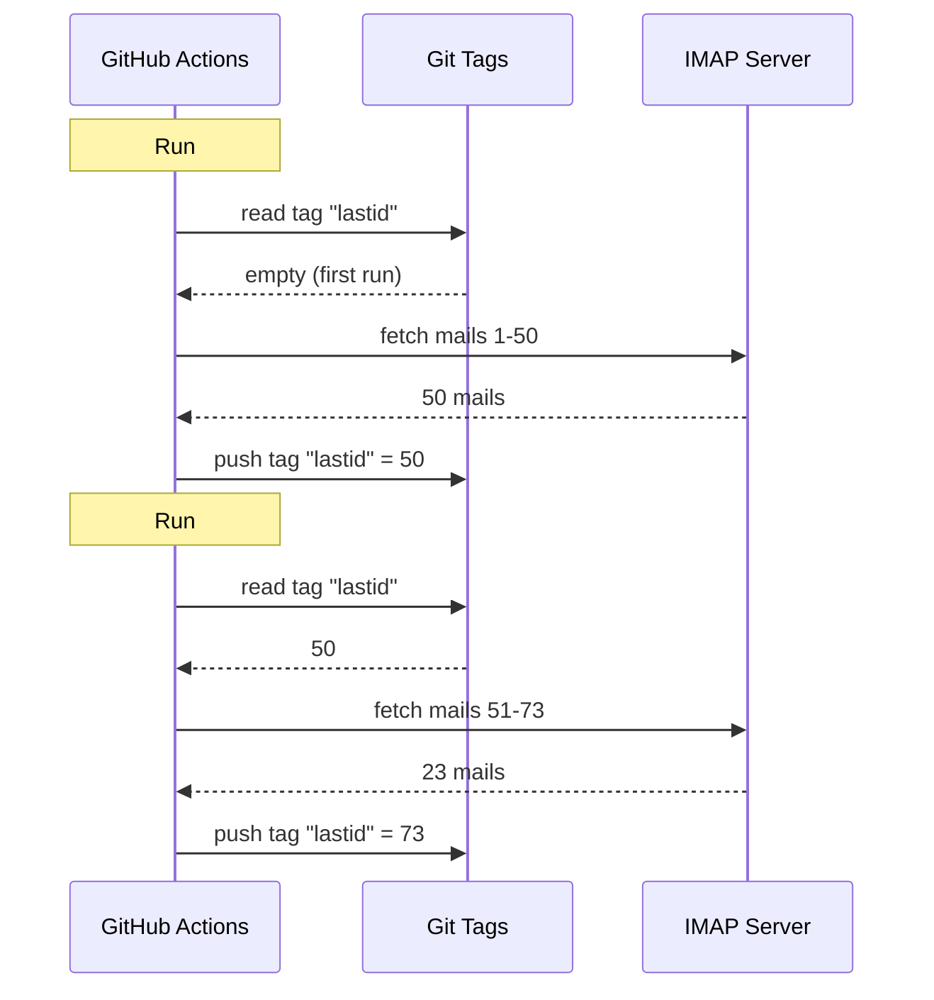

# I used git as a database to run a free bot on GitHub Actions

I have an email auto-responder running 24/7.

It reads my mail, figures out what it's about, and replies on its own with AI. It remembers past conversations. It ignores newsletters and `noreply@`. It forwards to a human when things get too hot.

Monthly cost: **0€**.

I skip the server, VPS, and database. Just GitHub Actions and a sick hack: **using git as a database**.

See where I'm going? No? Well, buckle up, it's dumb and awesome at the same time.

---

## The problem: GitHub Actions is stateless

GitHub Actions is free. You can run a cron every 5 minutes, run your code, free.

But there's a catch: it's **stateless**.

Every run starts on a pristine machine. Nothing is saved between two runs. The previous run? Forgotten. Erased. As if it never existed.

For an email responder, that's a huge problem. Like:

> "What's the last email I already processed?"

If the bot forgets that every run, it'll either re-reply to the same mails in a loop (catastrophe) or miss mails.

You need persistent state. And normally, persistent state = database. But a database is a server, and a server is no longer free.

That's where it gets interesting.

---

## The solution: git tags as a database

Your GitHub repo is already persistent storage. Free. Versioned. Always there.

So why not store state in it?

The idea: on each run, the bot reads the last processed email UID from a **git tag**. It processes new mails. Then it re-pushes the tag with the new UID.



The git tag IS the database. A single value, but that's all we need.

### Reading state

At the start of the job, we fetch the value from the tag:

```bash
git fetch origin --tags lastid || true
git show refs/tags/lastid:data/lastId > data/lastId || true
```

`git show refs/tags/lastid:data/lastId` means: "give me the content of file `data/lastId` as it was in tag `lastid`".

Boom. You have your value, no database.

### Writing state

At the end, we re-create the tag with the new value:

```bash
git switch --orphan lastid-tmp   # pristine branch with no history
git rm -rf .                      # empty everything
mkdir -p data
printf "%s\n" "${LAST_ID_CONTENT}" > data/lastId

git add data/lastId
git commit -m "lastId snapshot"
git tag -f lastid                 # force the tag onto this commit
git push --force ...origin lastid # push the tag
```

We create an **orphan** branch (no history), put just the `lastId` file in it, commit, tag, force push.

Why orphan? So we don't accumulate 10,000 state commits in the repo history. Each update overwrites the previous one. The tag always points to ONE commit containing ONE value.

It's clean. It's free. It's completely twisted and it works.

---

## The second hack: the runtime snapshot

There's another problem with GitHub Actions: `npm install`.

If on every run (every 5 minutes) you do `npm install` + `npm run build`, you waste 60-90 seconds each time. On a frequent cron, that's minutes of compute wasted for nothing.

Solution: pre-compile the code ONCE, and store it in a git tag too.

The build workflow (which runs when you push to `master`) does this:

```bash
# compile the code
bun install
bun run build

# store dist/ + node_modules/ in a "runtime" tag
git checkout --orphan temp-runtime
git rm -rf .
cp -r "$TMPDIR"/* .
git add dist node_modules package.json bun.lock data
git commit -m "runtime build"
git tag -f runtime
git push --force ...origin runtime
```

The `runtime` tag holds the compiled code AND the `node_modules`. All ready to run.

And the cron, in turn, directly checks out that tag:

```yaml
- name: Checkout runtime snapshot
  uses: actions/checkout@v4
  with:
    ref: refs/tags/runtime    # the pre-built code, not the source
    fetch-depth: 1

# no npm install, no build!
- name: Process emails
  run: node dist/index.js --action
```

The cron starts instantly and just runs `node dist/index.js`, no install or build.

Like, you have two tags doing two jobs:
- `runtime` = the code ready to run (updated when you push code)
- `lastid` = the persistent state (updated on every run)

It's elegant in a nasty way.

---

## The bot itself: AI auto-responder

OK, the git hack is cool, but what does the bot actually do?

It reads your mails via IMAP, understands them with an AI (Groq + Llama 3.3 70B), and replies automatically.

Clean services architecture with dependency injection (InversifyJS):

```
App
├── ImapService      → reads mails (IMAP)
├── SmtpService      → sends replies (SMTP)
├── ParserService    → parses mail content
├── ReplyService     → generates the AI reply
├── SummaryService   → conversation memory
├── AccountsService  → manages multiple email accounts
└── ConfigService    → config / env vars
```

### Two operating modes

The bot can run two ways:

**Listener mode** (real time): permanent IMAP connection with exponential reconnect. For a VPS.

```typescript
this.imapService.on("exists", async (data) => {
  console.log(`[MAIL] New mail! Total: ${data.count}`);
  // process the new mail immediately
});
```

**Action mode** (batch): processes new mails since `lastId`, then exits. For the GitHub Actions cron.

```bash
node dist/index.js --action
```

The `--action` mode is the one using the git hack. It reads `lastId`, processes what's new, writes the new `lastId`, done.

### Do NOT reply to robots

If your bot replies to ALL mails, it'll reply to newsletters, notifications, `noreply@`. Catastrophe. Worse: if two bots reply to each other, you get an infinite mail loop. The nightmare.

So aggressive filtering:

```typescript
export function isAutomatedSender(address) {
  const automatedPatterns = [
    "noreply", "no-reply", "donotreply",
    "mailer-daemon", "postmaster", "bounce",
    "newsletter", "notification", "marketing",
    "billing", "receipt", "promo", ...
  ];
  const local = address.split("@")[0].toLowerCase();
  return automatedPatterns.some(p => local.includes(p));
}
```

Plus detection via email headers:

```typescript
export function isAutomatedByHeaders(headers) {
  return (
    ["bulk", "list", "junk"].includes(headers.precedence) ||
    headers["auto-submitted"] !== "no" ||
    headers["list-unsubscribe"] !== "" ||   // newsletters have this
    /mailchimp|sendgrid|mailgun|brevo/i.test(headers["x-mailer"])
  );
}
```

`List-Unsubscribe` in the headers? It's a newsletter. `Precedence: bulk`? Mass mailing. `X-Mailer: Mailchimp`? You get the idea. We ignore them.

It's like a nightclub bouncer: robots don't get in.

### The magic triggers

The AI can decide not to reply at all, or to hand off to a human. How? With special triggers in its response.

The system prompt tells it:

> If it's an automated mail/newsletter → reply `<no_reply>`
> If it's too important/sensitive (legal, financial...) → reply `<manual_reply_required>`
> Otherwise → write a real reply

And the code reads it:

```typescript
const aiReply = completion.choices[0].message.content.trim();
const manualTrigger = aiReply.includes(MANUAL_REPLY_TRIGGER);
const noReply = aiReply.includes(NO_REPLY_TRIGGER);

if (noReply) {
  console.log("[MAIL] The AI decided to ignore. Skip.");
  return;
}

if (manualTrigger) {
  console.log("[MAIL] Too hot, forwarding to a human.");
  await this.smtpService.sendManualForward(...);
  return;
}

// otherwise send the AI reply
await this.smtpService.sendReply(...);
```

Like, the AI gets to say "nope, not touching that, call a real human". That's wisdom.

---

## Conversation memory

One detail that changes everything: the bot **remembers** conversations.

When it replies to someone, it saves a summary of the exchange. Next time that person writes, the summary is re-injected into the prompt.

Storage: one JSON file per contact.

```
data/customers/
├── me%40gmail.com/
│   ├── alice%40example.com.json
│   └── bob%40client.fr.json
```

And the summary itself is generated by the AI, merging the old summary with the new message:

```typescript
const completion = await groq.chat.completions.create({
  model: "llama-3.3-70b-versatile",
  messages: [
    { role: "system", content: "You are a memory assistant. Merge the old summary with the new message without losing info." },
    { role: "user", content: `Existing summary:\n${existing}\n\nNew message:\n${incomingContent}` }
  ],
  temperature: 0.0,  // deterministic, no creativity
  max_tokens: 800,
});
```

So the bot builds compressed memory over time. One summary that grows smarter is enough, no need to store every mail.

And those JSON files? Well... they're stored in git too, in the runtime tag. Git everywhere.

---

## The clever bit about prompt length

A small technical detail that made me smile.

Models have a token limit. If your mail + summary + persona prompt overflows, the API returns an error.

The code handles that with **cascading truncation** + retry:

```typescript
try {
  // first attempt with normal limits
  completion = await groq.chat.completions.create({...});
} catch (error) {
  if (!this.isLengthError(error)) throw error;

  // it was a length error: retry with tighter limits
  ({ systemContent, userContent } = this.buildPromptPayload({
    ...,
    limits: {
      systemPromptChars: 2200,  // instead of 3000
      summaryChars: 1800,       // instead of 4000
      personaChars: 900,        // instead of 1500
      userContentChars: 2200,   // instead of 8000
    },
  }));
  completion = await groq.chat.completions.create({...});  // retry
}
```

If it doesn't fit, cut shorter and retry. Simple, effective, no crash.

---

## OK, and concretely, how does it run?

The full flow of a cron run:

```
1. GitHub Actions triggers (cron every 5 min)
2. Checkout the "runtime" tag (pre-built code)
3. git show refs/tags/lastid → fetch the last processed UID
4. node dist/index.js --action
   ├── IMAP connection
   ├── fetch mails since lastId+1
   ├── for each mail:
   │   ├── parse the content
   │   ├── filter robots (skip if automated)
   │   ├── match the recipient account
   │   ├── fetch conversation memory
   │   ├── generate the AI reply (Groq)
   │   ├── <no_reply> ? skip
   │   ├── <manual_reply_required> ? forward to human
   │   ├── otherwise: send the reply (SMTP)
   │   └── update conversation memory
   └── write the new lastId
5. git push --force tag "lastid" with the new value
```

And it repeats in 5 minutes. Forever. Free.

---

**3 key points:**

1. **Git = free database** -- An orphan tag can store your persistent state between two stateless runs. `git show refs/tags/X:file` to read, force-push to write. You save a whole DB.

2. **Pre-build into a runtime tag** -- Instead of `npm install` on every cron run, store compiled code + node_modules in a git tag. The cron starts instantly.

3. **An AI bot must know when to stay quiet** -- The `<no_reply>` and `<manual_reply_required>` triggers let the AI decide not to reply or to hand off. Plus anti-robot filtering. Otherwise you create an infinite mail loop.

Serverless cron with persistent state, AI, memory, all for 0€/month. It's completely broken and I love this setup.
