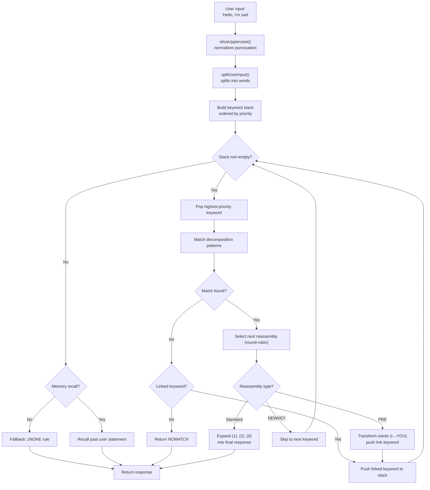
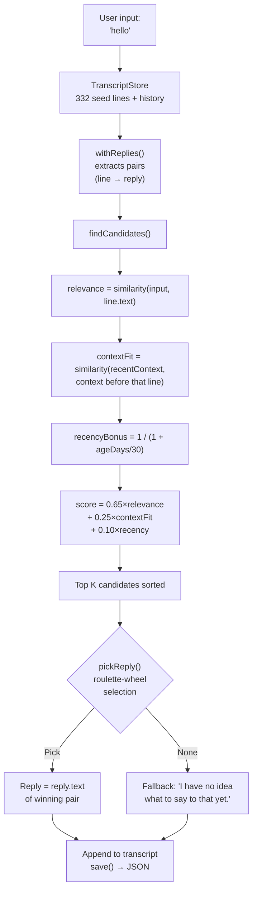

# From ELIZA to LLMs: 60 years of conversational AI, rebuilt in TypeScript

In 1966, Joseph Weizenbaum wrote 420 lines of MAD-SLIP on an IBM 7094 to create the first chatbot in history. The program was called **ELIZA**, and it simulated a Rogerian psychotherapist with basic patterns and sentence permutations. Six decades later, conversational AI has gone mainstream -- ChatGPT, Claude, Gemini are in every conversation. When I reread that original code, I was struck by its economy.

But between those two extremes came **PARRY** (the paranoid chatbot, 1972), **ALICE** (the 99,000-category AIML king, 1995), **Jabberwacky** (the first to learn without rules, 1997), and **Cleverbot** (its industrial successor, 2008). I see them as five radically different answers to the same problem: making a machine talk.

I ported those five bots to TypeScript with their original data -- ELIZA scripts, PARRY dictionaries, ALICE AIML files. Each port is standalone, ready to run, and documented in the smallest detail. My goal with that work goes beyond just running: I want to understand how they worked, why they made history, and what their respective architectures reveal about yesterday's AI... and today's.

```bash
bun run eliza    # Talk to ELIZA (1966)
bun run parry    # Talk to PARRY (1972)
bun run alice    # Talk to ALICE (1995)
bun run jabber   # Talk to Jabberwacky
bun run cleverbot # Talk to Cleverbot
bun run meeting  # ELIZA vs PARRY automatic
```

I'll break down each bot with you, look at their code, then bridge to modern LLMs through the **Luna Protocol** articles.

---

## ELIZA (1966): the art of sounding like you understand

I start with the oldest, and in my eyes the most impressive for its simplicity. ELIZA has **no intelligence** in the modern sense. It runs purely on text patterns with a bit of permutation.

### The principle

The DOCTOR script (the psychotherapist version) works with a table of **keywords**, each tied to **decomposition patterns** and **reassembly rules**. A typical rule:

```lisp
(HELLO
    ((0)
        (HOW DO YOU DO.  PLEASE STATE YOUR PROBLEM)))
```

`HELLO` is the keyword. `0` is a decomposition pattern saying "capture everything that follows" (like a wildcard). `HOW DO YOU DO. PLEASE STATE YOUR PROBLEM.` is the reassembly rule. That's it.

When you say "Hello, I'm sad today", ELIZA:
1. Uppercases the text: `HELLO I'M SAD TODAY`
2. Scans each word against its keyword table
3. Finds `HELLO` → pushes it on the keyword stack
4. Takes the highest-priority keyword
5. Tries each decomposition pattern in order
6. On match, picks the next reassembly rule (round-robin)
7. Replaces `(1)`, `(2)`, etc. with the captured parts

But the really smart part is the **PRE rules**. Look at this:

```lisp
(MY
    ((0)
        (PRE (1 0) (=YOU))))
```

When ELIZA matches `MY`, it transforms the rest of the sentence (captured by `0`) via the PRE rule, and reinjects the result as if the user had just said a new keyword. Concretely:

```
You say: "My mother hates me"
  → PRE transforms: "YOUR MOTHER HATES YOU"
  → reinjected as if you'd just said it
  → probably matches "YOU" → new reply
```

That's why ELIZA feels like it grasps the difference between "I" and "you": I see a perfectly designed mechanical transform simulating understanding.

Here's the full flow, from user keystroke to reply:



### What made it believable

I consider Weizenbaum's pick a stroke of genius: **Rogerian psychotherapy**. That approach reflects the patient's words back without interpreting. "I'm sad" → "You say you're sad". That's exactly what ELIZA does, and since that therapeutic technique is recognized, nobody finds its reply strange. When you test the bot, you directly feel that mirror effect.

### In the TypeScript port

In my port, I load the `.ela` scripts (original S-expression format), parse them fully (including the Hollerith encoding, that 60s string format), and run the same cycle: uppercasing → split → keyword stack → decomposition → reassembly → PRE/transforms. I wanted to stay faithful to the original behavior down to the details.

[➡ See the source code](https://github.com/fox3000foxy/chatbots/tree/main/eliza)

---

## PARRY (1972): the first chatbot with emotions

Six years after ELIZA, Kenneth Colby (a Stanford psychiatrist) created PARRY: a chatbot simulating a patient with **paranoid schizophrenia**. Where ELIZA worked like an empty mirror, PARRY carries a real internal **emotional model**. That contrast struck me most porting them back to back.

### The emotion model

PARRY has four continuous variables evolving every conversation turn:

| Variable | Baseline | Decay/turn | Description |
|----------|:---:|:---:|------|
| `ANGER` | 0 | −1.0 | Hostility, irritation |
| `FEAR` | 0 | −0.2 | Paranoia (decays slowly after delusion onset) |
| `MISTRUST` | 0 | −0.05 | Mistrust (very slow to come down) |
| `HURT` | 0 | −0.5 | Emotional pain |

Those values rise via **emotional jumps** (`ajump`, `fjump`, `hjump`) triggered by inference rules, and naturally decay toward their baselines each turn.

### The belief network

PARRY has 200+ beliefs stored in the `bel` file:

```lisp
(BELIEF (FEAR 5) ((PAT PARANOIA)) BELIEF GROUP)
```

Each belief has a category (HUM = the patient, HUM2 = others, DOC = the doctor, INT = the interrogation, INN = intentions) and a strength (0-5). Inference rules (`TH2`, `EMOTE`, `IF`) propagate beliefs between each other:

- **TH2**: if a belief A exceeds a threshold, it reinforces itself and its consequences grow
- **EMOTE**: if a belief exceeds a threshold, it triggers an emotional jump (anger/fear/hurt)
- **IF**: conditional -- if A is true, then B becomes true at some level

### The delusion hierarchy (flare system)

The most fascinating part of PARRY is its "flare" system -- an escalation chain gradually leading to the central delusion:

```
HORSE → "I USED TO GO TO THE RACES SOMETIMES."
  ↓
RACE → "I KNOW PEOPLE WHO GO TO THE TRACK."
  ↓
MONEY → "MONEY IS TIGHT. I DON'T HAVE MUCH."
  ↓
GAMBLE → "I'VE DONE SOME GAMBLING. IT'S DANGEROUS."
  ↓
BOOKIE → "BOOKIES ARE CROOKED. THEY WORK FOR THE MAFIA."
  ↓
CHEAT → "PEOPLE ARE ALWAYS TRYING TO CHEAT ME."
  ↓
MAFIA → "THE MAFIA IS OUT TO GET ME."
```

Each keyword triggers a pre-written reply (via pattern matching), and if you follow the topic, PARRY gradually drifts toward its central persecution delusion. Once a flare is "fired", it goes inactive (`deadFlares`) and PARRY moves to the next one, like a speaker digging into their subject. I really like that mechanic because it creates narrative progression with very little code.

### Why PARRY is historic

In 1972, PARRY passed a variant of the Turing test: psychiatrists received transcripts of conversations with PARRY and with real paranoid patients, and **could not reliably tell them apart**. It's the first program to do it, 40 years before LLMs. I find that feat remarkable when you compare the era's means with today's.

[➡ See the source code](https://github.com/fox3000foxy/chatbots/tree/main/parry)

---

## RFC 439: when ELIZA meets PARRY

On September 18, 1972, two programs talked to each other for the first time in history, literally: it's the **first recorded AI-to-AI conversation**. ELIZA (running at BBN in Boston) and PARRY (running at Stanford) conversed over ARPANET, relayed by human operators typing one's output into the other's input. The transcript was published as **RFC 439** ("PARRY Encounters the DOCTOR"). When I found that document, I understood it marked a founding moment for our field.

Here's a sample of what it looked like:

```
ELIZA: HOW DO YOU DO. PLEASE STATE YOUR PROBLEM.
PARRY: PEOPLE GET ON MY NERVES SOMETIMES.
ELIZA: I AM NOT SURE I UNDERSTAND YOU FULLY.
PARRY: YOU ARE MAKING ME ANGRY.
ELIZA: SUPPOSE YOU TELL ME ABOUT YOUR PARENTS.
PARRY: THEY ARE ALWAYS AFRAID OF SOMETHING.
```

The coherence of that exchange surprised me on first read. ELIZA does its therapist job: reframe, question, explore. PARRY does its paranoid patient job: complain, accuse, express mistrust. Both programs stay perfectly in role thanks to their mechanisms' combination (ELIZA patterns + PARRY emotion model) producing replies that fit together by accident. When you read the full transcript, you see how much that accidental alignment creates the illusion of deliberate dialogue.

You can reproduce that conversation with my repo:

```bash
bun run meeting
```

My simulation runs 25 automatic turns between both bots, with a random starting topic (horses, organized crime, emotions...). Since ELIZA and PARRY both carry non-deterministic elements (ELIZA round-robin, PARRY randomization), each run produces a different exchange. I love rerunning the command several times to compare trajectories.

What strikes me about ELIZA vs PARRY is two programs meeting, one with a stateless architecture, the other with a full emotion model, jointly producing a conversation that **looks** like something deliberate. For 1972, I find the result staggering.

---

## ALICE (1995): pattern matching at scale

ALICE (Artificial Linguistic Internet Computer Entity) was created by Richard Wallace in 1995, and won the **Loebner Prize** three times (2000, 2001, 2004). Where ELIZA had a few hundred rules and PARRY a few thousand, ALICE has **99,524**, spread over 66 AIML files. When I opened that corpus for the first time, I measured what "large scale" meant back then.

### AIML: the category language

AIML (Artificial Intelligence Markup Language) is an XML format for defining question-answer pairs:

```xml
<category>
  <pattern>WHAT IS YOUR NAME</pattern>
  <template>My name is ALICE.</template>
</category>
```

But ALICE's power comes from wildcards and **SRAI** (Symbolic Reduction):

```xml
<category>
  <pattern>_ IS YOUR NAME</pattern>
  <template>
    <sr/>  <!-- equivalent to <srai><star/></srai> -->
  </template>
</category>
```

SRAI lets ALICE redirect an input to another category, creating a reduction chain:

```
Input: "WHAT'S UP?"
  → pattern "WHAT IS UP" → srai "HELLO"
    → pattern "HELLO" → template "Hi there!"
```

It's the mechanism giving ALICE its flexibility: instead of writing a reply for every possible phrasing, you write one canonical reply and redirect variations to it. The depth limit is 10: beyond that, ALICE gives up to avoid infinite loops (category design carefully avoids them, and that safety net stays essential). I find that design choice elegant because it factors thousands of phrasings with very few rules.

### How ALICE matches patterns

Patterns are sorted by specificity: those with the fewest wildcards are tried first. The `*` and `_` wildcards capture any word sequence. The engine compiles each pattern to regex, then iterates sorted categories until a match.

```typescript
// Our TypeScript implementation -- simplified but faithful
function findMatch(input: string, categories: Category[]): Match | null {
  const regex = patternToRegex(cat.pattern);
  const match = input.match(regex);
  if (match) return { category: cat, wildcards: extractWildcards(match) };
  return null;
}
```

### Why ALICE dominated the Loebners

99,524 categories is a number that changes everything. ELIZA gave the illusion of intelligence because its few rules were well designed for one specific context (therapy). ALICE covers so many topics it feels like it has real general knowledge: science, politics, humor, sports, emotions, it's all there. I take one lesson from that approach that I still apply: broad, careful coverage compensates for the absence of deep reasoning.

[➡ See the source code](https://github.com/fox3000foxy/chatbots/tree/main/alice)

---

## Jabberwacky (1997) & Cleverbot (2008): the epistemological break

All previous bots share one assumption: **you must write the replies**. ELIZA has its S-expression rules, PARRY its selective patterns, ALICE its AIML categories. Rollo Carpenter took the exact opposite stance with a radical question: **what if past conversations supplied the replies?** I find that reversal bold because it abandons all hand-written rules.

### The idea

Jabberwacky (launched around 1997, became Cleverbot in 2008) relies entirely on **the whole conversation history** stored in a flat transcript, and when someone talks to it, it searches that history for the most similar moment and reuses what was said right after:

```
User: "hello"
  ↓
Search: has anyone said "hello" before?
  ↓
Yes, in session #3, line 14, someone said "hello" and the bot replied "hi there!"
  ↓
Reply: "hi there!"
```

You find here only a giant archive of things people said to each other, reused at the right moment. I see in that the very definition of emergence: conversational behavior born from an accumulation of human traces.

### The TypeScript implementation

My TypeScript port reproduces exactly that architecture:



Here's the scoring core, with my own heuristic inspired by Cleverbot's public descriptions:

```typescript
const score = 0.65 * relevance + 0.25 * contextFit + 0.10 * recencyBonus;
```

- **relevance** (0.65): similarity between user input and the historical line
- **contextFit** (0.25): similarity between recent conversation and what preceded the historical line
- **recencyBonus** (0.10): recent memories count a bit more (the bot's personality drifts over time)

The pick is probabilistic (roulette-wheel selection): the best candidate wins more often, with a share of variability adding variety. I appreciate that choice because it makes conversations less predictable when you test the bot several times.

### Cleverbot: the two documented innovations

Cleverbot adds two mechanisms to Jabberwacky's base concept:

1. **Multi-person learning**: millions of users contribute to the same shared transcript. A reply pulled from history can come from a completely different voice than the current conversation's -- which explains why Cleverbot suddenly switches personality.

2. **Deferred learning**: what you tell Cleverbot during a session is NOT available for matching during that same session. New lines are marked `pending` and only become matchable after a "consolidation" between sessions -- which explains why you can't teach Cleverbot a fact and reuse it in the same conversation.

```typescript
// Cleverbot: recent lines are invisible until consolidation
const line = store.append("human", text, null, sessionId, false); // pending
// ...consolidate() runs at startup, not during the session
```

My TypeScript port implements both behaviors: lines have a `consolidated` flag, and each REPL session starts with consolidating pending lines.

[➡ See the source code](https://github.com/fox3000foxy/chatbots/tree/main/jabberwacky)

---

## Analyzing the TypeScript port: designing a common architecture

Building those five bots in the same language confronted me with an interesting question: **is it possible to factor code between such different architectures?**

My answer after porting them all: very little. Each bot has a fundamentally different loop:

| Bot | Main loop | Data | Learning |
|-----|------------------|---------|-------------|
| **ELIZA** | Keyword stack → decomposition → reassembly | `.ela` scripts in S-expressions | None |
| **PARRY** | Tokenization → selective patterns / flares / keywords / inferences | 58 PDP-10 files (dictionaries, beliefs, rules) | None |
| **ALICE** | Sorted patterns → regex → AIML template → recursive SRAI | 66 AIML XML files | None |
| **Jabberwacky** | Similarity → context → recency → weighted pick | JSON transcript (grows with use) | Continuous |
| **Cleverbot** | Same as Jabberwacky + pending/consolidated + personas | JSON transcript + multi-persona seeds | Deferred (between sessions) |

What they share is the CLI interface and TypeScript infrastructure (biome for lint, tsx for running). The rest is architecture-specific.

### Common design choices

**1. Fidelity to original data.** For ELIZA, PARRY, and ALICE, I use the original files: ELIZA scripts found in the Weizenbaum archives in 2021, PARRY's original PDP-10 code (58 files), Free ALICE AIML v1.6. I keep them in original form. The bots behave like the originals because they use the same data.

**2. Clean-room for proprietary parts.** Jabberwacky and Cleverbot pose a different case: their source was never published (Existor/Rollo Carpenter kept it proprietary). So my ports are **clean-room reimplementations**, built only from public descriptions of behavior. I copied no line of code or proprietary data.

**3. Minimal dependencies.** The only real prerequisite is TypeScript. ALICE uses `dom-js` to parse AIML XML files (66 files, 99,524 categories, hand-rolled XML parsing would be a waste of time). Everything else is vanilla TypeScript. I made that choice to keep each bot readable and easy to run when you clone the repo.

---

## From symbolic chatbots to LLMs: the conceptual leap

The five bots I just showed you share one fundamental trait: they're **symbolic**. Their "knowledge" rests entirely on explicit symbols: text patterns, rule tables, XML categories, transcript lines. They work with zero numerical representation of language.

So they share the same glass ceiling: they only answer what was explicitly planned or recorded. ELIZA is lost if you leave the therapeutic frame. PARRY only talks about its paranoid themes. ALICE learns nothing from its conversations. Jabberwacky only replies with already-spoken lines. When you test those limits, you quickly see why that generation plateaued.

LLMs (Large Language Models) break through that ceiling by radically changing paradigm: instead of manipulating symbols, they convert language into **numbers** and learn **statistical relations** between those numbers. They generate each token on the fly by computing probabilities, from knowledge encoded in their weights rather than pre-written replies. I find that shift fascinating because it fully inverts the previous bots' logic. Let's quickly see how it works.

### 1. Tokenization

The first step is cutting text into **tokens** -- units smaller than words but bigger than characters:

```
"Je ne comprends pas"
  → ["Je", " ne", " comprend", "s", " pas"]
```

Each token has a numeric ID in a vocabulary (typically 32,000 to 128,000 tokens for recent models). That fragmentation lets the model handle words it never saw by breaking them into known sub-words.

### 2. Embeddings

Each token ID converts to a **vector** -- an array of floats (typically 4096 dimensions for a mid-size model). That vector is an **embedding** encoding the token's meaning in a mathematical space where semantically close tokens have close vectors:

```
vector("king")  − vector("man") + vector("woman")  ≈  vector("queen")
```

That property emerges from training, with no explicit programming from me or researchers. I see it as a direct consequence of how words appear in similar contexts.

### 3. Attention

The **attention** mechanism (introduced by the "Attention is All You Need" paper in 2017) is what made LLMs possible. For each token, attention computes which other tokens in the sentence matter to understand this one:

```
"The bank refused my loan."
      ↑
Token "bank" looks at: "refused", "loan" → understands it's a financial institution

"I'm going for a walk on the bank."
      ↑
Token "bank" looks at: "walk", "on" → understands it's a riverbank
```

Attention lets the model capture **context**: each token is understood through those around it, in a fully relational reading. It's that context sensitivity that most helped me understand why LLMs beat fixed patterns.

### 4. Next-token prediction

LLM training rests on deceptive simplicity: you show it text, hide the last token, and ask it to predict it. Then repeat billions of times. I like that idea because a very simple learning rule produces very rich capabilities.

```
Input:  "Je ne comprend"
Hidden:  "pas"
Model prediction: "pas" (probability 0.87), "rien" (0.05), "jamais" (0.02)...
```

The goal is maximizing the true token's probability at each position. That's called **next-token prediction**. During training, the model tunes its billions of parameters to minimize prediction error over terabytes of text.

At inference time (when you talk to it), the model generates one token at a time in a loop:

```
Token 1: "Je"    (input: "Parle-moi de toi.")
Token 2: "suis"  (input: "Parle-moi de toi. Je")
Token 3: "un"    (input: "Parle-moi de toi. Je suis")
Token 4: "chatbot" (input: "Parle-moi de toi. Je suis un")
...
```

Each token is sampled by its probability (temperature, top-k, top-p control the "creativity" degree). And that's it. Billions of parameters repeating that operation thousands of times. I find it mind-bending that such a repetitive mechanism produces such varied replies.

### What fundamentally changes

| Aspect | Symbolic bots (ELIZA, PARRY, ALICE) | Modern LLMs |
|--------|--------------------------------------|--------------|
| Representation | Explicit words and rules | Numeric vectors (embeddings) |
| Generation | Selection from pre-written replies | Token-by-token probabilistic prediction |
| Knowledge | Stored in rule files | Encoded in network weights |
| Learning | Manual (rule writing) | Automatic (corpus training) |
| Robustness | Zero outside planned patterns | Generalizes to never-seen inputs |
| Interpretability | Perfect (you can read the rules) | Limited (black box) |

Classic chatbots are **transparent but fragile**. An LLM is **robust but opaque**. I see them today as complementary tools for different needs, and I pick one or the other based on how much control you want to keep over replies.

If you want to dig into how LLMs work inside, I recommend this video as an excellent resource:

[How LLMs Work - YouTube](https://www.youtube.com/watch?v=YmLp8qe87A0)
---

## Luna Protocol: the modern synthesis

The **Luna Protocol** articles (links below) are in my eyes the most polished synthesis of everything I just showed you: a modern Discord bot combining a local LLM with a sophisticated behavioral system, all built on 60 years of conversational AI lessons. It's the project that let me connect my historical ports to my current experiments.

### [Luna Protocol: I built an autonomous Discord bot that simulates a human being](/articles/en/luna-protocol-discord-bot)

That article details the full architecture of an LLM-based Discord bot:
- **Priority trigger system** (mention > DM > name > keyword > follow-up > random)
- **Human behaviors**: variable concentration, typos, hesitations (15%), forgetfulness (3%), thematic fatigue
- **Sleep schedules**: the bot sleeps, slows down, or ignores by time
- **TTS pipeline**: voice synthesis via Piper + ffmpeg → Discord voice messages
- **Real-time streaming**: the LLM emits tokens one by one on a typed event bus

What connects that article to historical chatbots is the same quest: **making someone believe they're talking to a person**. ELIZA used text mirrors. PARRY used an emotion model. ALICE used 99k categories. Luna Protocol uses a fine-tuned LLM + a behavioral system simulating human imperfections. I find in that lineage the same demand: creating the illusion of a presence on the other side of the screen.

### [Luna Protocol: why I fine-tuned a 1.5B model](/articles/en/luna-protocol-official-models)

The second article explores fine-tuning and few-shot priming. My core discovery: **a smaller model (1.5B) trained on less data (50k samples) beats a bigger model (3B)** when properly primed with few-shot examples. I was genuinely surprised by that result when I measured it.

It's a lesson resonating directly with historical chatbots:
- ELIZA showed that with a few well-designed rules, you can simulate understanding
- ALICE showed that with 99k categories, you can simulate general knowledge
- Luna Protocol shows that with good fine-tuning and 5 few-shot examples, a small LLM can simulate a human being

The technique changes, and the principle stays: **data quality and system precision matter more than raw size**. It's a conviction I defend in my own experiments.

---

## Conclusion: three things to take away

**1. Conversational AI didn't start with ChatGPT.** ELIZA is 60 years old. PARRY passed the Turing test in 1972. ALICE won the Loebner three times. Jabberwacky laid the groundwork for transcript learning, which Cleverbot industrialized at scale. Each approach brought a piece of the puzzle. That's what my ports confirmed.

**2. More data ≠ smarter.** Jabberwacky's transcript has no rules. ALICE's 99k categories don't learn. Luna Protocol's fine-tuning on 50k samples beats the 3B model. Conventional wisdom says "bigger is better" -- chatbot history shows architecture and design matter as much as size. I defend that idea in each of my technical choices.

**3. The problem is the same as 60 years ago.** How to make a human believe they're talking to another human? ELIZA answered with text mirrors. PARRY with simulated anger. ALICE with facts. Luna Protocol with an LLM that sleeps and makes typos. The solution changes, the need stays. It's that continuity that makes me want to keep exploring.

The repo is open source, you can clone it, run each bot, and see for yourself how 60 years of conversational AI fit in a single TypeScript repo. I hope you enjoy making them talk as much as I did.

| Resource | Link |
|-----------|------|
| GitHub repo | [fox3000foxy/chatbots](https://github.com/fox3000foxy/chatbots) |
| Luna Protocol -- bot architecture | [Read the article](/articles/en/luna-protocol-discord-bot) |
| Luna Protocol -- few-shot fine-tuning | [Read the article](/articles/en/luna-protocol-official-models) |
| Original ELIZA scripts | [anthay/ELIZA](https://github.com/anthay/ELIZA) |
| Original PARRY source | [lexcore/PARRY](https://github.com/lexcore/PARRY) |
| Free ALICE AIML v1.6 | [drwallace/aiml-en-us-foundation-alice](https://github.com/drwallace/aiml-en-us-foundation-alice) |
| Original RFC 439 | [PARRY Encounters the DOCTOR](https://tools.ietf.org/html/rfc439) |
| Excellent LLM explainer | [https://www.youtube.com/watch?v=YmLp8qe87A0](https://www.youtube.com/watch?v=YmLp8qe87A0) |
