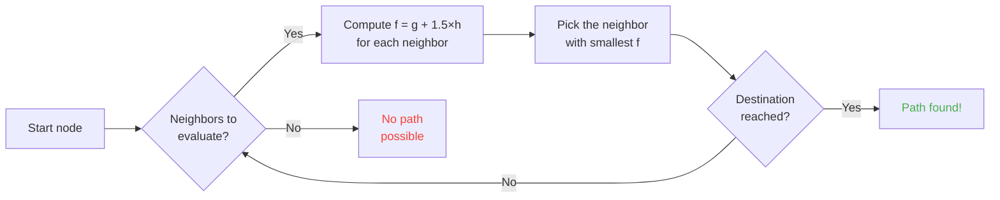

## Introduction

I spent hours watching sheep bump into walls.

And honestly? Best investment of my life.

Because the more you watch those mobs, the more you realize nothing about them is random. Every move is coded, predictable, and totally breakable. I ended up diving into the Minecraft source code to get exactly how pathfinding works, and what I found is that you can literally mind-control mobs. Like, force them to go where YOU want, not where chance decides.

This guide is everything I learned digging around. The AI, the A* algorithm, the hidden penalties, the exploits you can pull in survival. Grab your pickaxe.

---

## How Mob AI Works (Spoiler: It's Dumb)

### Goals

Every mob has *goals*. It's a list of actions it CAN do and how much it WANTS to do them. The smaller the number, the higher the priority, like a chaos-version todo list.

```java
protected void registerGoals() {
   this.goalSelector.addGoal(4, new Zombie.ZombieAttackTurtleEggGoal(this, 1.0, 3));
   this.goalSelector.addGoal(8, new LookAtPlayerGoal(this, Player.class, 8.0F));
   this.goalSelector.addGoal(8, new RandomLookAroundGoal(this));
   this.addBehaviourGoals();
}
```

Ever seen a zombie ignore a turtle egg to chase you? Here's why: `ZombieAttackTurtleEggGoal` is priority 4, while `ZombieAttackGoal` (the goal telling it to eat your face) is priority 2.

Yes, a zombie prefers eating you over breaking an egg. That's love.

The goal we really care about is `WaterAvoidingRandomStrollGoal`, priority 7. The "I've got nothing to do so I'll walk randomly" goal. That's where it all gets interesting.

### Movement (or "How a Random Stroll Has a 1-in-60 Chance of Happening")

Every tick (every 0.05 seconds), the game calls `canUse()` to see if the mob deigns to move. 1 chance in 60 every tick. Completely dumb design, and I love it.

```java
public boolean canUse() {
   if (this.mob.hasControllingPassenger()) {
      return false;
   } else {
      if (!this.forceTrigger) {
         if (this.checkNoActionTime && this.mob.getNoActionTime() >= 100) {
            return false;
         }
         if (this.mob.getRandom().nextInt(reducedTickDelay(this.interval)) != 0) {
            return false;
         }
      }
      Vec3 $$0 = this.getPosition();
      if ($$0 == null) {
         return false;
      } else {
         this.wantedX = $$0.x;
         this.wantedY = $$0.y;
         this.wantedZ = $$0.z;
         this.forceTrigger = false;
         return true;
      }
   }
}
```

So to sum up: if you're riding the mob -> no, if the mob has done nothing for 5 seconds -> no, if the random says no -> no. The game really does NOT want the mob to move.

But when it moves, `getPosition()` takes over:

```java
protected Vec3 getPosition() {
   if (this.mob.isInWater()) {
      Vec3 $$0 = LandRandomPos.getPos(this.mob, 15, 7);
      return $$0 == null ? super.getPosition() : $$0;
   } else {
      return this.mob.getRandom().nextFloat() >= this.probability
         ? LandRandomPos.getPos(this.mob, 10, 7)
         : super.getPosition();
   }
}
```

Look at those two numbers at the end: that's the XZ radius and Y radius. In water, the mob searches farther (15 instead of 10). If it finds no land, it falls back to `super.getPosition()` which accepts water. **Result: mobs WANT to get out of water.** That's why your animals swim toward the shore like mad.

Fun little detail: there's literally a 0.1% chance the mob takes `super.getPosition()` instead of `LandRandomPos`. One in a thousand. Classic Mojang.

### LandRandomPos: The Crappy Optimization That Changes Everything

This is MY favorite step. The most beautiful technical nonsense that makes pathfinding exploitable.

```java
public static Vec3 getPos(PathfinderMob $$0, int $$1, int $$2, ToDoubleFunction<BlockPos> $$3) {
   boolean $$4 = GoalUtils.mobRestricted($$0, $$1);
   return RandomPos.generateRandomPos(() -> {
      BlockPos $$4xx = RandomPos.generateRandomDirection($$0.getRandom(), $$1, $$2);
      BlockPos $$5 = generateRandomPosTowardDirection($$0, $$1, $$4, $$4xx);
      return $$5 == null ? null : movePosUpOutOfSolid($$0, $$5);
   }, $$3);
}
```

`movePosUpOutOfSolid`. The name says it all. If the picked position is inside a solid block, the game pushes it up until it's in the air.

It's an optimization: instead of wasting time ignoring underground positions, the game lifts them to the surface. Clever? Yes. But it creates a crazy bias: **mobs prefer heights**.

Imagine. Lots of blocks under the surface, the game generates 10 random positions. The ones inside blocks get pushed up. Dense zones (under a hill) produce more valid positions than hollow zones. Result: the mob statistically goes toward the hill more often.

Trust me, we'll break that in 2 minutes.

### Selection: The Best-Block Contest

10 positions, one winner, a score contest:

```java
public static Vec3 generateRandomPos(Supplier<BlockPos> $$0, ToDoubleFunction<BlockPos> $$1) {
   double $$2 = Double.NEGATIVE_INFINITY;
   BlockPos $$3 = null;
   for(int $$4 = 0; $$4 < 10; ++$$4) {
      BlockPos $$5 = (BlockPos)$$0.get();
      if ($$5 != null) {
         double $$6 = $$1.applyAsDouble($$5);
         if ($$6 > $$2) {
            $$2 = $$6;
            $$3 = $$5;
         }
      }
   }
   return $$3 != null ? Vec3.atBottomCenterOf($$3) : null;
}
```

The position with the best score WINS. And if you know the scoring criteria, you can make the position you want win. It's like rigging an election.

---

## Mob Preferences (or "Why Your Cow Crosses the Road")

Every mob has different tastes. And it changes everything.

| Mob | Loves it |
| --- | --- |
| **Animals** (cows, sheep, pigs) | Grass and light (hipsters) |
| **Monsters** (zombies, skeletons) | Darkness (edgelords) |
| **Turtles** | Water, otherwise sand, otherwise light |
| **Hoglins** | `crimson_nylium`; hate `warped_fungus` |
| **Striders** | Only lava. NOTHING else. |
| **Silverfish** | Infestable blocks (makes sense) |
| **Guardians** | Water + light (the snobs) |
| **Mooshrooms** | Mycelium + light (mushrooms) |
| **Bees** | Air. Yes, they prefer AIR. |

```java
// Animal: looks down, if it's grass, max score
public float getWalkTargetValue(BlockPos $$0, LevelReader $$1) {
   return $$1.getBlockState($$0.below()).is(Blocks.GRASS_BLOCK) ? 10.0F : $$1.getPathfindingCostFromLightLevels($$0);
}

// Monster: exactly the opposite
public float getWalkTargetValue(BlockPos $$0, LevelReader $$1) {
   return -$$1.getPathfindingCostFromLightLevels($$0);
}
```

Like, monsters are literally "if it's lit, negative score, I'm going elsewhere". They HATE light.

So you can, literally, guide your animals with grass and light, and your monsters with darkness. Dumb and awesome at the same time.

---

## The A* Algorithm in Minecraft (The Secret Formula)

Minecraft uses the A* (A-star) algorithm for pathfinding. But Mojang put its own spin on it:

```
f(n) = g(n) + 1.5 × h(n)
```

- **g(n)** = the path already walked (1 per block, ~1.41 diagonally)
- **h(n)** = the bird-flight distance
- **1.5** = because Mojang likes slightly broken values

Normally A* uses `f(n) = g(n) + h(n)`. MOJANG ADDED A 1.5 FACTOR. Why? So the algo goes faster toward the destination and prunes fewer search branches. Result: the path found is "good" but not always the best. It's a slightly drunk A*.



Important detail: **a mob can only pathfind over 16 blocks** (its follow range). If the destination is too far, it picks the closest block it CAN reach. That means you can create an out-of-range monolith, and the mob will pathfind toward the closest block that brings it closer to that monolith, making its moves fully predictable.

### The Two Exploits That Break the Game

#### 1. Block Updates = Forced Recalculation

```java
public boolean shouldRecomputePath(BlockPos $$0) {
   if (this.hasDelayedRecomputation) return false;
   if (this.path != null && !this.path.isDone() && this.path.getNodeCount() != 0) {
      Node $$1 = this.path.getEndNode();
      Vec3 $$2 = new Vec3(
         ((double)$$1.x + this.mob.getX()) / 2.0,
         ((double)$$1.y + this.mob.getY()) / 2.0,
         ((double)$$1.z + this.mob.getZ()) / 2.0
      );
      return $$0.closerToCenterThan($$2, (double)(this.path.getNodeCount() - this.path.getNextNodeIndex()));
   }
   return false;
}
```

Every block update near the mob's path forces an A* recalculation with a 1-second cooldown. You put a 1-second clock next to a mob, and it recalculates its path CONSTANTLY. It's like a GPS that resets every second.

And if you do that with 50 mobs at once? Lag city. RIP TPS.

#### 2. Block Penalties (Pathfinding Malice)

Some blocks scare mobs. Literally. Every block has an associated cost, defined by an enum:

| Block / Condition | Penalty |
| --- | --- |
| **Honey block** | +8 to cross |
| **Powder snow** | Impassable |
| **Closed doors** | Impassable |
| **Fire** | +16 to cross, +8 to walk alongside |
| **Animals & Villagers** | Fire = -1 (NOPE) |
| **Cactus / Sweet berry** | Impassable; adjacent = +8 |
| **Water** | +8 to cross or walk alongside |
| **Magma** | +8 to walk alongside (ouch) |

Animals are even more extreme:

```java
protected Animal(Entity<? extends Animal> $$0, Level $$1) {
   super($$0, $$1);
   this.setPathfindingMalus(PathType.DANGER_FIRE, 16.0F);
   this.setPathfindingMalus(PathType.DAMAGE_FIRE, -1.0F);
}
```

DAMAGE_FIRE at -1.0F is literally "forbidden". An animal would rather throw itself into the void than cross fire. Phew.

### Exercise: The Great Path Contest

Imagine a villager choosing between several paths.

- **Path A**: 15 blocks but 6 blocks alongside water (+8 each)
- **Path B**: 18 blocks with 2 blocks of water (+8) and 1 adjacent water block (+8)
- **Path C**: 14 blocks straight... but with fire -> IMPASSABLE for a villager
- **Path D**: 16 blocks with 1 magma-adjacent block (+8) + 1 honey-adjacent block (+8)
- **Path E**: 25 blocks but cacti everywhere (+8 everywhere) -> 90.82 total cost

Mental math:

- Path A: 15 blocks + 6×8 for water = 15 + 48 = **63** ... but there's the 1.5×distance to add. Let's do the real math.
- Path B: longer but fewer penalties. Total cost = cumulative distance + penalties.
- Path D: magma and honey stack their penalties.

The winner is often **Path B**: the detour pays off because water is EXPENSIVE.

A villager is essentially a cost calculator with legs.

### Every Mob Has Its Tastes

A villager: "fire? NO THANKS BYE"
A zombie: "fire? OK boomer *walks through flaming*"

You literally have roads some mobs take and others don't. You can build villager highways where zombies get burned.

---

## Villagers: The Ultimate Mess

OK, villagers. THE least understood system in all of Minecraft. But once you've read the code, you realize they're predictable machines with office hours.

### Sensors and Memories

9 sensors, running every 20 ticks (1 second). Each scans a radius around the villager and stores the result in memory. The villager sees everything, remembers everything, and acts accordingly.

Like: "is there an enemy? an item on the ground? a player to talk to?" It checks EVERYTHING.

### Packages (Its Phases of the Day)

A villager's brain is activity packages that activate by time:

| Package | Schedule | The villager... |
| --- | --- | --- |
| **Core** | 24/7 | Opens doors, swims (80% of the time), and ACQUIRES POIs |
| **Work** | 8am-3pm | "Going to work" -- walks to its workstation |
| **Meet** | 3pm-5pm | "Drinks!" -- goes to the bell, chats |
| **Rest** | 6pm-6am | "Gotta sleep" -- goes to bed |
| **Idle** | 6-8am, 5-6pm | "Chilling" -- wanders, makes babies, jumps on beds |
| **Panic** | Injury/hostile | "HELP" -- RUNS |

The **Panic** package is the only one that can interrupt ALL others. Even if the villager is sleeping or working, if there's a zombie, TOTAL PANIC.

### Acquire POI: The Trick Behind Wireless Redstone

```java
Set<Pair<Holder<PoiType>, BlockPos>> $$12 = (Set)$$10xx.findAllClosestFirstWithType(
   $$0, $$11, $$8x.blockPosition(), 48, PoiManager.Occupancy.HAS_SPACE
)
```

`Acquire POI` scans in a 48-block radius for all points of interest. It keeps the 5 closest, checks a path exists, and acquires the first reachable one.

Each POI has a limited number of slots:
- **Workstations**: 1 slot
- **Beds**: 1 slot
- **Bells**: 32 slots

The CRAZY bit: **the slot is reserved at acquisition time, NOT on arrival**. A villager can lock a composter from across the map, without ever reaching it.

You catch the power?

### Wireless Redstone. Yes, WIRELESS.

1. You put a villager in a minecart with a path to a composter
2. It acquires the composter (slot taken, nobody else can use it)
3. The villager is too far to click it, the bone meal stays
4. You WALK that villager anywhere in the world, it keeps the slot
5. When you want to trigger your contraption, you KILL the villager
6. The slot frees up, another villager acquires the composter, removes the bone meal
7. BLOCK UPDATE -> any redstone circuit activates

You literally created a wireless redstone signal, transmittable anywhere in the world, with zero chunk loading needed along the way. You can wire that to an ender pearl stasis chamber, teleport yourself from anywhere by killing a villager.

My favorite use? A "bounty hunter" mini-game: you put several villagers with composters, the player must kill THE RIGHT villager to activate the exit. Completely wtf mechanics.

### The Pathfinding Deadlock (or "The Villager That Freezes Forever")

There's a TOO GOOD bug between `Acquire POI` (which sees a path) and actual navigation (which refuses to take it). It happens when the block above the workstation isn't walkable. Result:

- Core package: "I want to acquire the POI"
- Navigation: "I can't walk there"
- Result: the villager stays FROZEN, forever, fighting with itself.

Literally villagers frozen in place, usable as decoration or as "props" in builds. An armor stand tank? Yes. A guard that doesn't move? Yes. Macabre? Maybe. But effective.

---

## Conclusion

Minecraft mob pathfinding isn't random. It's a deterministic, score-based system, predictable AND breakable.

**The three things to remember:**

1. **Blocks underfoot = height bias**: fill or empty the underground to guide mobs
2. **Penalties differ per mob**: create roads some take and others don't
3. **POI slots are reserved remotely**: free wireless redstone, teleportation, all that

Minecraft source code is a goldmine of underused mechanics. I spent hours reading decompiled Java and honestly? Every line is a functional Easter Egg. Except these ones, you use them in survival to do wireless redstone with villagers. Best game confirmed.
