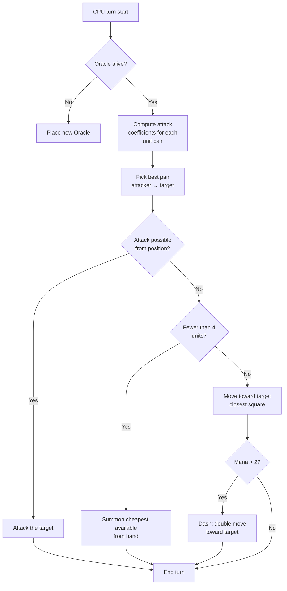

## My dumb AI for Nausicaa

Some projects start with "hey what if I made a chess game with mythologies?" and end with a system where an AI picks its own hyper-parameters every 5 turns.

Nausicaa is that. A turn-based board game where you build your deck of mythological creatures, manage your mana, deploy units on a 10x8 board. And there's an AI with personality crises.

I spent quite a while on this AI, and the result still escapes me sometimes, and that's what I like best about it.

## The game for real

Before talking about the brain, you need to understand the body:

- 10x8 board, 2-row deployment zone per player
- Mana starts at 1, +1 per turn, max 6. You spend it to summon, attack, use abilities
- Goal: kill the enemy Oracle

12 units, with different costs and movement patterns:

| Unit | Cost | Movement | HP |
| --- | --- | --- | --- |
| Oracle | 0 | King (8 directions) | 1 |
| Goblin | 1 | Forward 3 squares | 1 |
| Harpy | 1 | King (8 directions) | 1 |
| Naiad | 1 | Diagonal | 1 |
| Griffin | 2 | Hop 2 squares | 2 |
| Siren | 2 | Lateral | 1 |
| Centaur | 2 | Knight (L shape) | 2 |
| Archer | 3 | Lateral | 1 |
| Phoenix | 3 | Diagonal (dark squares) | 1 |
| Shapeshifter | 4 | Swap places | 1 |
| Seer | 4 | None (generates mana) | 1 |
| Titan | 6 | Limited (zone attack) | 3 |

Each unit has its own attack pattern. The Siren hits in the 4 diagonals, the Archer at range over 3 squares, the Titan destroys everything around it on summon. Basically a chess game with mythology and deckbuilding.

## How I made the CPU think

The core idea is dumb simple: **every enemy unit has an attractiveness coefficient**. The more dangerous it is, the more the AI wants to deal with it.

```javascript
const UNITS_ATTRACTIVENESS = {
    "oracle": 100,
    "titan": 95,
    "shapeshifter": 90,
    "phoenix": 80,
    "siren": 70,
    "archer": 70,
    "seer": 70,
    "griffin": 60,
    "centaur": 60,
    "harpy": 50,
    "naiad": 30,
    "gobelin": 20
};
```

Oracle at 100 -- makes sense, it's the win condition. Titan at 95 because it one-shots everything next to it on summon. Goblin at 20, it's a foot soldier, who cares.

Then for each pair of units (one ally, one enemy), I compute:

```
interest = attractiveness × coeff_attract / (distance × coeff_dist)
```

Basically: the more dangerous and close you are, the more the AI wants to smash you.

```javascript
calculateAttackCoefficient(x1, y1, x2, y2) {
    const distance = this.calculateEuclideanDistance(x1, y1, x2, y2);
    if (distance === 0) return Infinity;
    return (UNITS_ATTRACTIVENESS[unit.type] * COEFFICIENTS_IMPORTANCE["attractiveness"]) / distance;
}
```

### The trick with the changing coefficients

The important bit is that the importance coefficients **change randomly every 5 turns**.

```javascript
if (this.turnCount % 5 === 0) {
    const distanceCoefficient = parseInt(Math.random() * 100);
    const attractivenessCoefficient = parseInt(Math.random() * 100);
    this.regulateImportanceCoefficients({
        distance: distanceCoefficient,
        attractiveness: attractivenessCoefficient
    });
}
```

One turn the AI goes hyper aggressive (attract at 95, distance at 5), it crosses everything to kill your Oracle. The next turn it prioritizes distance and repositions.

It's borrowed from the Pac-Man ghosts -- Blinky chases, Pinky ambushes. Here the AI switches "personality" every phase.

**Result: impossible to predict the AI over a whole game.** The CPU never plays the same match twice.

### The Oracle is a coward

The enemy Oracle flees. Literally.

```javascript
const awayFromTarget = {
    row: Math.max(0, Math.min(7, botUnitElement.row + (botUnitElement.row - targetUnitElement.row))),
    col: Math.max(0, Math.min(9, botUnitElement.col + (botUnitElement.col - targetUnitElement.col)))
};
```

It computes the opposite direction from the threat and runs away. If there's a wall, it looks for the closest free square in that direction.

You spend 3 turns approaching the Oracle, and poof it's already fled to the other side.

### The decision loop

Here's how the AI decides:

1. If my Oracle is gone (dead), place a new one
2. Compute the coefficient for each allied unit → enemy unit pair
3. Pick the best pair
4. If the unit can attack the target from its position → attack
5. If I have fewer than 4 units → summon the cheapest available from hand
6. Otherwise, move toward the target (closest movement square to the enemy)
7. If enough mana (> 2), dash (double move) to get closer
8. If the unit is the Oracle → flee



```javascript
async makeAction(dash=false) {
    // all that in sequence
    // the CPU dashes if it has enough mana
    if(botPlayer.mana > 2) {
        this.makeAction(true);
    }
}
```

### Why Euclidean distance

I use Euclidean distance:

```javascript
calculateEuclideanDistance(x1, y1, x2, y2) {
    const deltaX = Math.pow(x1 - x2, 2);
    const deltaY = Math.pow(y1 - y2, 2);
    return Math.sqrt(deltaX + deltaY) * COEFFICIENTS_IMPORTANCE["distance"];
}
```

Why not Manhattan? Because units have varied movement patterns (L like the knight, diagonal, etc). Bird-flight distance is a better approximation of danger.

## Why not minimax

I could have coded a classic minimax. But with 12 unit types, different movement patterns, special abilities... the game tree explodes so fast it becomes unplayable. The heuristic approach makes smart picks without exploring 10 million states.

## What's cool

The attractiveness system creates funny dilemmas:

- The Seer (70) generates mana. If you let it live, the opponent gets more resources. But the Titan (95) is even more dangerous.
- The Shapeshifter (90) can swap places with any unit. It can steal your Oracle.
- The Harpy (50) has an explosive attack that kills it too. It stays secondary... until it ends up next to 3 of your units.

The AI evaluates overall danger based on positions, not just raw stats.

There's also an `activateSimulation()` function to test scenarios without replaying a game:

```javascript
activateSimulation() {
    // Place specific units on the board
    // Useful for debugging the AI
    this.game.board = simulation.board;
    this.game.players = simulation.players;
}
```

## What's missing

If I had more time:

- The AI reacts to the current state, it doesn't predict what the player will do
- It doesn't plan its hand over several turns
- The Shapeshifter and Centaur have abilities it underuses
- Reinforcement learning: make it play against itself to tune the coeffs

But for a browser game it holds up. Friends manage to lose against it, so it's validated.

## Try it

Available at [nausicaa-game.github.io](https://nausicaa-game.github.io/). You click "PLAY", CPU mode ON, and you watch the AI play.

Tip: let the AI play against itself. You'll see aggressive phases, then pfft it backs off.

The code is on [GitHub](https://github.com/nausicaa-game/nausicaa-game.github.io) in `js/cpu.js`.

**3 things to remember:**

1. **Heuristic coefficients** -- no minimax, each unit has an attractiveness
2. **Coeffs changing every 5 turns** -- the AI alternates aggression and control, Pac-Man style
3. **The Oracle flees** -- it computes the opposite direction from the threat and runs

If you have ideas to make the AI even nastier, open an issue. I have plans for a version that learns from its defeats, but that'll be for a future article.
