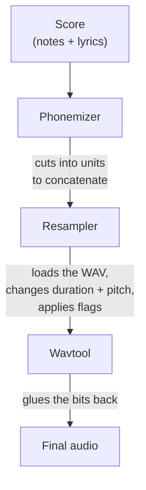

## UTAU: how a Visual Basic 6 app democratized synthetic singing

I mentioned it on my main page: I love UTAU. Here's why.

In 2008, if you wanted to make a synthetic voice sing, you had one option: VOCALOID. Yamaha's software. Expensive, proprietary, with official voices you couldn't create yourself.

Then some Japanese guy, Ameya/Ayame, released a program on his own. Software coded in **Visual Basic 6**. Free. That let you create your own voice with... WAV files you recorded yourself.

That software is called **UTAU** (歌う, "to sing" in Japanese). And for its time, it was magic.

I've always found it fascinating for its core idea more than its technical cleanliness (the encoding principle stays genuinely clever, even if the implementation is painful to look at): it opened vocal synthesis to the general public. You, me, anyone with a mic.

Let me explain why that was awesome.

---

## First: why singing synthesis is hard

A sung voice isn't notes. You've got the consonant that attacks, the vowel that holds, the breath, the transitions between the two. The "sa" in "salut" is a hissing "s" sliding into an open "a", and it's that slide that sounds human or not.

Today we solve that with deep learning: you train a model on hours of singing and it generates the voice (Synthesizer V, DiffSinger). But that's 2020+. In 2008, nothing like that.

UTAU uses the older method, older and cleverer: **concatenative synthesis**.

---

## Concatenative synthesis: copy-pasting bits of voice

The idea is dumb as a rock: you record small bits of voice and glue them together to form words. "salut" = sample "sa" + "lu" + "to", chained. A sound puzzle driven by a score.

It's the principle behind YouTube Poops where someone's words get cut up to make them say anything -- except here it's clean and automated.

And UTAU literally comes from that. Before it existed there was **"Jinriki Vocaloid"** (人力ボーカロイド, "manual Vocaloid"): people hand-cut vocal tracks, extracted phonemes, repitched them, and reassembled the whole thing in an audio editor to imitate a VOCALOID voice. By hand. Imagine the work.

Ameya looked at that pain and coded the tool to automate it. Originally UTAU was just that: an assistant for manual Vocaloid.

---

## Why it was revolutionary: YOU create the voice

Here's what changes everything.

With VOCALOID, you bought a voice. Miku, Luka, etc. Created by pros, sold by Yamaha. Voice creation stayed with Yamaha. With UTAU, **anyone records their voice and turns it into a singing instrument**.

The CV mode (the simplest) is: you record the ~100 base syllables of Japanese ("a", "ka", "sa", "ta"...), you configure the cut points, and there's your voicebank. A few hours of work.

Result: the ecosystem exploded. Thousands of community-made voicebanks -- fan voices, friends' voices, invented characters. A whole universe of virtual singers, free. And the software shipped with **Defoko** (Utane Uta), a default voice generated via the AquesTalk TTS engine, so you could start even without a mic.

---

## oto.ini: the heart of the system

How does UTAU know where to cut and paste sounds? Via a per-voicebank config file: **`oto.ini`**. For each WAV, it defines the cut points (in milliseconds):

- **Offset** → silence to drop at the start
- **Preutterance** → the point where the consonant switches to the vowel (the "s"→"a" boundary in "sa")
- **Overlap** → how much the previous note spills over onto this one
- **Fixed region** → the part that must NOT be stretched on a long note (typically the consonant)
- **Cutoff** → where to cut the end

**Preutterance** is the cleverest param. A syllable always has a bit of consonant before the vowel. For your note to land on the beat, it's the *vowel* that must land exactly, not the consonant. So UTAU shifts the sample backward: the "a" of "sa" lands on the beat, the "s" spills just before. Like a drummer anticipating their hit so the sound lands on time -- except this is in an `.ini`.

Visually, on a "ka" sample, the `oto.ini` zones break down like this:

```mermaid
flowchart LR
    A["🔇 silence<br/>(offset)"] --> B["🅺 consonant<br/>(fixed region,<br/>not stretched)"]
    B --> C["🅰 vowel<br/>(stretchable zone)"]
    C --> D["🔇 cut end<br/>(cutoff)"]
    style B fill:#3b4a6b
    style C fill:#5b3b6b
```



The consonant/vowel boundary is the preutterance. The vowel is the zone you stretch for long notes; the consonant stays intact, otherwise your "k" would last two seconds and sound horrible.

```ini
# oto.ini (simplified)
# file=alias,offset,consonant,cutoff,preutterance,overlap
_ka.wav=ka,120,80,-200,90,40
```

Five values per sound, across all your samples, and UTAU assembles any word cleanly.

---

## CV, VCV, CVVC: the race to realism

The base mode, **CV** (Consonant-Vowel), is one sound per syllable. Simple but a bit robotic: joints between syllables are raw.

In 2010 the community invented **VCV** (Vowel-Consonant-Vowel). Instead of recording "ka" alone, you record "a ka" -- with the tail of the previous vowel. The transition becomes natural because it's *in* the recording, not computed afterward.

The detail that stings: **VOCALOID didn't get VCV until VOCALOID3, in 2011.** The freeware in VB6 coded by one guy on his own beat Yamaha by a year on transition realism. A fan community faster than the multinational.

Then came **CVVC**, **ARPAsing** (English), **VCCV**... each method pushing realism further, all invented and documented by the community.

---

## The full pipeline: how a word becomes sound

When you place a note and type lyrics, here's what happens behind the scenes:



The **resampler** is the centerpiece: it takes your "ka" sample recorded at a given pitch and re-stretches/repitches it to match the target note -- stretching only the stretchable zone and keeping the consonant intact (hence the `oto.ini`).

And it's **modular**. UTAU shipped with a base resampler, but the community made others (moresampler, TIPS...), each with its own sonic grain. You swapped synthesis engines like a plugin. In 2008. On freeware.

---

## The mess under the hood (and why it's endearing)

I have to be honest about the state of the software:

- **Coded in Visual Basic 6.** A language already dead in 2008. You need the VB6 runtime to run it.
- **Windows only at first** (the Mac port, UTAU-Synth, came in 2011).
- **Mandatory Shift-JIS encoding.** If your files aren't encoded in Japanese Shift-JIS, UTAU understands nothing. Even today you often have to set your PC to Japanese locale or use AppLocale to launch it.
- **Austere UI**, documentation almost 100% in Japanese at the time.

And yet. And yet this software created a worldwide movement. Tens of thousands of voicebanks. Songs listened to millions of times.

The best example: **Kasane Teto**. A character created in 2008 and dropped as an April Fools joke, posing as a VOCALOID. It was a joke. Except people loved the character, a real UTAU voicebank got created behind it, and Teto became one of the most famous virtual singers in the world. In 2023 she even got an official Synthesizer V voice. A character born from an April Fools joke on free software.

---

## Why it still matters

UTAU is the perfect example of "poor" tech winning through openness.

VOCALOID was technically superior, better funded, more pro. But closed. UTAU was cobbled together, ugly, in VB6 -- but it let everyone take part. Creating voices, creating resamplers, creating plugins, creating recording methods. The community did the rest.

And the concept fully survives today. **OpenUtau**, a modern open-source successor, picks up the idea and dusts it off (multi-platform, UTF-8, support for modern resamplers AND AI). Concatenative synthesis still holds its own next to deep learning models, because it has an advantage they don't: you understand exactly what's happening, and you control every millisecond.

That's what I've always liked about UTAU. You see exactly what's happening. It's not an AI spitting out a magic result you don't understand: you've got your WAVs, your cut points, and you're the one deciding everything. When it sounds bad, you know why and you can fix it. I love that kind of control.

---

**3 key points:**

1. **Concatenative synthesis = voice puzzle** -- UTAU glues small WAV samples together to form words. The `oto.ini` defines where to cut and paste each sound. You control everything, down to the millisecond, no black box.
2. **Openness beats tech** -- VOCALOID was better but closed. UTAU was cobbled together but let everyone create their voices. The community blew the ecosystem up, and even beat Yamaha to VCV.
3. **A good idea outlives its code** -- VB6, Shift-JIS, Windows only... and yet the concept still runs via OpenUtau. Great tech can be coded badly.

Honestly, for Kasane Teto born from an April Fools joke alone, this software deserves respect.
