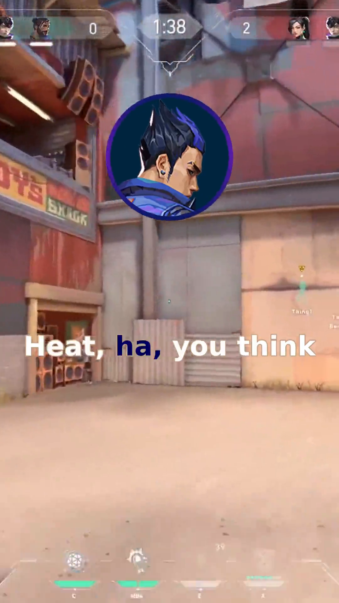
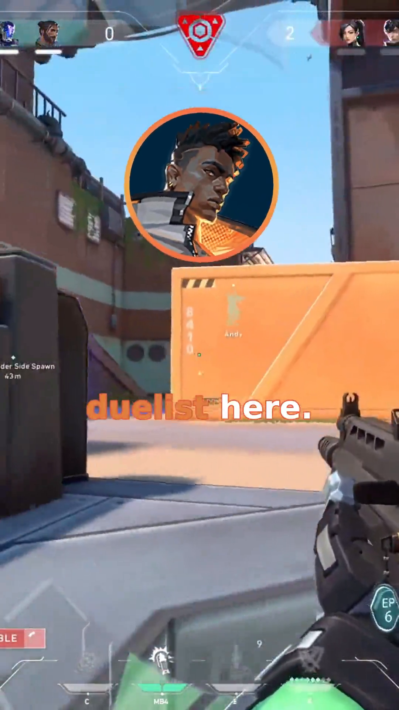

# valorant-short-maker: the pipeline that generates my Valorant shorts by itself

For a few months now, a YouTube channel has been running without me touching it: [@valorant_agents](https://www.youtube.com/@valorant_agents?app=desktop). Valorant agents trash-talking each other between rounds, dubbed, karaoke-subtitled, published as Shorts. Everything is generated by [`valorant-short-maker`](https://github.com/fox3000foxy/valorant-short-maker), a TypeScript/Bun pipeline that runs on a cron and publishes without anyone having to click anything.

Here is how it works, step by step.

## What it looks like

Three frames pulled from the video generated for "Duelist Debate" (Phoenix, Yoru, and Jett):






The result live on this Short: [Duelist Debate -- youtube.com/shorts/SX5Kme58aLU](https://www.youtube.com/shorts/SX5Kme58aLU). On the channel, Shorts get around 1.2 to 1.5k views. Nothing huge, but it's a channel that has run by itself from day one, so the number that really counts is zero -- zero minutes spent on it once the cron is running.

## The pipeline, in order

### 1. Writing the script -- Groq + Llama 3.3

Each run picks 3 to 4 agents at random from the 26 available, and sends Llama 3.3 70B (via Groq) a system prompt containing, for each chosen agent, a compact summary of their personality and relationships with the other agents in the scene (those personas live in `src/lore/`, one file per agent). The prompt enforces precise rules: one short punchy line per reply, fair rotation between characters, humor first, and above all pauses.

Concrete example with "Duelist Debate" -- Phoenix, Yoru, and Jett arguing over who gets to play duelist, generated July 6, 2026:

```
phoenix: I'm telling you, I've got the skills to play duelist this match.
yoru: Skills, you call burning things skills, Phoenix.
jett: I'm the fastest one here, I should play duelist.
phoenix: Fastest, but can you handle the heat, Jett [0.3] I doubt it.
yoru: Heat, ha, you think your flames are hotter than my rifts.
jett: This isn't about heat or flames, it's about speed and agility.
phoenix: Oh, I see, so now you're an expert on duelists, Yoru [0.3] that's rich.
yoru: At least I don't rely on cheap fire tricks.
jett: Cheap fire tricks, that's what you call Phoenix's abilities.
phoenix: Hey, my fire tricks have gotten us out of tight spots before [0.3] can't say the same for your rifts, Yoru.
yoru: Tight spots, you mean like the time I rifted us out of that trap.
jett: Enough, this is getting nowhere, let's just decide already.
phoenix: Fine, but I'm still saying I'm the best duelist here.
yoru: Please, you think you can take on the enemy team alone [0.3] I doubt it.
jett: I can take them on, no problem, I'm the fastest.
phoenix: Fastest, yeah, but can you outmaneuver them [0.3] that's the question.
yoru: Outmaneuver, ha, you think you can outmaneuver anyone, Phoenix.
jett: This is stupid, we're not going to agree on this.
phoenix: Fine, let's just play and see who comes out on top [0.3] I'm game if you are.
yoru: Bring it on, I'll show you what a real duelist looks like.
jett: I'm not backing down, I'm playing duelist.
phoenix: Oh, this should be good [0.3] let's see how you two do.
yoru: We'll see who comes out on top, won't we, Jett.
jett: Yeah, let's end this debate once and for all.
pause: 0.3
phoenix: Alright, let's get started then [0.3] may the best duelist win.
yoru: I'll make sure to burn you, Phoenix, not with fire, but with my rifts.
jett: I'll take you both down, no problem.
```

Pauses are the detail that makes the pacing feel natural: `[0.3]` inserted mid-line creates a 0.3s silence in the audio file without hiding the agent's on-screen circle, while a standalone `pause: 1.0` line creates a real silence between two speakers, circle hidden. Without that, a TTS chaining lines without breathing sounds robotic.

### 2. Giving it a voice -- Piper, one model per agent

Each agent has its own Piper model (`.onnx`) trained specifically, stored in `voices/<agent>/`. The generated text goes through the matching model, which outputs a WAV. It's the same tech I use for custom voice training in general (see the article on the Piper/Kaggle pipeline) -- here applied directly in prod, on the fly, on every video generation.

### 3. Karaoke subtitles -- generated ASS, color pulled from the icon

The subtitling is not a plain `.srt`. It's a `.ass` (Advanced SubStation Alpha) file generated word by word, with a karaoke effect: each word lights up in a color as it's spoken, while the rest of the text stays in a neutral color. The accent color is not fixed -- it's extracted dynamically from the speaking agent's icon (a Python script runs PIL over the icon PNG, samples non-transparent pixels, and returns the dominant colors). Result: Killjoy's subtitle lights up purple, Jett's in teal-green, without any color ever hardcoded anywhere.

### 4. The audio-reactive circle -- one FFmpeg expression per frame

This is the most twisted part of the pipeline, and probably the one I'm proudest of. The speaking agent's round icon doesn't sit still: it zooms in and out slightly to the rhythm of its own voice.

The math reads the raw WAV of the line, computes the RMS envelope (root mean square, a measure of signal energy) frame by frame at 60 fps, normalizes by the maximum, then smooths over a 3-frame window to avoid jank. Each envelope value is then converted to a scale factor bounded by `MAX_ZOOM_VARIATION` (0.2, so ±20% around the base size).

The result of that computation is not applied by pixel-manipulating code -- it's translated into a giant FFmpeg conditional expression (`lt(n,K)*val + between(n,K,K')*val + ...`, one branch per frame group) that drives the `scale` video filter parameter directly. FFmpeg evaluates that expression on every rendered frame. For a few-seconds line at 60 fps, that's quickly hundreds of branches in a single expression -- hence the `STEP` parameter grouping frames to cap the depth.

### 5. Per-segment rendering, then fisheye on the intro

Each line is rendered individually: video background (random excerpt from one of the gameplay clips in `bg-video/`, cut to the right length), the agent circle on top with audio-reactive zoom, subtitles burned in via FFmpeg's `ass` filter, TTS audio mixed with the background gameplay sound.

The very first segment gets special treatment: a fisheye distortion that resolves over the first 20% of frames (`lenscorrection` filter evaluated frame by frame, plus a `tmix=frames=3` that blends adjacent frames to fake motion blur), synced with a "whoosh" sound. It's the intro transition that makes it feel like the camera is "diving" into the scene.

### 6. Concatenation and final mixing

All segments are concatenated end to end, the background music (Sneaky Snitch, Kevin MacLeod, Creative Commons license) is mixed on top with **audio ducking** -- sidechain compression that automatically drops the music volume while an agent speaks, and raises it back during silences. Everything runs at 60 fps end to end, no framerate conversion between steps.

### 7. Automatic publishing

The `run-cron.sh` script, launched by a plain cron, activates the Python environment, loads the `.env`, and runs `bun src/workflow.ts --upload`. The `--upload` flag additionally triggers metadata generation (title, description, tags) and calls `uploaders/upload.py`, which publishes the video to YouTube and Instagram via two separate scripts (`uploaders/youtube/upload.py` and `uploaders/instagram/`). The whole chain, from LLM prompt to video online, runs with zero human intervention.

## Why TypeScript/Bun instead of an all-Python thing

The choice isn't ideological -- Bun gives direct, fast access to `Bun.spawn` for driving FFmpeg as a subprocess, strong typing over the pipeline's data structures (`Phrase`, `SegmentInfo`), and a much faster startup runtime than Node for a script that runs on a cron every X hours. The only two Python bits in the project are where Python is genuinely the best tool: PIL for color extraction, and the upload APIs (`google-api-python-client` for YouTube, the Instagram Graph API stack for IG).

## What it shows

This project is a good example of what you can build today with entirely free or open-source bricks: a fast, free LLM via the Groq API, a local TTS engine that runs without a dedicated GPU, FFmpeg for all video rendering -- and the glue is just a few hundred lines of TypeScript. None of those bricks is new on its own. What makes the pipeline is the arrangement: generating a coherent script with real relationships between characters, turning it into expressive audio with natural pauses, syncing a visual render to that audio's energy frame by frame, and automating the whole chain through to publishing.

---

**Resources**

- **Repo**: [github.com/fox3000foxy/valorant-short-maker](https://github.com/fox3000foxy/valorant-short-maker)
- **Channel**: [@valorant_agents](https://www.youtube.com/@valorant_agents?app=desktop)

**3 key points**

1. The script is generated by an LLM (Groq/Llama 3.3) with per-agent personas and relationships, not a plain list of pre-written jokes.
2. The agent circle zoom is driven by an FFmpeg expression computed frame by frame from the WAV's RMS envelope -- no classic keyframe animation.
3. The whole chain, from prompt to YouTube/Instagram post, runs through a single cron job with zero human intervention.
