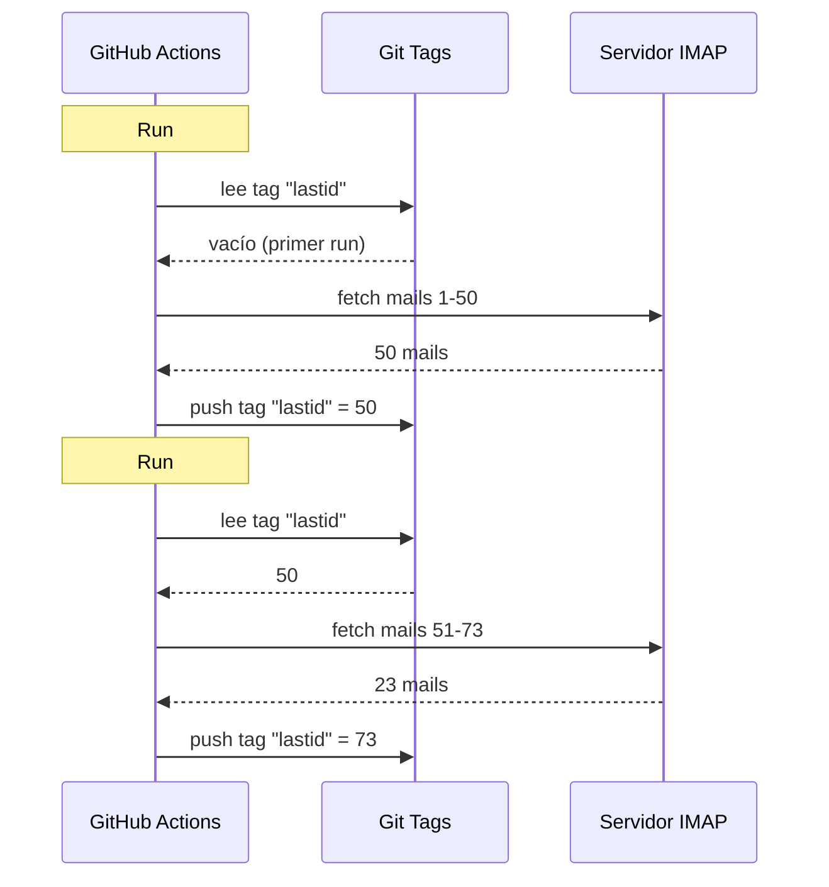

# Usé git como base de datos para correr un bot gratis en GitHub Actions

Tengo un contestador email automático que corre 24/7.

Lee mis mails, entiende de qué hablan, y responde solo con una IA. Recuerda las conversaciones previas. Ignora las newsletters y los `noreply@`. Deriva a un humano cuando está demasiado caliente.

Coste mensual: **0€**.

Paso de servidor, de VPS y de base de datos. Solo GitHub Actions y un hack de locos: **usar git como base de datos**.

¿Ves por dónde voy? ¿No? Bueno, agárrate, es tonto y genial a la vez.

---

## El problema: GitHub Actions es stateless

GitHub Actions es gratis. Puedes lanzar un cron cada 5 minutos, correr tu código, gratis.

Pero hay un problema: es **stateless**.

Cada run arranca en una máquina virgen. Nada se guarda entre dos ejecuciones. ¿El run anterior? Olvidado. Borrado. Como si nunca hubiera existido.

Para un contestador email, es un problema enorme. Tipo:

> "¿Cuál es el último mail que ya procesé?"

Si el bot olvida eso en cada run, o bien vuelve a responder los mismos mails en bucle (catástrofe), o bien pierde mails.

Hace falta un estado persistente. Y normalmente, estado persistente = base de datos. Pero una base de datos es un servidor, y un servidor ya no es gratis.

Ahí se pone interesante.

---

## La solución: git tags como base de datos

Tu repo GitHub ya es almacenamiento persistente. Gratis. Versionado. Siempre ahí.

¿Entonces por qué no guardar el estado ahí?

La idea: en cada run, el bot lee el último UID email procesado desde un **git tag**. Procesa los mails nuevos. Y luego vuelve a empujar el tag con el nuevo UID.



El tag git ES la base de datos. Un solo valor, pero es todo lo que necesitamos.

### Leer el state

Al inicio del job, recuperamos el valor desde el tag:

```bash
git fetch origin --tags lastid || true
git show refs/tags/lastid:data/lastId > data/lastId || true
```

`git show refs/tags/lastid:data/lastId` significa: "dame el contenido del archivo `data/lastId` tal como estaba en el tag `lastid`".

Boom. Tienes tu valor, sin base de datos.

### Escribir el state

Al final, recreamos el tag con el nuevo valor:

```bash
git switch --orphan lastid-tmp   # rama virgen sin historial
git rm -rf .                      # vaciamos todo
mkdir -p data
printf "%s\n" "${LAST_ID_CONTENT}" > data/lastId

git add data/lastId
git commit -m "lastId snapshot"
git tag -f lastid                 # fuerza el tag sobre ese commit
git push --force ...origin lastid # push del tag
```

Creamos una rama **huérfana** (sin historial), metemos solo el archivo `lastId`, commiteamos, tageamos, force push.

¿Por qué huérfana? Para no acumular 10 000 commits de state en el historial del repo. Cada update machaca el anterior. El tag siempre apunta a UN solo commit que contiene UN solo valor.

Es limpio. Es gratis. Es totalmente retorcido y funciona.

---

## El segundo hack: el runtime snapshot

Hay otro problema con GitHub Actions: el `npm install`.

Si en cada run (cada 5 minutos) haces `npm install` + `npm run build`, desperdicias 60-90 segundos cada vez. En un cron frecuente, son minutos de cómputo desperdiciados para nada.

Solución: precompilar el código UNA vez, y guardarlo en un tag git también.

El workflow de build (que corre cuando haces push a `master`) hace eso:

```bash
# compila el código
bun install
bun run build

# guarda dist/ + node_modules/ en un tag "runtime"
git checkout --orphan temp-runtime
git rm -rf .
cp -r "$TMPDIR"/* .
git add dist node_modules package.json bun.lock data
git commit -m "runtime build"
git tag -f runtime
git push --force ...origin runtime
```

El tag `runtime` contiene el código compilado Y los `node_modules`. Todo listo para correr.

Y el cron, por su parte, hace checkout directo de ese tag:

```yaml
- name: Checkout runtime snapshot
  uses: actions/checkout@v4
  with:
    ref: refs/tags/runtime    # el código pre-build, no la fuente
    fetch-depth: 1

# ¡sin npm install, sin build!
- name: Process emails
  run: node dist/index.js --action
```

El cron arranca al instante y solo ejecuta `node dist/index.js`, sin install ni build.

O sea, tienes dos tags que hacen dos trabajos:
- `runtime` = el código listo para correr (actualizado cuando haces push de código)
- `lastid` = el estado persistente (actualizado en cada run)

Es elegante como un guarro.

---

## El bot en sí: autorespondedor IA

Bueno, el hack git mola, pero ¿el bot qué hace exactamente?

Lee tus mails vía IMAP, los entiende con una IA (Groq + Llama 3.3 70B), y responde automáticamente.

Arquitectura en servicios limpios con inyección de dependencias (InversifyJS):

```
App
├── ImapService      → lee los mails (IMAP)
├── SmtpService      → envía las respuestas (SMTP)
├── ParserService    → parsea el contenido de los mails
├── ReplyService     → genera la respuesta IA
├── SummaryService   → memoria de conversación
├── AccountsService  → gestiona varias cuentas email
└── ConfigService    → config / env vars
```

### Dos modos de funcionamiento

El bot puede correr de dos formas:

**Modo listener** (tiempo real): conexión IMAP permanente con reconnect exponencial. Para un VPS.

```typescript
this.imapService.on("exists", async (data) => {
  console.log(`[MAIL] Nuevo mail ! Total: ${data.count}`);
  // procesa el nuevo mail de inmediato
});
```

**Modo action** (batch): procesa los mails nuevos desde el `lastId`, y luego se cierra. Para el cron GitHub Actions.

```bash
node dist/index.js --action
```

El modo `--action` es el que usa el hack git. Lee `lastId`, procesa lo nuevo, escribe el nuevo `lastId`, fin.

### NO responder a los robots

Si tu bot responde a TODOS los mails, va a responder a las newsletters, a las notificaciones, a los `noreply@`. Catástrofe. Peor: si dos bots se responden mutuamente, tienes un bucle infinito de mails. La pesadilla.

Así que filtrado agresivo:

```typescript
export function isAutomatedSender(address) {
  const automatedPatterns = [
    "noreply", "no-reply", "donotreply",
    "mailer-daemon", "postmaster", "bounce",
    "newsletter", "notification", "marketing",
    "billing", "receipt", "promo", ...
  ];
  const local = address.split("@")[0].toLowerCase();
  return automatedPatterns.some(p => local.includes(p));
}
```

Y también detección vía las cabeceras email:

```typescript
export function isAutomatedByHeaders(headers) {
  return (
    ["bulk", "list", "junk"].includes(headers.precedence) ||
    headers["auto-submitted"] !== "no" ||
    headers["list-unsubscribe"] !== "" ||   // las newsletters tienen eso
    /mailchimp|sendgrid|mailgun|brevo/i.test(headers["x-mailer"])
  );
}
```

¿`List-Unsubscribe` en las cabeceras? Es una newsletter. ¿`Precedence: bulk`? Mass-mailing. ¿`X-Mailer: Mailchimp`? Ya ves. Lo ignoramos.

Es como un portero de discoteca: los robots no pasan.

### Los triggers mágicos

La IA puede decidir no responder en absoluto, o pasar la mano a un humano. ¿Cómo? Con triggers especiales en su respuesta.

El prompt de sistema le dice:

> Si es un mail automático/newsletter → responde `<no_reply>`
> Si es demasiado importante/sensible (legal, financiero...) → responde `<manual_reply_required>`
> Si no → escribe una verdadera respuesta

Y el código lee eso:

```typescript
const aiReply = completion.choices[0].message.content.trim();
const manualTrigger = aiReply.includes(MANUAL_REPLY_TRIGGER);
const noReply = aiReply.includes(NO_REPLY_TRIGGER);

if (noReply) {
  console.log("[MAIL] La IA decidió ignorar. Skip.");
  return;
}

if (manualTrigger) {
  console.log("[MAIL] Demasiado caliente, lo derivo a un humano.");
  await this.smtpService.sendManualForward(...);
  return;
}

// si no enviamos la respuesta IA
await this.smtpService.sendReply(...);
```

O sea la IA tiene derecho a decir "no ahí no toco, llama a un humano de verdad". Eso es sabiduría.

---

## La memoria de conversación

Un detalle que lo cambia todo: el bot **recuerda** las conversaciones.

Cuando responde a alguien, guarda un resumen del intercambio. La próxima vez que esa persona escriba, el resumen se reinyecta en el prompt.

Almacenamiento: un archivo JSON por contacto.

```
data/customers/
├── moi%40gmail.com/
│   ├── alice%40example.com.json
│   └── bob%40client.fr.json
```

Y el resumen lo genera la propia IA, que fusiona el resumen viejo con el mensaje nuevo:

```typescript
const completion = await groq.chat.completions.create({
  model: "llama-3.3-70b-versatile",
  messages: [
    { role: "system", content: "Eres un asistente de memoria. Fusiona el resumen viejo con el mensaje nuevo sin perder info." },
    { role: "user", content: `Resumen existente:\n${existing}\n\nMensaje nuevo:\n${incomingContent}` }
  ],
  temperature: 0.0,  // determinista, sin creatividad
  max_tokens: 800,
});
```

Así el bot construye una memoria comprimida con el tiempo. Un resumen que crece con inteligencia basta, sin guardar todos los mails.

¿Y esos archivos JSON? Pues... también están guardados en git, en el runtime tag. Git en todas partes.

---

## El punto ingenioso con la longitud del prompt

Pequeño detalle técnico que me hizo sonreír.

Los modelos tienen un límite de tokens. Si tu mail + el resumen + el persona prompt superan, la API devuelve un error.

El código gestiona eso con una **truncación en cascada** + retry:

```typescript
try {
  // primer intento con los límites normales
  completion = await groq.chat.completions.create({...});
} catch (error) {
  if (!this.isLengthError(error)) throw error;

  // era un error de longitud: reintentamos con límites más prietos
  ({ systemContent, userContent } = this.buildPromptPayload({
    ...,
    limits: {
      systemPromptChars: 2200,  // en vez de 3000
      summaryChars: 1800,       // en vez de 4000
      personaChars: 900,        // en vez de 1500
      userContentChars: 2200,   // en vez de 8000
    },
  }));
  completion = await groq.chat.completions.create({...});  // retry
}
```

Si no pasa, cortamos más corto y reintentamos. Simple, eficaz, sin crash.

---

## Bueno, y en concreto, ¿cómo corre?

El flow completo de un run de cron:

```
1. GitHub Actions se dispara (cron cada 5 min)
2. Checkout del tag "runtime" (código pre-build)
3. git show refs/tags/lastid → recupera el último UID procesado
4. node dist/index.js --action
   ├── conexión IMAP
   ├── fetch de los mails desde lastId+1
   ├── para cada mail:
   │   ├── parsea el contenido
   │   ├── filtra los robots (skip si automated)
   │   ├── matchea la cuenta destinataria
   │   ├── recupera la memoria de conversación
   │   ├── genera la respuesta IA (Groq)
   │   ├── <no_reply> ? skip
   │   ├── <manual_reply_required> ? forward humano
   │   ├── si no: envía la respuesta (SMTP)
   │   └── update la memoria de conversación
   └── escribe el nuevo lastId
5. git push --force tag "lastid" con el nuevo valor
```

Y vuelve a empezar en 5 minutos. Para siempre. Gratis.

---

**Los 3 puntos a recordar:**

1. **Git = base de datos gratis**: Un tag huérfano puede guardar tu estado persistente entre dos runs stateless. `git show refs/tags/X:fichero` para leer, force-push para escribir. Te ahorras una DB completa.

2. **Precompila en un tag runtime**: En vez de `npm install` en cada run del cron, guarda el código compilado + node_modules en un tag git. El cron arranca al instante.

3. **Un bot IA debe saber callarse**: Los triggers `<no_reply>` y `<manual_reply_required>` dejan a la IA decidir no responder o pasar la mano. Más el filtrado antirrobot. Si no creas un bucle de mails infinito.

Cron serverless con estado persistente, IA, memoria, todo por 0€/mes. Está completamente roto y me encanta ese montaje.
