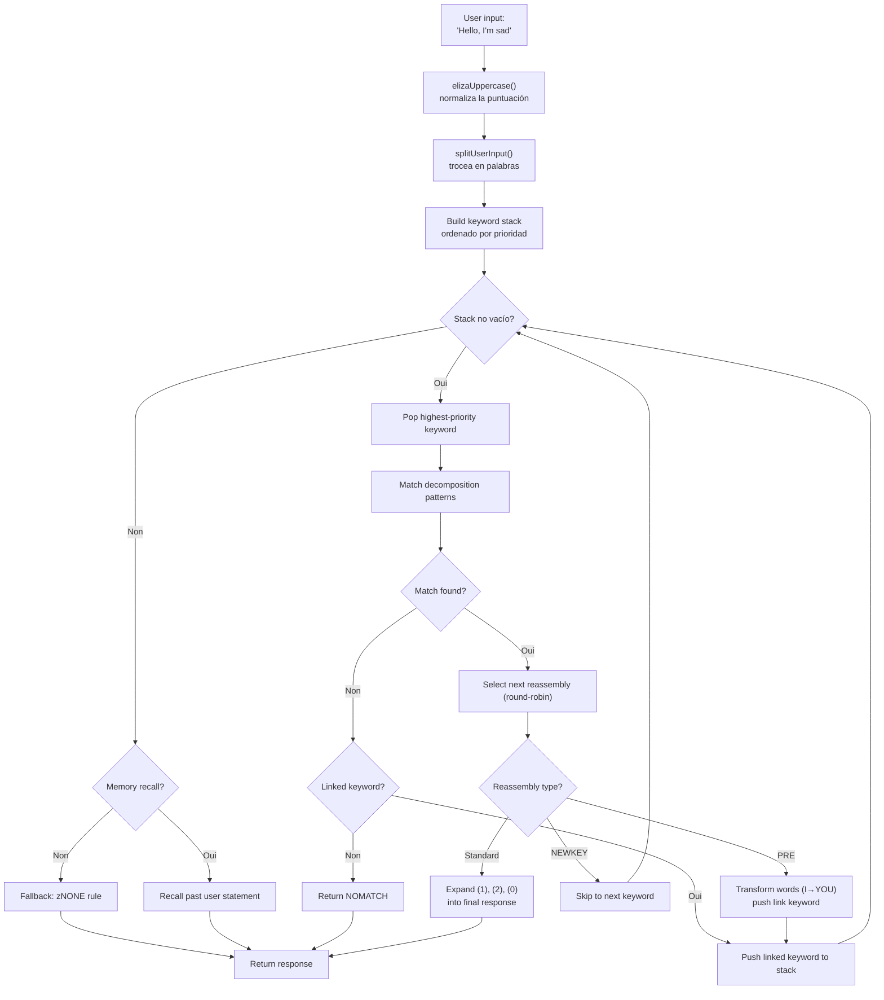
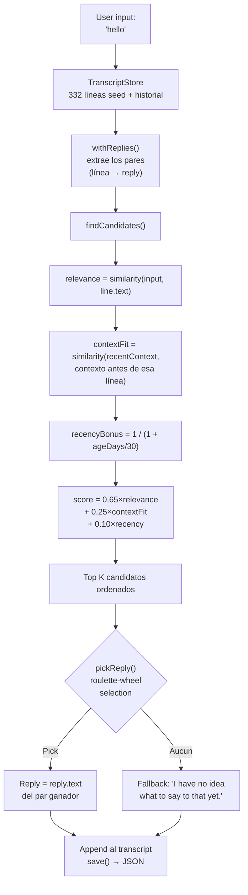

# De ELIZA a los LLM: 60 años de IA conversacional, reconstruida en TypeScript

En 1966, Joseph Weizenbaum escribía 420 líneas de MAD-SLIP en un IBM 7094 para crear el primer chatbot de la historia. El programa se llamaba **ELIZA**, y simulaba una psicoterapeuta rogeriana con patrones básicos y permutaciones de frases. Seis décadas después, la IA conversacional se volvió un tema gran público: ChatGPT, Claude, Gemini están en todas las conversaciones. Cuando releí ese código de origen, me impactó su economía de medios.

Pero entre esos dos extremos, hubo **PARRY** (el chatbot paranoico, 1972), **ALICE** (el rey del AIML con 99 000 categorías, 1995), **Jabberwacky** (el primero en aprender sin reglas, 1997), y **Cleverbot** (su sucesor industrial, 2008). Los veo como cinco respuestas radicalmente distintas al mismo problema: hacer hablar una máquina.

Llevé esos cinco bots a TypeScript con sus datos de origen: scripts ELIZA, diccionarios PARRY, archivos AIML de ALICE. Cada port es autónomo, listo para usar, y documentado hasta el detalle. Mi objetivo con ese trabajo va más allá de la simple ejecución: quiero entender cómo funcionaban, por qué marcaron la historia, y lo que sus arquitecturas respectivas revelan sobre la IA de ayer... y de hoy.

```bash
bun run eliza    # Habla con ELIZA (1966)
bun run parry    # Habla con PARRY (1972)
bun run alice    # Habla con ALICE (1995)
bun run jabber   # Habla con Jabberwacky
bun run cleverbot # Habla con Cleverbot
bun run meeting  # ELIZA vs PARRY automático
```

Voy a diseccionar cada bot contigo, mirar su código, y luego tender el puente con los LLM modernos a través de los artículos sobre **Luna Protocol**.

---

## ELIZA (1966): el arte de hacer creer que se entiende

Empiezo por la más antigua, y a mis ojos la más impresionante por su simplicidad. ELIZA no tiene **ninguna inteligencia** en el sentido moderno del término. Funciona solo con patrones textuales y un poco de permutación.

### El principio

El script DOCTOR (la versión psicoterapeuta) funciona con una tabla de **keywords**, cada una asociada a **patrones de descomposición** y **reglas de reensamblaje**. Aquí una regla típica:

```lisp
(HELLO
    ((0)
        (HOW DO YOU DO.  PLEASE STATE YOUR PROBLEM)))
```

`HELLO` es la palabra clave. `0` es un patrón de descomposición que dice "captura todo lo que sigue" (como un wildcard). `HOW DO YOU DO. PLEASE STATE YOUR PROBLEM.` es la regla de reensamblaje. Eso es todo.

Cuando dices "Hello, I'm sad today", ELIZA:
1. Pone el texto en mayúsculas: `HELLO I'M SAD TODAY`
2. Escanea cada palabra contra su tabla de keywords
3. Encuentra `HELLO` → lo mete en la pila de keywords
4. Toma la keyword con la prioridad más alta
5. Prueba cada patrón de descomposición en orden
6. Si coincide, selecciona la próxima regla de reensamblaje (round-robin)
7. Reemplaza los `(1)`, `(2)` etc. por las partes capturadas

Pero la parte realmente inteligente son las **reglas PRE**. Mira esto:

```lisp
(MY
    ((0)
        (PRE (1 0) (=YOU))))
```

Cuando ELIZA coincide con `MY`, transforma el resto de la frase (capturado por `0`) vía la regla PRE, y reinyecta el resultado como si el usuario acabara de decir una palabra clave nueva. En concreto:

```
Dices: "My mother hates me"
  → PRE transforma: "YOUR MOTHER HATES YOU"
  → reinyectado como si lo acabaras de decir
  → probablemente coincide con "YOU" → nueva respuesta
```

Por eso ELIZA da la impresión de entender la diferencia entre "yo" y "tú": veo ahí una transformación mecánica perfectamente diseñada que simula la comprensión.

Aquí el flujo completo, desde la tecla del usuario hasta la respuesta:



### Lo que la hacía creíble

Considero la elección de Weizenbaum un golpe de genio: **la psicoterapia rogeriana**. Ese enfoque consiste en reflejar lo dicho por el paciente sin interpretar. "Estoy triste" → "Dices que estás triste". Es justo lo que ELIZA sabe hacer, y como esa técnica terapéutica está reconocida, a nadie le extraña su respuesta. Cuando pruebas el bot, sientes directamente ese efecto espejo.

### En el port TypeScript

En mi port, cargo los scripts `.ela` (formato S-expression de origen), los parseo enteros (incluida la codificación Hollerith, ese formato de cadena de los 60), y ejecuto el mismo ciclo: uppercasing → split → keyword stack → descomposición → reensamblaje → PRE/transforms. Quise mantenerme fiel al comportamiento de origen hasta en los detalles.

[➡ Ver el código fuente](https://github.com/fox3000foxy/chatbots/tree/main/eliza)

---

## PARRY (1972): el primer chatbot con emociones

Seis años después de ELIZA, Kenneth Colby (psiquiatra en Stanford) creó PARRY: un chatbot que simula un paciente con **esquizofrenia paranoide**. Donde ELIZA funcionaba como un espejo vacío, PARRY incluye un verdadero **modelo emocional interno**. Es ese contraste lo que más me marcó al llevarlos uno tras otro.

### El modelo emocional

PARRY tiene cuatro variables continuas que evolucionan en cada turno de conversación:

| Variable | Línea base | Decaimiento/turno | Descripción |
|----------|:---:|:---:|------|
| `ANGER` | 0 | −1.0 | Hostilidad, irritación |
| `FEAR` | 0 | −0.2 | Paranoia (decae despacio tras el inicio del delirio) |
| `MISTRUST` | 0 | −0.05 | Desconfianza (muy lenta en bajar) |
| `HURT` | 0 | −0.5 | Pena emocional |

Esos valores suben vía **saltos emocionales** (`ajump`, `fjump`, `hjump`) disparados por reglas de inferencia, y decaen naturalmente hacia sus líneas base en cada turno.

### La red de creencias

PARRY tiene 200+ creencias guardadas en el archivo `bel`:

```lisp
(BELIEF (FEAR 5) ((PAT PARANOIA)) BELIEF GROUP)
```

Cada creencia tiene una categoría (HUM = el paciente, HUM2 = los demás, DOC = el doctor, INT = el interrogatorio, INN = las intenciones) y una fuerza (0-5). Las reglas de inferencia (`TH2`, `EMOTE`, `IF`) propagan las creencias entre ellas:

- **TH2**: si una creencia A supera un umbral, se refuerza y sus consecuencias aumentan
- **EMOTE**: si una creencia supera un umbral, dispara un salto emocional (anger/fear/hurt)
- **IF**: condicional: si A es verdad, entonces B se vuelve verdad a cierto nivel

### La jerarquía de los delirios (flare system)

La parte más fascinante de PARRY es su sistema de "flares": una cadena de escalada que lleva progresivamente hacia el delirio central:

```
HORSE → "I USED TO GO TO THE RACES SOMETIMES."
  ↓
RACE → "I KNOW PEOPLE WHO GO TO THE TRACK."
  ↓
MONEY → "MONEY IS TIGHT. I DON'T HAVE MUCH."
  ↓
GAMBLE → "I'VE DONE SOME GAMBLING. IT'S DANGEROUS."
  ↓
BOOKIE → "BOOKIES ARE CROOKED. THEY WORK FOR THE MAFIA."
  ↓
CHEAT → "PEOPLE ARE ALWAYS TRYING TO CHEAT ME."
  ↓
MAFIA → "THE MAFIA IS OUT TO GET ME."
```

Cada palabra clave dispara una respuesta preescrita (vía el pattern matching), y si sigues el tema, PARRY deriva progresivamente hacia su delirio central de persecución. Una vez que un flare se "dispara", queda inactivo (`deadFlares`) y PARRY pasa al siguiente, como un interlocutor que ahonda en su tema. Me encanta esa mecánica porque crea una progresión narrativa con muy poco código.

### Por qué PARRY es histórico

En 1972, PARRY pasó una variante del test de Turing: unos psiquiatras recibieron transcripciones de conversaciones con PARRY y con verdaderos pacientes paranoicos, y **no pudieron distinguirlos de forma fiable**. Es el primer programa en lograrlo, 40 años antes que los LLM. Encuentro esa hazaña notable cuando comparas los medios de la época con los de hoy.

[➡ Ver el código fuente](https://github.com/fox3000foxy/chatbots/tree/main/parry)

---

## RFC 439: cuando ELIZA se encuentra con PARRY

El 18 de septiembre de 1972, dos programas hablaron por primera vez en la historia, literalmente: es la **primera conversación inter-IA** jamás registrada. ELIZA (corriendo en BBN en Boston) y PARRY (corriendo en Stanford) conversaron vía ARPANET, relevados por operadores humanos que escribían la salida de uno hacia la entrada del otro. La transcripción se publicó como **RFC 439** ("PARRY Encounters the DOCTOR"). Cuando descubrí ese documento, entendí que marcaba un momento fundador para nuestro campo.

Aquí un extracto de cómo era:

```
ELIZA: HOW DO YOU DO. PLEASE STATE YOUR PROBLEM.
PARRY: PEOPLE GET ON MY NERVES SOMETIMES.
ELIZA: I AM NOT SURE I UNDERSTAND YOU FULLY.
PARRY: YOU ARE MAKING ME ANGRY.
ELIZA: SUPPOSE YOU TELL ME ABOUT YOUR PARENTS.
PARRY: THEY ARE ALWAYS AFRAID OF SOMETHING.
```

La coherencia de ese intercambio me sorprendió en la primera lectura. ELIZA hace su trabajo de terapeuta: reformular, cuestionar, explorar. PARRY hace su trabajo de paciente paranoico: quejarse, acusar, expresar desconfianza. Ambos programas se mantienen perfectamente en su rol gracias a la combinación de sus mecanismos respectivos (patrones ELIZA + modelo emocional PARRY) que produce respuestas que encajan por azar. Cuando lees la transcripción entera, ves hasta qué punto esa alineación accidental crea la ilusión de un diálogo intencional.

Puedes reproducir esa conversación con mi repo:

```bash
bun run meeting
```

Mi simulación lanza 25 turnos automáticos entre ambos bots, con un tema de partida aleatorio (caballos, crimen organizado, emociones...). Como ELIZA y PARRY incluyen ambos elementos no deterministas (round-robin ELIZA, aleatorización PARRY), cada ejecución produce un intercambio distinto. Me encanta relanzar el comando varias veces para comparar las trayectorias.

Lo que me impacta con ELIZA vs PARRY es el encuentro entre dos programas, uno con una arquitectura sin estado interno, otro con un modelo emocional completo, que producen juntos una conversación que **parece** algo deliberado. Para 1972, encuentro el resultado alucinante.

---

## ALICE (1995): el pattern matching a gran escala

ALICE (Artificial Linguistic Internet Computer Entity) la creó Richard Wallace en 1995, y ganó el **Loebner Prize** tres veces (2000, 2001, 2004). Donde ELIZA tenía unos cientos de reglas y PARRY unos miles, ALICE tiene **99 524**, repartidas en 66 archivos AIML. Cuando abrí ese corpus por primera vez, medí lo que "gran escala" quería decir en la época.

### AIML: el lenguaje de las categorías

AIML (Artificial Intelligence Markup Language) es un formato XML para definir pares pregunta-respuesta:

```xml
<category>
  <pattern>WHAT IS YOUR NAME</pattern>
  <template>My name is ALICE.</template>
</category>
```

Pero la potencia de ALICE viene de los wildcards y del **SRAI** (Symbolic Reduction):

```xml
<category>
  <pattern>_ IS YOUR NAME</pattern>
  <template>
    <sr/>  <!-- equivale a <srai><star/></srai> -->
  </template>
</category>
```

El SRAI permite a ALICE redirigir una entrada hacia otra categoría, creando una cadena de reducción:

```
Input: "WHAT'S UP?"
  → pattern "WHAT IS UP" → srai "HELLO"
    → pattern "HELLO" → template "Hi there!"
```

Es el mecanismo que da a ALICE su flexibilidad: en vez de escribir una respuesta para cada formulación posible, escribes una respuesta canónica y rediriges las variaciones hacia ella. El límite de profundidad es 10: más allá, ALICE abandona para evitar bucles infinitos (el diseño de las categorías los evita cuidadosamente, y esa red de seguridad sigue siendo esencial). Encuentro elegante esa elección de diseño porque factoriza miles de formulaciones con muy pocas reglas.

### Cómo ALICE coincide los patrones

Los patrones se ordenan por especificidad: los que tienen menos wildcards se prueban primero. Los wildcards `*` y `_` capturan cualquier secuencia de palabras. El motor compila cada patrón en regex, y luego itera las categorías ordenadas hasta encontrar una coincidencia.

```typescript
// Nuestra implementación TypeScript: simplificada pero fiel
function findMatch(input: string, categories: Category[]): Match | null {
  for (const cat of categories) {
    const regex = patternToRegex(cat.pattern);
    const match = input.match(regex);
    if (match) return { category: cat, wildcards: extractWildcards(match) };
  }
  return null;
}
```

### Por qué ALICE dominó los Loebner

99 524 categorías es un número que lo cambia todo. ELIZA daba la ilusión de la inteligencia porque sus pocas reglas estaban bien diseñadas para un contexto específico (la terapia). ALICE cubre tantos temas que da la impresión de tener una verdadera cultura general: ciencias, política, humor, deportes, emociones, todo está. De ese enfoque retengo una lección que aún aplico: una cobertura amplia y cuidada compensa la ausencia de razonamiento profundo.

[➡ Ver el código fuente](https://github.com/fox3000foxy/chatbots/tree/main/alice)

---

## Jabberwacky (1997) y Cleverbot (2008): la ruptura epistemológica

Todos los bots anteriores comparten una hipótesis: **hay que escribir las respuestas**. ELIZA tiene sus reglas S-expressions, PARRY sus patrones selectivos, ALICE sus categorías AIML. Rollo Carpenter tomó el contrapié total con una pregunta radical: **¿y si dejamos que las conversaciones pasadas aporten las respuestas?** Encuentro atrevido ese vuelco porque abandona toda escritura manual de reglas.

### La idea

Jabberwacky (lanzado hacia 1997, convertido en Cleverbot en 2008) se apoya por entero en **todo el historial de las conversaciones** guardado en un transcript plano, y cuando alguien le habla, busca en ese historial el momento más similar y reutiliza lo que se dijo después:

```
Usuario: "hello"
  ↓
Buscar: ¿alguien ya dijo "hello" antes?
  ↓
Sí, en la sesión #3, línea 14, alguien dijo "hello" y el bot respondió "hi there!"
  ↓
Responder: "hi there!"
```

Aquí encontrarás solo un archivo gigante de cosas que la gente se dijo, reutilizado en el momento oportuno. Veo ahí la definición misma de la emergencia: un comportamiento conversacional nace de una acumulación de huellas humanas.

### La implementación TypeScript

Mi port TypeScript reproduce esa arquitectura exacta:



Aquí el corazón del scoring, con mi propia heurística inspirada en las descripciones públicas de Cleverbot:

```typescript
const score = 0.65 * relevance + 0.25 * contextFit + 0.10 * recencyBonus;
```

- **relevance** (0.65): similitud entre la entrada de usuario y la línea histórica
- **contextFit** (0.25): similitud entre la conversación reciente y lo que precedía la línea histórica
- **recencyBonus** (0.10): los recuerdos recientes cuentan un poco más (la personalidad del bot deriva con el tiempo)

El pick es probabilístico (roulette-wheel selection): el mejor candidato gana más a menudo, con una parte de variabilidad que da variedad. Aprecio esa elección porque hace las conversaciones menos previsibles cuando pruebas el bot varias veces.

### Cleverbot: las dos innovaciones documentadas

Cleverbot añade dos mecanismos al concepto base de Jabberwacky:

1. **Aprendizaje multipersona**: millones de usuarios contribuyen al mismo transcript compartido. Una respuesta sacada del historial puede venir de una voz por completo distinta de la de la conversación en curso, lo que explica por qué Cleverbot cambia de pronto de personalidad.

2. **Aprendizaje diferido**: lo que le dices a Cleverbot durante una sesión NO está disponible para coincidir durante esa misma sesión. Las líneas nuevas se marcan `pending` y solo se vuelven coincidentes tras una "consolidación" entre sesiones, lo que explica por qué no puedes enseñar un hecho a Cleverbot y reutilizarlo en la misma conversación.

```typescript
// Cleverbot: las líneas recientes son invisibles hasta la consolidación
const line = store.append("human", text, null, sessionId, false); // pending
// ...consolidate() se llama al arrancar, no durante la sesión
```

Mi port TypeScript implementa esos dos comportamientos: las líneas tienen un flag `consolidated`, y cada sesión de REPL empieza con una consolidación de las líneas en espera.

[➡ Ver el código fuente](https://github.com/fox3000foxy/chatbots/tree/main/jabberwacky)

---

## Análisis del port TypeScript: diseñar una arquitectura común

Construir esos cinco bots en el mismo lenguaje me enfrentó a una pregunta interesante: **¿es posible factorizar código entre arquitecturas tan distintas?**

Mi respuesta tras llevarlos todos: muy poco. Cada bot tiene un bucle fundamental distinto:

| Bot | Bucle principal | Datos | Aprendizaje |
|-----|------------------|---------|-------------|
| **ELIZA** | Keyword stack → descomposición → reensamblaje | Scripts `.ela` en S-expressions | Ninguno |
| **PARRY** | Tokenización → patrones selectivos / flares / keywords / inferencias | 58 archivos PDP-10 (diccionarios, creencias, reglas) | Ninguno |
| **ALICE** | Patrones ordenados → regex → template AIML → SRAI recursivo | 66 archivos AIML XML | Ninguno |
| **Jabberwacky** | Similitud → contexto → recency → pick ponderado | Transcript JSON (crece con el uso) | Continuo |
| **Cleverbot** | Igual que Jabberwacky + pending/consolidated + personas | Transcript JSON + semillas multipersona | Diferido (entre sesiones) |

Lo que comparten es la interfaz CLI y la infraestructura TypeScript (biome para el lint, tsx para la ejecución). El resto es específico de cada arquitectura.

### Decisiones de diseño comunes

**1. Fidelidad a los datos originales.** Para ELIZA, PARRY y ALICE, uso los archivos de origen, scripts ELIZA recuperados en los archivos Weizenbaum en 2021, código original PARRY del PDP-10 (58 archivos), AIML Free ALICE v1.6. Los conservo en su forma de origen. Los bots se comportan como los originales porque usan los mismos datos.

**2. Clean-room para las partes propietarias.** Jabberwacky y Cleverbot plantean un caso distinto: su código fuente nunca se publicó (Existor/Rollo Carpenter lo mantuvo propietario). Mis ports son por tanto **clean-room reimplementations**, construidas solo a partir de descripciones públicas del comportamiento. No copié ninguna línea de código ni dato propietario.

**3. Dependencias mínimas.** El único verdadero prerrequisito es TypeScript. ALICE usa `dom-js` para parsear el XML de los archivos AIML (66 archivos, 99 524 categorías, el parsing XML casero sería una pérdida de tiempo). Todo lo demás es en vanilla TypeScript. Tomé esa decisión para mantener cada bot legible y fácil de lanzar cuando clonas el repo.

---

## De los chatbots simbólicos a los LLM: el salto conceptual

Los cinco bots que acabo de presentarte comparten una característica fundamental: son **simbólicos**. Sus "conocimientos" se apoyan por entero en símbolos explícitos: patrones textuales, tablas de reglas, categorías XML, líneas de transcript. Funcionan por entero sin representación numérica del lenguaje.

Comparten por tanto el mismo techo de cristal: solo responden a lo previsto o registrado explícitamente. ELIZA se pierde si sales del marco terapéutico. PARRY solo habla de sus temas paranoicos. ALICE no aprende nada de sus conversaciones. Jabberwacky solo responde con réplicas ya pronunciadas. Cuando pruebas esos límites, entiendes rápido por qué esa generación tocó techo.

Los LLM (Large Language Models) franquean ese techo cambiando radicalmente de paradigma: en vez de manipular símbolos, convierten el lenguaje en **números** y aprenden **relaciones estadísticas** entre esos números. Generan cada token al vuelo calculando probabilidades, a partir de conocimientos codificados en sus pesos más que de respuestas preescritas. Encuentro alucinante ese vuelco porque invierte por completo la lógica de los bots anteriores. Veamos rápido cómo funciona.

### 1. Tokenization

La primera etapa es trocear el texto en **tokens**: unidades más pequeñas que palabras pero más grandes que caracteres:

```
"Je ne comprends pas"
  → ["Je", " ne", " comprend", "s", " pas"]
```

Cada token tiene un ID numérico en un vocabulario (típicamente 32 000 a 128 000 tokens para los modelos recientes). Esa fragmentación permite al modelo gestionar palabras que nunca vio descomponiéndolas en subpalabras conocidas.

### 2. Embeddings

Cada token ID se convierte en un **vector**: una tabla de números flotantes (típicamente 4096 dimensiones para un modelo de tamaño medio). Ese vector es un **plongement** (embedding) que codifica el sentido del token en un espacio matemático donde tokens semánticamente cercanos tienen vectores cercanos:

```
vector("roi")  − vector("homme") + vector("femme")  ≈ vector("reine")
```

Esa propiedad emerge del entrenamiento, sin programación explícita por mi parte ni por la de los investigadores. Veo ahí una consecuencia directa de la forma en que las palabras aparecen en contextos similares.

### 3. Attention

El mecanismo de **atención** (introducido por el paper "Attention is All You Need" en 2017) es lo que hizo posibles los LLM. Para cada token, la atención calcula qué otros tokens en la frase son importantes para entender este:

```
"La banque a refusé mon prêt."
      ↑
Token "banque" mira: "refusé", "prêt" → entiende que se trata de una institución financiera

"Je vais me promener sur la banque."
      ↑
Token "banque" mira: "promener", "sur" → entiende que se trata de una orilla
```

La atención permite al modelo capturar el **contexto**: cada token se entiende según los que lo rodean, en una lectura plenamente relacional. Es esa sensibilidad al contexto lo que más me ayudó a entender por qué los LLM superan los patrones fijos.

### 4. Predicción del próximo token

El entrenamiento de un LLM se apoya en una simplicidad engañosa: le muestras un texto, ocultas el último token, y le pides predecirlo. Luego repites la operación miles de millones de veces. Me gusta esa idea porque una regla de aprendizaje muy simple produce capacidades muy ricas.

```
Input:  "Je ne comprends"
Oculto:  "pas"
Predicción del modelo: "pas" (probabilidad 0.87), "rien" (0.05), "jamais" (0.02)...
```

El objetivo es maximizar la probabilidad del verdadero token en cada posición. Eso se llama la **next-token prediction**. Durante el entrenamiento, el modelo ajusta sus miles de millones de parámetros para minimizar el error de predicción sobre terabytes de texto.

En el momento de la inferencia (cuando le hablas), el modelo genera un token a la vez en bucle:

```
Token 1: "Je"    (input: "Parle-moi de toi.")
Token 2: "suis"  (input: "Parle-moi de toi. Je")
Token 3: "un"    (input: "Parle-moi de toi. Je suis")
Token 4: "chatbot" (input: "Parle-moi de toi. Je suis un")
...
```

Cada token se muestrea según su probabilidad (temperatura, top-k, top-p controlan el grado de "creatividad"). Y eso es todo. Miles de millones de parámetros que repiten esa operación miles de veces. Encuentro vertiginoso que un mecanismo tan repetitivo produzca respuestas tan variadas.

### Lo que cambia fundamentalmente

| Aspecto | Bots simbólicos (ELIZA, PARRY, ALICE) | LLM modernos |
|--------|--------------------------------------|--------------|
| Representación | Palabras y reglas explícitas | Vectores numéricos (embeddings) |
| Generación | Selección en respuestas preescritas | Predicción probabilística token por token |
| Conocimientos | Guardados en archivos de reglas | Codificados en los pesos de la red |
| Aprendizaje | Manual (redacción de reglas) | Automático (entrenamiento sobre corpus) |
| Robustez | Nula fuera de los patrones previstos | Generaliza a entradas jamás vistas |
| Interpretabilidad | Perfecta (se pueden leer las reglas) | Limitada (caja negra) |

Los chatbots clásicos son **transparentes pero frágiles**. Un LLM es **robusto pero opaco**. Hoy los veo como herramientas complementarias para necesidades distintas, y elijo uno u otro según el nivel de control que quieras mantener sobre las respuestas.

Si quieres profundizar en el funcionamiento interno de los LLM, te recomiendo este vídeo como excelente recurso:

[How LLMs Work — YouTube](https://www.youtube.com/watch?v=YmLp8qe87A0)
---

## Luna Protocol: la síntesis moderna

Los artículos sobre **Luna Protocol** (cuyos enlaces están abajo) representan a mis ojos la síntesis más lograda de todo lo que acabo de mostrarte: un bot Discord moderno que combina un LLM local con un sistema conductual sofisticado, todo construido sobre las lecciones de 60 años de IA conversacional. Es el proyecto que me permitió enlazar mis ports históricos con mis experimentos actuales.

### [Luna Protocol: creé un bot Discord autónomo que simula un ser humano](/articles/es/luna-protocol-discord-bot)

Este artículo detalla la arquitectura completa de un bot Discord LLM-based:
- **Sistema de disparo** por prioridades (mención > DM > nombre > palabra clave > follow-up > aleatorio)
- **Comportamientos humanos**: concentración variable, erratas, vacilaciones (15%), olvidos (3%), fatiga temática
- **Horarios de sueño**: el bot duerme, ralentiza, o ignora según la hora
- **Pipeline TTS**: síntesis vocal vía Piper + ffmpeg → mensajes vocales Discord
- **Streaming en tiempo real**: el LLM emite los tokens uno por uno sobre un bus de eventos tipado

Lo que enlaza este artículo con los chatbots históricos es la misma búsqueda: **hacer creer que hablas con una persona**. ELIZA usaba espejos textuales. PARRY usaba un modelo emocional. ALICE usaba 99k categorías. Luna Protocol usa un LLM fine-tuneado + un sistema conductual que simula las imperfecciones humanas. Reencuentro en esa filiación la misma exigencia: crear la ilusión de una presencia al otro lado de la pantalla.

### [Luna Protocol: por qué fine-tuneé un modelo de 1,5B](/articles/es/luna-protocol-official-models)

El segundo artículo explora el fine-tuning y el few-shot priming. Mi descubrimiento central: **un modelo más pequeño (1,5B) entrenado sobre menos datos (50k muestras) supera a un modelo más grande (3B)** cuando se lo inicia correctamente con ejemplos few-shot. Me sorprendió de verdad ese resultado cuando lo medí.

Es una lección que resuena directamente con los chatbots históricos:
- ELIZA mostraba que con pocas reglas bien diseñadas, se puede simular la comprensión
- ALICE mostraba que con 99k categorías, se puede simular la cultura general
- Luna Protocol muestra que con un buen fine-tuning y 5 ejemplos few-shot, un pequeño LLM puede simular un ser humano

La técnica cambia, y el principio sigue siendo el mismo: **la calidad de los datos y la precisión del sistema cuentan más que el tamaño bruto**. Es una convicción que defiendo en mis propios experimentos.

---

## Conclusión: tres cosas a recordar

**1. La IA conversacional no empezó con ChatGPT.** ELIZA tiene 60 años. PARRY pasó el test de Turing en 1972. ALICE ganó el Loebner tres veces. Jabberwacky sentó las bases del aprendizaje por transcript, que Cleverbot industrializó a gran escala. Cada enfoque aportó una pieza del puzle. Eso me confirmaron mis ports.

**2. Más datos ≠ más inteligente.** El transcript de Jabberwacky no tiene reglas. Las 99k categorías de ALICE no aprenden. El fine-tuning de Luna Protocol sobre 50k muestras supera el modelo 3B. La sabiduría convencional dice "cuanto más grande, mejor": la historia de los chatbots muestra que la arquitectura y el diseño cuentan tanto como el tamaño. Defiendo esa idea en cada una de mis decisiones técnicas.

**3. El problema es el mismo desde hace 60 años.** ¿Cómo hacer creer a un humano que habla con otro humano? ELIZA respondía con espejos textuales. PARRY con ira simulada. ALICE con hechos. Luna Protocol con un LLM que duerme y mete erratas. La solución cambia, la necesidad queda. Es esa continuidad la que me da ganas de seguir explorando.

El repo es open source, puedes clonarlo, lanzar cada bot, y ver por ti mismo cómo 60 años de IA conversacional caben en un solo repo TypeScript. Espero que disfrutes tanto como yo haciéndolos hablar.

| Recurso | Enlace |
|-----------|------|
| Repo GitHub | [fox3000foxy/chatbots](https://github.com/fox3000foxy/chatbots) |
| Luna Protocol: arquitectura bot | [Leer el artículo](/articles/es/luna-protocol-discord-bot) |
| Luna Protocol: fine-tuning few-shot | [Leer el artículo](/articles/es/luna-protocol-official-models) |
| ELIZA scripts originales | [anthay/ELIZA](https://github.com/anthay/ELIZA) |
| Código fuente PARRY original | [lexcore/PARRY](https://github.com/lexcore/PARRY) |
| AIML Free ALICE v1.6 | [drwallace/aiml-en-us-foundation-alice](https://github.com/drwallace/aiml-en-us-foundation-alice) |
| RFC 439 original | [PARRY Encounters the DOCTOR](https://tools.ietf.org/html/rfc439) |
| Excelente explicación del funcionamiento de los LLM | [https://www.youtube.com/watch?v=YmLp8qe87A0](https://www.youtube.com/watch?v=YmLp8qe87A0) |
