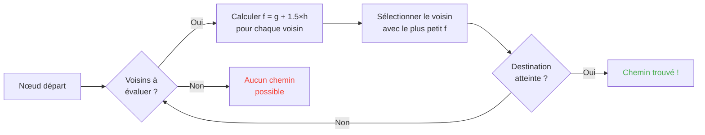

## Introducción

Pasé horas mirando ovejas chocando contra muros.

¿Y honestamente? La mejor inversión de mi vida.

Porque cuanto más miras esos mobs, más te das cuenta de que no tienen nada de aleatorio. Cada movimiento está programado, es previsible, y sobre todo totalmente rompible. Terminé zambulléndome en el código fuente de Minecraft para pillar exactamente cómo funciona el pathfinding, y lo que descubrí es que puedes literalmente hacer mind-control a los mobs. O sea, forzarlos a ir DONDE TÚ quieres, no a donde el azar decida.

Esta guía es todo lo que aprendí escarbando. La IA, el algoritmo A*, los malus ocultos, los exploits que puedes soltar en survival. Prepara tu pico.

---

## Cómo funciona la IA de los mobs (spoiler: es tonta)

### Los Goals

Cada mob tiene *goals*. Es una lista de acciones que PUEDE hacer y cuánto le APETECE hacerlas. Cuanto más pequeño el número, más prioritario, como una todo list versión caos.

```java
protected void registerGoals() {
   this.goalSelector.addGoal(4, new Zombie.ZombieAttackTurtleEggGoal(this, 1.0, 3));
   this.goalSelector.addGoal(8, new LookAtPlayerGoal(this, Player.class, 8.0F));
   this.goalSelector.addGoal(8, new RandomLookAroundGoal(this));
   this.addBehaviourGoals();
}
```

¿Ya viste un zombi ignorar un huevo de tortuga para correr tras de ti? He aquí por qué: `ZombieAttackTurtleEggGoal` tiene prioridad 4, mientras que `ZombieAttackGoal` (el goal que le dice que te coma la cara) está a prioridad 2.

Sí, un zombi prefiere comerte que romper un huevo. Qué bonito el amor.

El goal que de verdad nos interesa es `WaterAvoidingRandomStrollGoal`, prioridad 7. El goal "no tengo nada que hacer así que camino al azar". Ahí todo se pone interesante.

### El movimiento (o "cómo un random march tiene 1 probabilidad entre 60 de producirse")

Cada tick (cada 0.05 segundos), el juego llama a `canUse()` para ver si el mob se digna a moverse. 1 probabilidad entre 60 en cada tick. Diseño completamente tonto, y me encanta.

```java
public boolean canUse() {
   if (this.mob.hasControllingPassenger()) {
      return false;
   } else {
      if (!this.forceTrigger) {
         if (this.checkNoActionTime && this.mob.getNoActionTime() >= 100) {
            return false;
         }
         if (this.mob.getRandom().nextInt(reducedTickDelay(this.interval)) != 0) {
            return false;
         }
      }
      Vec3 $$0 = this.getPosition();
      if ($$0 == null) {
         return false;
      } else {
         this.wantedX = $$0.x;
         this.wantedY = $$0.y;
         this.wantedZ = $$0.z;
         this.forceTrigger = false;
         return true;
      }
   }
}
```

Así que en resumen: si estás montado en el mob -> no, si el mob no hizo nada desde hace 5 segundos -> no, si el random dice no -> no. El juego de VERDAD no quiere que el mob se mueva.

Pero cuando se mueve, `getPosition()` toma el relevo:

```java
protected Vec3 getPosition() {
   if (this.mob.isInWater()) {
      Vec3 $$0 = LandRandomPos.getPos(this.mob, 15, 7);
      return $$0 == null ? super.getPosition() : $$0;
   } else {
      return this.mob.getRandom().nextFloat() >= this.probability
         ? LandRandomPos.getPos(this.mob, 10, 7)
         : super.getPosition();
   }
}
```

Mira esos dos números al final: es el radio XZ y el radio Y. En el agua, el mob busca más lejos (15 en vez de 10). Si no encuentra tierra, recurre a `super.getPosition()` que acepta el agua. **Resultado: los mobs QUIEREN salir del agua.** Por eso tus animales nadan como locos hacia el borde.

Detallito jugoso: hay literalmente 0.1% de probabilidad de que el mob tome `super.getPosition()` en vez de `LandRandomPos`. Uno entre mil. Típico de Mojang.

### LandRandomPos: la optimización cutre que lo cambia todo

Es MI etapa favorita. La más bella tontería técnica que hace el pathfinding explotable.

```java
public static Vec3 getPos(PathfinderMob $$0, int $$1, int $$2, ToDoubleFunction<BlockPos> $$3) {
   boolean $$4 = GoalUtils.mobRestricted($$0, $$1);
   return RandomPos.generateRandomPos(() -> {
      BlockPos $$4xx = RandomPos.generateRandomDirection($$0.getRandom(), $$1, $$2);
      BlockPos $$5 = generateRandomPosTowardDirection($$0, $$1, $$4, $$4xx);
      return $$5 == null ? null : movePosUpOutOfSolid($$0, $$5);
   }, $$3);
}
```

`movePosUpOutOfSolid`. El nombre lo dice todo. Si la posición elegida está en un bloque sólido, el juego la empuja hacia arriba hasta que esté en el aire.

Es una optimización: en vez de perder tiempo ignorando las posiciones bajo tierra, el juego las sube a la superficie. ¿Ingenioso? Sí. Pero crea un sesgo de locos: **los mobs prefieren las alturas**.

Imagina. Tienes un montón de bloques bajo la superficie, el juego genera 10 posiciones aleatorias. Las que están en los bloques se empujan hacia arriba. Las zonas densas (bajo una colina) producen más posiciones válidas que las zonas huecas. Resultado: el mob irá estadísticamente más a menudo hacia la colina.

Créeme, vamos a romper eso en 2 minutos.

### La selección: el concurso del mejor bloque

10 posiciones, un solo ganador, un concurso de puntuación:

```java
public static Vec3 generateRandomPos(Supplier<BlockPos> $$0, ToDoubleFunction<BlockPos> $$1) {
   double $$2 = Double.NEGATIVE_INFINITY;
   BlockPos $$3 = null;
   for(int $$4 = 0; $$4 < 10; ++$$4) {
      BlockPos $$5 = (BlockPos)$$0.get();
      if ($$5 != null) {
         double $$6 = $$1.applyAsDouble($$5);
         if ($$6 > $$2) {
            $$2 = $$6;
            $$3 = $$5;
         }
      }
   }
   return $$3 != null ? Vec3.atBottomCenterOf($$3) : null;
}
```

La posición con la mejor puntuación GANA. Y si conocemos los criterios de puntuación, podemos hacer ganar la posición que queramos. Es como amañar una elección.

---

## Las preferencias de los mobs (o "por qué tu vaca cruza la carretera")

Cada mob tiene gustos distintos. Y eso lo cambia todo.

| Mob | Le flipa eso |
| --- | --- |
| **Animales** (vacas, ovejas, cerdos) | La hierba y la luz (hipsters) |
| **Monstruos** (zombis, esqueletos) | Lo negro (edgelords) |
| **Tortugas** | El agua, si no la arena, si no la luz |
| **Hoglins** | `crimson_nylium`; odian `warped_fungus` |
| **Striders** | Solo la lava. NADA más. |
| **Silverfish** | Los bloques infestables (lógico) |
| **Guardians** | Agua + luz (los snobs) |
| **Mooshrooms** | Micelio + luz (setas) |
| **Abejas** | El aire. Sí, prefieren EL AIRE. |

```java
// Animal: mira abajo, si es hierba, puntuación máx
public float getWalkTargetValue(BlockPos $$0, LevelReader $$1) {
   return $$1.getBlockState($$0.below()).is(Blocks.GRASS_BLOCK) ? 10.0F : $$1.getPathfindingCostFromLightLevels($$0);
}

// Monstruo: justo lo inverso
public float getWalkTargetValue(BlockPos $$0, LevelReader $$1) {
   return -$$1.getPathfindingCostFromLightLevels($$0);
}
```

O sea los monstruos son literalmente "si está iluminado, puntuación negativa, me voy a otro lado". Le hacen LA CRUZ a la luz.

Así que puedes, literalmente, guiar tus animales con hierba y luz, y tus monstruos con negro. Es tonto y genial a la vez.

---

## El algoritmo A* en Minecraft (la fórmula secreta)

Minecraft usa el algoritmo A* (A-star) para el pathfinding. Pero Mojang le puso su toque:

```
f(n) = g(n) + 1.5 × h(n)
```

- **g(n)** = el camino ya recorrido (1 por bloque, ~1.41 en diagonal)
- **h(n)** = la distancia a vuelo de pájaro
- **1.5** = porque a Mojang le gustan los valores un poco rotos

Normalmente A* usa `f(n) = g(n) + h(n)`. MOJANG AÑADIÓ UN FACTOR 1.5. ¿Por qué? Para que el algo vaya más rápido hacia el destino y corte menos ramas de búsqueda. Resultado: el camino encontrado es "bueno" pero no siempre el mejor. Es un A* un poco borracho.



Detalle importante: **un mob solo puede hacer pathfinder sobre 16 bloques** (su *follow range*). Si el destino está demasiado lejos, elige el bloque más cercano que PUEDE alcanzar. Eso significa que puedes crear un monolito fuera de alcance, y el mob hará pathfinder hacia el bloque más cercano que lo acerque a ese monolito, lo que hace sus movimientos por completo previsibles.

### Los dos exploits que rompen el juego

#### 1. Los block updates = recálculo forzado

```java
public boolean shouldRecomputePath(BlockPos $$0) {
   if (this.hasDelayedRecomputation) return false;
   if (this.path != null && !this.path.isDone() && this.path.getNodeCount() != 0) {
      Node $$1 = this.path.getEndNode();
      Vec3 $$2 = new Vec3(
         ((double)$$1.x + this.mob.getX()) / 2.0,
         ((double)$$1.y + this.mob.getY()) / 2.0,
         ((double)$$1.z + this.mob.getZ()) / 2.0
      );
      return $$0.closerToCenterThan($$2, (double)(this.path.getNodeCount() - this.path.getNextNodeIndex()));
   }
   return false;
}
```

Cada actualización de bloque cerca del camino del mob fuerza un recálculo de A* con un cooldown de 1 segundo. Pones un reloj a 1 segundo junto a un mob, y recalcula su camino CONSTANTEMENTE. Es el equivalente de poner un GPS que se reinicia cada segundo.

¿Y si haces eso con 50 mobs a la vez? Lag city. RIP TPS.

#### 2. Los malus de bloques (Pathfinding Malice)

Algunos bloques asustan a los mobs. Literalmente. Cada bloque tiene un coste asociado, definido por una enumeración:

| Bloque / Condición | Malus |
| --- | --- |
| **Bloque de miel** | +8 atravesar |
| **Nieve polvo** | Infranqueable |
| **Puertas cerradas** | Infranqueable |
| **Fuego** | +16 atravesar, +8 bordear |
| **Animales y aldeanos** | Fuego = -1 (NOPE) |
| **Cactus / Sweet berry** | Infranqueable; adyacente = +8 |
| **Agua** | +8 atravesar o bordear |
| **Magma** | +8 bordear (ay) |

Los animales son aún más extremos:

```java
protected Animal(EntityType<? extends Animal> $$0, Level $$1) {
   super($$0, $$1);
   this.setPathfindingMalus(PathType.DANGER_FIRE, 16.0F);
   this.setPathfindingMalus(PathType.DAMAGE_FIRE, -1.0F);
}
```

DAMAGE_FIRE a -1.0F es literalmente "prohibido". Un animal prefiere tirarse al vacío que atravesar fuego. Uf.

### Ejercicio: el gran concurso de caminos

Imagina un aldeano que debe elegir entre varios caminos.

- **Camino A**: 15 bloques pero 6 bloques bordean agua (+8 cada uno)
- **Camino B**: 18 bloques con 2 bloques de agua (+8) y 1 bloque adyacente de agua (+8)
- **Camino C**: 14 bloques todo recto... pero con fuego -> IMPASABLE para un aldeano
- **Camino D**: 16 bloques con 1 bloque adyacente magma (+8) + 1 bloque adyacente miel (+8)
- **Camino E**: 25 bloques pero cactus en todas partes (+8 en todas) -> 90.82 de coste total

Cálculo mental:

- Camino A: 15 bloques + 6×8 por el agua = 15 + 48 = **63** ... pero hay que añadir el 1.5×distancia. Hagamos los cálculos de verdad.
- Camino B: más largo pero menos malus. El coste total = distancia acumulada + malus.
- Camino D: el magma y la miel apilan sus malus.

El ganador suele ser el **Camino B**: el desvío compensa porque el agua es CARA.

Un aldeano es esencialmente una calculadora de costes con piernas.

### Cada mob tiene sus gustos

Un aldeano: "¿fuego? NO GRACIAS ADIÓS"
Un zombi: "¿fuego? OK boomer *atraviesa en llamas*"

Tienes literalmente rutas que algunos mobs toman y otros no. Puedes hacer autopistas para aldeanos donde los zombis se queman.

---

## Los aldeanos: el lío total

Ok, los aldeanos. Es EL sistema menos entendido de todo Minecraft. Pero una vez que pillas el código, te das cuenta de que son máquinas previsibles con horario de oficina.

### Sensores y memorias

9 sensores, que giran cada 20 ticks (1 segundo). Cada uno escruta un radio alrededor del aldeano y guarda el resultado en memoria. El aldeano lo ve todo, recuerda todo, y actúa en función.

Tipo: "¿hay un enemigo? ¿un item en el suelo? ¿un jugador con quien hablar?" Lo checkea TODO.

### Los packages (sus fases del día)

El cerebro de un aldeano son packages de actividad que se activan según la hora:

| Package | Horario | El aldeano... |
| --- | --- | --- |
| **Core** | H24 | Abre puertas, nada (80% del tiempo), y ADQUIERE POIs |
| **Work** | 8h-15h | "Voy a currar": camina hacia su puesto |
| **Meet** | 15h-17h | "¡Aperitivo!": va a la campana, charla |
| **Rest** | 18h-6h | "Hay que dormir": va a la cama |
| **Idle** | 6h-8h, 17h-18h | "No hago nada": pasea, hace bebés, salta en las camas |
| **Panic** | Herida/hostil | "¡SOCORRO!": HUIDA |

El package **Panic** es el único que puede interrumpir TODOS los demás. Aunque el aldeano esté durmiendo o currando, si hay un zombi, PÁNICO GENERAL.

### Acquire POI: lo que permite la redstone sin cables

```java
Set<Pair<Holder<PoiType>, BlockPos>> $$12 = (Set)$$10xx.findAllClosestFirstWithType(
   $$0, $$11, $$8x.blockPosition(), 48, PoiManager.Occupancy.HAS_SPACE
)
```

`Acquire POI` escanea en un radio de 48 bloques todos los POI (puntos de interés). Guarda los 5 más cercanos, comprueba que existe un camino, y adquiere el primero accesible.

Cada POI tiene un número limitado de slots:
- **Puestos de trabajo**: 1 slot
- **Camas**: 1 slot
- **Campanas**: 32 slots

El punto LOCO: **el slot se reserva en el momento de la adquisición, NO al llegar**. Un aldeano puede bloquear un compostador desde la otra punta del mapa, sin llegar a alcanzarlo nunca.

¿Captas la potencia?

### Redstone sin cables. Sí, SIN CABLES.

1. Metes un aldeano en un minecart con un camino hacia un compostador
2. Adquiere el compostador (slot ocupado, nadie más puede usarlo)
3. El aldeano está demasiado lejos para hacer clic, el bone meal se queda
4. PASEAS ese aldeano a cualquier sitio del mundo, guarda el slot
5. Cuando quieres activar tu cosa, M A T A S al aldeano
6. El slot se libera, otro aldeano adquiere el compostador, retira el bone meal
7. BLOCK UPDATE -> cualquier circuito redstone activado

Literalmente creaste una señal redstone sin cables, transmisible en todo el mundo, con cero chunk load necesario en el camino. Puedes enchufarlo a una ender pearl stasis chamber, hacerte teletransportar desde cualquier sitio matando un aldeano.

¿Mi uso favorito? Un minijuego "bounty hunter": metes varios aldeanos con compostadores, el jugador debe matar EL aldeano BUENO para activar la salida. Es totalmente wtf como mecánica.

### El Pathfinding Deadlock (o "el aldeano que se congela para siempre")

Hay un bug MUY bueno entre `Acquire POI` (que ve un camino) y la navegación real (que se niega a tomarlo). Pasa cuando el bloque sobre el puesto de trabajo no es caminable. Resultado:

- Core package: "quiero adquirir el POI"
- Navegación: "no puedo caminar ahí"
- Resultado: el aldeano queda CONGELADO, para siempre, peleando consigo mismo.

Literalmente aldeanos frozen en su sitio, usables como decoración o como "props" en builds. ¿Un stand de armadura tanque? Sí. ¿Un guardia que no se mueve? Sí. ¿Macabro? Quizá. Pero eficaz.

---

## Conclusión

El pathfinding de los mobs Minecraft no es azar. Es un sistema determinista, basado en puntuaciones, previsible Y rompible.

**Los tres puntos a recordar:**

1. **Bloques bajo los pies = sesgo de altura**: rellena o vacía el subsuelo para guiar los mobs
2. **Los malus son distintos para cada mob**: crea rutas que algunos toman y otros no
3. **Los slots POI se reservan a distancia**: redstone sin cables gratis, teletransporte, todo eso

El código fuente de Minecraft es una mina de oro de mecánicas subexplotadas. Pasé horas leyendo Java descompilado y francamente, cada línea es un Easter Egg funcional. Salvo que esos, los usas en survival para hacer redstone sin cables con aldeanos. Mejor juego confirmado.
