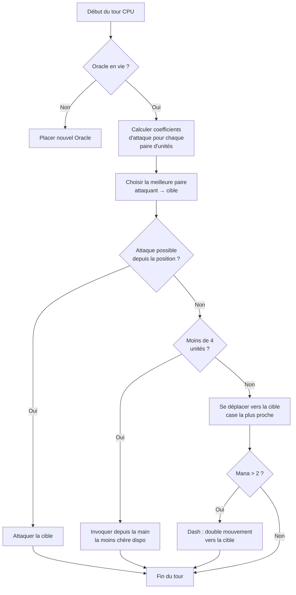

## Mi IA cutre para Nausicaa

Hay proyectos que empiezan con "¿y si hiciera un ajedrez con mitologías?" y terminan con un sistema con una IA que decide sus propios hiperparámetros cada 5 turnos.

Nausicaa es eso. Un juego de mesa por turnos donde construyes tu mazo de criaturas mitológicas, gestionas tu maná, despliegas unidades en un tablero 10x8. Y hay una IA que tiene crisis de personalidad.

Pasé bastante tiempo en esa IA, y el resultado aún se me escapa a veces, y eso es lo que más me gusta.

## El juego de verdad

Antes de hablar del cerebro, hay que entender el cuerpo:

- Tablero 10x8, zona de despliegue de 2 filas por jugador
- Maná empieza en 1, +1 por turno, máx 6. Gastas para invocar, atacar, usar capacidades
- Objetivo: matar al Oráculo adverso

12 unidades, costes y patrones de movimiento distintos:

| Unit | Coût | Mouvement | PV |
| --- | --- | --- | --- |
| Oracle | 0 | Rey (8 direcciones) | 1 |
| Gobelin | 1 | Adelante 3 casillas | 1 |
| Harpie | 1 | Rey (8 direcciones) | 1 |
| Naïade | 1 | Diagonal | 1 |
| Griffin | 2 | Salto 2 casillas | 2 |
| Sirène | 2 | Lateral | 1 |
| Centaure | 2 | Caballo (en L) | 2 |
| Archer | 3 | Lateral | 1 |
| Phénix | 3 | Diagonal (casillas oscuras) | 1 |
| Métamorphe | 4 | Intercambio de sitio | 1 |
| Voyant | 4 | Ninguno (genera maná) | 1 |
| Titan | 6 | Limitado (ataque zona) | 3 |

Cada unidad tiene su propio patrón de ataque. La Sirena pega en las 4 diagonales, el Arquero a distancia en 3 casillas, el Titán destruye todo alrededor al invocar. En resumen, un ajedrez con mitología y deckbuilding.

## Cómo hice pensar la CPU

La idea base es tontamente simple: **cada unidad enemiga tiene un coeficiente de atractivo**. Cuanto más peligrosa, más la IA quiere ocuparse de ella.

```javascript
const UNITS_ATTRACTIVENESS = {
    "oracle": 100,
    "titan": 95,
    "shapeshifter": 90,
    "phoenix": 80,
    "siren": 70,
    "archer": 70,
    "seer": 70,
    "griffin": 60,
    "centaur": 60,
    "harpy": 50,
    "naiad": 30,
    "gobelin": 20
};
```

Oráculo a 100: lógico, es la condición de victoria. Titán a 95 porque mata todo lo de al lado al invocar. Gobelin a 20, es un infante, nos importa un bledo.

Luego para cada par de unidades (una aliada, una enemiga), calculo:

```
interes = atractivo × coeff_attract / (distancia × coeff_dist)
```

En resumen: cuanto más peligroso y cercano, más la IA quiere destrozarte.

```javascript
calculateAttackCoefficient(x1, y1, x2, y2) {
    const distance = this.calculateEuclideanDistance(x1, y1, x2, y2);
    if (distance === 0) return Infinity;
    return (UNITS_ATTRACTIVENESS[unit.type] * COEFFICIENTS_IMPORTANCE["attractiveness"]) / distance;
}
```

### El truco de los coeficientes que cambian

El punto importante es que los coeficientes de importancia **cambian aleatoriamente cada 5 turnos**.

```javascript
if (this.turnCount % 5 === 0) {
    const distanceCoefficient = parseInt(Math.random() * 100);
    const attractivenessCoefficient = parseInt(Math.random() * 100);
    this.regulateImportanceCoefficients({
        distance: distanceCoefficient,
        attractiveness: attractivenessCoefficient
    });
}
```

Una vez la IA va hiperagresiva (atractivo a 95, distancia a 5), atraviesa todo para matar tu Oráculo. La vez siguiente prioriza la distancia y se reposiciona.

Está copiado de los fantasmas de Pac-Man: Blinky caza, Pinky embosca. Aquí la IA cambia de "personalidad" cada fase.

**Resultado: imposible predecir la IA en una partida entera.** La CPU nunca hace dos veces el mismo match.

### El Oráculo es un gallina

El Oráculo enemigo huye. Literalmente.

```javascript
const awayFromTarget = {
    row: Math.max(0, Math.min(7, botUnitElement.row + (botUnitElement.row - targetUnitElement.row))),
    col: Math.max(0, Math.min(9, botUnitElement.col + (botUnitElement.col - targetUnitElement.col)))
};
```

Calcula la dirección opuesta a la amenaza y se pira. Si hay un muro, busca la casilla libre más cercana en esa dirección.

Pasas 3 turnos acercándote al Oráculo, y paf ya huyó al otro extremo.

### El bucle de decisión

Así decide la IA:

1. Si ya no tengo Oráculo (muerto), colocar uno nuevo
2. Calcular el coeficiente para cada par unidad aliada → unidad enemiga
3. Elegir la mejor pareja
4. Si la unidad puede atacar al objetivo desde su posición → ataca
5. Si tengo menos de 4 unidades → invocar la más barata disponible desde la mano
6. Si no, moverse hacia el objetivo (casilla de movimiento más cercana al enemigo)
7. Si hay bastante maná (> 2), dash (doble movimiento) para acercarse más
8. Si la unidad es el Oráculo → huir



```javascript
async makeAction(dash=false) {
    // todo eso en secuencia
    // la CPU hace dash si tiene bastante maná
    if(botPlayer.mana > 2) {
        this.makeAction(true);
    }
}
```

### Por qué la distancia euclidiana

Uso la distancia euclidiana:

```javascript
calculateEuclideanDistance(x1, y1, x2, y2) {
    const deltaX = Math.pow(x1 - x2, 2);
    const deltaY = Math.pow(y1 - y2, 2);
    return Math.sqrt(deltaX + deltaY) * COEFFICIENTS_IMPORTANCE["distance"];
}
```

¿Por qué no Manhattan? Porque las unidades tienen patrones de movimiento variados (L como el caballo, diagonal, etc). La distancia a vuelo de pájaro es una mejor aproximación del peligro.

## Por qué no minimax

Podría haber programado un minimax clásico. Pero con 12 tipos de unidades, patrones de movimiento distintos, capacidades especiales... el árbol de juego explota tan rápido que se vuelve injugable. El enfoque heurístico toma decisiones inteligentes sin explorar 10 millones de estados.

## Lo que mola

El sistema de atractivo crea dilemas divertidos:

- El Vidente (70) genera maná. Si lo dejas vivir, el adversario tiene más recursos. Pero el Titán (95) es aún más peligroso.
- El Metamorfo (90) puede intercambiar su sitio con cualquier unidad. Puede robar tu Oráculo.
- La Harpía (50) tiene un ataque explosivo que también la mata. Queda secundaria... hasta que acaba junto a 3 de tus unidades.

La IA evalúa el peligro global según las posiciones, no solo las stats en bruto.

También hay una función `activateSimulation()` para probar escenarios sin repetir una partida:

```javascript
activateSimulation() {
    // Coloca unidades específicas en el tablero
    // Útil para depurar la IA
    this.game.board = simulation.board;
    this.game.players = simulation.players;
}
```

## Lo que falta

Si tuviera más tiempo:

- La IA reacciona al estado actual, no predice lo que el jugador va a hacer
- No planifica su mano en varios turnos
- El Metamorfo y el Centauro tienen capacidades que subexploita
- Aprendizaje por refuerzo: hacerla jugar contra sí misma para ajustar los coeffs

Pero para un juego de navegador aguanta el tipo. Hay colegas que logran perder contra ella, así que está validada.

## Prueba

Disponible en [nausicaa-game.github.io](https://nausicaa-game.github.io/). Haces clic en "JOUER", modo CPU ON, y miras la IA hacer.

Consejo: deja la IA jugar contra sí misma. Vas a ver fases agresivas, y luego pfft retrocede todo.

El código está en [GitHub](https://github.com/nausicaa-game/nausicaa-game.github.io) en `js/cpu.js`.

**3 puntos a recordar:**

1. **Coeficientes heurísticos**: sin minimax, cada unidad tiene un atractivo
2. **Coeffs que cambian cada 5 turnos**: la IA alterna agresividad y control, estilo Pac-Man
3. **El Oráculo huye**: calcula la dirección opuesta a la amenaza y se pira

Si tienes ideas para hacer la IA aún más retorcida, abre una issue. Tengo planes para una versión que aprenda de sus derrotas, pero eso será para un próximo artículo.
