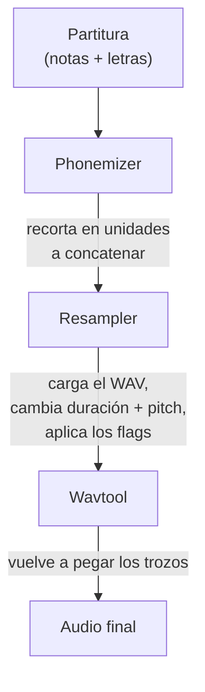

## UTAU: cómo un software en Visual Basic 6 democratizó la voz sintética

Ya lo había mencionado en mi página principal: me gusta UTAU. Aquí va por qué.

En 2008, si querías hacer cantar una voz sintética, tenías una opción: VOCALOID. El software de Yamaha. Caro, propietario, con voces oficiales que no podías crear tú mismo.

Y entonces un tío japonés, Ameya/Ayame, sacó un programa por su cuenta. Un software programado en **Visual Basic 6**. Gratis. Que te dejaba crear tu propia voz con... archivos WAV que grababas tú mismo.

Ese software se llama **UTAU** (歌う, "cantar" en japonés). Y para su época, era magia.

Siempre me pareció fascinante por su idea de partida más que por su limpieza técnica (el principio de codificación sigue siendo muy ingenioso, aunque la implementación duela a la vista): abrió la síntesis vocal al gran público. Tú, yo, cualquiera con un micro.

Déjame explicarte por qué era genial.

---

## Primero, por qué la síntesis de canto es un rollo

Una voz cantada no son notas. Tienes la consonante que ataca, la vocal que sostiene, el aliento, las transiciones entre ambas. El "sa" de "salut" es una "s" que silba deslizándose hacia una "a" abierta, y es ese deslizamiento el que suena humano o no.

Hoy lo resolvemos con deep learning: entrenas un modelo con horas de canto y genera la voz (Synthesizer V, DiffSinger). Pero eso es 2020+. En 2008, nada de nada.

UTAU usa el método de antes, más viejo y más ingenioso: la **síntesis concatenativa**.

---

## La síntesis concatenativa: copiar y pegar trozos de voz

La idea es tonta como ella sola: grabas trocitos de voz y los pegas juntos para formar palabras. "salut" = muestra "sa" + "lu" + "to", encadenados. Un puzle sonoro pilotado por una partitura.

Es el principio de los YouTube Poop donde recortan las palabras de un personaje para hacerle decir cualquier cosa, salvo que aquí es cuadrado y automatizado.

Y UTAU viene literalmente de ahí. Antes existía el **"Jinriki Vocaloid"** (人力ボーカロイド, "Vocaloid manual"): gente que recortaba a mano pistas vocales, extraía los fonemas, cambiaba el pitch, y reensamblaba todo en un editor de audio para imitar una voz VOCALOID. A mano. Imagina el curro.

Ameya miró ese calvario y programó la herramienta para automatizarlo. Al principio UTAU era justo eso: un asistente para Vocaloid manual.

---

## Por qué fue revolucionario: TÚ creas la voz

Aquí está lo que lo cambia todo.

VOCALOID: comprabas una voz. Miku, Luka, etc. Creadas por profesionales, vendidas por Yamaha. La creación seguía reservada a Yamaha. Con UTAU, **cualquiera graba su voz y la convierte en un instrumento cantante**.

El modo CV (el más simple) es: grabas las ~100 sílabas base del japonés ("a", "ka", "sa", "ta"...), configuras los puntos de corte, y listo tu voicebank. Unas horas de trabajo.

Resultado: el ecosistema explotó. Miles de voicebanks creadas por la comunidad: voces de fans, de colegas, de personajes inventados. Un universo entero de cantantes virtuales, gratis. Y el software venía con **Defoko** (Utane Uta), una voz por defecto generada vía el motor TTS AquesTalk, así que podías empezar incluso sin micro.

---

## El oto.ini: el corazón del sistema

¿Cómo sabe UTAU dónde cortar y pegar los sonidos? Vía un archivo de config por voicebank: el **`oto.ini`**. Para cada WAV, define los puntos de corte (en milisegundos):

- **Offset** → silencio a eliminar al principio
- **Preutterance** → el punto donde la consonante pasa a la vocal (la frontera "s"→"a" en "sa")
- **Overlap** → cuánto la nota anterior se derrama sobre esta
- **Fixed region** → la parte que NO debe estirarse en una nota larga (típicamente la consonante)
- **Cutoff** → dónde cortar el final

La **preutterance** es el parámetro más ingenioso. Una sílaba siempre tiene un trozo de consonante antes de la vocal. Para que tu nota caiga en el tiempo, es la *vocal* la que tiene que caer justa, no la consonante. Así que UTAU desplaza la muestra hacia atrás: la "a" de "sa" aterriza en el tiempo, la "s" se derrama justo antes. Como un batería que anticipa su golpe para que el sonido caiga justo, salvo que aquí es en un `.ini`.

Visualmente, en una muestra "ka", las zonas del `oto.ini` se recortan así:

```mermaid
flowchart LR
    A["🔇 silencio<br/>(offset)"] --> B["🅺 consonante<br/>(fixed region,<br/>no estirada)"]
    B --> C["🅰 vocal<br/>(zona estirable)"]
    C --> D["🔇 final cortado<br/>(cutoff)"]
    style B fill:#3b4a6b
    style C fill:#5b3b6b
```



La frontera entre la consonante y la vocal es la preutterance. La vocal es la zona que se estira para las notas largas; la consonante queda intacta, si no tu "k" duraría dos segundos y sonaría horrible.

```ini
# oto.ini (simplificado)
# archivo=alias,offset,consonant,cutoff,preutterance,overlap
_ka.wav=ka,120,80,-200,90,40
```

Cinco valores por sonido, en todas tus muestras, y UTAU ensambla cualquier palabra limpiamente.

---

## CV, VCV, CVVC: la carrera por el realismo

El modo base, **CV** (Consonante-Vocal), es un sonido por sílaba. Simple pero un poco robótico: las uniones entre sílabas son toscas.

En 2010 la comunidad inventa el **VCV** (Vocal-Consonante-Vocal). En vez de grabar "ka" solo, grabas "a ka": con la cola de la vocal anterior. La transición se vuelve natural porque está *en* la grabación, no calculada después.

El detalle que duele: **VOCALOID no tuvo el VCV hasta VOCALOID3, en 2011.** El freeware en VB6 programado por un tío solo adelantó a Yamaha un año en el realismo de las transiciones. Una comunidad de fans más rápida que la multinacional.

Luego vinieron el **CVVC**, el **ARPAsing** (inglés), el **VCCV**... cada método empujando el realismo más lejos, todos inventados y documentados por la comunidad.

---

## El pipeline completo: cómo una palabra se convierte en sonido

Cuando colocas una nota y escribes una letra, esto es lo que pasa entre bambalinas:



El **resampler** es la pieza maestra: coge tu muestra "ka" grabada a una altura dada y la reestira/recambia de pitch para igualar la nota deseada, estirando solo la zona estirable y manteniendo la consonante intacta (de ahí el `oto.ini`).

Y es **modular**. UTAU venía con un resampler base, pero la comunidad sacó otros (moresampler, TIPS...), cada uno con su grano sonoro. Cambiabas de motor de síntesis como un plugin. En 2008. En un freeware.

---

## El obrador bajo el capó (y por qué resulta entrañable)

Tengo que ser honesto sobre el estado técnico del software:

- **Programado en Visual Basic 6.** Un lenguaje ya muerto en 2008. Hace falta el runtime VB6 para hacerlo correr.
- **Windows only de base** (el port a Mac, UTAU-Synth, llegó en 2011).
- **Codificación Shift-JIS obligatoria.** Si tus archivos no están codificados en Shift-JIS japonés, UTAU no entiende nada. Aún hoy suele hacer falta poner el PC en locale japonesa o usar AppLocale para lanzarlo.
- **Interfaz austera**, documentación casi 100% en japonés en la época.

Y aun así. Aun así ese software creó un movimiento mundial. Decenas de miles de voicebanks. Canciones escuchadas millones de veces.

El mejor ejemplo: **Kasane Teto**. Un personaje creado en 2008 y lanzado como una broma del 1 de abril, haciéndose pasar por una VOCALOID. Era un chiste. Salvo que a la gente le encantó el personaje, se creó una voicebank UTAU real detrás, y Teto se convirtió en una de las cantantes virtuales más famosas del mundo. En 2023 incluso tuvo una voz oficial de Synthesizer V. Un personaje nacido de una inocentada en un software gratuito.

---

## Por qué sigue importando

UTAU es el ejemplo perfecto de una tecnología "pobre" que gana por la apertura.

VOCALOID era técnicamente superior, mejor financiado, más pro. Pero cerrado. UTAU estaba chapuceado, feo, en VB6, pero dejaba participar a todo el mundo. Crear voces, crear resamplers, crear plugins, crear métodos de grabación. La comunidad hizo el resto.

Y el concepto sobrevive por completo hoy. **OpenUtau**, un sucesor moderno open source, retoma la idea y la actualiza (multiplataforma, UTF-8, soporte de resamplers modernos Y de IA). La síntesis concatenativa aún se sostiene junto a los modelos deep learning, porque tiene una ventaja que ellos no tienen: entiendes exactamente qué pasa, y controlas cada milisegundo.

Eso es lo que siempre me gustó de UTAU. Ves exactamente qué pasa. No es una IA que te escupe un resultado mágico que no entiendes: tienes tus WAV, tus puntos de corte, y eres tú quien decide todo. Cuando suena mal, sabes por qué y puedes corregirlo. Me gusta ese tipo de control.

---

**Las 3 cosas a recordar:**

1. **Síntesis concatenativa = puzle de voz**: UTAU pega pequeños samples WAV para formar palabras. El `oto.ini` define dónde cortar y pegar cada sonido. Lo controlas todo, al milisegundo, sin caja negra.

2. **La apertura gana a la técnica**: VOCALOID era mejor pero cerrado. UTAU estaba chapuceado pero dejaba que todo el mundo creara sus voces. La comunidad hizo explotar el ecosistema, e incluso adelantó a Yamaha en el VCV.

3. **Una buena idea sobrevive a su código**: VB6, Shift-JIS, Windows only... y aun así el concepto sigue corriendo vía OpenUtau. Una tecnología genial puede estar programada con los pies.

Honestamente, solo por Kasane Teto nacida de una inocentada, ese software merece respeto.
