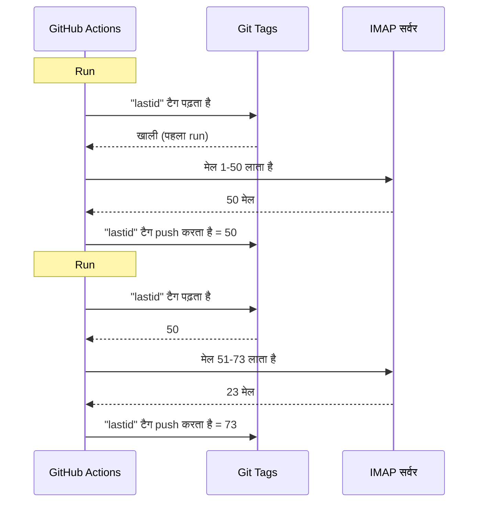

# मैंने GitHub Actions पर मुफ्त बॉट चलाने के लिए git को डेटाबेस की तरह इस्तेमाल किया

मेरा स्वचालित email उत्तरदाता है जो 24/7 चलता है।

वह मेरे मेल पढ़ता है, समझता है कि क्या बात है, और AI से खुद जवाब देता है। उसे पिछली बातचीत याद रहती है। वह newsletter और `noreply@` को नजरअंदाज करता है। जब बहुत गरम हो तो मानव को forward करता है।

मासिक लागत : **0€**।

मुझे सर्वर, VPS और डेटाबेस नहीं चाहिए। सिर्फ GitHub Actions और पागल hack : **git को डेटाबेस की तरह इस्तेमाल करना**।

समझ रहे हो मैं कहाँ जा रहा हूँ ? नहीं ? अच्छा, पकड़कर बैठो, यह बेवकूफी और शानदार दोनों है।

---

## समस्या : GitHub Actions stateless है

GitHub Actions मुफ्त है। तुम हर 5 मिनट cron चला सकते हो, अपना कोड चला सकते हो, मुफ्त।

लेकिन एक दिक्कत है : यह **stateless** है।

हर run खाली मशीन में शुरू होता है। दो निष्पादनों के बीच कुछ सहेजा नहीं जाता। पिछला run ? भूला हुआ। मिटा हुआ। जैसे कभी मौजूद ही नहीं था।

email उत्तरदाता के लिए, यह बहुत बड़ी समस्या है। जैसे :

> "आखिरी मेल कौन सा है जो मैं पहले ही प्रोसेस कर चुका हूँ ?"

अगर बॉट हर run पर यह भूल जाता है, तो वह या तो उन्हीं मेलों को लूप में फिर से जवाब देगा (तबाही), या मेल छूट जाएँगे।

स्थायी स्थिति चाहिए। और सामान्यतः, स्थायी स्थिति = डेटाबेस। लेकिन डेटाबेस मतलब सर्वर, और सर्वर मतलब मुफ्त नहीं।

यहीं यह दिलचस्प होता है।

---

## समाधान : डेटाबेस के रूप में git टैग

तुम्हारा GitHub repo, पहले से स्थायी भंडारण है। मुफ्त। संस्करणबद्ध। हमेशा वहाँ।

तो उसमें स्थिति क्यों न संग्रहित की जाए ?

विचार : हर run पर, बॉट **git टैग** से आखिरी प्रोसेस किया email UID पढ़ता है। वह नए मेल प्रोसेस करता है। फिर नए UID के साथ टैग फिर से push करता है।



git टैग ही डेटाबेस है। एक ही मान, लेकिन हमें बस इतना चाहिए।

### स्थिति पढ़ना

job की शुरुआत में, टैग से मान लिया जाता है :

```bash
git fetch origin --tags lastid || true
git show refs/tags/lastid:data/lastId > data/lastId || true
```

`git show refs/tags/lastid:data/lastId` का मतलब : "मुझे `lastid` टैग में जैसी थी वैसी `data/lastId` फाइल की सामग्री दो"।

धड़ाम। बिना डेटाबेस तुम्हारा मान मिल गया।

### स्थिति लिखना

अंत में, नए मान के साथ टैग फिर से बनाया जाता है :

```bash
git switch --orphan lastid-tmp   # इतिहास रहित खाली शाखा
git rm -rf .                      # सब खाली करते हैं
mkdir -p data
printf "%s\n" "${LAST_ID_CONTENT}" > data/lastId

git add data/lastId
git commit -m "lastId snapshot"
git tag -f lastid                 # इस कमिट पर टैग बल लगाता है
git push --force ...origin lastid # टैग push करता है
```

एक **अनाथ** शाखा बनाई जाती है (इतिहास रहित), सिर्फ `lastId` फाइल रखी जाती है, commit, tag, force push।

अनाथ क्यों ? ताकि repo इतिहास में राज्य के 10 000 commit जमा न हों। हर अद्यतन पिछले को मिटाता है। टैग हमेशा एक ही कमिट की ओर इशारा करता है जिसमें एक ही मान है।

यह साफ है। यह मुफ्त है। यह पूरी तरह टेढ़ा है और काम करता है।

---

## दूसरा hack : runtime snapshot

GitHub Actions के साथ एक और समस्या है : `npm install`।

अगर हर run पर (हर 5 मिनट) तुम `npm install` + `npm run build` करते हो, तो हर बार 60-90 सेकंड बर्बाद करते हो। बार बार cron पर, यह बिना बात बर्बाद compute मिनट हैं।

समाधान : कोड एक बार पूर्व संकलित करना, और उसे भी git टैग में संग्रहित करना।

build workflow (जो `master` पर push करने पर चलता है) यह करता है :

```bash
# कोड संकलित करता है
bun install
bun run build

# dist/ + node_modules/ को "runtime" टैग में संग्रहित करता है
git checkout --orphan temp-runtime
git rm -rf .
cp -r "$TMPDIR"/* .
git add dist node_modules package.json bun.lock data
git commit -m "runtime build"
git tag -f runtime
git push --force ...origin runtime
```

`runtime` टैग में संकलित कोड और `node_modules` हैं। चलने को सब तैयार।

और cron, सीधे इस टैग को checkout करता है :

```yaml
- name: Checkout runtime snapshot
  uses: actions/checkout@v4
  with:
    ref: refs/tags/runtime    # पूर्व निर्मित कोड, स्रोत नहीं
    fetch-depth: 1

# कोई npm install नहीं, कोई build नहीं !
- name: Process emails
  run: node dist/index.js --action
```

cron तुरंत शुरू होता है और install या build के बिना बस `node dist/index.js` निष्पादित करता है।

जैसे, तुम्हारे पास दो टैग हैं जो दो काम करते हैं :
- `runtime` = चलने को तैयार कोड (`master` पर कोड push करने पर अद्यतन)
- `lastid` = स्थायी स्थिति (हर run पर अद्यतन)

यह गंदे जितना सुंदर है।

---

## बॉट खुद : AI auto responder

अच्छा, git hack अच्छा है, लेकिन बॉट ठीक क्या करता है ?

वह IMAP से तुम्हारे मेल पढ़ता है, AI (Groq + Llama 3.3 70B) से उन्हें समझता है, और अपने आप जवाब देता है।

निर्भरता इंजेक्शन (InversifyJS) के साथ साफ सेवा आर्किटेक्चर :

```
App
├── ImapService      → मेल पढ़ता है (IMAP)
├── SmtpService      → उत्तर भेजता है (SMTP)
├── ParserService    → मेल सामग्री parse करता है
├── ReplyService     → AI उत्तर बनाता है
├── SummaryService   → बातचीत स्मृति
├── AccountsService  → कई email खाते प्रबंधित करता है
└── ConfigService    → config / env vars
```

### दो संचालन मोड

बॉट दो तरह से चल सकता है :

**listener मोड** (वास्तविक समय) : घातांकीय पुनः जुड़ाव के साथ स्थायी IMAP कनेक्शन। VPS के लिए।

```typescript
this.imapService.on("exists", async (data) => {
  console.log(`[MAIL] नया मेल ! कुल: ${data.count}`);
  // नया मेल तुरंत प्रोसेस करता है
});
```

**action मोड** (batch) : `lastId` से नए मेल प्रोसेस करता है, फिर बंद हो जाता है। GitHub Actions cron के लिए।

```bash
node dist/index.js --action
```

`--action` मोड वही है जो git hack इस्तेमाल करता है। वह `lastId` पढ़ता है, जो नया है वह प्रोसेस करता है, नया `lastId` लिखता है, खत्म।

### रोबोट को जवाब मत दो

अगर तुम्हारा बॉट सभी मेलों को जवाब देता है, तो वह newsletter, सूचनाओं, `noreply@` को जवाब देगा। तबाही। बदतर : अगर दो बॉट एक दूसरे को जवाब देते हैं, तो तुम्हें मेलों का अनंत लूप मिलता है। दुःस्वप्न।

इसलिए आक्रामक छँटाई :

```typescript
export function isAutomatedSender(address) {
  const automatedPatterns = [
    "noreply", "no-reply", "donotreply",
    "mailer-daemon", "postmaster", "bounce",
    "newsletter", "notification", "marketing",
    "billing", "receipt", "promo", ...
  ];
  const local = address.split("@")[0].toLowerCase();
  return automatedPatterns.some(p => local.includes(p));
}
```

और email हेडर से पहचान भी :

```typescript
export function isAutomatedByHeaders(headers) {
  return (
    ["bulk", "list", "junk"].includes(headers.precedence) ||
    headers["auto-submitted"] !== "no" ||
    headers["list-unsubscribe"] !== "" ||   // newsletter में यह होता है
    /mailchimp|sendgrid|mailgun|brevo/i.test(headers["x-mailer"])
  );
}
```

हेडर में `List-Unsubscribe` ? यह newsletter है। `Precedence: bulk` ? सामूहिक मेलिंग। `X-Mailer: Mailchimp` ? समझ रहे हो। नजरअंदाज करते हैं।

यह नाइट क्लब बाउंसर जैसा है : रोबोट नहीं गुजरते।

### जादुई trigger

AI बिल्कुल जवाब न देने, या मानव को सौंपने का फैसला कर सकता है। कैसे ? उसके उत्तर में विशेष trigger से।

तंत्र प्रॉम्प्ट उसे कहता है :

> अगर स्वचालित मेल/newsletter है → `<no_reply>` जवाब दो
> अगर बहुत महत्वपूर्ण/संवेदनशील है (कानूनी, वित्तीय...) → `<manual_reply_required>` जवाब दो
> वरना → असली उत्तर लिखो

और कोड इसे पढ़ता है :

```typescript
const aiReply = completion.choices[0].message.content.trim();
const manualTrigger = aiReply.includes(MANUAL_REPLY_TRIGGER);
const noReply = aiReply.includes(NO_REPLY_TRIGGER);

if (noReply) {
  console.log("[MAIL] AI ने नजरअंदाज करने का फैसला किया। छोड़ो।");
  return;
}

if (manualTrigger) {
  console.log("[MAIL] बहुत गरम, मैं मानव को forward करता हूँ।");
  await this.smtpService.sendManualForward(...);
  return;
}

// वरना AI उत्तर भेजते हैं
await this.smtpService.sendReply(...);
```

जैसे AI को "नहीं यहाँ मैं नहीं छूता, असली मानव बुलाओ" कहने का अधिकार है। यह बुद्धिमानी है।

---

## बातचीत स्मृति

एक विवरण जो सब बदलता है : बॉट बातचीत **याद रखता है**।

जब वह किसी को जवाब देता है, तो वह आदान प्रदान का सारांश सहेजता है। अगली बार जब वह व्यक्ति लिखता है, तो सारांश प्रॉम्प्ट में फिर से डाला जाता है।

भंडारण : प्रति संपर्क एक JSON फाइल।

```
data/customers/
├── moi%40gmail.com/
│   ├── alice%40example.com.json
│   └── bob%40client.fr.json
```

और सारांश खुद AI द्वारा उत्पन्न होता है, जो पुराने सारांश को नए संदेश के साथ मिलाता है :

```typescript
const completion = await groq.chat.completions.create({
  model: "llama-3.3-70b-versatile",
  messages: [
    { role: "system", content: "तुम स्मृति सहायक हो। जानकारी खोए बिना पुराने सारांश को नए संदेश के साथ मिलाओ।" },
    { role: "user", content: `मौजूदा सारांश:\n${existing}\n\nनया संदेश:\n${incomingContent}` }
  ],
  temperature: 0.0,  // नियतात्मक, कोई रचनात्मकता नहीं
  max_tokens: 800,
});
```

इसलिए बॉट समय के साथ संपीड़ित स्मृति बनाता है। बुद्धिमानी से बढ़ता सारांश काफी है, बिना सभी मेल संग्रहित किए।

और ये JSON फाइलें ? खैर... वे भी git में संग्रहित हैं, runtime टैग में। हर जगह Git।

---

## प्रॉम्प्ट लंबाई वाली चतुर बात

छोटा तकनीकी विवरण जिसने मुझे हँसाया।

मॉडलों की token सीमा होती है। अगर तुम्हारा मेल + सारांश + persona प्रॉम्प्ट पार कर जाते हैं, तो API त्रुटि लौटाता है।

कोड इसे **झरना काट छाँट** + retry से संभालता है :

```typescript
try {
  // सामान्य सीमाओं के साथ पहला प्रयास
  completion = await groq.chat.completions.create({...});
} catch (error) {
  if (!this.isLengthError(error)) throw error;

  // लंबाई त्रुटि थी : सख्त सीमाओं के साथ फिर से प्रयास करते हैं
  ({ systemContent, userContent } = this.buildPromptPayload({
    ...,
    limits: {
      systemPromptChars: 2200,  // 3000 के बजाय
      summaryChars: 1800,       // 4000 के बजाय
      personaChars: 900,        // 1500 के बजाय
      userContentChars: 2200,   // 8000 के बजाय
    },
  }));
  completion = await groq.chat.completions.create({...});  // retry
}
```

अगर पार नहीं होता, तो और छोटा काटकर फिर प्रयास करते हैं। सरल, प्रभावी, कोई crash नहीं।

---

## अच्छा, और ठोस रूप में, यह कैसे चलता है ?

cron run का पूरा प्रवाह :

```
1. GitHub Actions ट्रिगर होता है (हर 5 मिनट cron)
2. "runtime" टैग का Checkout (पूर्व निर्मित कोड)
3. git show refs/tags/lastid → आखिरी प्रोसेस किया UID लेता है
4. node dist/index.js --action
   ├── IMAP कनेक्शन
   ├── lastId+1 से मेल लाता है
   ├── हर मेल के लिए :
   │   ├── सामग्री parse करता है
   │   ├── रोबोट छाँटता है (स्वचालित होने पर छोड़ता है)
   │   ├── प्राप्तकर्ता खाता मिलाता है
   │   ├── बातचीत स्मृति लेता है
   │   ├── AI उत्तर बनाता है (Groq)
   │   ├── <no_reply> ? छोड़ता है
   │   ├── <manual_reply_required> ? मानव forward
   │   ├── वरना : उत्तर भेजता है (SMTP)
   │   └── बातचीत स्मृति अद्यतन करता है
   └── नया lastId लिखता है
5. नए मान के साथ "lastid" टैग का git push --force
```

और यह 5 मिनट में फिर शुरू होता है। हमेशा के लिए। मुफ्त।

---

**याद रखने के 3 बिंदु :**

1. **Git = मुफ्त डेटाबेस** , अनाथ टैग दो stateless run के बीच तुम्हारी स्थायी स्थिति संग्रहित कर सकता है। पढ़ने के लिए `git show refs/tags/X:फाइल`, लिखने के लिए force-push। तुम पूरी DB बचाते हो।
2. **runtime टैग में पूर्व संकलन** , cron के हर run पर `npm install` के बजाय, संकलित कोड + node_modules git टैग में संग्रहित करो। cron तुरंत शुरू होता है।
3. **AI बॉट को चुप रहना आना चाहिए** , `<no_reply>` और `<manual_reply_required>` trigger AI को जवाब न देने या सौंपने देते हैं। एंटी रोबोट छँटाई भी। वरना तुम मेलों का अनंत लूप बनाते हो।

स्थायी स्थिति वाला Serverless cron, AI, स्मृति, सब 0€/महीना पर। यह पूरी तरह टूटा हुआ है और मुझे यह जुगाड़ पसंद है।
