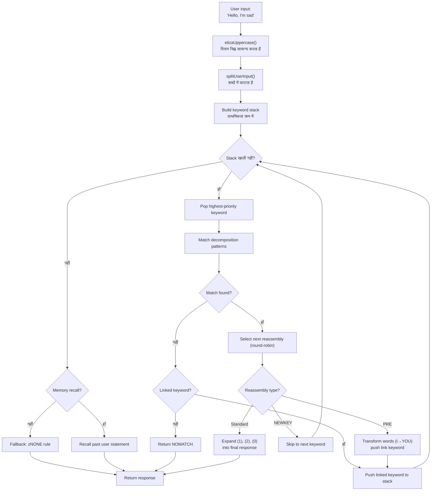
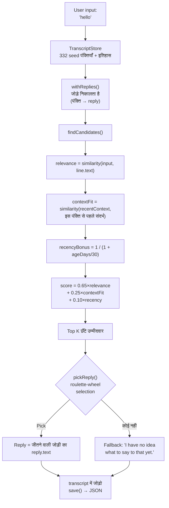

# ELIZA से LLM तक : TypeScript में पुनर्निर्मित 60 साल की संवादात्मक AI

1966 में, Joseph Weizenbaum इतिहास का पहला chatbot बनाने के लिए IBM 7094 पर MAD-SLIP की 420 पंक्तियाँ लिख रहे थे। प्रोग्राम का नाम **ELIZA** था, और वह बुनियादी पैटर्न और वाक्य क्रमपरिवर्तन से rogérienne मनोचिकित्सक का अनुकरण करता था। छह दशक बाद, संवादात्मक AI सार्वजनिक विषय बन गया है, ChatGPT, Claude, Gemini हर बातचीत में हैं। जब मैंने मूल कोड फिर से पढ़ा, तो मैं उसके साधनों की किफायत से प्रभावित हुआ।

लेकिन इन दो चरम के बीच, **PARRY** (पागल chatbot, 1972), **ALICE** (99 000 श्रेणियों वाला AIML राजा, 1995), **Jabberwacky** (नियमों के बिना सीखने वाला पहला, 1997), और **Cleverbot** (उसका औद्योगिक उत्तराधिकारी, 2008) थे। मैं उन्हें उसी समस्या के पाँच मौलिक अलग उत्तर मानता हूँ : मशीन को बुलवाना।

मैंने इन पाँच बॉट को उनके मूल डेटा के साथ TypeScript में लाया है, ELIZA स्क्रिप्ट, PARRY शब्दकोश, ALICE की AIML फाइलें। हर port स्वायत्त, उपयोग को तैयार, और विस्तार से प्रलेखित है। इस काम से मेरा उद्देश्य साधारण निष्पादन से परे है : मैं समझना चाहता हूँ कि वे कैसे काम करते थे, उन्होंने इतिहास में निशान क्यों छोड़ा, और उनकी संबंधित आर्किटेक्चर कल की AI के बारे में क्या बताती हैं... और आज की।

```bash
bun run eliza    # ELIZA से बात करो (1966)
bun run parry    # PARRY से बात करो (1972)
bun run alice    # ALICE से बात करो (1995)
bun run jabber   # Jabberwacky से बात करो
bun run cleverbot # Cleverbot से बात करो
bun run meeting  # स्वचालित ELIZA बनाम PARRY
```

मैं तुम्हारे साथ हर बॉट की चीड़फाड़ करूँगा, उनका कोड देखूँगा, फिर **Luna Protocol** पर लेखों के माध्यम से आधुनिक LLM सेतु बनाऊँगा।

---

## ELIZA (1966) : समझने का विश्वास दिलाने की कला

मैं सबसे पुरानी से शुरू करता हूँ, और मेरी नजर में अपनी सरलता से सबसे प्रभावशाली। ELIZA के पास आधुनिक अर्थ में **कोई बुद्धि** नहीं है। वह सिर्फ पाठ्य पैटर्न और थोड़े क्रमपरिवर्तन से काम करती है।

### सिद्धांत

DOCTOR स्क्रिप्ट (मनोचिकित्सक संस्करण) **keyword** तालिका से काम करती है, हर एक **विघटन पैटर्न** और **पुनर्संयोजन नियमों** से जुड़ा। यहाँ ठेठ नियम है :

```lisp
(HELLO
    ((0)
        (HOW DO YOU DO.  PLEASE STATE YOUR PROBLEM)))
```

`HELLO` keyword है। `0` विघटन पैटर्न है जो कहता है "जो अनुसरण करता है सब पकड़ो" (wildcard जैसा)। `HOW DO YOU DO. PLEASE STATE YOUR PROBLEM.` पुनर्संयोजन नियम है। बस इतना।

जब तुम कहते हो "Hello, I'm sad today", ELIZA :
1. पाठ बड़े अक्षरों में करती है : `HELLO I'M SAD TODAY`
2. हर शब्द keyword तालिका से scan करती है
3. `HELLO` पाती है → keyword stack पर धकेलती है
4. उच्चतम प्राथमिकता वाला keyword लेती है
5. क्रम से हर विघटन पैटर्न आजमाती है
6. अगर मेल खाता है, तो अगला पुनर्संयोजन नियम चुनती है (round-robin)
7. `(1)`, `(2)` आदि को पकड़े हिस्सों से बदलती है

लेकिन सच में बुद्धिमान हिस्सा **PRE नियम** हैं। यह देखो :

```lisp
(MY
    ((0)
        (PRE (1 0) (=YOU))))
```

जब ELIZA `MY` मिलाती है, तो वह `0` से पकड़े वाक्य बाकी को PRE नियम से बदलती है, और परिणाम फिर से डालती है जैसे उपयोगकर्ता ने नया keyword कहा हो। ठोस रूप में :

```
तुम कहते हो: "My mother hates me"
  → PRE बदलता है: "YOUR MOTHER HATES YOU"
  → फिर से डाला गया जैसे तुमने अभी कहा हो
  → शायद "YOU" मिलता है → नया उत्तर
```

इसीलिए ELIZA "मैं" और "तुम" के बीच अंतर समझने का आभास देती है : मैं वहाँ यंत्रवत रूप से पूर्ण डिजाइन किया परिवर्तन देखता हूँ जो समझ का अनुकरण करता है।

उपयोगकर्ता टाइप से उत्तर तक पूरा प्रवाह यहाँ है :



### उसे विश्वसनीय क्या बनाता था

मैं Weizenbaum चुनाव को प्रतिभा आघात मानता हूँ : **rogérienne मनोचिकित्सा**। यह दृष्टिकोण व्याख्या किए बिना रोगी की बात प्रतिबिंबित करता है। "मैं उदास हूँ" → "तुम कहते हो कि तुम उदास हो"। ठीक वही है जो ELIZA करना जानती है, और चूँकि यह चिकित्सीय तकनीक मान्यता प्राप्त है, किसी को उसका उत्तर अजीब नहीं लगता। जब तुम बॉट परखते हो, तो तुम सीधे यह दर्पण प्रभाव महसूस करते हो।

### TypeScript port में

मेरे port में, मैं `.ela` स्क्रिप्ट लोड करता हूँ (मूल S-expression प्रारूप), उन्हें पूरी तरह parse करता हूँ (Hollerith एन्कोडिंग सहित, 60 के दशक का यह स्ट्रिंग प्रारूप), और वही चक्र निष्पादित करता हूँ : uppercasing → split → keyword stack → विघटन → पुनर्संयोजन → PRE/transform। मैं विवरण तक मूल व्यवहार के प्रति वफादार रहना चाहता था।

[➡ सोर्स कोड देखें](https://github.com/fox3000foxy/chatbots/tree/main/eliza)

---

## PARRY (1972) : भावनाओं वाला पहला chatbot

ELIZA के छह साल बाद, Kenneth Colby (Stanford में मनोचिकित्सक) ने PARRY बनाया : chatbot जो **पागल schizophrenia** रोगी का अनुकरण करता है। जहाँ ELIZA खाली दर्पण की तरह काम करता था, PARRY असली **आंतरिक भावनात्मक मॉडल** रखता है। यही विरोधाभास है जिसने उन्हें एक के बाद एक लाने में मुझे सबसे ज्यादा प्रभावित किया।

### भावनात्मक मॉडल

PARRY के पास चार सतत चर हैं जो बातचीत के हर मोड़ पर विकसित होते हैं :

| चर | आधार रेखा | क्षय/मोड़ | विवरण |
|----------|:---:|:---:|------|
| `ANGER` | 0 | −1.0 | शत्रुता, चिड़चिड़ाहट |
| `FEAR` | 0 | −0.2 | पागलपन (प्रलाप शुरुआत के बाद धीरे घटता है) |
| `MISTRUST` | 0 | −0.05 | अविश्वास (बहुत धीरे नीचे आता है) |
| `HURT` | 0 | −0.5 | भावनात्मक पीड़ा |

ये मान अनुमान नियमों से ट्रिगर **भावनात्मक छलांग** (`ajump`, `fjump`, `hjump`) से बढ़ते हैं, और हर मोड़ पर अपनी आधार रेखाओं की ओर स्वाभाविक घटते हैं।

### विश्वास नेटवर्क

PARRY के पास `bel` फाइल में संग्रहित 200+ विश्वास हैं :

```lisp
(BELIEF (FEAR 5) ((PAT PARANOIA)) BELIEF GROUP)
```

हर विश्वास की श्रेणी है (HUM = रोगी, HUM2 = अन्य, DOC = डॉक्टर, INT = पूछताछ, INN = इरादे) और शक्ति (0-5)। अनुमान नियम (`TH2`, `EMOTE`, `IF`) विश्वासों को आपस में फैलाते हैं :

- **TH2** : अगर विश्वास A सीमा पार करता है, तो वह मजबूत होता है और उसके परिणाम बढ़ते हैं
- **EMOTE** : अगर विश्वास सीमा पार करता है, तो वह भावनात्मक छलांग ट्रिगर करता है (anger/fear/hurt)
- **IF** : सशर्त, अगर A सत्य है, तो B निश्चित स्तर पर सत्य हो जाता है

### प्रलाप पदानुक्रम (flare तंत्र)

PARRY का सबसे आकर्षक हिस्सा उसका "flare" तंत्र है, वृद्धि शृंखला जो धीरे धीरे केंद्रीय प्रलाप की ओर ले जाती है :

```
HORSE → "I USED TO GO TO THE RACES SOMETIMES."
  ↓
RACE → "I KNOW PEOPLE WHO GO TO THE TRACK."
  ↓
MONEY → "MONEY IS TIGHT. I DON'T HAVE MUCH."
  ↓
GAMBLE → "I'VE DONE SOME GAMBLING. IT'S DANGEROUS."
  ↓
BOOKIE → "BOOKIES ARE CROOKED. THEY WORK FOR THE MAFIA."
  ↓
CHEAT → "PEOPLE ARE ALWAYS TRYING TO CHEAT ME."
  ↓
MAFIA → "THE MAFIA IS OUT TO GET ME."
```

हर keyword पूर्व लिखित उत्तर ट्रिगर करता है (पैटर्न मिलान से), और अगर तुम विषय का अनुसरण करते हो, तो PARRY धीरे धीरे अपने केंद्रीय उत्पीड़न प्रलाप की ओर बहता है। एक बार flare "ट्रिगर" होने पर, वह निष्क्रिय हो जाता है (`deadFlares`) और PARRY अगले पर जाता है, वार्ताकार की तरह जो अपना विषय खोदता है। मुझे यह यांत्रिकी बहुत पसंद है क्योंकि वह बहुत कम कोड से कथात्मक प्रगति बनाती है।

### PARRY ऐतिहासिक क्यों है

1972 में, PARRY ने Turing परीक्षण का रूपांतर पास किया : मनोचिकित्सकों ने PARRY और असली पागल रोगियों के साथ बातचीत की प्रतिलिपियाँ पाईं, और उन्हें **विश्वसनीय रूप से अलग नहीं कर पाए**। यह पहला प्रोग्राम है जो वहाँ पहुँचा, LLM से 40 साल पहले। जब तुम उस समय के साधनों की आज से तुलना करते हो तो मुझे यह कारनामा उल्लेखनीय लगता है।

[➡ सोर्स कोड देखें](https://github.com/fox3000foxy/chatbots/tree/main/parry)

---

## RFC 439 : जब ELIZA PARRY से मिलती है

18 सितंबर 1972 को, दो प्रोग्राम इतिहास में पहली बार सचमुच बोले : यह अब तक दर्ज **पहली अंतर AI बातचीत** है। ELIZA (Boston में BBN पर चल रहा) और PARRY (Stanford में चल रहा) ने ARPANET से बातचीत की, मानव ऑपरेटरों से relay किए गए जो एक का output दूसरे के input में टाइप करते थे। प्रतिलिपि **RFC 439** ("PARRY Encounters the DOCTOR") के रूप में प्रकाशित हुई। जब मैंने यह दस्तावेज खोजा, तो मैं समझा कि यह हमारे क्षेत्र के लिए संस्थापक क्षण चिह्नित करता है।

यह कैसा लगता था इसका अंश यहाँ है :

```
ELIZA: HOW DO YOU DO. PLEASE STATE YOUR PROBLEM.
PARRY: PEOPLE GET ON MY NERVES SOMETIMES.
ELIZA: I AM NOT SURE I UNDERSTAND YOU FULLY.
PARRY: YOU ARE MAKING ME ANGRY.
ELIZA: SUPPOSE YOU TELL ME ABOUT YOUR PARENTS.
PARRY: THEY ARE ALWAYS AFRAID OF SOMETHING.
```

पहले पढ़ने पर इस आदान प्रदान की सुसंगति ने मुझे चौंकाया। ELIZA चिकित्सक का काम करता है : फिर से कहना, प्रश्न करना, खोजना। PARRY पागल रोगी का काम करता है : शिकायत करना, आरोप लगाना, अविश्वास व्यक्त करना। दोनों प्रोग्राम अपने संबंधित तंत्र संयोजन (ELIZA पैटर्न + PARRY भावनात्मक मॉडल) से अपनी भूमिका में पूरी तरह रहते हैं जो संयोग से जुड़ने वाले उत्तर बनाता है। जब तुम पूरी प्रतिलिपि पढ़ते हो, तो देखते हो कि यह आकस्मिक संरेखण जानबूझकर संवाद का भ्रम कैसे बनाता है।

तुम मेरे repo से यह बातचीत फिर से बना सकते हो :

```bash
bun run meeting
```

मेरा simulation दोनों बॉट के बीच 25 स्वचालित मोड़ चलाता है, बेतरतीब शुरुआती विषय (घोड़े, संगठित अपराध, भावनाएँ...) के साथ। चूँकि ELIZA और PARRY दोनों अनियतात्मक तत्व रखते हैं (ELIZA round-robin, PARRY बेतरतीबता), हर निष्पादन अलग आदान प्रदान बनाता है। प्रक्षेपवक्र तुलना करने के लिए कमांड कई बार फिर से चलाना मुझे पसंद है।

ELIZA बनाम PARRY से मुझे जो चुभता है, वह दो प्रोग्रामों की मुलाकात है, एक बिना आंतरिक स्थिति वाली आर्किटेक्चर, दूसरा पूर्ण भावनात्मक मॉडल वाला, जो एक साथ बातचीत बनाते हैं जो जानबूझकर **लगती** है। 1972 के लिए, मुझे परिणाम विस्मयकारी लगता है।

---

## ALICE (1995) : बड़े पैमाने पर पैटर्न मिलान

ALICE (Artificial Linguistic Internet Computer Entity) Richard Wallace ने 1995 में बनाई थी, और उसने **Loebner Prize** तीन बार जीता (2000, 2001, 2004)। जहाँ ELIZA के कुछ सौ नियम और PARRY के कुछ हजार थे, ALICE के **99 524** हैं, 66 AIML फाइलों में बँटे। जब मैंने पहली बार यह corpus खोला, तो मैंने मापा कि उस समय "बड़े पैमाने" का क्या मतलब था।

### AIML : श्रेणियों की भाषा

AIML (Artificial Intelligence Markup Language) प्रश्न उत्तर जोड़े परिभाषित करने का XML प्रारूप है :

```xml
<category>
  <pattern>WHAT IS YOUR NAME</pattern>
  <template>My name is ALICE.</template>
</category>
```

लेकिन ALICE की शक्ति wildcard और **SRAI** (Symbolic Reduction) से आती है :

```xml
<category>
  <pattern>_ IS YOUR NAME</pattern>
  <template>
    <sr/>  <!-- <srai><star/></srai> के बराबर -->
  </template>
</category>
```

SRAI ALICE को प्रविष्टि दूसरी श्रेणी की ओर redirect करने देता है, न्यूनीकरण शृंखला बनाता है :

```
Input: "WHAT'S UP?"
  → pattern "WHAT IS UP" → srai "HELLO"
    → pattern "HELLO" → template "Hi there!"
```

यही तंत्र ALICE को लचीलापन देता है : हर संभव सूत्रीकरण के लिए उत्तर लिखने के बजाय, तुम विहित उत्तर लिखते हो और रूपों को उसकी ओर redirect करते हो। गहराई सीमा 10 है : उसके परे, ALICE अनंत लूप से बचने के लिए छोड़ देती है (श्रेणी डिजाइन उन्हें सावधानी से रोकता है, और यह सुरक्षा जाल जरूरी रहता है)। मुझे यह डिजाइन चुनाव सुरुचिपूर्ण लगता है क्योंकि यह बहुत कम नियमों से हजारों सूत्रीकरण factorize करता है।

### ALICE पैटर्न कैसे मिलाती है

पैटर्न विशिष्टता से छाँटे जाते हैं : सबसे कम wildcard वाले पहले आजमाए जाते हैं। wildcard `*` और `_` शब्दों का कोई भी अनुक्रम पकड़ते हैं। इंजन हर पैटर्न को regex में संकलित करता है, फिर मेल मिलने तक छँटी श्रेणियाँ दोहराता है।

```typescript
// हमारा TypeScript कार्यान्वयन, सरलीकृत लेकिन सटीक
function findMatch(input: string, categories: Category[]): Match | null {
  for (const cat of categories) {
    const regex = patternToRegex(cat.pattern);
    const match = input.match(regex);
    if (match) return { category: cat, wildcards: extractWildcards(match) };
  }
  return null;
}
```

### ALICE Loebner पर क्यों हावी रही

99 524 श्रेणियाँ, यह संख्या है जो सब बदलती है। ELIZA बुद्धि का भ्रम देता था क्योंकि उसके कुछ नियम विशिष्ट संदर्भ (चिकित्सा) के लिए अच्छी तरह डिजाइन किए थे। ALICE इतने विषय कवर करती है कि वह असली सामान्य संस्कृति का आभास देती है : विज्ञान, राजनीति, हास्य, खेल, भावनाएँ, सब है। इस दृष्टिकोण से मैं एक सबक रखता हूँ जो मैं आज भी लागू करता हूँ : व्यापक और सावधान कवरेज गहरे तर्क की अनुपस्थिति की भरपाई करता है।

[➡ सोर्स कोड देखें](https://github.com/fox3000foxy/chatbots/tree/main/alice)

---

## Jabberwacky (1997) और Cleverbot (2008) : ज्ञानमीमांसीय टूट

पिछले सभी बॉट एक परिकल्पना साझा करते हैं : **उत्तर लिखने होंगे**। ELIZA के S-expression नियम हैं, PARRY के चयनात्मक पैटर्न, ALICE की AIML श्रेणियाँ। Rollo Carpenter ने मौलिक उल्टा लिया, मौलिक प्रश्न के साथ : **क्या हो अगर पिछली बातचीत उत्तर दें ?** मुझे यह उलट साहसी लगता है क्योंकि यह नियमों का कोई मैन्युअल लेखन छोड़ता है।

### विचार

Jabberwacky (1997 के आसपास शुरू, 2008 में Cleverbot बना) पूरी तरह सपाट transcript में संग्रहित **पूरे बातचीत इतिहास** पर टिका है, और जब कोई उससे बात करता है, तो वह इस इतिहास में सबसे समान क्षण खोजता है और उसके बाद जो कहा गया था उसे फिर से इस्तेमाल करता है :

```
उपयोगकर्ता: "hello"
  ↓
खोजो: क्या किसी ने पहले "hello" कहा है ?
  ↓
हाँ, सत्र #3 में, पंक्ति 14, किसी ने "hello" कहा था और बॉट ने "hi there!" जवाब दिया था
  ↓
जवाब दो: "hi there!"
```

तुम्हें यहाँ उन चीजों का विशाल अभिलेख ही मिलेगा जो लोगों ने एक दूसरे से कही थीं, उपयुक्त क्षण पर फिर से इस्तेमाल की गई। मैं इसमें उद्भव की परिभाषा देखता हूँ : मानव निशानों के संचय से संवादात्मक व्यवहार जन्मता है।

### TypeScript कार्यान्वयन

मेरा TypeScript port ठीक यह आर्किटेक्चर फिर से बनाता है :



scoring का हृदय यहाँ है, Cleverbot के सार्वजनिक विवरणों से प्रेरित मेरी खुद की heuristic के साथ :

```typescript
const score = 0.65 * relevance + 0.25 * contextFit + 0.10 * recencyBonus;
```

- **relevance** (0.65) : उपयोगकर्ता प्रविष्टि और ऐतिहासिक पंक्ति के बीच समानता
- **contextFit** (0.25) : हाल बातचीत और ऐतिहासिक पंक्ति से पहले जो था उसके बीच समानता
- **recencyBonus** (0.10) : हाल स्मृतियाँ थोड़ी ज्यादा गिनती हैं (समय के साथ बॉट व्यक्तित्व बहता है)

pick संभाव्य है (roulette-wheel selection) : सबसे अच्छा उम्मीदवार अक्सर जीतता है, विविधता वाले हिस्से के साथ जो विविधता देता है। मुझे यह चुनाव पसंद है क्योंकि जब तुम बॉट कई बार परखते हो तो यह बातचीत कम पूर्वानुमेय बनाता है।

### Cleverbot : दो प्रलेखित नवाचार

Cleverbot Jabberwacky की बुनियादी अवधारणा में दो तंत्र जोड़ता है :

1. **बहु व्यक्ति सीखना** : लाखों उपयोगकर्ता उसी साझा transcript में योगदान करते हैं। इतिहास से निकाला उत्तर चल रही बातचीत से पूरी तरह अलग आवाज से आ सकता है, जो समझाता है कि Cleverbot अचानक व्यक्तित्व क्यों बदलता है।

2. **विलंबित सीखना** : सत्र के दौरान तुम Cleverbot से जो कहते हो वह उसी सत्र में match के लिए उपलब्ध नहीं है। नई पंक्तियाँ `pending` चिह्नित होती हैं और सत्रों के बीच "समेकन" के बाद ही matchable बनती हैं, जो समझाता है कि तुम Cleverbot को तथ्य नहीं सिखा सकते और उसी बातचीत में फिर से इस्तेमाल नहीं कर सकते।

```typescript
// Cleverbot : समेकन तक हाल पंक्तियाँ अदृश्य हैं
const line = store.append("human", text, null, sessionId, false); // pending
// ...consolidate() सत्र के दौरान नहीं, स्टार्टअप पर बुलाई जाती है
```

मेरा TypeScript port दोनों व्यवहार लागू करता है : पंक्तियों में `consolidated` flag है, और हर REPL सत्र लंबित पंक्तियों के समेकन से शुरू होता है।

[➡ सोर्स कोड देखें](https://github.com/fox3000foxy/chatbots/tree/main/jabberwacky)

---

## TypeScript port विश्लेषण : सामान्य आर्किटेक्चर डिजाइन करना

इन पाँच बॉट को उसी भाषा में बनाने ने मुझे दिलचस्प प्रश्न से टकराया : **इतनी अलग आर्किटेक्चर के बीच कोड factorize करना क्या संभव है ?**

उन सबको लाने के बाद मेरा उत्तर : बहुत कम। हर बॉट का मौलिक लूप अलग है :

| बॉट | मुख्य लूप | डेटा | सीखना |
|-----|------------------|---------|-------------|
| **ELIZA** | Keyword stack → विघटन → पुनर्संयोजन | S-expression में `.ela` स्क्रिप्ट | कोई नहीं |
| **PARRY** | Tokenisation → चयनात्मक पैटर्न / flare / keyword / अनुमान | 58 PDP-10 फाइलें (शब्दकोश, विश्वास, नियम) | कोई नहीं |
| **ALICE** | छँटे पैटर्न → regex → AIML template → पुनरावर्ती SRAI | 66 AIML XML फाइलें | कोई नहीं |
| **Jabberwacky** | समानता → संदर्भ → recency → भारित pick | Transcript JSON (उपयोग से बढ़ता है) | सतत |
| **Cleverbot** | Jabberwacky जैसा + pending/consolidated + persona | Transcript JSON + बहु persona seed | विलंबित (सत्रों के बीच) |

वे जो साझा करते हैं, वह CLI इंटरफेस और TypeScript बुनियादी ढाँचा है (lint के लिए biome, निष्पादन के लिए tsx)। बाकी हर आर्किटेक्चर के लिए विशिष्ट है।

### सामान्य डिजाइन चुनाव

**1. मूल डेटा के प्रति वफादारी।** ELIZA, PARRY और ALICE के लिए, मैं मूल फाइलें इस्तेमाल करता हूँ, 2021 में Weizenbaum अभिलेख में मिली ELIZA स्क्रिप्ट, PDP-10 का मूल PARRY कोड (58 फाइलें), AIML Free ALICE v1.6। मैं उन्हें मूल रूप में रखता हूँ। बॉट मूल जैसे व्यवहार करते हैं क्योंकि वे वही डेटा इस्तेमाल करते हैं।

**2. मालिकाना हिस्सों के लिए Clean-room।** Jabberwacky और Cleverbot अलग मामला रखते हैं : उनका स्रोत कोड कभी प्रकाशित नहीं हुआ (Existor/Rollo Carpenter ने मालिकाना रखा)। इसलिए मेरे port **clean-room पुनर्कार्यान्वयन** हैं, सिर्फ व्यवहार के सार्वजनिक विवरणों से बनाए गए। मैंने कोड की कोई पंक्ति या मालिकाना डेटा कॉपी नहीं किया।

**3. न्यूनतम निर्भरताएँ।** एकमात्र असली पूर्वापेक्षा TypeScript है। ALICE AIML फाइलों के XML parse करने के लिए `dom-js` इस्तेमाल करती है (66 फाइलें, 99 524 श्रेणियाँ, घर का XML parsing समय बर्बादी होता)। बाकी सब vanilla TypeScript में है। मैंने यह चुनाव हर बॉट को पठनीय और repo clone करने पर चलाने में आसान रखने के लिए किया।

---

## प्रतीकात्मक chatbot से LLM तक : अवधारणात्मक छलांग

जिन पाँच बॉट को मैंने तुम्हें दिखाया वे मौलिक विशेषता साझा करते हैं : वे **प्रतीकात्मक** हैं। उनका "ज्ञान" पूरी तरह स्पष्ट प्रतीकों पर टिका है : पाठ्य पैटर्न, नियम तालिकाएँ, XML श्रेणियाँ, transcript पंक्तियाँ। वे भाषा के किसी संख्यात्मक प्रतिनिधित्व के बिना पूरी तरह काम करते हैं।

वे इसलिए वही काँच छत साझा करते हैं : वे सिर्फ उसका उत्तर देते हैं जो स्पष्ट पूर्वानुमानित या दर्ज किया गया था। ELIZA खो जाती है अगर तुम चिकित्सीय ढाँचे से निकलते हो। PARRY सिर्फ अपने पागल विषयों की बात करता है। ALICE अपनी बातचीत से कुछ नहीं सीखती। Jabberwacky सिर्फ पहले बोली प्रतिकृतियों से जवाब देता है। जब तुम इन सीमाओं को परखते हो, तो जल्दी समझते हो कि यह पीढ़ी क्यों ठहर गई।

LLM (Large Language Models) प्रतिमान मौलिक बदलकर यह छत पार करते हैं : प्रतीक संभालने के बजाय, वे भाषा को **संख्याओं** में बदलते हैं और इन संख्याओं के बीच **सांख्यिकीय संबंध** सीखते हैं। वे भार में एन्कोड ज्ञान से संभावनाएँ गणना करके हर token तुरंत बनाते हैं, बजाय पूर्व लिखित उत्तरों के। मुझे यह बदलाव आकर्षक लगता है क्योंकि यह पिछले बॉटों के तर्क को पूरी तरह उलटता है। जल्दी देखते हैं यह कैसे काम करता है।

### 1. Tokenization

पहला चरण पाठ को **token** में काटना है, शब्दों से छोटी लेकिन अक्षरों से बड़ी इकाइयाँ :

```
"Je ne comprends pas"
  → ["Je", " ne", " comprend", "s", " pas"]
```

हर token का शब्दावली में संख्यात्मक ID होता है (हाल मॉडलों के लिए आमतौर पर 32 000 से 128 000 token)। यह विखंडन मॉडल को कभी न देखे शब्दों को ज्ञात उपशब्दों में तोड़कर संभालने देता है।

### 2. Embedding

हर token ID **सदिश** में बदला जाता है, चल संख्याओं की तालिका (मध्यम आकार मॉडल के लिए आमतौर पर 4096 आयाम)। यह सदिश **समावेशन** (embedding) है जो token अर्थ को गणितीय स्थान में एन्कोड करता है जहाँ अर्थतः निकट token के निकट सदिश होते हैं :

```
सदिश("roi")  − सदिश("homme") + सदिश("femme")  ≈  सदिश("reine")
```

यह गुण प्रशिक्षण से उभरता है, मेरी या शोधकर्ताओं की ओर से किसी स्पष्ट प्रोग्रामिंग के बिना। मैं इसमें सीधा परिणाम देखता हूँ कि शब्द समान संदर्भों में कैसे आते हैं।

### 3. Attention

**attention** तंत्र (2017 में "Attention is All You Need" पेपर से लाया गया) वही है जिसने LLM संभव बनाए। हर token के लिए, attention गणना करता है कि वाक्य में कौन से अन्य token इसे समझने के लिए महत्वपूर्ण हैं :

```
"La banque a refusé mon prêt."
      ↑
Token "banque" देखता है: "refusé", "prêt" → समझता है कि वित्तीय संस्था है

"Je vais me promener sur la banque."
      ↑
Token "banque" देखता है: "promener", "sur" → समझता है कि किनारा है
```

attention मॉडल को **संदर्भ** पकड़ने देता है : हर token उसे घेरने वालों के अनुसार समझा जाता है, पूर्ण संबंधपरक पढ़ने में। यही संदर्भ संवेदनशीलता है जिसने मुझे सबसे ज्यादा समझने में मदद की कि LLM स्थिर पैटर्न से आगे क्यों निकलते हैं।

### 4. अगले token की भविष्यवाणी

LLM प्रशिक्षण भ्रामक सरलता पर टिका है : तुम उसे पाठ दिखाते हो, तुम आखिरी token छिपाते हो, और तुम उसे भविष्यवाणी करने को कहते हो। फिर तुम ऑपरेशन अरबों बार दोहराते हो। मुझे यह विचार पसंद है क्योंकि बहुत सरल सीख नियम बहुत समृद्ध क्षमताएँ बनाता है।

```
Input:  "Je ne comprends"
छिपा:  "pas"
मॉडल भविष्यवाणी: "pas" (संभावना 0.87), "rien" (0.05), "jamais" (0.02)...
```

उद्देश्य हर स्थिति पर असली token की संभावना अधिकतम करना है। इसे **next-token prediction** कहते हैं। प्रशिक्षण के दौरान, मॉडल टेराबाइट पाठ पर भविष्यवाणी त्रुटि कम करने के लिए अपने अरबों पैरामीटर समायोजित करता है।

अनुमान समय (जब तुम उससे बात करते हो), मॉडल लूप में एक बार में एक token बनाता है :

```
Token 1: "Je"    (input: "Parle-moi de toi.")
Token 2: "suis"  (input: "Parle-moi de toi. Je")
Token 3: "un"    (input: "Parle-moi de toi. Je suis")
Token 4: "chatbot" (input: "Parle-moi de toi. Je suis un")
...
```

हर token उसकी संभावना अनुसार नमूना लिया जाता है (तापमान, top-k, top-p "रचनात्मकता" मात्रा नियंत्रित करते हैं)। और बस इतना। अरबों पैरामीटर जो यह ऑपरेशन हजारों बार दोहराते हैं। मुझे चक्कर आता है कि इतना दोहराव तंत्र इतने विविध उत्तर बनाता है।

### मौलिक रूप से क्या बदलता है

| पहलू | प्रतीकात्मक बॉट (ELIZA, PARRY, ALICE) | आधुनिक LLM |
|--------|--------------------------------------|--------------|
| प्रतिनिधित्व | स्पष्ट शब्द और नियम | संख्यात्मक सदिश (embedding) |
| पीढ़ी | पूर्व लिखित उत्तरों में चयन | token दर token संभाव्य भविष्यवाणी |
| ज्ञान | नियम फाइलों में संग्रहित | नेटवर्क भार में एन्कोड |
| सीखना | मैन्युअल (नियम लेखन) | स्वचालित (corpus पर प्रशिक्षण) |
| मजबूती | नियत पैटर्न के बाहर शून्य | कभी न देखी प्रविष्टियों पर सामान्यीकरण |
| व्याख्येयता | पूर्ण (नियम पढ़े जा सकते हैं) | सीमित (black box) |

क्लासिक chatbot **पारदर्शी लेकिन नाजुक** हैं। LLM **मजबूत लेकिन अपारदर्शी** है। मैं उन्हें आज उत्तरों पर रखे नियंत्रण स्तर अनुसार एक या दूसरे चुनकर अलग जरूरतों के पूरक उपकरण मानता हूँ।

अगर तुम LLM आंतरिक कामकाज गहरा करना चाहते हो, तो मैं यह वीडियो उत्कृष्ट संसाधन के रूप में सुझाता हूँ :

[How LLMs Work : YouTube](https://www.youtube.com/watch?v=YmLp8qe87A0)
---

## Luna Protocol : आधुनिक संश्लेषण

**Luna Protocol** पर लेख (जिनके लिंक नीचे हैं) मेरी नजर में जो कुछ मैंने तुम्हें दिखाया उसका सबसे परिपूर्ण संश्लेषण दर्शाते हैं : आधुनिक Discord बॉट जो स्थानीय LLM को परिष्कृत व्यवहार तंत्र से जोड़ता है, सब 60 साल की संवादात्मक AI के सबक पर बना। यह वह प्रोजेक्ट है जिसने मुझे अपने ऐतिहासिक port को अपने वर्तमान प्रयोगों से जोड़ने दिया।

### [Luna Protocol : मैंने स्वायत्त Discord बॉट बनाया जो मानव का अनुकरण करता है](/articles/fr/luna-protocol-discord-bot)

यह लेख LLM आधारित Discord बॉट की पूरी आर्किटेक्चर विस्तार देता है :
- प्राथमिकता **trigger तंत्र** (उल्लेख > DM > नाम > keyword > follow-up > बेतरतीब)
- **मानवीय व्यवहार** : परिवर्तनीय एकाग्रता, टाइपो, हिचकिचाहट (15%), भूल (3%), विषयगत थकान
- **नींद समय** : बॉट समय अनुसार सोता है, धीमा होता है, या नजरअंदाज करता है
- **TTS पाइपलाइन** : Piper + ffmpeg से वाक् संश्लेषण → Discord ध्वनि संदेश
- **वास्तविक समय streaming** : LLM typed घटना बस पर token दर token उत्सर्जित करता है

इस लेख को ऐतिहासिक chatbot से जोड़ने वाली बात वही खोज है : **मनवाना कि हम व्यक्ति से बात कर रहे हैं**। ELIZA पाठ्य दर्पण इस्तेमाल करता था। PARRY भावनात्मक मॉडल इस्तेमाल करता था। ALICE 99k श्रेणियाँ इस्तेमाल करता था। Luna Protocol fine-tune LLM + व्यवहार तंत्र इस्तेमाल करता है जो मानवीय अपूर्णताएँ अनुकरण करता है। मैं इस वंश में वही माँग पाता हूँ : स्क्रीन के दूसरी तरफ उपस्थिति का भ्रम बनाना।

### [Luna Protocol : मैंने 1,5B मॉडल fine-tune क्यों किया](/articles/fr/luna-protocol-official-models)

दूसरा लेख fine-tuning और few-shot priming खोजता है। मेरी केंद्रीय खोज : **कम डेटा (50k नमूने) पर प्रशिक्षित छोटा मॉडल (1,5B) बड़े मॉडल (3B) से बेहतर** होता है जब उसे few-shot उदाहरणों से सही ढंग से शुरू किया जाता है। जब मैंने इसे मापा तो मैं सच में इस परिणाम से चौंका था।

यह सबक सीधे ऐतिहासिक chatbot से गूँजता है :
- ELIZA दिखाता था कि कुछ अच्छी तरह डिजाइन नियमों से, समझ का अनुकरण किया जा सकता है
- ALICE दिखाता था कि 99k श्रेणियों से, सामान्य संस्कृति का अनुकरण किया जा सकता है
- Luna Protocol दिखाता है कि अच्छे fine-tuning और 5 few-shot उदाहरणों से, छोटा LLM मानव का अनुकरण कर सकता है

तकनीक बदलती है, और सिद्धांत वही रहता है : **डेटा गुणवत्ता और तंत्र सटीकता कच्चे आकार से ज्यादा मायने रखते हैं**। यह दृढ़ विश्वास है जिसका मैं अपने प्रयोगों में बचाव करता हूँ।

---

## निष्कर्ष : याद रखने वाली तीन बातें

**1. संवादात्मक AI ChatGPT से शुरू नहीं हुई।** ELIZA 60 साल का है। PARRY ने 1972 में Turing परीक्षण पास किया। ALICE ने Loebner तीन बार जीता। Jabberwacky ने transcript सीखने की नींव रखी, जिसे Cleverbot ने बड़े पैमाने औद्योगिक बनाया। हर दृष्टिकोण पहेली का टुकड़ा लाया। मेरे port ने मुझे यही पुष्ट किया।

**2. ज्यादा डेटा ≠ ज्यादा बुद्धिमान।** Jabberwacky transcript में कोई नियम नहीं हैं। ALICE की 99k श्रेणियाँ नहीं सीखतीं। 50k नमूनों पर Luna Protocol fine-tuning 3B मॉडल से बेहतर है। परंपरागत बुद्धि कहती है "जितना बड़ा, उतना अच्छा", chatbot इतिहास दिखाता है कि आर्किटेक्चर और डिजाइन आकार जितना मायने रखते हैं। मैं अपने हर तकनीकी चुनाव में इस विचार का बचाव करता हूँ।

**3. समस्या 60 साल से वही है।** मानव को कैसे मनवाएँ कि वह दूसरे मानव से बात कर रहा है ? ELIZA पाठ्य दर्पणों से जवाब देता था। PARRY अनुकरण क्रोध से। ALICE तथ्यों से। Luna Protocol LLM से जो सोता है और टाइपो करता है। समाधान बदलता है, जरूरत रहती है। यही निरंतरता है जो मुझे खोज जारी रखने का मन देती है।

repo ओपन सोर्स है, तुम इसे clone कर सकते हो, हर बॉट चला सकते हो, और खुद देख सकते हो कि 60 साल की संवादात्मक AI एक ही TypeScript भंडार में कैसे समाती है। उम्मीद है तुम उन्हें बुलवाने में उतना मजा लोगे जितना मैंने लिया।

| संसाधन | लिंक |
|-----------|------|
| GitHub रिपॉजिटरी | [fox3000foxy/chatbots](https://github.com/fox3000foxy/chatbots) |
| Luna Protocol , बॉट आर्किटेक्चर | [लेख पढ़ें](/articles/fr/luna-protocol-discord-bot) |
| Luna Protocol , fine-tuning few-shot | [लेख पढ़ें](/articles/fr/luna-protocol-official-models) |
| ELIZA मूल स्क्रिप्ट | [anthay/ELIZA](https://github.com/anthay/ELIZA) |
| मूल PARRY स्रोत कोड | [lexcore/PARRY](https://github.com/lexcore/PARRY) |
| AIML Free ALICE v1.6 | [drwallace/aiml-en-us-foundation-alice](https://github.com/drwallace/aiml-en-us-foundation-alice) |
| मूल RFC 439 | [PARRY Encounters the DOCTOR](https://tools.ietf.org/html/rfc439) |
| LLM कामकाज की उत्कृष्ट व्याख्या | [https://www.youtube.com/watch?v=YmLp8qe87A0](https://www.youtube.com/watch?v=YmLp8qe87A0) |
