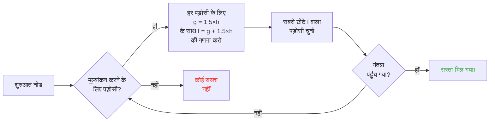

## परिचय

मैंने भेड़ों को दीवारों में टकराते देखने में घंटे बिताए।

और ईमानदारी से ? मेरी जिंदगी का सर्वश्रेष्ठ निवेश।

क्योंकि तुम इन mob को जितना देखते हो, उतना महसूस करते हो कि उनमें कुछ बेतरतीब नहीं है। हर गति कोड की हुई, पूर्वानुमेय, और खासकर पूरी तरह टूटने योग्य है। मैं pathfinding ठीक कैसे काम करता है यह समझने के लिए Minecraft स्रोत कोड में गोता लगाकर खत्म हुआ, और जो मैंने खोजा वह है कि तुम सचमुच mob को mind-control कर सकते हो। जैसे, उन्हें वहाँ जाने को मजबूर करना जहाँ तुम चाहते हो, न कि जहाँ संयोग तय करता है।

यह guide वह सब है जो मैंने छानबीन में सीखा। AI, A* एल्गोरिदम, छिपे दंड, survival में फेंके जा सकने वाले exploit। अपनी pickaxe तैयार करो।

---

## mob AI कैसे काम करती है (spoiler : यह मूर्ख है)

### Goal

हर mob के *goal* होते हैं। यह क्रियाओं की सूची है जो वह कर सकता है और कितना वह उन्हें करना चाहता है। संख्या जितनी छोटी, उतनी प्राथमिकता, अराजकता संस्करण todo list जैसी।

```java
protected void registerGoals() {
   this.goalSelector.addGoal(4, new Zombie.ZombieAttackTurtleEggGoal(this, 1.0, 3));
   this.goalSelector.addGoal(8, new LookAtPlayerGoal(this, Player.class, 8.0F));
   this.goalSelector.addGoal(8, new RandomLookAroundGoal(this));
   this.addBehaviourGoals();
}
```

तुमने कभी zombie को तुम्हारे पीछे दौड़ने के लिए कछुआ अंडा नजरअंदाज करते देखा है ? इसलिए : `ZombieAttackTurtleEggGoal` को प्राथमिकता 4 है, जबकि `ZombieAttackGoal` (goal जो उसे तुम्हारा चेहरा खाने को कहता है) प्राथमिकता 2 पर है।

हाँ, zombie अंडा तोड़ने के बजाय तुम्हें खाना पसंद करता है। प्यार खूबसूरत है।

जो goal हमें सच में रुचिकर है वह `WaterAvoidingRandomStrollGoal` है, प्राथमिकता 7। "मुझे कुछ करना नहीं इसलिए बेतरतीब चलता हूँ" goal। यहीं सब दिलचस्प होता है।

### गति (या "बेतरतीब चाल की 60 में 1 संभावना कैसे होती है")

हर tick (हर 0.05 सेकंड), खेल `canUse()` बुलाता है यह देखने के लिए कि क्या mob हिलने की कृपा करता है। हर tick पर 60 में 1 संभावना। पूरी तरह मूर्ख डिजाइन, और मुझे यह पसंद है।

```java
public boolean canUse() {
   if (this.mob.hasControllingPassenger()) {
      return false;
   } else {
      if (!this.forceTrigger) {
         if (this.checkNoActionTime && this.mob.getNoActionTime() >= 100) {
            return false;
         }
         if (this.mob.getRandom().nextInt(reducedTickDelay(this.interval)) != 0) {
            return false;
         }
      }
      Vec3 $$0 = this.getPosition();
      if ($$0 == null) {
         return false;
      } else {
         this.wantedX = $$0.x;
         this.wantedY = $$0.y;
         this.wantedZ = $$0.z;
         this.forceTrigger = false;
         return true;
      }
   }
}
```

तो संक्षेप में : अगर तुम mob पर सवार हो -> नहीं, अगर mob ने 5 सेकंड से कुछ नहीं किया -> नहीं, अगर बेतरतीब ना कहता है -> नहीं। खेल सच में नहीं चाहता कि mob हिले।

लेकिन जब वह हिलता है, तो `getPosition()` लेता है :

```java
protected Vec3 getPosition() {
   if (this.mob.isInWater()) {
      Vec3 $$0 = LandRandomPos.getPos(this.mob, 15, 7);
      return $$0 == null ? super.getPosition() : $$0;
   } else {
      return this.mob.getRandom().nextFloat() >= this.probability
         ? LandRandomPos.getPos(this.mob, 10, 7)
         : super.getPosition();
   }
}
```

अंत में इन दो संख्याओं को देखो : यह XZ त्रिज्या और Y त्रिज्या है। पानी में, mob दूर खोजता है (10 के बजाय 15)। अगर उसे जमीन नहीं मिलती, तो वह `super.getPosition()` पर लौटता है जो पानी स्वीकार करता है। **परिणाम : mob पानी से बाहर निकलना चाहते हैं।** इसीलिए तुम्हारे जानवर किनारे की ओर पागलों जैसे तैरते हैं।

मजेदार छोटा विवरण : सचमुच 0.1% संभावना है कि mob `LandRandomPos` के बजाय `super.getPosition()` ले। हजार में एक। यह ठेठ Mojang है।

### LandRandomPos : घटिया अनुकूलन जो सब बदलता है

यह मेरा पसंदीदा चरण है। सबसे खूबसूरत तकनीकी बेवकूफी जो pathfinding को शोषण योग्य बनाती है।

```java
public static Vec3 getPos(PathfinderMob $$0, int $$1, int $$2, ToDoubleFunction<BlockPos> $$3) {
   boolean $$4 = GoalUtils.mobRestricted($$0, $$1);
   return RandomPos.generateRandomPos(() -> {
      BlockPos $$4xx = RandomPos.generateRandomDirection($$0.getRandom(), $$1, $$2);
      BlockPos $$5 = generateRandomPosTowardDirection($$0, $$1, $$4, $$4xx);
      return $$5 == null ? null : movePosUpOutOfSolid($$0, $$5);
   }, $$3);
}
```

`movePosUpOutOfSolid`। नाम सब कहता है। अगर चुनी स्थिति ठोस ब्लॉक में है, तो खेल उसे ऊपर धकेलता है जब तक वह हवा में न हो।

यह अनुकूलन है : जमीन के नीचे स्थितियों को नजरअंदाज करने में समय खोने के बजाय, खेल उन्हें सतह पर उठाता है। चालाक ? हाँ। लेकिन यह पागल पूर्वाग्रह बनाता है : **mob ऊँचाइयाँ पसंद करते हैं**।

कल्पना करो। सतह के नीचे बहुत सारे ब्लॉक हैं, खेल 10 बेतरतीब स्थितियाँ बनाता है। ब्लॉक में वे ऊपर धकेली जाती हैं। घने क्षेत्र (पहाड़ी नीचे) खोखले क्षेत्रों से ज्यादा वैध स्थितियाँ बनाते हैं। परिणाम : mob सांख्यिकीय पहाड़ी की ओर ज्यादा जाता है।

मुझ पर भरोसा करो, हम इसे 2 मिनट में तोड़ेंगे।

### चयन : सर्वश्रेष्ठ ब्लॉक प्रतियोगिता

10 स्थितियाँ, एक ही विजेता, स्कोर प्रतियोगिता :

```java
public static Vec3 generateRandomPos(Supplier<BlockPos> $$0, ToDoubleFunction<BlockPos> $$1) {
   double $$2 = Double.NEGATIVE_INFINITY;
   BlockPos $$3 = null;
   for(int $$4 = 0; $$4 < 10; ++$$4) {
      BlockPos $$5 = (BlockPos)$$0.get();
      if ($$5 != null) {
         double $$6 = $$1.applyAsDouble($$5);
         if ($$6 > $$2) {
            $$2 = $$6;
            $$3 = $$5;
         }
      }
   }
   return $$3 != null ? Vec3.atBottomCenterOf($$3) : null;
}
```

सर्वश्रेष्ठ स्कोर वाली स्थिति जीतती है। और अगर हम स्कोर मानदंड जानते हैं, तो हम चाही स्थिति जितवा सकते हैं। चुनाव धाँधली जैसा है।

---

## mob पसंद (या "तुम्हारी गाय सड़क क्यों पार करती है")

हर mob के अलग स्वाद हैं। और यह सब बदलता है।

| Mob | यह पसंद करता है |
| --- | --- |
| **जानवर** (गाय, भेड़, सूअर) | घास और रोशनी (hipster) |
| **राक्षस** (zombie, कंकाल) | अंधेरा (edgelord) |
| **कछुए** | पानी, वरना रेत, वरना रोशनी |
| **Hoglin** | `crimson_nylium` ; `warped_fungus` से नफरत |
| **Strider** | सिर्फ लावा। कुछ और नहीं। |
| **Silverfish** | संक्रमित करने योग्य ब्लॉक (तार्किक) |
| **Guardian** | पानी + रोशनी (snob) |
| **Mooshroom** | Mycelium + रोशनी (मशरूम) |
| **मधुमक्खियाँ** | हवा। हाँ, वे हवा पसंद करती हैं। |

```java
// जानवर : नीचे देखता है, अगर घास है, तो अधिकतम स्कोर
public float getWalkTargetValue(BlockPos $$0, LevelReader $$1) {
   return $$1.getBlockState($$0.below()).is(Blocks.GRASS_BLOCK) ? 10.0F : $$1.getPathfindingCostFromLightLevels($$0);
}

// राक्षस : बिल्कुल उल्टा
public float getWalkTargetValue(BlockPos $$0, LevelReader $$1) {
   return -$$1.getPathfindingCostFromLightLevels($$0);
}
```

जैसे राक्षस सचमुच "अगर रोशन है, नकारात्मक स्कोर, मैं कहीं और जाता हूँ" हैं। वे रोशनी से मुँह बनाते हैं।

तो तुम, सचमुच, अपने जानवरों को घास और रोशनी से, और अपने राक्षसों को अंधेरे से मार्गदर्शन कर सकते हो। यह मूर्ख और शानदार दोनों है।

---

## Minecraft में A* एल्गोरिदम (गुप्त सूत्र)

Minecraft pathfinding के लिए A* (A-star) एल्गोरिदम इस्तेमाल करता है। लेकिन Mojang ने अपनी छाप लगाई :

```
f(n) = g(n) + 1.5 × h(n)
```

- **g(n)** = पहले तय रास्ता (प्रति ब्लॉक 1, विकर्ण में ~1.41)
- **h(n)** = सीधी दूरी
- **1.5** = क्योंकि Mojang को थोड़े टूटे मान पसंद हैं

सामान्यतः A* `f(n) = g(n) + h(n)` इस्तेमाल करता है। MOJANG ने 1.5 फैक्टर जोड़ा। क्यों ? ताकि एल्गो गंतव्य की ओर तेज जाए और खोज शाखाएँ कम काटे। परिणाम : मिला रास्ता "अच्छा" है लेकिन हमेशा सर्वश्रेष्ठ नहीं। यह थोड़ा नशे में A* है।



महत्वपूर्ण विवरण : **mob सिर्फ 16 ब्लॉक पर pathfinder कर सकता है** (उसकी *follow range*)। अगर गंतव्य बहुत दूर है, तो वह निकटतम ब्लॉक चुनता है जिसे वह पहुँच सकता है। इसका मतलब है कि तुम पहुँच से बाहर monolithe बना सकते हो, और mob उस ब्लॉक की ओर pathfinder करेगा जो उसे इस monolithe के सबसे करीब लाता है, जो उसकी गति पूरी तरह पूर्वानुमेय बनाता है।

### दो exploit जो खेल तोड़ते हैं

#### 1. ब्लॉक update = बाध्य पुनर्गणना

```java
public boolean shouldRecomputePath(BlockPos $$0) {
   if (this.hasDelayedRecomputation) return false;
   if (this.path != null && !this.path.isDone() && this.path.getNodeCount() != 0) {
      Node $$1 = this.path.getEndNode();
      Vec3 $$2 = new Vec3(
         ((double)$$1.x + this.mob.getX()) / 2.0,
         ((double)$$1.y + this.mob.getY()) / 2.0,
         ((double)$$1.z + this.mob.getZ()) / 2.0
      );
      return $$0.closerToCenterThan($$2, (double)(this.path.getNodeCount() - this.path.getNextNodeIndex()));
   }
   return false;
}
```

mob रास्ते के पास हर ब्लॉक अद्यतन 1 सेकंड cooldown के साथ A* की पुनर्गणना बाध्य करता है। तुम mob बगल में 1 सेकंड घड़ी रखते हो, और वह लगातार अपना रास्ता फिर से गणना करता है। यह GPS रखने जैसा है जो हर सेकंड reset होता है।

और अगर तुम यह 50 mob के साथ एक साथ करते हो ? Lag city। RIP TPS।

#### 2. ब्लॉक दंड (Pathfinding Malice)

कुछ ब्लॉक mob को डराते हैं। सचमुच। हर ब्लॉक का जुड़ा लागत है, गणना से परिभाषित :

| ब्लॉक / शर्त | दंड |
| --- | --- |
| **शहद ब्लॉक** | पार करने पर +8 |
| **पाउडर बर्फ** | अपारगम्य |
| **बंद दरवाजे** | अपारगम्य |
| **आग** | पार करने पर +16, साथ चलने पर +8 |
| **जानवर और ग्रामीण** | आग = -1 (नहीं) |
| **Cactus / Sweet berry** | अपारगम्य ; आसन्न = +8 |
| **पानी** | पार करने या साथ चलने पर +8 |
| **Magma** | साथ चलने पर +8 (आउच) |

जानवर और चरम हैं :

```java
protected Animal(EntityType<? extends Animal> $$0, Level $$1) {
   super($$0, $$1);
   this.setPathfindingMalus(PathType.DANGER_FIRE, 16.0F);
   this.setPathfindingMalus(PathType.DAMAGE_FIRE, -1.0F);
}
```

DAMAGE_FIRE -1.0F पर, यह सचमुच "निषिद्ध" है। जानवर आग पार करने के बजाय शून्य में कूदना पसंद करता है। फिउ।

### अभ्यास : रास्तों की बड़ी प्रतियोगिता

कल्पना करो ग्रामीण को कई रास्तों में चुनना है।

- **रास्ता A** : 15 ब्लॉक लेकिन 6 ब्लॉक पानी साथ (हर एक +8)
- **रास्ता B** : 18 ब्लॉक 2 पानी ब्लॉक (+8) और 1 आसन्न पानी ब्लॉक (+8) के साथ
- **रास्ता C** : 14 ब्लॉक सीधे... लेकिन आग के साथ -> ग्रामीण के लिए अपारगम्य
- **रास्ता D** : 16 ब्लॉक 1 आसन्न magma ब्लॉक (+8) + 1 आसन्न शहद ब्लॉक (+8) के साथ
- **रास्ता E** : 25 ब्लॉक लेकिन हर जगह cactus (+8 हर जगह) -> कुल लागत 90.82

मानसिक गणना :

- रास्ता A : 15 ब्लॉक + पानी के लिए 6×8 = 15 + 48 = **63** ... लेकिन जोड़ने को 1.5×दूरी है। असली गणना करते हैं।
- रास्ता B : लंबा लेकिन कम दंड। कुल cost = जमा दूरी + दंड।
- रास्ता D : magma और शहद अपने दंड जोड़ते हैं।

विजेता अक्सर **रास्ता B** है : चक्कर लाभदायक है क्योंकि पानी महँगा है।

ग्रामीण अनिवार्य रूप से पैरों वाला लागत गणनाकर्ता है।

### हर mob के अपने स्वाद हैं

ग्रामीण : "आग ? नहीं धन्यवाद बाय"
zombie : "आग ? ठीक है boomer *जलते हुए पार करता है*"

तुम्हारे पास सचमुच सड़कें हैं जो कुछ mob लेते हैं और अन्य नहीं। तुम ग्रामीण highway बना सकते हो जहाँ zombie जलते हैं।

---

## ग्रामीण : परम गड़बड़

ठीक, ग्रामीण। यह पूरे Minecraft का सबसे कम समझा तंत्र है। लेकिन एक बार कोड पकड़ने पर, तुम महसूस करते हो कि ये कार्यालय समय वाली पूर्वानुमेय मशीनें हैं।

### सेंसर और स्मृतियाँ

9 सेंसर, जो हर 20 tick (1 सेकंड) चलते हैं। हर एक ग्रामीण आसपास त्रिज्या जाँचता है और परिणाम स्मृति में संग्रहित करता है। ग्रामीण सब देखता है, सब याद रखता है, और तदनुसार काम करता है।

जैसे : "क्या शत्रु है ? जमीन पर item ? बात करने वाला खिलाड़ी ?" वह सब जाँचता है।

### package (उसके दिन के चरण)

ग्रामीण मस्तिष्क गतिविधि package हैं जो समय अनुसार सक्रिय होते हैं :

| Package | समय | ग्रामीण... |
| --- | --- | --- |
| **Core** | 24 घंटे | दरवाजे खोलता है, तैरता है (80% समय), और POI प्राप्त करता है |
| **Work** | 8h-15h | "मैं काम करने जाता हूँ", अपने post की ओर चलता है |
| **Meet** | 15h-17h | "Apéro !" , घंटी जाता है, गपशप करता है |
| **Rest** | 18h-6h | "सोना चाहिए", बिस्तर जाता है |
| **Idle** | 6h-8h, 17h-18h | "मैं आवारा हूँ", घूमता है, बच्चे बनाता है, बिस्तरों पर कूदता है |
| **Panic** | चोट/शत्रु | "बचाओ", भागना |

**Panic** package अकेला है जो बाकी सब बाधित कर सकता है। भले ही ग्रामीण सो रहा हो या काम कर रहा हो, अगर zombie है, तो सामान्य दहशत।

### Acquire POI : वह चीज जो बिना तार redstone देती है

```java
Set<Pair<Holder<PoiType>, BlockPos>> $$12 = (Set)$$10xx.findAllClosestFirstWithType(
   $$0, $$11, $$8x.blockPosition(), 48, PoiManager.Occupancy.HAS_SPACE
)
```

`Acquire POI` 48 ब्लॉक त्रिज्या में सभी POI (रुचि बिंदु) scan करता है। वह 5 निकटतम रखता है, जाँचता है कि रास्ता मौजूद है, और पहला पहुँच योग्य प्राप्त करता है।

हर POI में सीमित slot संख्या है :
- **कार्य post** : 1 slot
- **बिस्तर** : 1 slot
- **घंटियाँ** : 32 slot

पागल बिंदु : **slot प्राप्ति समय आरक्षित होता है, पहुँचने पर नहीं**। ग्रामीण नक्शे के दूसरे छोर से composter lock कर सकता है, बिना कभी पहुँचे।

शक्ति पकड़ रहे हो ?

### बिना तार Redstone। हाँ, बिना तार।

1. तुम ग्रामीण को composter की ओर रास्ते वाले minecart में रखते हो
2. वह composter प्राप्त करता है (slot लिया, कोई और इस्तेमाल नहीं कर सकता)
3. ग्रामीण उस पर क्लिक करने को बहुत दूर है, bone meal रहती है
4. तुम इस ग्रामीण को दुनिया में कहीं भी घुमाते हो, वह slot रखता है
5. जब तुम अपनी चीज सक्रिय करना चाहते हो, तो तुम ग्रामीण मारते हो
6. slot मुक्त होता है, दूसरा ग्रामीण composter प्राप्त करता है, bone meal हटाता है
7. BLOCK UPDATE -> कोई भी redstone circuit सक्रिय

तुमने सचमुच बिना तार redstone संकेत बनाया है, पूरी दुनिया में संचारणीय, रास्ते पर शून्य chunk load जरूरी। तुम इसे ender pearl stasis chamber पर जोड़ सकते हो, ग्रामीण मारकर कहीं से teleport करा सकते हो।

मेरा पसंदीदा उपयोग ? "bounty hunter" mini-game : तुम composter वाले कई ग्रामीण रखते हो, खिलाड़ी को output सक्रिय करने के लिए सही ग्रामीण मारना होगा। यह पूरी तरह wtf यांत्रिकी है।

### Pathfinding Deadlock (या "हमेशा freeze ग्रामीण")

`Acquire POI` (जो रास्ता देखता है) और असली navigation (जो उसे लेने से मना करता है) के बीच बहुत अच्छा bug है। यह तब होता है जब कार्य post ऊपर ब्लॉक चलने योग्य नहीं है। परिणाम :

- Core package : "मैं POI प्राप्त करना चाहता हूँ"
- Navigation : "मैं वहाँ नहीं चल सकता"
- परिणाम : ग्रामीण हमेशा के लिए जमा रहता है, खुद से लड़ता हुआ।

सचमुच जगह पर frozen ग्रामीण, सजावट या build में "prop" के रूप में उपयोगी। armor stand tank ? हाँ। न हिलने वाला guard ? हाँ। वीभत्स ? शायद। लेकिन प्रभावी।

---

## निष्कर्ष

Minecraft mob pathfinding संयोग नहीं है। यह नियतात्मक तंत्र है, स्कोर आधारित, पूर्वानुमेय और तोड़ने योग्य।

**याद रखने वाले तीन बिंदु :**

1. **पैरों नीचे ब्लॉक = ऊँचाई पूर्वाग्रह** : mob मार्गदर्शन के लिए उपमृदा भरो या खाली करो
2. **दंड हर mob के लिए अलग हैं** : सड़कें बनाओ जो कुछ लेते हैं और अन्य नहीं
3. **POI slot दूरी पर आरक्षित होते हैं** : मुफ्त बिना तार redstone, teleportation, यह सब

Minecraft स्रोत कोड कम शोषित यांत्रिकी की सोने की खान है। मैंने डीकंपाइल Java पढ़ने में घंटे बिताए और सच कहूँ ? हर पंक्ति कार्यात्मक Easter Egg है। सिवाय इसके कि वे, तुम survival में ग्रामीणों से बिना तार redstone बनाने के लिए इस्तेमाल करते हो। सर्वश्रेष्ठ खेल पुष्ट।
