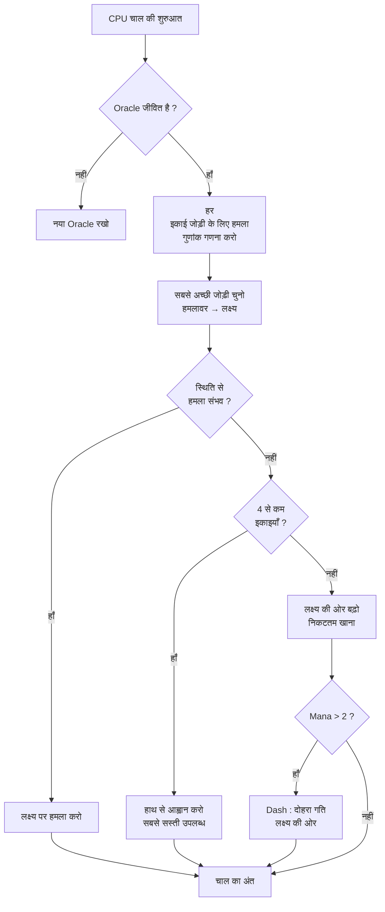

## Nausicaa के लिए मेरा बेवकूफ AI

कुछ प्रोजेक्ट "क्या हो अगर मैं पौराणिक कथाओं के साथ शतरंज बनाऊँ ?" से शुरू होते हैं और ऐसी प्रणाली पर खत्म होते हैं जिसमें AI हर 5 चाल में अपने हाइपर पैरामीटर खुद तय करता है।

Nausicaa यही है। बारी आधारित बोर्ड गेम जहाँ तुम पौराणिक प्राणियों का डेक बनाते हो, अपना mana प्रबंधित करते हो, 10x8 बोर्ड पर इकाइयाँ तैनात करते हो। और एक AI है जिसे व्यक्तित्व संकट होते हैं।

मैंने इस AI पर काफी समय बिताया, और परिणाम कभी कभी मुझे भी चकमा देता है, और यही मुझे सबसे ज्यादा पसंद है।

## असली खेल

दिमाग की बात से पहले, शरीर समझना होगा :

- 10x8 बोर्ड, प्रति खिलाड़ी 2 पंक्तियों का तैनाती क्षेत्र
- Mana 1 से शुरू, प्रति चाल +1, अधिकतम 6। तुम आह्वान करने, हमला करने, क्षमताएँ इस्तेमाल करने के लिए खर्च करते हो
- लक्ष्य : विरोधी Oracle को मारना

12 इकाइयाँ, अलग लागत और गति पैटर्न :

| इकाई | लागत | गति | HP |
| --- | --- | --- | --- |
| Oracle | 0 | राजा (8 दिशाएँ) | 1 |
| Gobelin | 1 | आगे 3 खाने | 1 |
| Harpie | 1 | राजा (8 दिशाएँ) | 1 |
| Naïade | 1 | विकर्ण | 1 |
| Griffin | 2 | 2 खाने छलांग | 2 |
| Sirène | 2 | पार्श्व | 1 |
| Centaure | 2 | घोड़ा (L में) | 2 |
| Archer | 3 | पार्श्व | 1 |
| Phénix | 3 | विकर्ण (गहरे खाने) | 1 |
| Métamorphe | 4 | जगह अदला बदली | 1 |
| Voyant | 4 | कोई नहीं (mana बनाता है) | 1 |
| Titan | 6 | सीमित (क्षेत्र हमला) | 3 |

हर इकाई का अपना हमला पैटर्न है। Sirène 4 विकर्णों में मारती है, Archer 3 खानों पर दूरी से, Titan आह्वान पर आसपास सब नष्ट करता है। संक्षेप में, पौराणिक कथाओं और डेकबिल्डिंग वाला शतरंज खेल।

## मैंने CPU को कैसे सोचवाया

बुनियादी विचार मूर्खतापूर्ण सरल है : **हर शत्रु इकाई का आकर्षण गुणांक होता है**। जितनी खतरनाक, उतना AI उससे निपटना चाहता है।

```javascript
const UNITS_ATTRACTIVENESS = {
    "oracle": 100,
    "titan": 95,
    "shapeshifter": 90,
    "phoenix": 80,
    "siren": 70,
    "archer": 70,
    "seer": 70,
    "griffin": 60,
    "centaur": 60,
    "harpy": 50,
    "naiad": 30,
    "gobelin": 20
};
```

Oracle 100, तर्कसंगत, यह जीत शर्त है। Titan 95 क्योंकि वह आह्वान पर पास सब कुछ एक बार में मारता है। Gobelin 20, यह पैदल सैनिक है, हमें परवाह नहीं।

फिर इकाइयों की हर जोड़ी (एक मित्र, एक शत्रु) के लिए, मैं गणना करता हूँ :

```
रुचि = आकर्षण × गुणांक_आकर्षण / (दूरी × गुणांक_दूरी)
```

मोटे तौर पर : तुम जितने खतरनाक और करीब, उतना AI तुम्हें पीटना चाहता है।

```javascript
calculateAttackCoefficient(x1, y1, x2, y2) {
    const distance = this.calculateEuclideanDistance(x1, y1, x2, y2);
    if (distance === 0) return Infinity;
    return (UNITS_ATTRACTIVENESS[unit.type] * COEFFICIENTS_IMPORTANCE["attractiveness"]) / distance;
}
```

### बदलते गुणांकों वाली चाल

महत्वपूर्ण बिंदु यह है कि महत्व गुणांक **हर 5 चाल में बेतरतीब बदलते हैं**।

```javascript
if (this.turnCount % 5 === 0) {
    const distanceCoefficient = parseInt(Math.random() * 100);
    const attractivenessCoefficient = parseInt(Math.random() * 100);
    this.regulateImportanceCoefficients({
        distance: distanceCoefficient,
        attractiveness: attractivenessCoefficient
    });
}
```

एक बार AI अति आक्रामक हो जाता है (आकर्षण 95, दूरी 5), वह तुम्हारे Oracle को मारने के लिए सब पार करता है। अगली बार वह दूरी प्राथमिकता देता है और फिर से स्थिति लेता है।

यह Pac-Man भूतों से उठाया गया है, Blinky शिकार करता है, Pinky घात लगाता है। यहाँ AI हर चरण में "व्यक्तित्व" बदलता है।

**परिणाम : पूरी बाजी में AI की भविष्यवाणी असंभव।** CPU कभी दो बार एक जैसा मैच नहीं खेलता।

### Oracle कायर है

शत्रु Oracle भागता है। सचमुच।

```javascript
const awayFromTarget = {
    row: Math.max(0, Math.min(7, botUnitElement.row + (botUnitElement.row - targetUnitElement.row))),
    col: Math.max(0, Math.min(9, botUnitElement.col + (botUnitElement.col - targetUnitElement.col)))
};
```

वह खतरे की विपरीत दिशा गणना करता है और भाग जाता है। अगर दीवार है, तो वह उस दिशा में निकटतम खाली खाना खोजता है।

तुम Oracle के करीब जाने में 3 चाल बिताते हो, और धड़ाम वह पहले ही दूसरे छोर पर भाग चुका है।

### निर्णय लूप

AI कैसे तय करता है :

1. अगर मेरा Oracle नहीं रहा (मरा), नया रखना
2. हर मित्र इकाई → शत्रु इकाई जोड़े के लिए गुणांक गणना करना
3. सबसे अच्छी जोड़ी चुनना
4. अगर इकाई अपनी स्थिति से लक्ष्य पर हमला कर सकती है → हमला
5. अगर मेरी 4 से कम इकाइयाँ हैं → हाथ से सबसे सस्ती उपलब्ध आह्वान करना
6. वरना, लक्ष्य की ओर बढ़ना (शत्रु के निकटतम गति खाना)
7. अगर पर्याप्त mana (> 2), dash (दोहरा गति) ताकि और करीब आए
8. अगर इकाई Oracle है → भागना



```javascript
async makeAction(dash=false) {
    // यह सब क्रम में
    // CPU dash करता है अगर उसके पास पर्याप्त mana है
    if(botPlayer.mana > 2) {
        this.makeAction(true);
    }
}
```

### यूक्लिडीय दूरी क्यों

मैं यूक्लिडीय दूरी इस्तेमाल करता हूँ :

```javascript
calculateEuclideanDistance(x1, y1, x2, y2) {
    const deltaX = Math.pow(x1 - x2, 2);
    const deltaY = Math.pow(y1 - y2, 2);
    return Math.sqrt(deltaX + deltaY) * COEFFICIENTS_IMPORTANCE["distance"];
}
```

Manhattan क्यों नहीं ? क्योंकि इकाइयों के विविध गति पैटर्न हैं (घोड़े जैसा L, विकर्ण, आदि)। सीधी दूरी खतरे का बेहतर अनुमान है।

## minimax क्यों नहीं

मैं क्लासिक minimax कोड कर सकता था। लेकिन 12 इकाई प्रकार, अलग गति पैटर्न, विशेष क्षमताओं के साथ... खेल वृक्ष इतनी जल्दी फटता है कि खेलना असंभव हो जाता है। अनुमानी दृष्टिकोण 10 मिलियन अवस्थाएँ खोजे बिना बुद्धिमान चुनाव करता है।

## क्या अच्छा है

आकर्षण प्रणाली मजेदार दुविधाएँ बनाती है :

- Voyant (70) mana बनाता है। अगर तुम उसे जीने देते हो, तो विरोधी के पास ज्यादा संसाधन हैं। लेकिन Titan (95) और भी खतरनाक है।
- Métamorphe (90) किसी भी इकाई से जगह बदल सकता है। वह तुम्हारा Oracle चुरा सकता है।
- Harpie (50) का विस्फोटक हमला है जो उसे भी मारता है। वह गौण रहती है... जब तक वह तुम्हारी 3 इकाइयों के बगल में न हो।

AI सिर्फ कच्चे आँकड़ों से नहीं, स्थितियों के अनुसार वैश्विक खतरा मूल्यांकित करता है।

बिना बाजी दोहराए परिदृश्य परखने के लिए `activateSimulation()` फंक्शन भी है :

```javascript
activateSimulation() {
    // बोर्ड पर विशिष्ट इकाइयाँ रखता है
    // AI डिबग करने के लिए उपयोगी
    this.game.board = simulation.board;
    this.game.players = simulation.players;
}
```

## क्या कमी है

अगर मेरे पास ज्यादा समय होता :

- AI वर्तमान स्थिति पर प्रतिक्रिया करता है, वह भविष्यवाणी नहीं करता कि खिलाड़ी क्या करेगा
- वह कई चालों पर अपना हाथ योजनाबद्ध नहीं करता
- Métamorphe और Centaure की क्षमताओं का वह कम उपयोग करता है
- सुदृढ़ीकरण सीखना : गुणांक समायोजित करने के लिए उसे खुद से खेलवाना

लेकिन ब्राउजर गेम के लिए यह चलता है। दोस्त इससे हार जाते हैं, इसलिए मान्य है।

## परखो

[nausicaa-game.github.io](https://nausicaa-game.github.io/) पर उपलब्ध। तुम "JOUER" क्लिक करते हो, CPU मोड ON, और AI को करते देखते हो।

सलाह : AI को खुद से खेलने दो। तुम आक्रामक चरण देखोगे, फिर फुस्स वह सब पीछे हटता है।

कोड [GitHub](https://github.com/nausicaa-game/nausicaa-game.github.io) पर `js/cpu.js` में है।

**याद रखने के 3 बिंदु :**

1. **अनुमानी गुणांक** , minimax नहीं, हर इकाई का आकर्षण है
2. **गुणांक जो हर 5 चाल में बदलते हैं** , AI आक्रामकता और नियंत्रण बदलता है, Pac-Man तरह
3. **Oracle भागता है** , वह खतरे की विपरीत दिशा गणना करता है और निकल जाता है

अगर AI को और दुष्ट बनाने के विचार हैं, तो issue खोलो। मेरे पास हार से सीखने वाले संस्करण की योजनाएँ हैं, लेकिन वह अगले लेख के लिए होगा।
