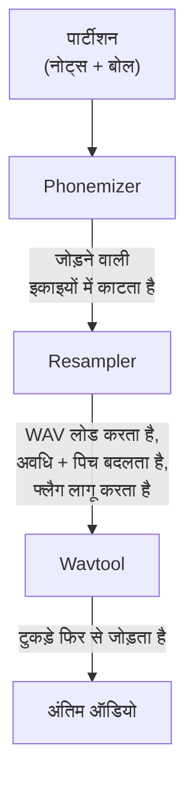

## UTAU : Visual Basic 6 के एक सॉफ्टवेयर ने सिंथेटिक आवाज को सबके लिए कैसे सुलभ बनाया

मैंने अपने मुख्य पेज पर इसका जिक्र किया था : मुझे UTAU पसंद है। यहाँ बताया क्यों।

2008 में, अगर तुम किसी सिंथेटिक आवाज से गाना गवाना चाहते थे, तो तुम्हारे पास एक विकल्प था : VOCALOID। Yamaha का सॉफ्टवेयर। महँगा, मालिकाना, आधिकारिक आवाजों के साथ जिन्हें तुम खुद नहीं बना सकते थे।

और फिर एक जापानी आदमी, Ameya/Ayame, ने अपने कोने में एक प्रोग्राम निकाला। **Visual Basic 6** में कोड किया गया सॉफ्टवेयर। मुफ्त। जो तुम्हें अपनी खुद की आवाज बनाने देता था, उन WAV फाइलों से जिन्हें तुम खुद रिकॉर्ड करते थे।

इस सॉफ्टवेयर का नाम **UTAU** है (歌う, जापानी में "गाना")। और अपने समय के लिए, यह जादू था।

मुझे यह इसकी तकनीकी सफाई से ज्यादा शुरुआती विचार के लिए हमेशा आकर्षक लगा (एन्कोडिंग का सिद्धांत सच में चतुर है, भले ही कार्यान्वयन आँखों में चुभे) : इसने वाक् संश्लेषण को आम जनता के लिए खोल दिया। तुम, मैं, माइक वाला कोई भी।

मुझे समझाने दो कि यह शानदार क्यों था।

---

## पहले, गायन संश्लेषण मुश्किल क्यों है

गाई हुई आवाज नोट्स नहीं होती। व्यंजन जो हमला करता है, स्वर जो टिका रहता है, साँस, दोनों के बीच संक्रमण। "salut" का "sa" एक सीटी बजाता "s" है जो खुले "a" की ओर फिसलता है, और यही फिसलन है जो मानवीय लगती है या नहीं।

आज हम इसे डीप लर्निंग से सुलझाते हैं : तुम घंटों के गायन पर एक मॉडल प्रशिक्षित करते हो और वह आवाज उत्पन्न करता है (Synthesizer V, DiffSinger)। लेकिन वह 2020 के बाद की बात है। 2008 में, कुछ भी नहीं।

UTAU पहले वाली, पुरानी और चालाक विधि का उपयोग करता है : **कंकैटेनेटिव संश्लेषण**।

---

## कंकैटेनेटिव संश्लेषण : आवाज के टुकड़ों का कॉपी पेस्ट

विचार मूर्खतापूर्ण सरल है : तुम आवाज के छोटे टुकड़े रिकॉर्ड करते हो और शब्द बनाने के लिए उन्हें एक साथ चिपका देते हो। "salut" = नमूना "sa" + "lu" + "to", एक के बाद एक। संगीत स्कोर द्वारा संचालित ध्वनि पहेली।

यह उन YouTube Poop का सिद्धांत है जहाँ किसी पात्र के शब्दों को फिर से काटकर उससे कुछ भी बुलवाया जाता है, सिवाय इसके कि यहाँ यह साफ और स्वचालित है।

और UTAU सचमुच वहीं से आया है। उससे पहले **"Jinriki Vocaloid"** (人力ボーカロイド, "मैन्युअल Vocaloid") मौजूद था : लोग हाथ से वोकल ट्रैक काटते थे, स्वनिम निकालते थे, पिच बदलते थे, और VOCALOID आवाज की नकल करने के लिए सब कुछ ऑडियो एडिटर में फिर से जोड़ते थे। हाथ से। काम का अंदाजा लगाओ।

Ameya ने यह झंझट देखा और इसे स्वचालित करने का उपकरण कोड किया। शुरू में UTAU बस यही था : मैन्युअल Vocaloid का सहायक।

---

## यह क्रांतिकारी क्यों था : तुम आवाज बनाते हो

यही वह है जो सब कुछ बदल देता है।

VOCALOID में तुम एक आवाज खरीदते थे। Miku, Luka, आदि। पेशेवरों द्वारा बनाई गई, Yamaha द्वारा बेची गई। निर्माण Yamaha तक सीमित रहा। UTAU के साथ, **कोई भी अपनी आवाज रिकॉर्ड करता है और उसे गाने वाला वाद्य बना देता है**।

CV मोड (सबसे सरल) यह है : तुम जापानी के लगभग 100 बुनियादी अक्षर रिकॉर्ड करते हो ("a", "ka", "sa", "ta"...), तुम काटने के बिंदु कॉन्फ़िगर करते हो, और हो गई तुम्हारी voicebank। कुछ घंटों का काम।

परिणाम : पारिस्थितिकी तंत्र फट पड़ा। समुदाय द्वारा बनाई गई हजारों voicebank, प्रशंसकों, दोस्तों, आविष्कृत पात्रों की आवाजें। आभासी गायकों का पूरा ब्रह्मांड, मुफ्त। और सॉफ्टवेयर **Defoko** (Utane Uta) के साथ आया, AquesTalk TTS इंजन से उत्पन्न डिफ़ॉल्ट आवाज, इसलिए तुम बिना माइक के भी शुरू कर सकते थे।

---

## oto.ini : प्रणाली का हृदय

UTAU कैसे जानता है कि ध्वनियाँ कहाँ काटनी और चिपकानी हैं ? प्रति voicebank एक कॉन्फ़िग फाइल के माध्यम से : **`oto.ini`**। हर WAV के लिए, यह काटने के बिंदु परिभाषित करता है (मिलीसेकंड में) :

- **Offset** → शुरुआत में हटाने वाला मौन
- **Preutterance** → वह बिंदु जहाँ व्यंजन स्वर में बदलता है ("sa" में "s" से "a" की सीमा)
- **Overlap** → पिछला नोट इस पर कितना चढ़ता है
- **Fixed region** → वह हिस्सा जिसे लंबे नोट पर खींचा नहीं जाना चाहिए (आमतौर पर व्यंजन)
- **Cutoff** → अंत कहाँ काटना है

**preutterance** सबसे चालाक पैरामीटर है। एक अक्षर में स्वर से पहले हमेशा व्यंजन का टुकड़ा होता है। तुम्हारा नोट समय पर पड़े, इसके लिए *स्वर* बिल्कुल समय पर पड़ना चाहिए, व्यंजन नहीं। इसलिए UTAU नमूने को पीछे खिसकाता है : "sa" का "a" समय पर उतरता है, "s" ठीक पहले छलकता है। जैसे कोई ढोलकिया अपनी चोट का पूर्वानुमान करता है ताकि ध्वनि सही पड़े, सिवाय इसके कि यहाँ यह `.ini` में है।

दृश्य रूप में, "ka" नमूने पर `oto.ini` के क्षेत्र इस तरह कटते हैं :

```mermaid
flowchart LR
    A["🔇 मौन<br/>(offset)"] --> B["🅺 व्यंजन<br/>(fixed region,<br/>नहीं खींचा जाता)"]
    B --> C["🅰 स्वर<br/>(खींचने योग्य क्षेत्र)"]
    C --> D["🔇 कटा अंत<br/>(cutoff)"]
    style B fill:#3b4a6b
    style C fill:#5b3b6b
```



व्यंजन और स्वर के बीच की सीमा preutterance है। स्वर वह क्षेत्र है जिसे लंबे नोटों के लिए खींचा जाता है ; व्यंजन अक्षुण्ण रहता है, वरना तुम्हारा "k" दो सेकंड चलेगा और भयानक लगेगा।

```ini
# oto.ini (सरलीकृत)
# फाइल=उपनाम,ऑफसेट,व्यंजन,कटऑफ,प्रीअटरेंस,ओवरलैप
_ka.wav=ka,120,80,-200,90,40
```

हर ध्वनि के लिए पाँच मान, तुम्हारे सभी नमूनों पर, और UTAU कोई भी शब्द साफ जोड़ देता है।

---

## CV, VCV, CVVC : यथार्थवाद की दौड़

बुनियादी मोड, **CV** (व्यंजन स्वर), प्रति अक्षर एक ध्वनि है। सरल लेकिन थोड़ा रोबोटिक : अक्षरों के बीच जोड़ कच्चे होते हैं।

2010 में समुदाय ने **VCV** (स्वर व्यंजन स्वर) का आविष्कार किया। अकेले "ka" रिकॉर्ड करने के बजाय, तुम "a ka" रिकॉर्ड करते हो, पिछले स्वर की पूँछ के साथ। संक्रमण स्वाभाविक हो जाता है क्योंकि वह *रिकॉर्डिंग में* है, बाद में गणना किया हुआ नहीं।

चुभने वाला विवरण : **VOCALOID को VCV 2011 में VOCALOID3 से पहले नहीं मिला।** अकेले एक आदमी द्वारा कोड किए गए VB6 फ्रीवेयर ने संक्रमण के यथार्थवाद में Yamaha को एक साल से आगे कर दिया। बहुराष्ट्रीय कंपनी से तेज प्रशंसकों का समुदाय।

फिर **CVVC**, **ARPAsing** (अंग्रेजी), **VCCV** आए... हर विधि यथार्थवाद को आगे बढ़ाती, सभी समुदाय द्वारा आविष्कृत और प्रलेखित।

---

## पूरा पाइपलाइन : एक शब्द ध्वनि कैसे बनता है

जब तुम एक नोट रखते हो और बोल टाइप करते हो, तो पर्दे के पीछे यह होता है :



**resampler** मुख्य टुकड़ा है : यह तुम्हारा "ka" नमूना लेता है जो एक निश्चित ऊँचाई पर रिकॉर्ड किया गया है और वांछित नोट से मेल खाने के लिए उसे फिर से खींचता/पिच बदलता है, सिर्फ खींचने योग्य क्षेत्र खींचकर और व्यंजन अक्षुण्ण रखकर (इसीलिए `oto.ini`)।

और यह **मॉड्यूलर** है। UTAU बुनियादी resampler के साथ आया था, लेकिन समुदाय ने और बनाए (moresampler, TIPS...), हर एक अपनी ध्वनि दाने के साथ। तुम प्लगइन की तरह संश्लेषण इंजन बदलते थे। 2008 में। एक फ्रीवेयर पर।

---

## हुड के नीचे काम (और यह प्यारा क्यों है)

मुझे सॉफ्टवेयर की तकनीकी स्थिति पर ईमानदार होना चाहिए :

- **Visual Basic 6 में कोड किया गया।** 2008 में पहले से मरी भाषा। इसे चलाने के लिए VB6 रनटाइम चाहिए।
- **शुरू में सिर्फ Windows** (Mac पोर्ट, UTAU-Synth, 2011 में आया)।
- **अनिवार्य Shift-JIS एन्कोडिंग।** अगर तुम्हारी फाइलें जापानी Shift-JIS में एन्कोड नहीं हैं, तो UTAU कुछ नहीं समझता। आज भी अक्सर अपना PC जापानी लोकल में रखना पड़ता है या इसे चलाने के लिए AppLocale इस्तेमाल करना पड़ता है।
- **सादा इंटरफेस**, उस समय लगभग 100% जापानी में दस्तावेज।

और फिर भी। फिर भी इस सॉफ्टवेयर ने विश्वव्यापी आंदोलन बनाया। दसियों हजार voicebank। लाखों बार सुने गए गाने।

सबसे अच्छा उदाहरण : **Kasane Teto**। 2008 में बनाया गया पात्र और 1 अप्रैल के मजाक के तौर पर फेंका गया, VOCALOID होने का दिखावा करते हुए। यह एक मजाक था। सिवाय इसके कि लोगों को पात्र बहुत पसंद आया, पीछे एक असली UTAU voicebank बनाई गई, और Teto दुनिया की सबसे प्रसिद्ध आभासी गायिकाओं में से एक बन गई। 2023 में उसे आधिकारिक Synthesizer V आवाज भी मिली। मुफ्त सॉफ्टवेयर पर अप्रैल फूल से जन्मा पात्र।

---

## यह आज भी क्यों मायने रखता है

UTAU "गरीब" तकनीक का सही उदाहरण है जो खुलेपन से जीतती है।

VOCALOID तकनीकी रूप से बेहतर था, बेहतर वित्तपोषित, ज्यादा पेशेवर। लेकिन बंद। UTAU जुगाड़ू था, भद्दा, VB6 में, लेकिन वह सबको भाग लेने देता था। आवाजें बनाना, resampler बनाना, प्लगइन बनाना, रिकॉर्डिंग विधियाँ बनाना। बाकी समुदाय ने किया।

और अवधारणा आज पूरी तरह जीवित है। **OpenUtau**, एक आधुनिक ओपन सोर्स उत्तराधिकारी, विचार लेता है और उसे तरोताजा करता है (मल्टी प्लेटफॉर्म, UTF-8, आधुनिक resampler और AI का समर्थन)। कंकैटेनेटिव संश्लेषण डीप लर्निंग मॉडलों के बगल में आज भी टिका है, क्योंकि इसका एक फायदा है जो उनके पास नहीं है : तुम बिल्कुल समझते हो कि क्या हो रहा है, और तुम हर मिलीसेकंड नियंत्रित करते हो।

मुझे UTAU में यही हमेशा पसंद आया। तुम बिल्कुल देखते हो कि क्या हो रहा है। यह कोई AI नहीं है जो तुम्हें जादुई परिणाम थूकता है जिसे तुम समझते नहीं : तुम्हारे पास तुम्हारे WAV हैं, तुम्हारे काटने के बिंदु हैं, और सब कुछ तुम तय करते हो। जब यह बुरा लगता है, तुम जानते हो क्यों और सुधार सकते हो। मुझे इस तरह का नियंत्रण पसंद है।

---

**याद रखने के 3 बिंदु :**

1. **कंकैटेनेटिव संश्लेषण = आवाज पहेली** , UTAU शब्द बनाने के लिए छोटे WAV नमूनों को एक साथ चिपकाता है। `oto.ini` परिभाषित करता है कि हर ध्वनि कहाँ काटनी और चिपकानी है। तुम सब कुछ नियंत्रित करते हो, मिलीसेकंड तक, बिना ब्लैक बॉक्स।
2. **खुलापन तकनीक को हराता है** , VOCALOID बेहतर था लेकिन बंद। UTAU जुगाड़ू था लेकिन सबको अपनी आवाजें बनाने देता था। समुदाय ने पारिस्थितिकी तंत्र विस्फोटित किया, और VCV पर Yamaha से भी आगे निकला।
3. **अच्छा विचार अपने कोड से बचता है** , VB6, Shift-JIS, सिर्फ Windows... और फिर भी अवधारणा OpenUtau के माध्यम से चलती है। शानदार तकनीक घटिया कोड के साथ लिखी जा सकती है।

ईमानदारी से, सिर्फ 1 अप्रैल को जन्मी Kasane Teto के लिए, यह सॉफ्टवेयर सम्मान का हकदार है।
