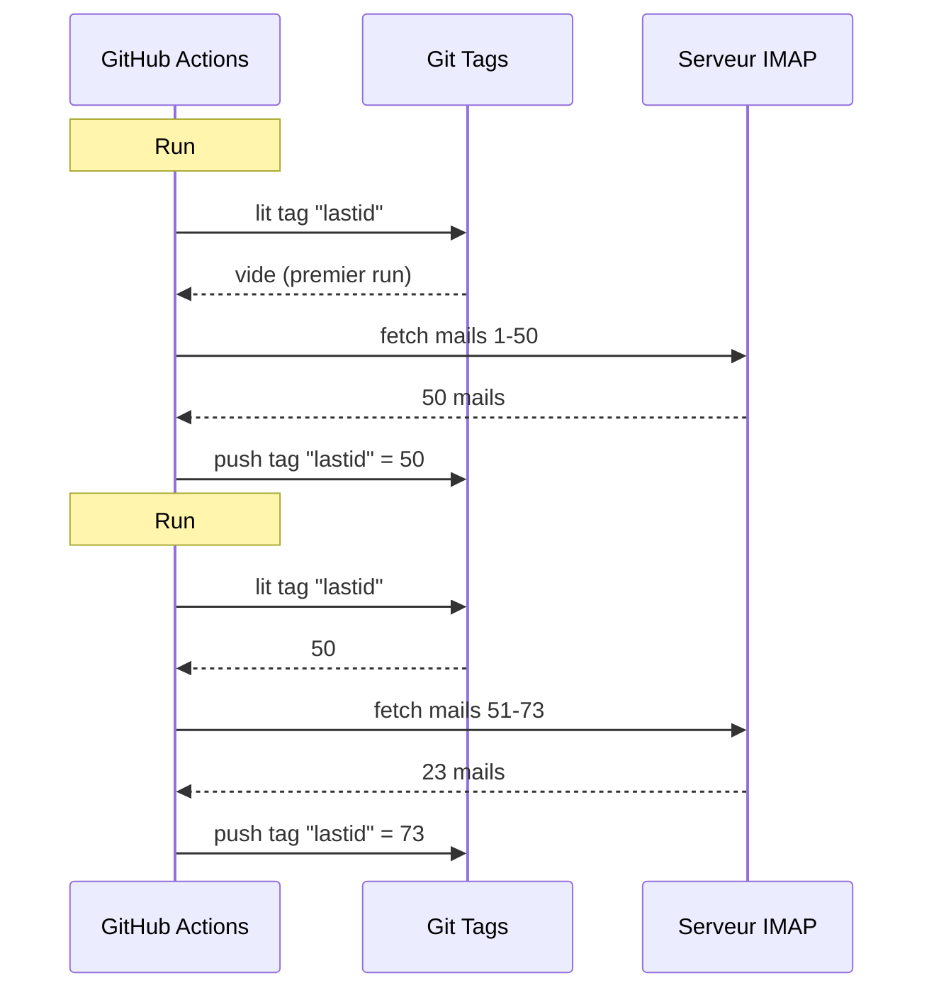

# Saya memakai git sebagai basis data untuk menjalankan bot gratis di GitHub Actions

Saya punya penjawab email otomatis yang berjalan 24/7.

Ia membaca email saya, memahami isinya, dan menjawab sendiri dengan AI. Ia mengingat percakapan sebelumnya. Ia mengabaikan newsletter dan `noreply@`. Ia meneruskan ke manusia kalau terlalu panas.

Biaya bulanan : **0€**.

Saya tidak memakai server, VPS, maupun basis data. Hanya GitHub Actions dan hack gila : **memakai git sebagai basis data**.

Kamu paham maksud saya? Tidak? Oke, pegangan, ini bodoh sekaligus jenius.

---

## Masalahnya : GitHub Actions itu stateless

GitHub Actions itu gratis. Kamu bisa menjalankan cron setiap 5 menit, menjalankan kodemu, gratis.

Tapi ada masalah : ia **stateless**.

Setiap run dimulai di mesin perawan. Tidak ada yang disimpan antara dua eksekusi. Run sebelumnya? Lupa. Dihapus. Seolah tidak pernah ada.

Untuk penjawab email, ini masalah besar. Semisal :

> "Email terakhir apa yang sudah saya proses?"

Kalau bot lupa itu di setiap run, ia akan menjawab email yang sama berulang-ulang (bencana), atau melewatkan email.

Butuh keadaan persisten. Dan normalnya, keadaan persisten = basis data. Tapi basis data berarti server, dan server berarti tidak gratis lagi.

Di sinilah jadi menarik.

---

## Solusinya : tag git sebagai basis data

Repo GitHub-mu sudah penyimpanan persisten. Gratis. Berversi. Selalu ada.

Jadi kenapa tidak menyimpan keadaan di sana?

Idenya : di setiap run, bot membaca UID email terakhir yang diproses dari **tag git**. Ia memproses email baru. Lalu ia push ulang tag dengan UID baru.



Tag git ADALAH basis datanya. Satu nilai saja, tapi itu semua yang kita butuhkan.

### Membaca state

Di awal job, kita mengambil nilai dari tag :

```bash
git fetch origin --tags lastid || true
git show refs/tags/lastid:data/lastId > data/lastId || true
```

`git show refs/tags/lastid:data/lastId` artinya : "kasih saya isi berkas `data/lastId` sebagaimana adanya di tag `lastid`".

Boom. Kamu dapat nilaimu, tanpa basis data.

### Menulis state

Di akhir, kita membuat ulang tag dengan nilai baru :

```bash
git switch --orphan lastid-tmp   # branche vierge sans historique
git rm -rf .                      # on vide tout
mkdir -p data
printf "%s\n" "${LAST_ID_CONTENT}" > data/lastId

git add data/lastId
git commit -m "lastId snapshot"
git tag -f lastid                 # force le tag sur ce commit
git push --force ...origin lastid # push le tag
```

Kita membuat branch **yatim** (tanpa riwayat), menaruh berkas `lastId` saja, commit, tag, force push.

Kenapa yatim? Supaya tidak menumpuk 10 000 commit state di riwayat repo. Setiap pembaruan menimpa sebelumnya. Tag selalu menunjuk ke SATU commit yang berisi SATU nilai.

Ini bersih. Gratis. Benar-benar bengkok dan berhasil.

---

## Hack kedua : snapshot runtime

Ada masalah lain dengan GitHub Actions : `npm install`.

Kalau di setiap run (setiap 5 menit) kamu melakukan `npm install` + `npm run build`, kamu membuang 60-90 detik setiap kali. Pada cron yang sering, itu menit-menit komputasi yang terbuang percuma.

Solusi : pra-kompilasi kode SEKALI saja, dan simpan dalam tag git juga.

Workflow build (yang berjalan ketika kamu push ke `master`) melakukan ini :

```bash
# mengompilasi kode
bun install
bun run build

# menyimpan dist/ + node_modules/ dalam tag "runtime"
git checkout --orphan temp-runtime
git rm -rf .
cp -r "$TMPDIR"/* .
git add dist node_modules package.json bun.lock data
git commit -m "runtime build"
git tag -f runtime
git push --force ...origin runtime
```

Tag `runtime` berisi kode terkompilasi DAN `node_modules`. Semua siap jalan.

Dan cron, checkout langsung tag ini :

```yaml
- name: Checkout runtime snapshot
  uses: actions/checkout@v4
  with:
    ref: refs/tags/runtime    # le code pré-build, pas le source
    fetch-depth: 1

# pas de npm install, pas de build !
- name: Process emails
  run: node dist/index.js --action
```

Cron mulai seketika dan hanya menjalankan `node dist/index.js`, tanpa install maupun build.

Jadi, kamu punya dua tag yang mengerjakan dua tugas :
- `runtime` = kode siap jalan (diperbarui ketika kamu push kode)
- `lastid` = keadaan persisten (diperbarui di setiap run)

Elegan seperti orang gila.

---

## Botnya sendiri : penjawab otomatis AI

Oke, hack git keren, tapi bot ngapain tepatnya?

Ia membaca emailmu lewat IMAP, memahaminya dengan AI (Groq + Llama 3.3 70B), dan menjawab otomatis.

Arsitektur dalam layanan bersih dengan injeksi dependensi (InversifyJS) :

```
App
├── ImapService      → lit les mails (IMAP)
├── SmtpService      → envoie les réponses (SMTP)
├── ParserService    → parse le contenu des mails
├── ReplyService     → génère la réponse IA
├── SummaryService   → mémoire de conversation
├── AccountsService  → gère plusieurs comptes email
└── ConfigService    → config / env vars
```

### Dua mode operasi

Bot bisa berjalan dua cara :

**Mode listener** (waktu nyata) : koneksi IMAP permanen dengan reconnect eksponensial. Untuk VPS.

```typescript
this.imapService.on("exists", async (data) => {
  console.log(`[MAIL] Nouveau mail ! Total: ${data.count}`);
  // memproses email baru segera
});
```

**Mode action** (batch) : memproses email baru sejak `lastId`, lalu menutup. Untuk cron GitHub Actions.

```bash
node dist/index.js --action
```

Mode `--action` itulah yang memakai hack git. Ia membaca `lastId`, memproses yang baru, menulis `lastId` baru, selesai.

### JANGAN menjawab robot

Kalau botmu menjawab SEMUA email, ia akan menjawab newsletter, notifikasi, `noreply@`. Bencana. Lebih parah : kalau dua bot saling menjawab, kamu dapat loop email tak berujung. Mimpi buruk.

Jadi penyaringan agresif :

```typescript
export function isAutomatedSender(address) {
  const automatedPatterns = [
    "noreply", "no-reply", "donotreply",
    "mailer-daemon", "postmaster", "bounce",
    "newsletter", "notification", "marketing",
    "billing", "receipt", "promo", ...
  ];
  const local = address.split("@")[0].toLowerCase();
  return automatedPatterns.some(p => local.includes(p));
}
```

Dan juga deteksi lewat header email :

```typescript
export function isAutomatedByHeaders(headers) {
  return (
    ["bulk", "list", "junk"].includes(headers.precedence) ||
    headers["auto-submitted"] !== "no" ||
    headers["list-unsubscribe"] !== "" ||   // newsletter punya itu
    /mailchimp|sendgrid|mailgun|brevo/i.test(headers["x-mailer"])
  );
}
```

`List-Unsubscribe` di header? Itu newsletter. `Precedence: bulk`? Mass-mailing. `X-Mailer: Mailchimp`? Kamu paham maksudnya. Kita abaikan.

Ini seperti penjaga klub malam : robot tidak lewat.

### Pemicu ajaib

AI bisa memutuskan tidak menjawab sama sekali, atau menyerahkan ke manusia. Bagaimana? Dengan pemicu khusus dalam responsnya.

Prompt sistem memberitahunya :

> Kalau ini email otomatis/newsletter → jawab `<no_reply>`
> Kalau ini terlalu penting/sensitif (legal, finansial...) → jawab `<manual_reply_required>`
> Kalau tidak → tulis jawaban sungguhan

Dan kode membacanya :

```typescript
const aiReply = completion.choices[0].message.content.trim();
const manualTrigger = aiReply.includes(MANUAL_REPLY_TRIGGER);
const noReply = aiReply.includes(NO_REPLY_TRIGGER);

if (noReply) {
  console.log("[MAIL] L'IA a décidé d'ignorer. Skip.");
  return;
}

if (manualTrigger) {
  console.log("[MAIL] Trop chaud, je forward à un humain.");
  await this.smtpService.sendManualForward(...);
  return;
}

// kalau tidak kita kirim jawaban AI
await this.smtpService.sendReply(...);
```

Jadi AI berhak bilang "bukan, saya tidak sentuh, panggil manusia sungguhan". Itu kebijaksanaan.

---

## Memori percakapan

Detail yang mengubah segalanya : bot **mengingat** percakapan.

Ketika ia menjawab seseorang, ia menyimpan ringkasan pertukaran. Lain kali orang itu menulis, ringkasan disuntikkan ulang ke prompt.

Penyimpanan : satu berkas JSON per kontak.

```
data/customers/
├── moi%40gmail.com/
│   ├── alice%40example.com.json
│   └── bob%40client.fr.json
```

Dan ringkasannya sendiri dibangkitkan oleh AI, yang menggabung ringkasan lama dengan pesan baru :

```typescript
const completion = await groq.chat.completions.create({
  model: "llama-3.3-70b-versatile",
  messages: [
    { role: "system", content: "Tu es un assistant de mémoire. Merge l'ancien résumé avec le nouveau message sans perdre d'info." },
    { role: "user", content: `Résumé existant:\n${existing}\n\nNouveau message:\n${incomingContent}` }
  ],
  temperature: 0.0,  // déterministe, pas de créativité
  max_tokens: 800,
});
```

Jadi bot membangun memori terkompresi seiring waktu. Satu ringkasan yang membesar dengan cerdas sudah cukup, tanpa menyimpan semua email.

Dan berkas-berkas JSON itu? Ya... mereka juga disimpan di git, di tag runtime. Git di mana-mana.

---

## Poin cerdik soal panjang prompt

Detail teknis kecil yang membuat saya tersenyum.

Model punya batas token. Kalau emailmu + ringkasan + prompt persona melebihi, API mengembalikan error.

Kode menanganinya dengan **pemotongan bertingkat** + retry :

```typescript
try {
  // percobaan pertama dengan batas normal
  completion = await groq.chat.completions.create({...});
} catch (error) {
  if (!this.isLengthError(error)) throw error;

  // itu error panjang : kita coba lagi dengan batas lebih ketat
  ({ systemContent, userContent } = this.buildPromptPayload({
    ...,
    limits: {
      systemPromptChars: 2200,  // au lieu de 3000
      summaryChars: 1800,       // au lieu de 4000
      personaChars: 900,        // au lieu de 1500
      userContentChars: 2200,   // au lieu de 8000
    },
  }));
  completion = await groq.chat.completions.create({...});  // retry
}
```

Kalau tidak lolos, kita potong lebih pendek dan coba lagi. Sederhana, efektif, tidak crash.

---

## Oke, dan konkretnya, bagaimana jalannya?

Alur lengkap satu run cron :

```
1. GitHub Actions terpicu (cron setiap 5 mnt)
2. Checkout tag "runtime" (kode pra-build)
3. git show refs/tags/lastid → mengambil UID terakhir yang diproses
4. node dist/index.js --action
   ├── koneksi IMAP
   ├── fetch email sejak lastId+1
   ├── untuk setiap email :
   │   ├── parse isi
   │   ├── saring robot (skip kalau otomatis)
   │   ├── cocokkan akun penerima
   │   ├── ambil memori percakapan
   │   ├── bangkitkan jawaban AI (Groq)
   │   ├── <no_reply> ? skip
   │   ├── <manual_reply_required> ? teruskan ke manusia
   │   ├── kalau tidak : kirim jawaban (SMTP)
   │   └── perbarui memori percakapan
   └── menulis lastId baru
5. git push --force tag "lastid" dengan nilai baru
```

Dan itu berulang dalam 5 menit. Selamanya. Gratis.

---

**3 poin yang perlu diingat :**

1. **Git = basis data gratis** -- Tag yatim bisa menyimpan keadaan persistenmu antara dua run stateless. `git show refs/tags/X:fichier` untuk membaca, force-push untuk menulis. Kamu menghemat satu DB utuh.

2. **Pra-kompilasi dalam tag runtime** -- Alih-alih `npm install` di setiap run cron, simpan kode terkompilasi + node_modules dalam tag git. Cron mulai seketika.

3. **Bot AI harus tahu diam** -- Pemicu `<no_reply>` dan `<manual_reply_required>` membiarkan AI memutuskan tidak menjawab atau menyerahkan. Ditambah penyaringan anti-robot. Kalau tidak kamu menciptakan loop email tak berujung.

Cron serverless dengan keadaan persisten, AI, memori, semuanya seharga 0€/bulan. Ini benar-benar rusak dan saya suka rakitan ini.
