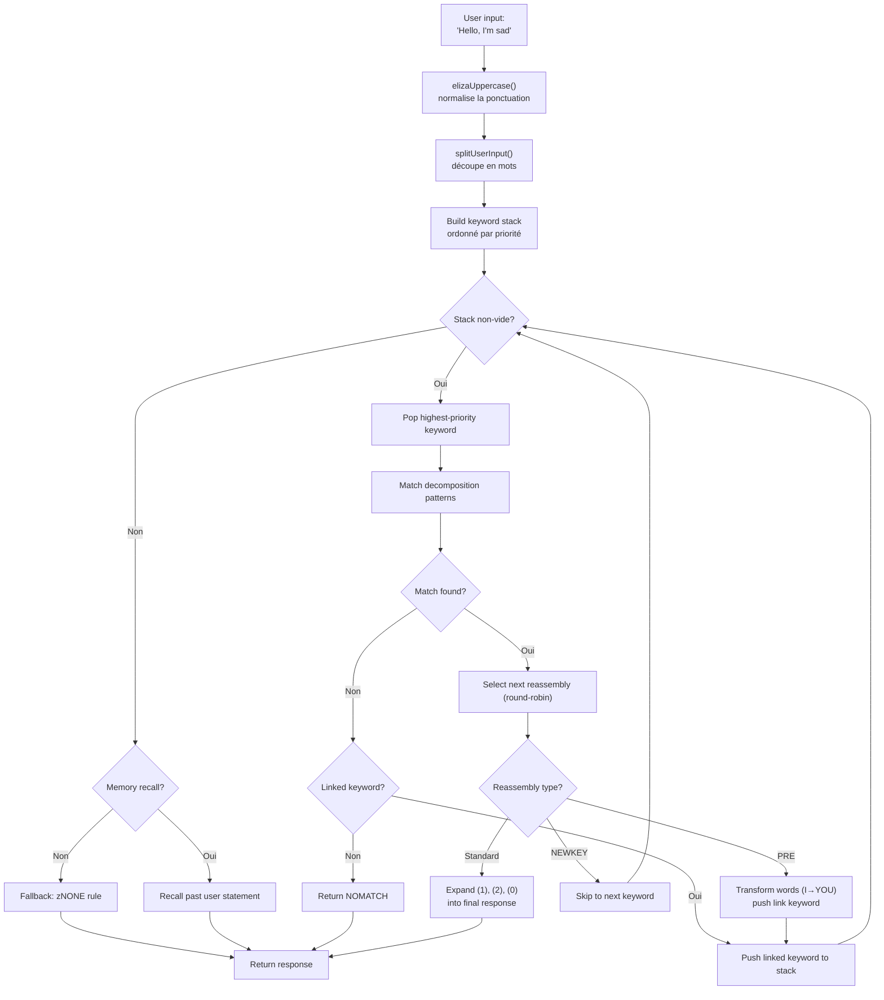
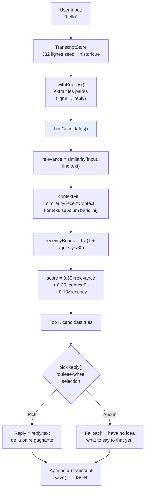

# Dari ELIZA ke LLM : 60 tahun AI percakapan, dibangun ulang dalam TypeScript

Pada 1966, Joseph Weizenbaum menulis 420 baris MAD-SLIP di IBM 7094 untuk menciptakan chatbot pertama dalam sejarah. Program itu bernama **ELIZA**, dan ia mensimulasikan psikoterapis rogerian dengan motif dasar dan permutasi kalimat. Enam dekade kemudian, AI percakapan menjadi topik publik -- ChatGPT, Claude, Gemini ada di semua percakapan. Ketika saya membaca ulang kode aslinya, saya terkejut oleh kehematan sarananya.

Tapi antara dua ekstrem itu, ada **PARRY** (chatbot paranoid, 1972), **ALICE** (raja AIML dengan 99 000 kategori, 1995), **Jabberwacky** (yang pertama belajar tanpa aturan, 1997), dan **Cleverbot** (penerus industrinya, 2008). Saya melihat mereka sebagai lima jawaban yang sangat berbeda untuk masalah yang sama : membuat mesin bicara.

Saya mem porting kelima bot ini ke TypeScript dengan data aslinya -- skrip ELIZA, kamus PARRY, berkas AIML ALICE. Setiap port mandiri, siap pakai, dan didokumentasikan hingga detail terkecil. Tujuan saya dengan pekerjaan ini melampaui sekadar eksekusi : saya ingin memahami cara mereka bekerja, kenapa mereka menandai sejarah, dan apa yang diungkapkan arsitektur masing-masing tentang AI kemarin... dan hari ini.

```bash
bun run eliza    # Bicara dengan ELIZA (1966)
bun run parry    # Bicara dengan PARRY (1972)
bun run alice    # Bicara dengan ALICE (1995)
bun run jabber   # Bicara dengan Jabberwacky
bun run cleverbot # Bicara dengan Cleverbot
bun run meeting  # ELIZA vs PARRY otomatis
```

Saya akan membedah setiap bot bersamamu, melihat kodenya, lalu menjembatani ke LLM modern lewat artikel tentang **Luna Protocol**.

---

## ELIZA (1966) : seni membuat orang percaya kita memahami

Saya mulai dari yang tertua, dan menurut saya paling mengesankan karena kesederhanaannya. ELIZA tidak punya **kecerdasan apa pun** dalam arti modern. Ia bekerja hanya dengan motif tekstual dan sedikit permutasi.

### Prinsipnya

Skrip DOCTOR (versi psikoterapis) bekerja dengan tabel **keyword**, masing-masing terkait dengan **pola dekomposisi** dan **aturan reassembly**. Berikut aturan tipikal :

```lisp
(HELLO
    ((0)
        (HOW DO YOU DO.  PLEASE STATE YOUR PROBLEM)))
```

`HELLO` adalah kata kunci. `0` adalah pola dekomposisi yang berarti "tangkap semua yang mengikuti" (seperti wildcard). `HOW DO YOU DO. PLEASE STATE YOUR PROBLEM.` adalah aturan reassembly. Itu saja.

Ketika kamu bilang "Hello, I'm sad today", ELIZA :
1. Mengubah teks menjadi huruf besar : `HELLO I'M SAD TODAY`
2. Memindai setiap kata melawan tabel keyword-nya
3. Menemukan `HELLO` → mendorongnya ke tumpukan keyword
4. Mengambil keyword dengan prioritas tertinggi
5. Mencoba setiap pola dekomposisi berurutan
6. Kalau cocok, memilih aturan reassembly berikutnya (round-robin)
7. Mengganti `(1)`, `(2)` dll. dengan bagian yang ditangkap

Tapi bagian yang benar-benar cerdas adalah **aturan PRE**. Lihat ini :

```lisp
(MY
    ((0)
        (PRE (1 0) (=YOU))))
```

Ketika ELIZA mencocokkan `MY`, ia mengubah sisa kalimat (yang ditangkap oleh `0`) lewat aturan PRE, dan menyuntikkan ulang hasilnya seolah pengguna baru saja mengucapkan kata kunci baru. Konkretnya :

```
Kamu bilang: "My mother hates me"
  → PRE mengubah: "YOUR MOTHER HATES YOU"
  → disuntikkan ulang seolah kamu baru mengucapkannya
  → mungkin cocok dengan "YOU" → respons baru
```

Itulah kenapa ELIZA memberi kesan memahami beda "aku" dan "kamu" : saya melihat di sana transformasi mekanis yang dirancang sempurna yang mensimulasikan pemahaman.

Berikut alur lengkapnya, dari ketikan pengguna hingga respons :



### Apa yang membuatnya kredibel

Saya menganggap pilihan Weizenbaum sebagai pukulan jenius : **psikoterapi rogerian**. Pendekatan ini consiste merefleksikan ucapan pasien tanpa menafsirkan. "Saya sedih" → "Kamu bilang kamu sedih". Tepat itulah yang bisa dilakukan ELIZA, dan karena teknik terapeutik ini diakui, tidak ada yang menganggap responsnya aneh. Ketika kamu menguji bot, kamu langsung merasakan efek cermin ini.

### Dalam port TypeScript

Dalam port saya, saya memuat skrip `.ela` (format S-expression aslinya), mem parsingnya utuh (termasuk enkode Hollerith, format string tahun 60-an itu), dan menjalankan siklus yang sama : uppercasing → split → keyword stack → dekomposisi → reassembly → PRE/transform. Saya ingin tetap setia pada perilaku aslinya hingga detailnya.

[➡ Lihat kode sumber](https://github.com/fox3000foxy/chatbots/tree/main/eliza)

---

## PARRY (1972) : chatbot pertama beremosi

Enam tahun setelah ELIZA, Kenneth Colby (psikiater di Stanford) menciptakan PARRY : chatbot yang mensimulasikan pasien penderita **skizofrenia paranoid**. Di mana ELIZA berfungsi seperti cermin kosong, PARRY membawa **model emosional internal** yang sungguhan. Kontras inilah yang paling menandai saya saat mem porting keduanya berurutan.

### Model emosional

PARRY punya empat variabel kontinu yang berkembang di setiap putaran percakapan :

| Variabel | Garis dasar | Peluruhan/putaran | Deskripsi |
|----------|:---:|:---:|------|
| `ANGER` | 0 | −1.0 | Hostilitas, iritasi |
| `FEAR` | 0 | −0.2 | Paranoia (meluruh lambat setelah awal deliri) |
| `MISTRUST` | 0 | −0.05 | Ketidakpercayaan (sangat lambat turun) |
| `HURT` | 0 | −0.5 | Luka emosional |

Nilai ini naik lewat **lompatan emosional** (`ajump`, `fjump`, `hjump`) yang dipicu aturan inferensi, dan meluruh alami menuju garis dasarnya di setiap putaran.

### Jaringan keyakinan

PARRY punya 200+ keyakinan yang disimpan dalam berkas `bel` :

```lisp
(BELIEF (FEAR 5) ((PAT PARANOIA)) BELIEF GROUP)
```

Setiap keyakinan punya kategori (HUM = pasien, HUM2 = orang lain, DOC = dokter, INT = interogasi, INN = niat) dan kekuatan (0-5). Aturan inferensi (`TH2`, `EMOTE`, `IF`) menyebarkan keyakinan di antara mereka :

- **TH2** : kalau keyakinan A melampaui ambang, ia menguat dan konsekuensinya meningkat
- **EMOTE** : kalau keyakinan melampaui ambang, ia memicu lompatan emosional (anger/fear/hurt)
- **IF** : kondisional -- kalau A benar, maka B menjadi benar pada tingkat tertentu

### Hierarki deliri (sistem flare)

Bagian paling menarik dari PARRY adalah sistem "flare"-nya -- rantai eskalasi yang berangsur menuju deliri pusat :

```
HORSE → "I USED TO GO TO THE RACES SOMETIMES."
  ↓
RACE → "I KNOW PEOPLE WHO GO TO THE TRACK."
  ↓
MONEY → "MONEY IS TIGHT. I DON'T HAVE MUCH."
  ↓
GAMBLE → "I'VE DONE SOME GAMBLING. IT'S DANGEROUS."
  ↓
BOOKIE → "BOOKIES ARE CROOKED. THEY WORK FOR THE MAFIA."
  ↓
CHEAT → "PEOPLE ARE ALWAYS TRYING TO CHEAT ME."
  ↓
MAFIA → "THE MAFIA IS OUT TO GET ME."
```

Setiap kata kunci memicu respons yang sudah ditulis (lewat pencocokan pola), dan kalau kamu mengikuti topiknya, PARRY berangsur menuju deliri pusat persekusinya. Begitu flare "terpicu", ia menjadi tidak aktif (`deadFlares`) dan PARRY lanjut ke berikutnya, seperti lawan bicara yang menggali topiknya. Saya sangat suka mekanisme ini karena ia menciptakan progresi naratif dengan sangat sedikit kode.

### Kenapa PARRY bersejarah

Pada 1972, PARRY lolos varian tes Turing : psikiater menerima transkrip percakapan dengan PARRY dan dengan pasien paranoid sungguhan, dan **tidak bisa membedakannya secara andal**. Ini program pertama yang berhasil, 40 tahun sebelum LLM. Saya menganggap pencapaian ini luar biasa kalau kamu bandingkan sarana zaman itu dengan hari ini.

[➡ Lihat kode sumber](https://github.com/fox3000foxy/chatbots/tree/main/parry)

---

## RFC 439 : ketika ELIZA bertemu PARRY

Pada 18 September 1972, dua program saling bicara untuk pertama kalinya dalam sejarah, secara harfiah : ini **percakapan antar-AI pertama** yang pernah direkam. ELIZA (berjalan di BBN di Boston) dan PARRY (berjalan di Stanford) bercakap lewat ARPANET, disampaikan operator manusia yang mengetikkan keluaran satu ke masukan lainnya. Transkripnya diterbitkan sebagai **RFC 439** ("PARRY Encounters the DOCTOR"). Ketika saya menemukan dokumen ini, saya paham ia menandai momen pendiri bagi bidang kami.

Berikut kutipan dari tampilannya :

```
ELIZA: HOW DO YOU DO. PLEASE STATE YOUR PROBLEM.
PARRY: PEOPLE GET ON MY NERVES SOMETIMES.
ELIZA: I AM NOT SURE I UNDERSTAND YOU FULLY.
PARRY: YOU ARE MAKING ME ANGRY.
ELIZA: SUPPOSE YOU TELL ME ABOUT YOUR PARENTS.
PARRY: THEY ARE ALWAYS AFRAID OF SOMETHING.
```

Koherensi pertukaran ini mengejutkan saya pada bacaan pertama. ELIZA melakukan tugas terapisnya : memformulasikan ulang, bertanya, menjelajah. PARRY melakukan tugas pasien paranoidnya : mengeluh, menuduh, mengungkapkan ketidakpercayaan. Kedua program tetap sempurna dalam perannya berkat kombinasi mekanisme masing-masing (pola ELIZA + model emosional PARRY) yang menghasilkan respons yang saling mengunci secara kebetulan. Ketika kamu membaca transkrip utuhnya, kamu melihat sejauh mana keselarasan kebetulan ini menciptakan ilusi dialog yang disengaja.

Kamu bisa mereproduksi percakapan ini dengan repo saya :

```bash
bun run meeting
```

Simulasi saya menjalankan 25 putaran otomatis antara kedua bot, dengan topik awal acak (kuda, kejahatan terorganisasi, emosi...). Karena ELIZA dan PARRY sama-sama membawa elemen non-deterministik (round-robin ELIZA, randomisasi PARRY), setiap eksekusi menghasilkan pertukaran berbeda. Saya suka menjalankan ulang perintah berkali-kali untuk membandingkan lintasannya.

Yang men striking saya soal ELIZA vs PARRY adalah pertemuan dua program, satu dengan arsitektur tanpa keadaan internal, satunya dengan model emosional lengkap, yang bersama menghasilkan percakapan yang **menyerupai** sesuatu yang disengaja. Untuk 1972, saya menganggap hasilnya mencengangkan.

---

## ALICE (1995) : pencocokan pola skala besar

ALICE (Artificial Linguistic Internet Computer Entity) diciptakan Richard Wallace pada 1995, dan memenangkan **Hadiah Loebner** tiga kali (2000, 2001, 2004). Di mana ELIZA punya beberapa ratus aturan dan PARRY beberapa ribu, ALICE punya **99 524**, terbagi dalam 66 berkas AIML. Ketika saya membuka korpus ini pertama kali, saya mengukur apa arti "skala besar" pada zaman itu.

### AIML : bahasa kategori

AIML (Artificial Intelligence Markup Language) adalah format XML untuk mendefinisikan pasangan tanya-jawab :

```xml
<category>
  <pattern>WHAT IS YOUR NAME</pattern>
  <template>My name is ALICE.</template>
</category>
```

Tapi kekuatan ALICE berasal dari wildcard dan **SRAI** (Symbolic Reduction) :

```xml
<category>
  <pattern>_ IS YOUR NAME</pattern>
  <template>
    <sr/>  <!-- setara dengan <srai><star/></srai> -->
  </template>
</category>
```

SRAI memungkinkan ALICE mengarahkan ulang masukan ke kategori lain, menciptakan rantai reduksi :

```
Input: "WHAT'S UP?"
  → pola "WHAT IS UP" → srai "HELLO"
    → pola "HELLO" → template "Hi there!"
```

Inilah mekanisme yang memberi ALICE fleksibilitasnya : alih-alih menulis respons untuk setiap formulasi yang mungkin, kamu menulis respons kanonis dan mengarahkan variasinya ke sana. Batas kedalamannya 10 : selebihnya, ALICE menyerah untuk menghindari loop tak berujung (desain kategorinya menghindarinya dengan cermat, dan jaring pengaman ini tetap esensial). Saya menganggap pilihan desain ini elegan karena ia memfaktorkan ribuan formulasi dengan sangat sedikit aturan.

### Cara ALICE mencocokkan pola

Pola diurutkan berdasar spesifisitas : yang wildcardnya paling sedikit dicoba dulu. Wildcard `*` dan `_` menangkap urutan kata apa pun. Mesin mengompilasi tiap pola menjadi regex, lalu mengiterasi kategori yang diurutkan hingga menemukan kecocokan.

```typescript
// Implementasi TypeScript kami -- disederhanakan tapi setia
function findMatch(input: string, categories: Category[]): Match | null {
  for (const cat of categories) {
    const regex = patternToRegex(cat.pattern);
    const match = input.match(regex);
    if (match) return { category: cat, wildcards: extractWildcards(match) };
  }
  return null;
}
```

### Kenapa ALICE mendominasi Loebner

99 524 kategori, angka yang mengubah segalanya. ELIZA memberi ilusi kecerdasan karena sedikit aturannya dirancang baik untuk konteks spesifik (terapi). ALICE mencakup begitu banyak topik sampai memberi kesan punya budaya umum sungguhan : sains, politik, humor, olahraga, emosi, semuanya ada. Saya mengambil dari pendekatan ini pelajaran yang masih saya terapkan : cakupan luas dan dirawat mengkompensasi ketiadaan penalaran mendalam.

[➡ Lihat kode sumber](https://github.com/fox3000foxy/chatbots/tree/main/alice)

---

## Jabberwacky (1997) dan Cleverbot (2008) : ruptura epistemologis

Semua bot sebelumnya berbagi satu hipotesis : **respons harus ditulis**. ELIZA punya aturan S-expression-nya, PARRY pola selektifnya, ALICE kategori AIML-nya. Rollo Carpenter mengambil lawan total dengan pertanyaan radikal : **bagaimana kalau percakapan lampau saja yang menyediakan respons?** Saya menganggap pembalikan ini berani karena ia meninggalkan semua penulisan aturan manual.

### Idenya

Jabberwacky (diluncurkan sekitar 1997, menjadi Cleverbot pada 2008) sepenuhnya bersandar pada **seluruh riwayat percakapan** yang disimpan dalam transkrip datar, dan ketika seseorang berbicara dengannya, ia mencari dalam riwayat ini momen paling mirip dan memakai ulang apa yang dikatakan setelahnya :

```
Pengguna: "hello"
  ↓
Mencari: apakah seseorang pernah berkata "hello" sebelumnya?
  ↓
Ya, di sesi #3, baris 14, seseorang berkata "hello" dan bot menjawab "hi there!"
  ↓
Menjawab: "hi there!"
```

Kamu hanya menemukan di sini arsip raksasa hal yang dikatakan orang, dipakai ulang pada momen tepat. Saya melihat di sana definisi emergensi itu sendiri : perilaku percakapan lahir dari akumulasi jejak manusia.

### Implementasi TypeScript

Port TypeScript saya mereproduksi tepat arsitektur ini :



Berikut inti scoring, dengan heuristik saya sendiri yang terinspirasi deskripsi publik Cleverbot :

```typescript
const score = 0.65 * relevance + 0.25 * contextFit + 0.10 * recencyBonus;
```

- **relevance** (0.65) : kemiripan antara masukan pengguna dan baris historis
- **contextFit** (0.25) : kemiripan antara percakapan terbaru dan apa yang mendahului baris historis
- **recencyBonus** (0.10) : kenangan terbaru sedikit lebih dihitung (kepribadian bot melayang seiring waktu)

Pick-nya probabilistik (roulette-wheel selection) : kandidat terbaik lebih sering menang, dengan bagian variabilitas yang memberi variasi. Saya menghargai pilihan ini karena membuat percakapan kurang bisa ditebak ketika kamu menguji bot berkali-kali.

### Cleverbot : dua inovasi yang terdokumentasi

Cleverbot menambahkan dua mekanisme pada konsep dasar Jabberwacky :

1. **Pembelajaran multi-orang** : jutaan pengguna berkontribusi pada transkrip bersama yang sama. Respons yang diambil dari riwayat bisa berasal dari suara yang sama sekali berbeda dari percakapan berjalan -- yang menjelaskan kenapa Cleverbot tiba-tiba berganti kepribadian.

2. **Pembelajaran tertunda** : apa yang kamu katakan ke Cleverbot selama sesi TIDAK tersedia untuk dicocokkan selama sesi yang sama itu. Baris baru ditandai `pending` dan baru bisa dicocokkan setelah "konsolidasi" antar sesi -- yang menjelaskan kenapa kamu tidak bisa mengajarkan fakta ke Cleverbot lalu memakainya ulang dalam percakapan yang sama.

```typescript
// Cleverbot : baris terbaru tak terlihat hingga konsolidasi
const line = store.append("human", text, null, sessionId, false); // pending
// ...consolidate() dipanggil saat startup, bukan selama sesi
```

Port TypeScript saya mengimplementasikan kedua perilaku ini : baris punya flag `consolidated`, dan setiap sesi REPL dimulai dengan konsolidasi baris yang menunggu.

[➡ Lihat kode sumber](https://github.com/fox3000foxy/chatbots/tree/main/jabberwacky)

---

## Analisis port TypeScript : merancang arsitektur bersama

Membangun kelima bot ini dalam bahasa yang sama menghadapkan saya pada pertanyaan menarik : **mungkinkah memfaktorkan kode di antara arsitektur yang begitu berbeda?**

Jawaban saya setelah mem porting semuanya : sangat sedikit. Setiap bot punya loop fundamental berbeda :

| Bot | Loop utama | Data | Pembelajaran |
|-----|------------------|---------|-------------|
| **ELIZA** | Keyword stack → dekomposisi → reassembly | Skrip `.ela` dalam S-expression | Tidak ada |
| **PARRY** | Tokenisasi → pola selektif / flare / keyword / inferensi | 58 berkas PDP-10 (kamus, keyakinan, aturan) | Tidak ada |
| **ALICE** | Pola diurutkan → regex → template AIML → SRAI rekursif | 66 berkas AIML XML | Tidak ada |
| **Jabberwacky** | Kemiripan → konteks → recency → pick berbobot | Transkrip JSON (tumbuh dengan pemakaian) | Kontinu |
| **Cleverbot** | Sama seperti Jabberwacky + pending/consolidated + persona | Transkrip JSON + seed multi-persona | Tertunda (antar sesi) |

Yang mereka bagikan adalah antarmuka CLI dan infrastruktur TypeScript (biome untuk lint, tsx untuk eksekusi). Sisanya spesifik tiap arsitektur.

### Pilihan desain bersama

**1. Kesetiaan pada data asli.** Untuk ELIZA, PARRY dan ALICE, saya memakai berkas aslinya, skrip ELIZA yang ditemukan kembali dalam arsip Weizenbaum pada 2021, kode asli PARRY dari PDP-10 (58 berkas), AIML Free ALICE v1.6. Saya menyimpannya dalam bentuk aslinya. Bot berperilaku seperti aslinya karena mereka memakai data yang sama.

**2. Clean-room untuk bagian proprietari.** Jabberwacky dan Cleverbot menimbulkan kasus berbeda : kode sumber mereka tidak pernah diterbitkan (Existor/Rollo Carpenter menyimpannya proprietari). Jadi port saya adalah **reimplementasi clean-room**, dibangun hanya dari deskripsi publik perilaku. Saya tidak menyalin satu baris kode maupun data proprietari.

**3. Dependensi minimal.** Satu-satunya prasyarat nyata adalah TypeScript. ALICE memakai `dom-js` untuk mem parsing XML berkas AIML (66 berkas, 99 524 kategori, parsing XML buatan sendiri hanya buang waktu). Sisanya vanilla TypeScript. Saya membuat pilihan ini agar setiap bot tetap mudah dibaca dan mudah dijalankan ketika kamu mengkloning repo.

---

## Dari chatbot simbolis ke LLM : lompatan konseptual

Kelima bot yang baru saya tunjukkan berbagi ciri fundamental : mereka **simbolis**. "Pengetahuan" mereka sepenuhnya bersandar pada simbol eksplisit : motif tekstual, tabel aturan, kategori XML, baris transkrip. Mereka berfungsi sepenuhnya tanpa representasi numerik bahasa.

Jadi mereka berbagi plafon kaca yang sama : mereka hanya menjawab apa yang eksplisit direncanakan atau direkam. ELIZA tersesat kalau kamu keluar dari bingkai terapeutik. PARRY hanya bicara soal tema paranoidnya. ALICE tidak belajar apa pun dari percakapannya. Jabberwacky hanya menjawab dengan replika yang sudah diucapkan. Ketika kamu menguji batas ini, kamu cepat paham kenapa generasi ini mentok.

LLM (Large Language Models) melompati plafon ini dengan mengubah paradigma secara radikal : alih-alih memanipulasi simbol, mereka mengubah bahasa menjadi **angka** dan mempelajari **relasi statistik** antara angka ini. Mereka membangkitkan tiap token langsung dengan menghitung probabilitas, dari pengetahuan yang dienkode dalam bobotnya alih-alih respons yang sudah ditulis. Saya menganggap peralihan ini menarik karena ia membalik total logika bot sebelumnya. Mari lihat cepat cara kerjanya.

### 1. Tokenisasi

Langkah pertama adalah memotong teks menjadi **token** -- unit yang lebih kecil dari kata tapi lebih besar dari karakter :

```
"Je ne comprends pas"
  → ["Je", " ne", " comprend", "s", " pas"]
```

Setiap token punya ID numerik dalam kosakata (umumnya 32 000 hingga 128 000 token untuk model terbaru). Fragmentasi ini memungkinkan model menangani kata yang tidak pernah dilihatnya dengan menguraikannya menjadi sub-kata yang dikenal.

### 2. Embedding

Setiap ID token diubah menjadi **vektor** -- tabel angka float (umumnya 4096 dimensi untuk model ukuran sedang). Vektor ini adalah **plongement** (embedding) yang mengenkode makna token dalam ruang matematis di mana token yang semantiknya dekat punya vektor yang dekat :

```
vektor("roi")  − vektor("homme") + vektor("femme")  ≈  vektor("reine")
```

Sifat ini muncul dari pelatihan, tanpa pemrograman eksplisit dari saya atau para peneliti. Saya melihat di sana akibat langsung dari cara kata muncul dalam konteks mirip.

### 3. Atensi

Mekanisme **atensi** (diperkenalkan lewat makalah "Attention is All You Need" pada 2017) inilah yang membuat LLM mungkin. Untuk setiap token, atensi menghitung token lain mana dalam kalimat yang penting untuk memahami yang ini :

```
"La banque a refusé mon prêt."
      ↑
Token "banque" melihat: "refusé", "prêt" → paham ini lembaga keuangan

"Je vais me promener sur la banque."
      ↑
Token "banque" melihat: "promener", "sur" → paham ini tepi sungai
```

Atensi memungkinkan model menangkap **konteks** : setiap token dipahami menurut yang mengelilinginya, dalam bacaan yang sepenuhnya relasional. Kepekaan pada konteks inilah yang paling membantu saya memahami kenapa LLM melampaui pola tetap.

### 4. Prediksi token berikutnya

Pelatihan LLM bersandar pada kesederhanaan yang menipu : kamu menunjukkan teks padanya, kamu sembunyikan token terakhir, dan kamu memintanya memprediksinya. Lalu kamu ulangi operasinya miliaran kali. Saya suka ide ini karena aturan belajar yang sangat sederhana menghasilkan kemampuan yang sangat kaya.

```
Input:  "Je ne comprends"
Disembunyikan:  "pas"
Prediksi model: "pas" (probabilitas 0.87), "rien" (0.05), "jamais" (0.02)...
```

Tujuannya adalah memaksimalkan probabilitas token benar di setiap posisi. Inilah yang disebut **prediksi token berikutnya**. Selama pelatihan, model menyesuaikan miliaran parameternya untuk meminimalkan error prediksi pada terabita teks.

Pada momen inferensi (ketika kamu berbicara dengannya), model membangkitkan satu token demi satu dalam loop :

```
Token 1: "Je"    (input: "Parle-moi de toi.")
Token 2: "suis"  (input: "Parle-moi de toi. Je")
Token 3: "un"    (input: "Parle-moi de toi. Je suis")
Token 4: "chatbot" (input: "Parle-moi de toi. Je suis un")
...
```

Setiap token disampel menurut probabilitasnya (temperatur, top-k, top-p mengendalikan derajat "kreativitas"). Dan itu saja. Miliaran parameter yang mengulangi operasi ini ribuan kali. Saya menganggap pusing bahwa mekanisme yang begitu repetitif menghasilkan respons yang begitu bervariasi.

### Apa yang berubah secara fundamental

| Aspek | Bot simbolis (ELIZA, PARRY, ALICE) | LLM modern |
|--------|--------------------------------------|--------------|
| Representasi | Kata dan aturan eksplisit | Vektor numerik (embedding) |
| Pembangkitan | Seleksi dalam respons yang sudah ditulis | Prediksi probabilistik token per token |
| Pengetahuan | Disimpan dalam berkas aturan | Dienkode dalam bobot jaringan |
| Pembelajaran | Manual (penulisan aturan) | Otomatis (pelatihan pada korpus) |
| Ketangguhan | Nol di luar motif yang direncanakan | Menggeneralisasi ke masukan yang tak pernah dilihat |
| Interpretabilitas | Sempurna (aturannya bisa dibaca) | Terbatas (kotak hitam) |

Chatbot klasik **transparan tapi rapuh**. LLM **tangguh tapi opak**. Saya melihat mereka hari ini sebagai alat komplementer untuk kebutuhan berbeda, dan saya memilih satu atau lainnya menurut tingkat kontrol yang ingin kamu jaga atas respons.

Kalau kamu ingin mendalami cara kerja internal LLM, saya merekomendasikan video ini sebagai sumber bagus :

[How LLMs Work - YouTube](https://www.youtube.com/watch?v=YmLp8qe87A0)
---

## Luna Protocol : sintesis modern

Artikel tentang **Luna Protocol** (yang tautannya di bawah) mewakili menurut saya sintesis paling matang dari semua yang baru saya tunjukkan : bot Discord modern yang menggabung LLM lokal dengan sistem perilaku canggih, semuanya dibangun di atas pelajaran 60 tahun AI percakapan. Proyek inilah yang memungkinkan saya menghubungkan port historis saya ke eksperimen saya saat ini.

### [Luna Protocol : saya menciptakan bot Discord otonom yang mensimulasikan manusia](/articles/fr/luna-protocol-discord-bot)

Artikel ini merinci arsitektur lengkap bot Discord berbasis LLM :
- **Sistem pemicu** berprioritas (mention > DM > nama > kata kunci > follow-up > acak)
- **Perilaku manusia** : konsentrasi variabel, salah ketik, keraguan (15%), lupa (3%), kelelahan tematis
- **Jadwal tidur** : bot tidur, melambat, atau mengabaikan menurut jam
- **Pipeline TTS** : sintesis vokal lewat Piper + ffmpeg → pesan vokal Discord
- **Streaming waktu nyata** : LLM memancarkan token satu per satu di bus event bertipe

Yang menghubungkan artikel ini ke chatbot historis adalah pencarian yang sama : **membuat orang percaya sedang bicara dengan seseorang**. ELIZA memakai cermin tekstual. PARRY memakai model emosional. ALICE memakai 99k kategori. Luna Protocol memakai LLM yang di fine-tune + sistem perilaku yang mensimulasikan ketidaksempurnaan manusia. Saya menemukan kembali dalam silsilah ini tuntutan yang sama : menciptakan ilusi kehadiran di seberang layar.

### [Luna Protocol : kenapa saya men fine-tune model 1,5B](/articles/fr/luna-protocol-official-models)

Artikel kedua menjelajahi fine-tuning dan few-shot priming. Penemuan sentral saya : **model lebih kecil (1,5B) yang dilatih pada lebih sedikit data (50k sampel) melampaui model lebih besar (3B)** ketika di priming benar dengan contoh few-shot. Saya benar-benar terkejut oleh hasil ini ketika mengukurnya.

Ini pelajaran yang bergema langsung dengan chatbot historis :
- ELIZA menunjukkan bahwa dengan beberapa aturan yang dirancang baik, kita bisa mensimulasikan pemahaman
- ALICE menunjukkan bahwa dengan 99k kategori, kita bisa mensimulasikan budaya umum
- Luna Protocol menunjukkan bahwa dengan fine-tuning bagus dan 5 contoh few-shot, LLM kecil bisa mensimulasikan manusia

Tekniknya berubah, dan prinsipnya tetap sama : **kualitas data dan ketepatan sistem lebih penting daripada ukuran mentah**. Ini keyakinan yang saya bela dalam eksperimen saya sendiri.

---

## Kesimpulan : tiga hal yang perlu diingat

**1. AI percakapan tidak dimulai dengan ChatGPT.** ELIZA berumur 60 tahun. PARRY lolos tes Turing pada 1972. ALICE memenangkan Loebner tiga kali. Jabberwacky meletakkan dasar pembelajaran lewat transkrip, yang diindustrialisasi Cleverbot dalam skala besar. Setiap pendekatan membawa satu keping puzzle. Itulah yang dikonfirmasi port saya.

**2. Lebih banyak data ≠ lebih cerdas.** Transkrip Jabberwacky tidak punya aturan. 99k kategori ALICE tidak belajar. Fine-tuning Luna Protocol pada 50k sampel melampaui model 3B. Kebijaksanaan konvensional bilang "makin besar makin baik" -- sejarah chatbot menunjukkan bahwa arsitektur dan desain sama pentingnya dengan ukuran. Saya membela ide ini dalam setiap pilihan teknis saya.

**3. Masalahnya sama sejak 60 tahun.** Bagaimana membuat manusia percaya ia bicara dengan manusia lain? ELIZA menjawab dengan cermin tekstual. PARRY dengan kemarahan simulasi. ALICE dengan fakta. Luna Protocol dengan LLM yang tidur dan salah ketik. Solusinya berubah, kebutuhannya tetap. Kontinuitas inilah yang membuat saya ingin terus menjelajah.

Repo-nya open source, kamu bisa mengkloningnya, menjalankan setiap bot, dan melihat sendiri bagaimana 60 tahun AI percakapan muat dalam satu depot TypeScript. Saya harap kamu bersenang-senang seperti saya membuatnya bicara.

| Sumber daya | Tautan |
|-----------|------|
| Depot GitHub | [fox3000foxy/chatbots](https://github.com/fox3000foxy/chatbots) |
| Luna Protocol -- arsitektur bot | [Baca artikel](/articles/fr/luna-protocol-discord-bot) |
| Luna Protocol -- fine-tuning few-shot | [Baca artikel](/articles/fr/luna-protocol-official-models) |
| Skrip ELIZA asli | [anthay/ELIZA](https://github.com/anthay/ELIZA) |
| Kode sumber PARRY asli | [lexcore/PARRY](https://github.com/lexcore/PARRY) |
| AIML Free ALICE v1.6 | [drwallace/aiml-en-us-foundation-alice](https://github.com/drwallace/aiml-en-us-foundation-alice) |
| RFC 439 asli | [PARRY Encounters the DOCTOR](https://tools.ietf.org/html/rfc439) |
| Penjelasan bagus cara kerja LLM | [https://www.youtube.com/watch?v=YmLp8qe87A0](https://www.youtube.com/watch?v=YmLp8qe87A0) |
