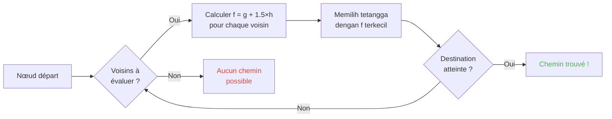

## Pendahuluan

Saya menghabiskan berjam-jam menonton domba menabrak tembok.

Dan sejujurnya? Investasi terbaik dalam hidup saya.

Karena makin kamu menonton mob ini, makin kamu sadar mereka sama sekali tidak acak. Setiap gerakan dikode, bisa diprediksi, dan terutama sepenuhnya bisa dirusak. Saya akhirnya menyelam ke kode sumber Minecraft untuk paham tepat cara kerja pathfinding, dan yang saya temukan adalah kamu secara harfiah bisa mind-control mob. Maksudnya, memaksa mereka pergi ke tempat KAMU mau, bukan ke tempat yang diputuskan acak.

Panduan ini adalah semua yang saya pelajari dengan mengobrak-abrik. AI, algoritma A*, malus tersembunyi, exploit yang bisa kamu keluarkan di survival. Siapkan pickaxe-mu.

---

## Cara kerja AI mob (bocoran : ini bodoh)

### Goal

Setiap mob punya *goal*. Ini daftar aksi yang BISA ia lakukan dan seberapa INGIN ia melakukannya. Makin kecil angkanya, makin prioritas, seperti daftar tugas versi chaos.

```java
protected void registerGoals() {
   this.goalSelector.addGoal(4, new Zombie.ZombieAttackTurtleEggGoal(this, 1.0, 3));
   this.goalSelector.addGoal(8, new LookAtPlayerGoal(this, Player.class, 8.0F));
   this.goalSelector.addGoal(8, new RandomLookAroundGoal(this));
   this.addBehaviourGoals();
}
```

Pernah lihat zombie mengabaikan telur penyu untuk mengejarmu? Inilah kenapanya : `ZombieAttackTurtleEggGoal` prioritasnya 4, sedangkan `ZombieAttackGoal` (goal yang menyuruhnya memakan mukamu) prioritasnya 2.

Ya, zombie lebih suka memakanmu daripada menghancurkan telur. Indahnya cinta.

Goal yang benar-benar menarik buat kita adalah `WaterAvoidingRandomStrollGoal`, prioritas 7. Goal "saya tidak ada kerjaan jadi jalan ngawur". Di sinilah segalanya menjadi menarik.

### Gerakan (atau "cara random march punya 1 peluang dari 60 untuk terjadi")

Setiap tick (setiap 0.05 detik), permainan memanggil `canUse()` untuk melihat apakah mob berkenan bergerak. 1 peluang dari 60 di setiap tick. Desain yang benar-benar bodoh, dan saya suka itu.

```java
public boolean canUse() {
   if (this.mob.hasControllingPassenger()) {
      return false;
   } else {
      if (!this.forceTrigger) {
         if (this.checkNoActionTime && this.mob.getNoActionTime() >= 100) {
            return false;
         }
         if (this.mob.getRandom().nextInt(reducedTickDelay(this.interval)) != 0) {
            return false;
         }
      }
      Vec3 $$0 = this.getPosition();
      if ($$0 == null) {
         return false;
      } else {
         this.wantedX = $$0.x;
         this.wantedY = $$0.y;
         this.wantedZ = $$0.z;
         this.forceTrigger = false;
         return true;
      }
   }
}
```

Jadi ringkasnya : kalau kamu menunggangi mob -> tidak, kalau mob tidak melakukan apa pun selama 5 detik -> tidak, kalau random bilang tidak -> tidak. Permainan BENAR-BENAR tidak ingin mob bergerak.

Tapi ketika ia bergerak, `getPosition()` mengambil alih :

```java
protected Vec3 getPosition() {
   if (this.mob.isInWater()) {
      Vec3 $$0 = LandRandomPos.getPos(this.mob, 15, 7);
      return $$0 == null ? super.getPosition() : $$0;
   } else {
      return this.mob.getRandom().nextFloat() >= this.probability
         ? LandRandomPos.getPos(this.mob, 10, 7)
         : super.getPosition();
   }
}
```

Lihat dua angka di akhir : itu radius XZ dan radius Y. Di air, mob mencari lebih jauh (15 alih-alih 10). Kalau ia tidak menemukan daratan, ia jatuh kembali ke `super.getPosition()` yang menerima air. **Hasilnya : mob INGIN keluar dari air.** Makanya hewanmu berenang seperti orang gila ke tepi.

Detail kecil yang renyah : secara harfiah ada peluang 0.1% mob mengambil `super.getPosition()` alih-alih `LandRandomPos`. Satu per seribu. Khas Mojang.

### LandRandomPos : optimasi busuk yang mengubah segalanya

Ini tahap FAVORIT saya. Kebodohan teknis terindah yang membuat pathfinding bisa dieksploitasi.

```java
public static Vec3 getPos(PathfinderMob $$0, int $$1, int $$2, ToDoubleFunction<BlockPos> $$3) {
   boolean $$4 = GoalUtils.mobRestricted($$0, $$1);
   return RandomPos.generateRandomPos(() -> {
      BlockPos $$4xx = RandomPos.generateRandomDirection($$0.getRandom(), $$1, $$2);
      BlockPos $$5 = generateRandomPosTowardDirection($$0, $$1, $$4, $$4xx);
      return $$5 == null ? null : movePosUpOutOfSolid($$0, $$5);
   }, $$3);
}
```

`movePosUpOutOfSolid`. Namanya mengatakan semuanya. Kalau posisi yang dipilih ada di blok padat, permainan mendorongnya ke atas sampai berada di udara.

Ini optimasi : alih-alih membuang waktu mengabaikan posisi di bawah tanah, permainan menaikkannya ke permukaan. Cerdik? Ya. Tapi itu menciptakan bias gila : **mob lebih suka ketinggian**.

Bayangkan. Kamu punya banyak blok di bawah permukaan, permainan membangkitkan 10 posisi acak. Yang ada di blok didorong ke atas. Zona padat (di bawah bukit) menghasilkan lebih banyak posisi valid daripada zona berongga. Hasilnya : mob secara statistik lebih sering pergi ke bukit.

Percaya saya, kita akan merusaknya dalam 2 menit.

### Seleksi : kontes blok terbaik

10 posisi, satu pemenang, kontes skor :

```java
public static Vec3 generateRandomPos(Supplier<BlockPos> $$0, ToDoubleFunction<BlockPos> $$1) {
   double $$2 = Double.NEGATIVE_INFINITY;
   BlockPos $$3 = null;
   for(int $$4 = 0; $$4 < 10; ++$$4) {
      BlockPos $$5 = (BlockPos)$$0.get();
      if ($$5 != null) {
         double $$6 = $$1.applyAsDouble($$5);
         if ($$6 > $$2) {
            $$2 = $$6;
            $$3 = $$5;
         }
      }
   }
   return $$3 != null ? Vec3.atBottomCenterOf($$3) : null;
}
```

Posisi dengan skor terbaik MENANG. Dan kalau kita tahu kriteria skor, kita bisa membuat posisi yang kita mau menang. Ini seperti mencurangi pemilu.

---

## Preferensi mob (atau "kenapa sapimu menyeberang jalan")

Setiap mob punya selera berbeda. Dan itu mengubah segalanya.

| Mob | Suka ini |
| --- | --- |
| **Hewan** (sapi, domba, babi) | Rumput dan cahaya (hipster) |
| **Monster** (zombie, skeleton) | Gelap (edgelord) |
| **Penyu** | Air, kalau tidak pasir, kalau tidak cahaya |
| **Hoglin** | `crimson_nylium` ; benci `warped_fungus` |
| **Strider** | Hanya lava. TIDAK yang lain. |
| **Silverfish** | Blok yang bisa diinfestasi (logis) |
| **Guardian** | Air + cahaya (si snob) |
| **Mooshroom** | Miselium + cahaya (jamur) |
| **Lebah** | Udara. Ya, mereka lebih suka UDARA. |

```java
// Hewan : melihat ke bawah, kalau rumput, skor maks
public float getWalkTargetValue(BlockPos $$0, LevelReader $$1) {
   return $$1.getBlockState($$0.below()).is(Blocks.GRASS_BLOCK) ? 10.0F : $$1.getPathfindingCostFromLightLevels($$0);
}

// Monster : kebalikannya persis
public float getWalkTargetValue(BlockPos $$0, LevelReader $$1) {
   return -$$1.getPathfindingCostFromLightLevels($$0);
}
```

Maksudnya monster itu secara harfiah "kalau terang, skor negatif, saya pergi ke tempat lain". Mereka MELOTOTI cahaya.

Jadi kamu bisa, secara harfiah, menuntun hewanmu dengan rumput dan cahaya, dan monstermu dengan gelap. Ini bodoh sekaligus jenius.

---

## Algoritma A* di Minecraft (formula rahasia)

Minecraft memakai algoritma A* (A-star) untuk pathfinding. Tapi Mojang membubuhkan capnya :

```
f(n) = g(n) + 1.5 × h(n)
```

- **g(n)** = jalan yang sudah ditempuh (1 per blok, ~1.41 secara diagonal)
- **h(n)** = jarak garis lurus
- **1.5** = karena Mojang suka nilai yang agak rusak

Normalnya A* memakai `f(n) = g(n) + h(n)`. MOJANG MENAMBAHKAN FAKTOR 1.5. Kenapa? Supaya algo lebih cepat menuju tujuan dan memangkas lebih sedikit cabang pencarian. Hasilnya : jalan yang ditemukan "bagus" tapi tidak selalu terbaik. Ini A* yang agak mabuk.



Detail penting : **mob hanya bisa pathfinding sejauh 16 blok** (*follow range*-nya). Kalau tujuannya terlalu jauh, ia memilih blok terdekat yang BISA ia capai. Artinya kamu bisa membuat monolit di luar jangkauan, dan mob akan pathfinding ke blok terdekat yang mendekatkannya ke monolit itu, yang membuat gerakannya sepenuhnya bisa diprediksi.

### Dua exploit yang merusak permainan

#### 1. Pembaruan blok = komputasi ulang paksa

```java
public boolean shouldRecomputePath(BlockPos $$0) {
   if (this.hasDelayedRecomputation) return false;
   if (this.path != null && !this.path.isDone() && this.path.getNodeCount() != 0) {
      Node $$1 = this.path.getEndNode();
      Vec3 $$2 = new Vec3(
         ((double)$$1.x + this.mob.getX()) / 2.0,
         ((double)$$1.y + this.mob.getY()) / 2.0,
         ((double)$$1.z + this.mob.getZ()) / 2.0
      );
      return $$0.closerToCenterThan($$2, (double)(this.path.getNodeCount() - this.path.getNextNodeIndex()));
   }
   return false;
}
```

Setiap pembaruan blok di dekat jalan mob memaksa komputasi ulang A* dengan cooldown 1 detik. Kamu menaruh jam 1 detik di samping mob, dan ia menghitung ulang jalannya TERUS-MENERUS. Ini setara menaruh GPS yang ke reset setiap detik.

Dan kalau kamu melakukan itu dengan 50 mob bersamaan? Kota lag. RIP TPS.

#### 2. Malus blok (Pathfinding Malice)

Beberapa blok menakuti mob. Secara harfiah. Setiap blok punya biaya terkait, didefinisikan oleh enumerasi :

| Blok / Kondisi | Malus |
| --- | --- |
| **Blok madu** | +8 untuk dilewati |
| **Salju bubuk** | Tidak bisa dilewati |
| **Pintu tertutup** | Tidak bisa dilewati |
| **Api** | +16 untuk dilewati, +8 untuk disusuri |
| **Hewan dan Villager** | Api = -1 (TIDAK) |
| **Kaktus / buah berry manis** | Tidak bisa dilewati ; bersebelahan = +8 |
| **Air** | +8 untuk dilewati atau disusuri |
| **Magma** | +8 untuk disusuri (aduh) |

Hewan bahkan lebih ekstrem :

```java
protected Animal(EntityType<? extends Animal> $$0, Level $$1) {
   super($$0, $$1);
   this.setPathfindingMalus(PathType.DANGER_FIRE, 16.0F);
   this.setPathfindingMalus(PathType.DAMAGE_FIRE, -1.0F);
}
```

DAMAGE_FIRE -1.0F itu secara harfiah "dilarang". Hewan lebih suka menjatuhkan diri ke kehampaan daripada melewati api. Fiuh.

### Latihan : kontes besar jalan

Bayangkan villager yang harus memilih antara beberapa jalan.

- **Jalan A** : 15 blok tapi 6 blok menyusuri air (+8 tiap)
- **Jalan B** : 18 blok dengan 2 blok air (+8) dan 1 blok bersebelahan air (+8)
- **Jalan C** : 14 blok lurus... tapi dengan api -> TIDAK BISA DILEWATI bagi villager
- **Jalan D** : 16 blok dengan 1 blok bersebelahan magma (+8) + 1 blok bersebelahan madu (+8)
- **Jalan E** : 25 blok tapi kaktus di mana-mana (+8 di mana-mana) -> biaya total 90.82

Hitungan mental :

- Jalan A : 15 blok + 6×8 untuk air = 15 + 48 = **63** ... tapi ada 1.5×jarak yang ditambahkan. Mari lakukan perhitungan sungguhan.
- Jalan B : lebih panjang tapi lebih sedikit malus. Biaya total = jarak kumulatif + malus.
- Jalan D : magma dan madu menumpuk malusnya.

Pemenangnya sering **Jalan B** : memutarnya menguntungkan karena air itu MAHAL.

Villager pada dasarnya kalkulator biaya berkaki.

### Setiap mob punya seleranya

Villager : "api? TIDAK MAKASIH DADAH"
Zombie : "api? OK boomer *melewati sambil terbakar*"

Kamu secara harfiah punya jalan yang diambil mob tertentu dan tidak oleh lainnya. Kamu bisa membuat jalan tol villager di mana zombie terbakar.

---

## Para villager : kekacauan pamungkas

Oke, para villager. Ini sistem yang PALING tidak dipahami di seluruh Minecraft. Tapi begitu kamu mengantongi kodenya, kamu sadar mereka adalah mesin yang bisa diprediksi dengan jam kantor.

### Sensor dan memori

9 sensor, yang berjalan setiap 20 tick (1 detik). Masing-masing memindai radius di sekitar villager dan menyimpan hasilnya dalam memori. Villager melihat semuanya, mengingat semuanya, dan bertindak menurut itu.

Maksudnya : "apakah ada musuh? item di tanah? pemain yang bisa diajak bicara?" Ia memeriksa SEMUANYA.

### Paket (fase harinya)

Otak villager adalah paket aktivitas yang aktif menurut jam :

| Paket | Jadwal | Villager... |
| --- | --- | --- |
| **Core** | 24 jam | Membuka pintu, berenang (80% waktu), dan MEMPEROLEH POI |
| **Work** | 8.00-15.00 | "Saya mau kerja" -- berjalan ke posnya |
| **Meet** | 15.00-17.00 | "Apéro !" -- pergi ke lonceng, mengobrol |
| **Rest** | 18.00-6.00 | "Harus tidur" -- pergi ke tempat tidur |
| **Idle** | 6.00-8.00, 17.00-18.00 | "Saya bengong" -- berkeliaran, membuat bayi, melompat di tempat tidur |
| **Panic** | Luka/musuh | "TOLONG" -- KABUR |

Paket **Panic** satu-satunya yang bisa menginterupsi SEMUA lainnya. Bahkan kalau villager sedang tidur atau kerja, kalau ada zombie, PANIK UMUM.

### Acquire POI : hal yang memungkinkan redstone tanpa kabel

```java
Set<Pair<Holder<PoiType>, BlockPos>> $$12 = (Set)$$10xx.findAllClosestFirstWithType(
   $$0, $$11, $$8x.blockPosition(), 48, PoiManager.Occupancy.HAS_SPACE
)
```

`Acquire POI` memindai dalam radius 48 blok semua POI (point of interest). Ia menyimpan 5 terdekat, memeriksa bahwa jalan ada, dan memperoleh yang pertama bisa diakses.

Setiap POI punya jumlah slot terbatas :
- **Pos kerja** : 1 slot
- **Tempat tidur** : 1 slot
- **Lonceng** : 32 slot

Poin GILA : **slot dicadangkan pada momen akuisisi, BUKAN saat tiba**. Villager bisa mengunci composter dari seberang peta, tanpa pernah mencapainya.

Kamu menangkap kekuatannya?

### Redstone tanpa kabel. Ya, TANPA KABEL.

1. Kamu menaruh villager di minecart dengan jalan ke composter
2. Ia memperoleh composter (slot diambil, tidak ada yang bisa memakainya)
3. Villager terlalu jauh untuk mengkliknya, bone meal tetap di sana
4. Kamu MEMBAWA villager ini ke mana saja di dunia, ia menyimpan slotnya
5. Ketika kamu ingin mengaktifkan barangmu, kamu B U N U H villager
6. Slot bebas, villager lain memperoleh composter, mengambil bone meal
7. PEMBARUAN BLOK -> rangkaian redstone apa pun aktif

Kamu secara harfiah menciptakan sinyal redstone tanpa kabel, bisa ditransmisikan ke seluruh dunia, dengan nol chunk load yang diperlukan di jalan. Kamu bisa mencoloknya ke ender pearl stasis chamber, membuatmu diteleportasi dari mana saja dengan membunuh villager.

Pemakaian favorit saya? Mini-game "pemburu hadiah" : kamu menaruh beberapa villager dengan composter, pemain harus membunuh villager YANG BENAR untuk mengaktifkan keluaran. Ini mekanisme yang benar-benar gila.

### Deadlock Pathfinding (atau "villager yang freeze selamanya")

Ada bug yang BAGUS BANGET antara `Acquire POI` (yang melihat jalan) dan navigasi nyata (yang menolak memakainya). Ini terjadi ketika blok di atas pos kerja tidak bisa diinjak. Hasilnya :

- Paket core : "saya ingin memperoleh POI"
- Navigasi : "saya tidak bisa berjalan ke sana"
- Hasilnya : villager tetap BEKU, selamanya, bertarung dengan dirinya sendiri.

Secara harfiah villager yang beku di tempat, bisa dipakai sebagai dekorasi atau sebagai "properti" dalam build. Tank armor stand? Ya. Penjaga yang tidak bergerak? Ya. Mengerikan? Mungkin. Tapi efektif.

---

## Kesimpulan

Pathfinding mob Minecraft bukan acak. Ini sistem deterministik, berdasarkan skor, bisa diprediksi DAN bisa dirusak.

**Tiga poin yang perlu diingat :**

1. **Blok di bawah kaki = bias ketinggian** : isi atau kosongkan bawah tanah untuk menuntun mob
2. **Malus berbeda untuk tiap mob** : buat jalan yang diambil sebagian dan tidak oleh lainnya
3. **Slot POI dicadangkan dari jauh** : redstone tanpa kabel gratis, teleportasi, semua itu

Kode sumber Minecraft adalah tambang emas mekanisme yang kurang dieksploitasi. Saya menghabiskan berjam-jam membaca Java yang didekompilasi dan sejujurnya? Setiap baris adalah Easter Egg fungsional. Hanya saja yang ini, kamu pakai di survival untuk membuat redstone tanpa kabel dengan villager. Permainan terbaik terkonfirmasi.
