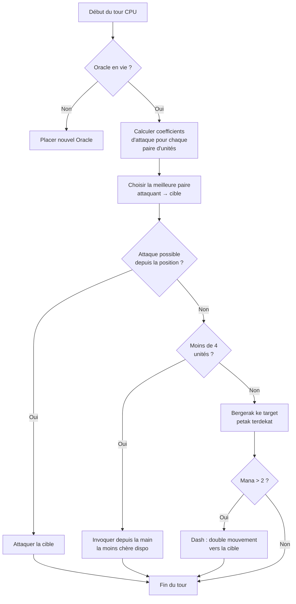

## AI jelekku untuk Nausicaa

Ada proyek yang dimulai dengan "eh gimana kalau saya bikin catur dengan mitologi?" dan berakhir dengan sistem yang AI-nya memutuskan hyper-parameternya sendiri setiap 5 giliran.

Nausicaa itu begitu. Permainan papan bergiliran di mana kamu membangun dek makhluk mitologismu, mengatur manamu, menempatkan unit di papan 10x8. Dan ada AI yang mengalami krisis kepribadian.

Saya menghabiskan cukup banyak waktu untuk AI ini, dan hasilnya kadang masih lolos dari saya, dan itulah yang paling saya suka.

## Permainannya secara nyata

Sebelum bicara soal otak, harus paham badannya dulu :

- Papan 10x8, zona penempatan 2 baris per pemain
- Mana mulai dari 1, +1 per giliran, maks 6. Kamu belanjakan untuk memanggil, menyerang, memakai kemampuan
- Tujuan : membunuh Oracle lawan

12 unit, dengan biaya dan pola gerakan berbeda :

| Unit | Biaya | Gerakan | HP |
| --- | --- | --- | --- |
| Oracle | 0 | Raja (8 arah) | 1 |
| Gobelin | 1 | Maju 3 petak | 1 |
| Harpie | 1 | Raja (8 arah) | 1 |
| Naïade | 1 | Diagonal | 1 |
| Griffin | 2 | Lompat 2 petak | 2 |
| Sirène | 2 | Lateral | 1 |
| Centaure | 2 | Kuda (L) | 2 |
| Archer | 3 | Lateral | 1 |
| Phénix | 3 | Diagonal (petak gelap) | 1 |
| Métamorphe | 4 | Tukar tempat | 1 |
| Voyant | 4 | Tidak ada (menghasilkan mana) | 1 |
| Titan | 6 | Terbatas (serangan area) | 3 |

Setiap unit punya pola serangannya sendiri. Sirène memukul ke 4 diagonal, Archer jarak jauh 3 petak, Titan menghancurkan semua di sekitar saat dipanggil. Singkatnya, permainan catur dengan mitologi dan deckbuilding.

## Cara saya membuat CPU berpikir

Ide dasarnya sangat sederhana : **setiap unit musuh punya koefisien daya tarik**. Makin berbahaya dia, makin ingin AI mengurusnya.

```javascript
const UNITS_ATTRACTIVENESS = {
    "oracle": 100,
    "titan": 95,
    "shapeshifter": 90,
    "phoenix": 80,
    "siren": 70,
    "archer": 70,
    "seer": 70,
    "griffin": 60,
    "centaur": 60,
    "harpy": 50,
    "naiad": 30,
    "gobelin": 20
};
```

Oracle 100 -- logis, itu win condition. Titan 95 karena ia menghabisi semua di sebelahnya saat dipanggil. Gobelin 20, itu prajurit biasa, tidak peduli.

Lalu untuk setiap pasangan unit (satu sekutu, satu musuh), saya hitung :

```
interet = attractivite × coeff_attract / (distance × coeff_dist)
```

Intinya : makin berbahaya dan dekat kamu, makin ingin AI menghajarmu.

```javascript
calculateAttackCoefficient(x1, y1, x2, y2) {
    const distance = this.calculateEuclideanDistance(x1, y1, x2, y2);
    if (distance === 0) return Infinity;
    return (UNITS_ATTRACTIVENESS[unit.type] * COEFFICIENTS_IMPORTANCE["attractiveness"]) / distance;
}
```

### Trik koefisien yang berubah

Poin pentingnya adalah koefisien kepentingan **berubah acak setiap 5 giliran**.

```javascript
if (this.turnCount % 5 === 0) {
    const distanceCoefficient = parseInt(Math.random() * 100);
    const attractivenessCoefficient = parseInt(Math.random() * 100);
    this.regulateImportanceCoefficients({
        distance: distanceCoefficient,
        attractiveness: attractivenessCoefficient
    });
}
```

Sekali AI jadi hiper agresif (attract 95, distance 5), ia menerobos segalanya untuk membunuh Oracle-mu. Berikutnya ia memprioritaskan jarak dan memposisikan ulang.

Ini dicuri dari hantu Pac-Man -- Blinky mengejar, Pinky menyergap. Di sini AI berganti "kepribadian" tiap fase.

**Hasilnya : mustahil memprediksi AI selama satu permainan penuh.** CPU tidak pernah memainkan dua match yang sama.

### Oracle itu pengecut

Oracle musuh kabur. Secara harfiah.

```javascript
const awayFromTarget = {
    row: Math.max(0, Math.min(7, botUnitElement.row + (botUnitElement.row - targetUnitElement.row))),
    col: Math.max(0, Math.min(9, botUnitElement.col + (botUnitElement.col - targetUnitElement.col)))
};
```

Ia menghitung arah berlawanan dari ancaman dan kabur. Kalau ada tembok, ia mencari petak bebas terdekat ke arah itu.

Kamu menghabiskan 3 giliran mendekati Oracle, dan tiba-tiba ia sudah kabur ke ujung lain.

### Loop keputusan

Begini cara AI memutuskan :

1. Kalau saya tidak punya Oracle lagi (mati), tempatkan yang baru
2. Hitung koefisien untuk setiap pasangan unit sekutu → unit musuh
3. Pilih pasangan terbaik
4. Kalau unit bisa menyerang target dari posisinya → serang
5. Kalau saya punya kurang dari 4 unit → panggil yang termurah yang tersedia dari tangan
6. Kalau tidak, bergerak ke target (petak gerakan terdekat ke musuh)
7. Kalau mana cukup (> 2), dash (gerakan ganda) untuk makin mendekat
8. Kalau unitnya Oracle → kabur



```javascript
async makeAction(dash=false) {
    // semua itu berurutan
    // le CPU dash si il a assez de mana
    if(botPlayer.mana > 2) {
        this.makeAction(true);
    }
}
```

### Kenapa jarak euclidean

Saya memakai jarak euclidean :

```javascript
calculateEuclideanDistance(x1, y1, x2, y2) {
    const deltaX = Math.pow(x1 - x2, 2);
    const deltaY = Math.pow(y1 - y2, 2);
    return Math.sqrt(deltaX + deltaY) * COEFFICIENTS_IMPORTANCE["distance"];
}
```

Kenapa bukan Manhattan? Karena unit-unitnya punya pola gerakan beragam (L seperti kuda, diagonal, dll). Jarak garis lurus adalah perkiraan bahaya yang lebih baik.

## Kenapa bukan minimax

Saya bisa saja mengoding minimax klasik. Tapi dengan 12 tipe unit, pola gerakan berbeda, kemampuan khusus... pohon permainannya meledak begitu cepat sampai tidak bisa dimainkan. Pendekatan heuristik membuat pilihan cerdas tanpa menjelajahi 10 juta keadaan.

## Yang keren

Sistem daya tarik menciptakan dilema yang lucu :

- Voyant (70) menghasilkan mana. Kalau kamu biarkan hidup, lawan punya lebih banyak sumber daya. Tapi Titan (95) masih lebih berbahaya.
- Métamorphe (90) bisa bertukar tempat dengan unit mana pun. Ia bisa mencuri Oracle-mu.
- Harpie (50) punya serangan meledak yang juga membunuhnya. Ia tetap sekunder... sampai ia berakhir di samping 3 unitmu.

AI menilai bahaya global menurut posisi, bukan sekadar stat mentah.

Ada juga fungsi `activateSimulation()` untuk menguji skenario tanpa mengulang permainan :

```javascript
activateSimulation() {
    // Place des unités spécifiques sur le plateau
    // Berguna untuk men-debug AI
    this.game.board = simulation.board;
    this.game.players = simulation.players;
}
```

## Yang kurang

Kalau saya punya lebih banyak waktu :

- AI bereaksi pada keadaan saat ini, ia tidak memprediksi apa yang akan dilakukan pemain
- Ia tidak merencanakan tangannya selama beberapa giliran
- Métamorphe dan Centaure punya kemampuan yang kurang dieksploitasi
- Pembelajaran penguatan : membuatnya bermain melawan dirinya sendiri untuk menyesuaikan koefisien

Tapi untuk permainan peramban ini sudah cukup oke. Teman-teman bisa kalah melawannya, jadi sudah tervalidasi.

## Coba

Tersedia di [nausicaa-game.github.io](https://nausicaa-game.github.io/). Kamu klik "JOUER", mode CPU ON, dan kamu lihat AI beraksi.

Saran : biarkan AI bermain melawan dirinya sendiri. Kamu akan melihat fase agresif, lalu tiba-tiba ia mundur semua.

Kodenya ada di [GitHub](https://github.com/nausicaa-game/nausicaa-game.github.io) di `js/cpu.js`.

**3 poin yang perlu diingat :**

1. **Koefisien heuristik** -- tanpa minimax, setiap unit punya daya tarik
2. **Koefisien yang berubah setiap 5 giliran** -- AI bergantian antara agresivitas dan kontrol, ala Pac-Man
3. **Oracle kabur** -- ia menghitung arah berlawanan dari ancaman dan kabur

Kalau kamu punya ide untuk membuat AI makin licik, buka issue. Saya punya rencana untuk versi yang belajar dari kekalahannya, tapi itu untuk artikel berikutnya.
