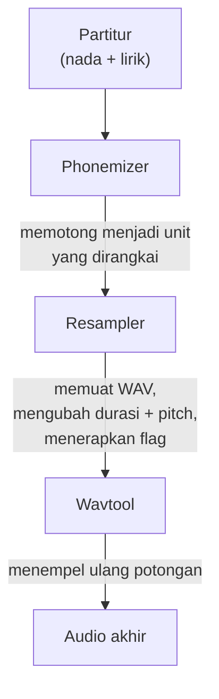

## UTAU : bagaimana perangkat lunak Visual Basic 6 mendemokratisasi suara sintetis

Saya sempat menyinggungnya di halaman utama saya : saya suka UTAU. Inilah kenapanya.

Pada 2008, kalau kamu ingin membuat suara sintetis bernyanyi, kamu punya satu opsi : VOCALOID. Perangkat lunak Yamaha. Mahal, proprietari, dengan suara resmi yang tidak bisa kamu buat sendiri.

Lalu ada orang Jepang, Ameya/Ayame, yang merilis program buatannya sendiri. Perangkat lunak yang dikode dalam **Visual Basic 6**. Gratis. Yang membiarkanmu membuat suaramu sendiri dengan... berkas WAV yang kamu rekam sendiri.

Perangkat lunak ini bernama **UTAU** (歌う, "bernyanyi" dalam bahasa Jepang). Dan untuk zamannya, itu sihir.

Saya selalu menganggapnya menarik karena ide awalnya lebih daripada kerapian teknisnya (prinsip enkodenya tetap benar-benar cerdik, meski implementasinya bikin mata perih) : ia membuka sintesis vokal ke publik luas. Kamu, saya, siapa pun yang punya mikrofon.

Biar saya jelaskan kenapa itu jenius.

---

## Pertama, kenapa sintesis nyanyian itu sulit

Suara bernyanyi bukan nada. Ada konsonan yang menyerang, vokal yang bertahan, napas, transisi antara keduanya. "Sa" dari "salut" adalah "s" berdesis yang meluncur ke "a" terbuka, dan justru luncuran inilah yang terdengar manusiawi atau tidak.

Hari ini kita menyelesaikannya dengan deep learning : kamu melatih model pada berjam-jam nyanyian dan ia membangkitkan suara (Synthesizer V, DiffSinger). Tapi itu 2020+. Pada 2008, tidak ada apa-apa.

UTAU memakai metode sebelumnya, lebih tua dan lebih cerdik : **sintesis konkatentif**.

---

## Sintesis konkatentif : salin-tempel potongan suara

Idenya bodoh sederhananya : kamu merekam potongan suara kecil dan menempelkannya bersama untuk membentuk kata. "salut" = sampel "sa" + "lu" + "to", dirangkai. Puzzle suara yang digerakkan partitur.

Ini prinsip YouTube Poop di mana kata-kata karakter dipotong ulang agar ia mengatakan apa saja -- kecuali di sini rapi dan otomatis.

Dan UTAU secara harfiah berasal dari sana. Sebelumnya ada **"Jinriki Vocaloid"** (人力ボーカロイド, "Vocaloid manual") : orang memotong manual trek vokal, mengekstrak fonem, me repitch, dan merakit ulang semuanya dalam editor audio untuk meniru suara VOCALOID. Manual. Kamu bayangkan kerjaannya.

Ameya melihat kerepotan itu dan mengoding alat untuk mengotomasinya. Awalnya UTAU hanya itu : asisten untuk Vocaloid manual.

---

## Kenapa revolusioner : KAMU menciptakan suara

Inilah yang mengubah segalanya.

VOCALOID, kamu membeli suara. Miku, Luka, dll. Dibuat oleh profesional, dijual Yamaha. Penciptaan tetap disediakan untuk Yamaha. Dengan UTAU, **siapa pun merekam suaranya dan menjadikannya instrumen bernyanyi**.

Mode CV (paling sederhana) begini : kamu merekam ~100 suku kata dasar bahasa Jepang ("a", "ka", "sa", "ta"...), kamu mengonfigurasi titik potong, dan jadilah voicebank-mu. Beberapa jam kerja.

Hasilnya : ekosistem meledak. Ribuan voicebank yang dibuat komunitas -- suara penggemar, teman, karakter ciptaan. Semesta utuh penyanyi virtual, gratis. Dan perangkat lunak datang dengan **Defoko** (Utane Uta), suara bawaan yang dibangkitkan lewat mesin TTS AquesTalk, jadi kamu bisa mulai bahkan tanpa mikrofon.

---

## Oto.ini : jantung sistem

Bagaimana UTAU tahu di mana memotong dan menempel suara? Lewat berkas config per voicebank : **`oto.ini`**. Untuk setiap WAV, ia mendefinisikan titik potong (dalam milidetik) :

- **Offset** → hening yang dibuang di awal
- **Preutterance** → titik di mana konsonan beralih ke vokal (perbatasan "s"→"a" dalam "sa")
- **Overlap** → seberapa jauh nada sebelumnya meluap ke yang ini
- **Fixed region** → bagian yang TIDAK boleh diregangkan pada nada panjang (biasanya konsonan)
- **Cutoff** → di mana memotong akhir

**Preutterance** adalah param paling cerdik. Suku kata selalu punya potongan konsonan sebelum vokal. Supaya nadamu jatuh tepat waktu, *vokal*-lah yang harus jatuh tepat, bukan konsonan. Jadi UTAU menggeser sampel ke belakang : "a" dari "sa" mendarat tepat waktu, "s" meluap tepat sebelumnya. Seperti drummer yang mengantisipasi pukulannya supaya bunyi jatuh tepat -- kecuali di sini dalam `.ini`.

Secara visual, pada sampel "ka", zona `oto.ini` terpotong begini :

```mermaid
flowchart LR
    A["🔇 hening<br/>(offset)"] --> B["🅺 konsonan<br/>(fixed region,<br/>tidak diregangkan)"]
    B --> C["🅰 vokal<br/>(zona bisa diregangkan)"]
    C --> D["🔇 akhir dipotong<br/>(cutoff)"]
    style B fill:#3b4a6b
    style C fill:#5b3b6b
```



Perbatasan antara konsonan dan vokal itulah preutterance. Vokal adalah zona yang diregangkan untuk nada panjang ; konsonan tetap utuh, kalau tidak "k"-mu berlangsung dua detik dan terdengar mengerikan.

```ini
# oto.ini (disederhanakan)
# berkas=alias,offset,consonant,cutoff,preutterance,overlap
_ka.wav=ka,120,80,-200,90,40
```

Lima nilai per suara, pada semua sampelmu, dan UTAU merakit kata apa pun dengan bersih.

---

## CV, VCV, CVVC : perlombaan menuju realisme

Mode dasar, **CV** (Konsonan-Vokal), adalah satu suara per suku kata. Sederhana tapi agak robotik : sambungan antar suku kata kasar.

Pada 2010 komunitas menciptakan **VCV** (Vokal-Konsonan-Vokal). Alih-alih merekam "ka" saja, kamu merekam "a ka" -- dengan ekor vokal sebelumnya. Transisinya menjadi alami karena ada *dalam* rekaman, bukan dihitung setelahnya.

Detail yang menyakitkan : **VOCALOID tidak punya VCV sebelum VOCALOID3, pada 2011.** Freeware VB6 yang dikode satu orang saja mendahului Yamaha setahun dalam realisme transisi. Komunitas penggemar lebih cepat daripada multinasional.

Lalu datang **CVVC**, **ARPAsing** (Inggris), **VCCV**... tiap metode mendorong realisme lebih jauh, semuanya diciptakan dan didokumentasikan komunitas.

---

## Pipeline lengkap : cara kata menjadi suara

Ketika kamu menaruh nada dan mengetik lirik, inilah yang terjadi di balik layar :



**Resampler** adalah karya utamanya : ia mengambil sampel "ka"-mu yang direkam pada ketinggian tertentu dan me rentang/me repitch untuk mencocokkan nada yang diinginkan -- hanya merentangkan zona yang bisa direntangkan dan menjaga konsonan tetap utuh (makanya `oto.ini`).

Dan ia **modular**. UTAU datang dengan resampler dasar, tapi komunitas menetaskan lainnya (moresampler, TIPS...), masing-masing dengan butir suaranya. Kamu berganti mesin sintesis seperti plugin. Pada 2008. Pada freeware.

---

## Pekerjaan di balik kap (dan kenapa itu menawan)

Saya harus jujur soal keadaan teknis perangkat lunak :

- **Dikode dalam Visual Basic 6.** Bahasa yang sudah mati pada 2008. Butuh runtime VB6 untuk menjalankannya.
- **Awalnya hanya Windows** (porting Mac, UTAU-Synth, datang 2011).
- **Enkode Shift-JIS wajib.** Kalau berkasmu tidak dienkode dalam Shift-JIS Jepang, UTAU tidak paham apa-apa. Bahkan hari ini sering harus menaruh PC dalam locale Jepang atau memakai AppLocale untuk menjalankannya.
- **Antarmuka sederhana**, dokumentasi nyaris 100% berbahasa Jepang waktu itu.

Namun. Namun perangkat lunak ini menciptakan gerakan dunia. Puluhan ribu voicebank. Lagu yang didengar jutaan kali.

Contoh terbaik : **Kasane Teto**. Karakter yang dibuat pada 2008 dan dilempar sebagai lelucon 1 April, dengan menyamar sebagai VOCALOID. Itu lelucon. Kecuali orang menyukai karakternya, voicebank UTAU sungguhan dibuat di belakangnya, dan Teto menjadi salah satu penyanyi virtual paling terkenal di dunia. Pada 2023 ia bahkan mendapat suara Synthesizer V resmi. Karakter yang lahir dari lelucon April Mop pada perangkat lunak gratis.

---

## Kenapa masih penting

UTAU adalah contoh sempurna teknologi "miskin" yang menang lewat keterbukaan.

VOCALOID secara teknis unggul, lebih didanai, lebih pro. Tapi tertutup. UTAU tambal sulam, jelek, dalam VB6 -- tapi membiarkan semua orang berpartisipasi. Membuat suara, membuat resampler, membuat plugin, membuat metode perekaman. Komunitas melakukan sisanya.

Dan konsepnya bertahan sepenuhnya hari ini. **OpenUtau**, penerus open-source modern, mengambil ide itu dan membersihkannya (multi-platform, UTF-8, dukungan resampler modern DAN AI). Sintesis konkatentif tetap berdiri di samping model deep learning, karena punya keunggulan yang tidak mereka miliki : kamu paham tepat apa yang terjadi, dan kamu mengendalikan setiap milidetik.

Itulah yang selalu saya suka dari UTAU. Kamu melihat tepat apa yang terjadi. Ini bukan AI yang memuntahkan hasil ajaib yang tidak kamu pahami : kamu punya WAV-mu, titik potongmu, dan kamulah yang memutuskan segalanya. Ketika terdengar buruk, kamu tahu kenapa dan bisa memperbaiki. Saya suka kontrol semacam itu.

---

**3 poin yang perlu diingat :**

1. **Sintesis konkatentif = puzzle suara** -- UTAU menempelkan sampel WAV kecil bersama untuk membentuk kata. `oto.ini` mendefinisikan di mana memotong dan menempel setiap suara. Kamu mengendalikan segalanya, hingga milidetik, tanpa kotak hitam.

2. **Keterbukaan mengalahkan teknik** -- VOCALOID lebih baik tapi tertutup. UTAU tambal sulam tapi membiarkan semua orang membuat suaranya. Komunitas meledakkan ekosistem, dan bahkan mendahului Yamaha dalam VCV.

3. **Ide bagus bertahan dari kodenya** -- VB6, Shift-JIS, hanya Windows... namun konsepnya tetap berjalan lewat OpenUtau. Teknologi jenius bisa dikode dengan kaki.

Sejujurnya, hanya demi Kasane Teto yang lahir dari lelucon April Mop, perangkat lunak ini layak dihormati.
