## Introduzione

Far girare un server Minecraft su un microcontrollore da 1 dollaro, sembra uno scherzo.

Mi sono fatto la domanda, e la risposta è sì. Letteralmente.

C'è un progetto che si chiama [Bareiron](https://github.com/p2r3/bareiron/), firmato p2r3, ed è probabilmente uno dei progetti più affascinanti che abbia visto nel mondo Minecraft in questi ultimi anni. Parliamo di un binario che sta in **300 kilobyte**, **6800 righe di C**, zero dipendenze esterne, niente malloc, niente threading, e gira su una **ESP32 da 1 dollaro**.

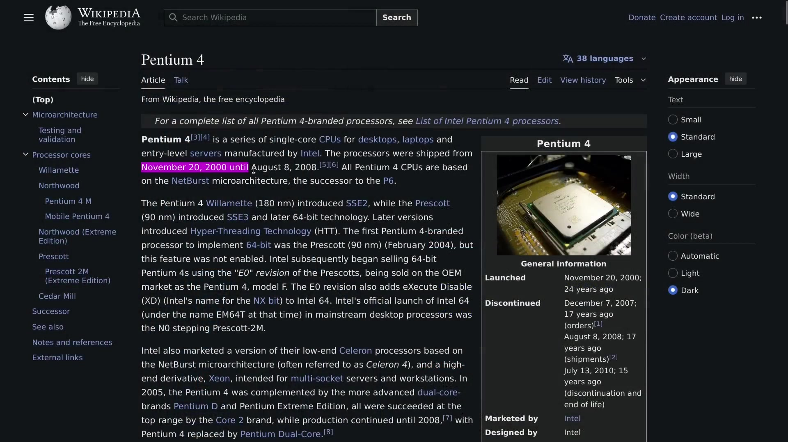

Generazione di terreno infinita. Biomi. Grotte. Craft. Miniere. Mob. Fame. Casse. Tutto ciò che ti aspetti da un server survival.

Su un chip che consuma **0.5 Watt** e che ha **160 MHz** di clock.

Per dare un ordine di idea: un server Minecraft vanilla ha bisogno di vari giga di RAM. L'ESP32-C3, sono **520 KB di SRAM** (400 disponibili dopo il boot). I processori 20 anni fa giravano già in gigahertz: questo si ferma a 160 MHz. Il fattore tra i due in potenza pura, è circa **20 000**.

p2r3 non ha scritto un server Minecraft in C, ha reinventato ogni mattone del server perché stesse in questi vincoli. Guardiamo come, aprendo il codice sorgente.

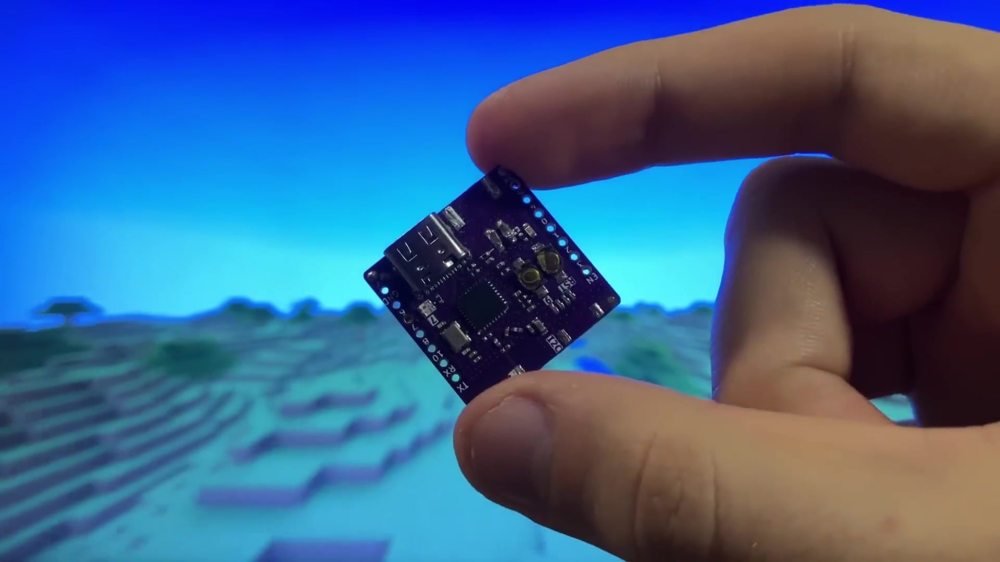

## Il cervello del progetto: una generazione di terreno senza memoria

Il problema più grosso quando vuoi fare un server MC embedded, è la generazione del terreno.

In Minecraft vanilla, il mondo è generato con **Perlin noise**: più strati sovrapposti (ottave), 6 parametri biomici (temperatura, umidità, continentalità, erosione, weirdness, profondità), e tutto un sistema di caching per non dover ricalcolare tutto ogni volta.

Il risultato è magnifico. Ma costa in calcolo, e prende RAM per salvare i chunk generati.

L'approccio di Bareiron è radicalmente diverso. Invece di impilare rumore, usa **bilinear interpolation** su 4 punti generati da un **RNG deterministico**.

Sai quando ingrandisci una piccola immagine pixelata e i bordi diventano sfocati? È esattamente quello.

```c
// worldgen.c, righe 117-171 (semplificato)

// interpola i 4 angoli in base alla posizione nel chunk
uint8_t interpolate (uint8_t a, uint8_t b, uint8_t c, uint8_t d, int x, int z) {
  uint16_t top    = a * (CHUNK_SIZE - x) + b * x;
  uint16_t bottom = c * (CHUNK_SIZE - x) + d * x;
  return (top * (CHUNK_SIZE - z) + bottom * z) / (CHUNK_SIZE * CHUNK_SIZE);
}

// altezza del terreno in un punto dalle coordinate mondo
uint8_t getHeightAt (int x, int z) {
  int _x = floor(x / CHUNK_SIZE);  // coordinate chunk
  int _z = floor(z / CHUNK_SIZE);
  int rx = x % CHUNK_SIZE;          // offset dentro il chunk
  int rz = z % CHUNK_SIZE;
  uint32_t hash = getChunkHash(_x, _z);
  uint8_t biome = getChunkBiome(_x, _z);
  // interpolazione tra 4 angoli seminati da hash + bioma
  return getHeightAtFromHash(rx, rz, _x, _z, hash, biome);
}
```

L'interpolazione bilineare standard: 4 angoli, pesi secondo la posizione, un solo `uint8_t` in uscita. CHUNK_SIZE è 8, quindi si fa in moltiplicazioni intere, niente float.

p2r3 lo mostra passo passo nel video: prima i 4 angoli del chunk, ognuno con un'altezza seminata dal RNG.

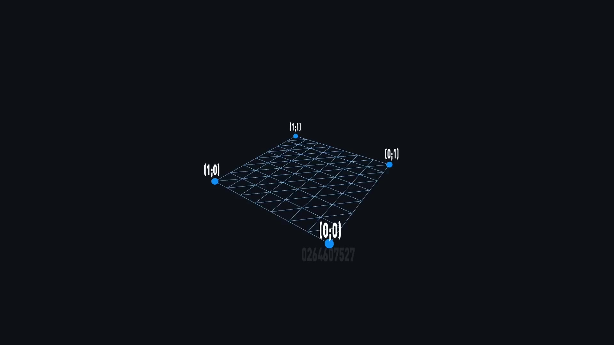

Poi l'interpolazione tra questi 4 punti crea una superficie continua.

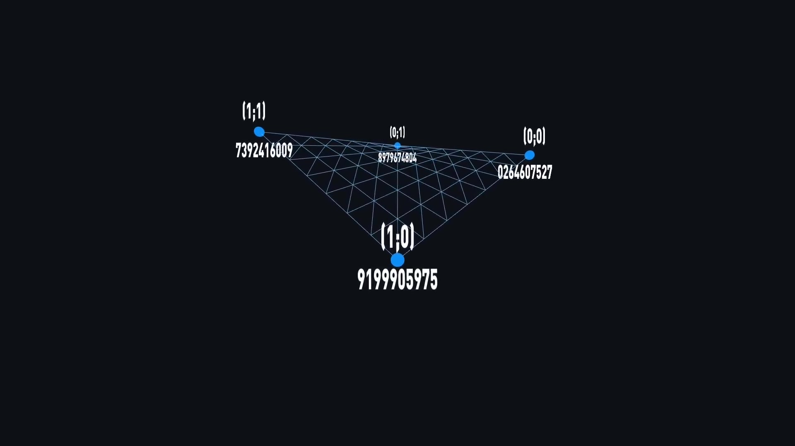

E ripetendo il pattern su tutti i chunk adiacenti, si ottiene un terreno che si estende all'infinito.

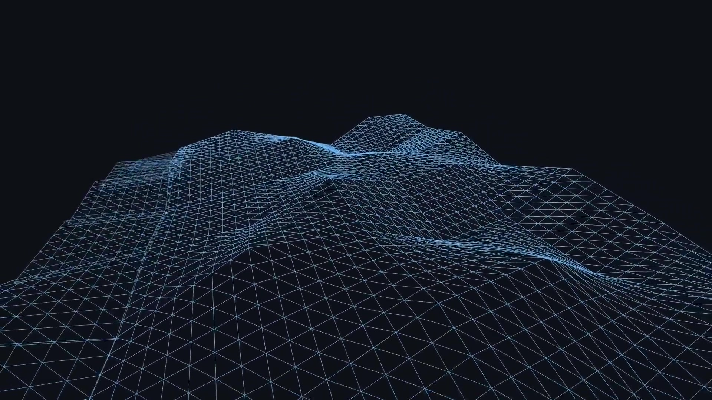

### L'RNG deterministico

La chiave che rende tutto questo possibile, è il seeding. Ogni chunk ha 4 angoli, e ogni angolo ha bisogno di un valore pseudo-casuale unico ma riproducibile.

```c
// worldgen.c, righe 13-22

// hash unico per chunk da coordinate + seed mondo
uint32_t getChunkHash (short x, short z) {
  uint8_t buf[8];
  memcpy(buf, &x, 2);          // 16 bit di coordinata X
  memcpy(buf + 2, &z, 2);      // 16 bit di coordinata Z
  memcpy(buf + 4, &world_seed, 4);  // 32 bit di seed globale
  return splitmix64(*((uint64_t *)buf));  // hash
}
```

Impacchetta i 16 bit di X, 16 bit di Z, e 32 bit di seed, in un buffer di 8 byte, e passa il tutto in `splitmix64`. Risultato: un valore deterministico unico per ogni posizione, basato sulla seed del mondo.

Cogli la potenza del meccanismo? Il server non ha bisogno di salvare il terreno. Ricalcola al volo quando il giocatore arriva in una nuova zona, e dà esattamente lo stesso risultato ogni volta.

Lo `splitmix64` usato è un prng ultra-rapido pensato per gli hash a 64 bit:

```c
// worldgen.c (semplificato)

// prng veloce per hash a 64 bit
static uint32_t splitmix64 (uint64_t state) {
  state += 0x9E3779B97F4A7C15ull;
  uint64_t z = state;
  z = (z ^ (z >> 30)) * 0xBF58476D1CE4E5B9ull;
  z = (z ^ (z >> 27)) * 0x94D049BB133111EBull;
  return (z ^ (z >> 31)) >> 32;
}
```

3 operazioni: addizione, xor/shift, moltiplicazione, xor/shift, moltiplicazione, xor/shift. Il tutto sta in operazioni dirette, senza tabella né ciclo. Prende il buffer di 8 byte (X + Z + seed), lo tratta come un intero a 64 bit, e restituisce 32 bit di hash. È deterministico, rapido, e sta in 5 righe.

### Perché non è Perlin noise

p2r3 lo dice lui stesso nel video: "più aggiungi cifre del numero casuale, più il terreno diventa regolare, come più lanci di moneta ti avvicinano a 50/50". In pratica, è il numero di bit dell'hash che combina:

```c
// worldgen.c, righe 51-115

// Per un bioma pianure: 4 fattori combinati → terreno regolare
h = (hash % 3) + ((hash >> 4) % 3) + ((hash >> 8) % 3) + ((hash >> 12) % 3);
// Per pianure innevate: 2 fattori → più accidentato
h = (hash % 5) + ((hash >> 4) % 5);
```

Ogni bioma sceglie quante estrazioni di bit combina. Più ce ne sono, più la distribuzione si stabilizza: come più lanci di moneta che si avvicinano a 50/50. Meno ce ne sono, più le variazioni locali sono forti.

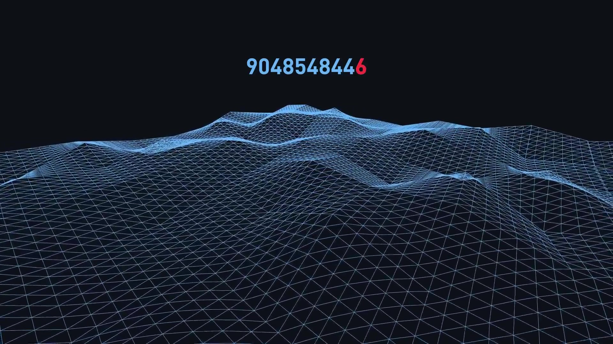

Con solo 2 fattori, le pianure innevate producono un terreno collinare, quasi montuoso. Picchi e avvallamenti sono frequenti.


Con 4 fattori, le pianure restano piatte e prevedibili. La distribuzione si stabilizza.

Un chunk si genera in **200 ms** su ESP32: contro un tempo non misurabile sullo stesso hardware con Perlin noise, tanto costa.

### Il dettaglio che spacca: interrogare un blocco senza generare tutto il chunk

Giochi, mini un blocco. Il server deve sapere che item darti. Ingenuamente, servirebbe generare tutto il chunk per questo.

Con la bilinear interpolation, interroghi **qualsiasi punto** del piano direttamente dalle coordinate. Gli angoli del chunk si ottengono dalla posizione del giocatore, l'interpolazione ti dà l'altezza a qualsiasi offset. Una manciata di operazioni matematiche, niente generazione di chunk.

p2r3: "quello che voglio, è una funzione magica che può dirmi che blocco si trova a una coordinata data, senza accedere alla memoria né calcolare costose mappe di rumore". Esattamente ciò che ha fatto.

Ecco come l'altezza diventa blocchi concreti:

```c
// worldgen.c (semplificato)

// restituisce il tipo di blocco a una coordinata
uint8_t getTerrainBlock (int x, uint8_t y, int z) {
  uint8_t surface = getHeightAt(x, z);

  if (y > surface)             return B_air;
  if (y == surface)            return biome_top[getChunkBiome(x, z)];
  if (y > surface - 4)         return B_dirt;
  if (y > surface - 16)        return B_stone;
  if (y > CAVE_BASE_DEPTH)     return B_deepslate;
                               return B_bedrock;
}
```

5 condizioni. Uno strato di grass/dirt/stone/deepslate/bedrock. Il blocco di superficie dipende dal bioma via `biome_top[]`: grass per le pianure, sand per il deserto. Una semplice cascata di if cade nello strato giusto, e questo sostituisce ciclo e switch.

### Le grotte, mirror più pigro

```c
// altezza grotta = mirror della superficie in profondità
altitude_grotte = CAVE_BASE_DEPTH - (hauteur_surface - y);
```

Fa il mirror dell'altezza della superficie sottoterra. Assomiglia alle grandi cavità deepslate. Zero compute, una riga.

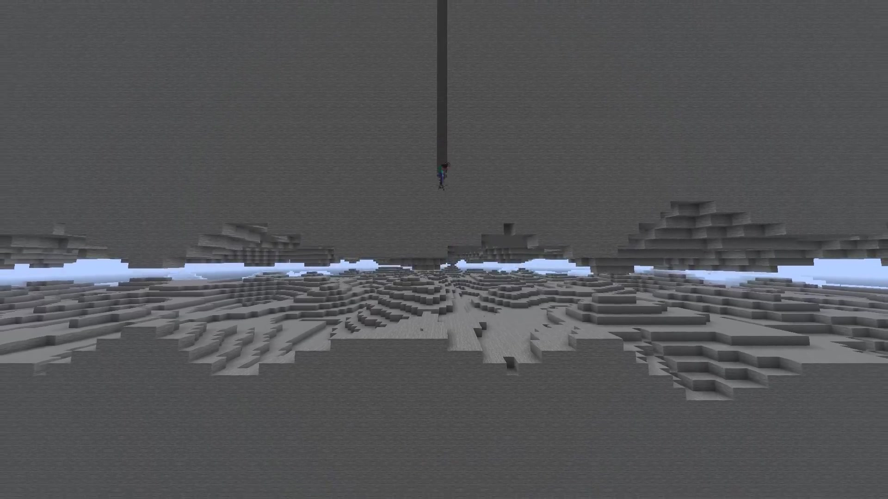

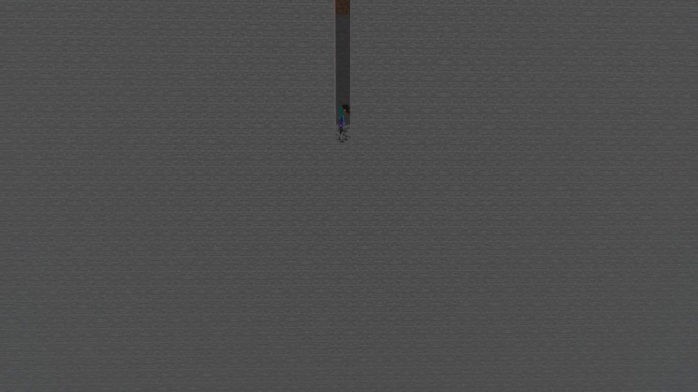

### I minerali, versione XOR

```c
// un candidato per colonna via XOR di coordinate
candidat = (chunk_x ^ col_x ^ col_z) % 100;
if (candidat < 5 && y < 16) -> diamond
```

Uno XOR di coordinate garantisce un candidato per colonna. Il tipo dipende solo dall'altitudine. I diamanti sono nascosti sotto il punto più basso delle grotte perché scavare resti utile.

### I biomi in tile map

Ogni bioma è un'isola circolare in una griglia, il suo tipo determinato da un pattern calcolato dalla seed. Grigliato, prevedibile, e gratis.

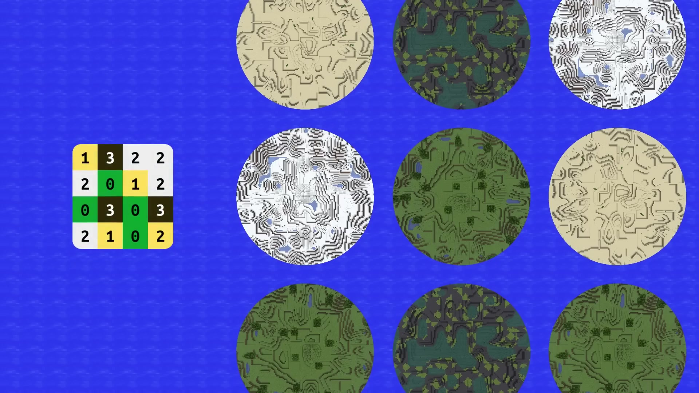

Ogni bioma ha il suo set di parametri codificato in tabelle:

```c
// worldgen.c (semplificato)

// altezze di base per bioma
static const uint8_t biome_base[] = {
  [BIOME_PLAINS]  = 48,   // altezza di base: 48
  [BIOME_DESERT]  = 52,   // leggermente più alto
  [BIOME_FOREST]  = 50,   // in mezzo
  [BIOME_TAIGA]   = 46,   // un po' più basso
  [BIOME_SNOWY]   = 40,   // il più basso
};

// blocco di superficie per bioma
static const uint8_t biome_top[] = {
  [BIOME_PLAINS]  = B_grass,
  [BIOME_DESERT]  = B_sand,
  [BIOME_FOREST]  = B_grass,
  [BIOME_TAIGA]   = B_grass,
  [BIOME_SNOWY]   = B_snow_block,
};

// numero di fattori di rumore per bioma
static const uint8_t biome_factors[] = {
  [BIOME_PLAINS]  = 4,   // 4 estrazioni → molto regolare
  [BIOME_DESERT]  = 3,   // 3 estrazioni → moderato
  [BIOME_FOREST]  = 4,   // 4 estrazioni → regolare, collinare
  [BIOME_TAIGA]   = 3,   // 3 estrazioni → moderato
  [BIOME_SNOWY]   = 2,   // 2 estrazioni → molto accidentato
};
```

**Plains**: altezza 48, 4 fattori, poi terreno molto piatto, erba.

```c
// pianure: 4 fattori → variazione di ±4 blocchi max
h = (hash % 3) + ((hash >> 4) % 3) + ((hash >> 8) % 3) + ((hash >> 12) % 3);
// Risultato: variazione di ±4 blocchi max
```

**Desert**: altezza 52, 3 fattori, blocco superficie = sabbia. Mai sotto il livello del mare.

```c
// deserto: 3 fattori → variazione di ±6 blocchi max
h = (hash % 3) + ((hash >> 4) % 3) + ((hash >> 8) % 3);
// Risultato: variazione di ±6 blocchi max, limitato a SEA_LEVEL+1
```

**Forest**: altezza 50, 4 fattori come le pianure ma base più alta, poi colline boscose.

**Taiga**: altezza 46, 3 fattori, poi variazioni moderate, terreno freddo.

**Snowy plains**: altezza 40, solo 2 fattori, poi il più accidentato.

```c
// pianure innevate: 2 fattori → variazione di ±14 blocchi max
h = (hash % 5) + ((hash >> 4) % 5);
// Risultato: variazione di ±14 blocchi max
```

Ogni bioma è codificato in **3 tabelle da 5 voci**: altezza di base, blocco di superficie, numero di fattori. Quando `getHeightAtFromHash` riceve il bioma, consulta queste tabelle per regolare il terreno. 15 byte di dati per sostituire tutto il sistema di biomi di Minecraft.

Il rilevatore di bioma usa la seed per determinare che bioma corrisponde a ogni chunk:

```c
// worldgen.c (semplificato)

// pattern di 16 voci per assegnare i biomi
static const uint8_t biome_pattern[] = {
  BIOME_PLAINS, BIOME_FOREST, BIOME_PLAINS, BIOME_DESERT,
  BIOME_FOREST, BIOME_TAIGA,  BIOME_PLAINS, BIOME_SNOWY,
  BIOME_PLAINS, BIOME_FOREST, BIOME_DESERT,  BIOME_PLAINS,
  BIOME_SNOWY,  BIOME_PLAINS, BIOME_FOREST, BIOME_TAIGA,
};

// bioma di un chunk da coordinate + seed
uint8_t getChunkBiome (short cx, short cz) {
  uint32_t h = splitmix64(cx * 31 + cz * 97 + world_seed);
  uint8_t index = h % 16;
  return biome_pattern[index];
}
```

Un pattern di 16 voci, un indice seminato dalle coordinate del chunk. Dà una griglia ripetitiva ma visivamente coerente. 4 righe di codice per sostituire tutto il sistema di parametri biomici di Minecraft vanilla.

### getHeightAtFromHash: l'assemblatore di terreno

La funzione al cuore della generazione combina i 4 angoli seminati per bioma:

```c
// worldgen.c (semplificato)

// combina i 4 angoli seminati e interpola
static uint8_t getHeightAtFromHash (int rx, int rz, short cx, short cz,
                                    uint32_t h, uint8_t biome) {
  // 4 angoli estratti dall'hash, seed diversa per angolo
  uint8_t h1 = biome_base[biome] + (h & 0x0F);
  uint8_t h2 = biome_base[biome] + ((h >> 4) & 0x0F);
  uint8_t h3 = biome_base[biome] + ((h >> 8) & 0x0F);
  uint8_t h4 = biome_base[biome] + ((h >> 12) & 0x0F);

  // Vincolo bioma: deserto mai sott'acqua
  if (biome == BIOME_DESERT) {
    h1 = max(h1, SEA_LEVEL + 1);
    h2 = max(h2, SEA_LEVEL + 1);
    h3 = max(h3, SEA_LEVEL + 1);
    h4 = max(h4, SEA_LEVEL + 1);
  }

  // Interpolazione dai 4 angoli
  return interpolate(h1, h2, h3, h4, rx, rz);
}
```

Ogni bioma ha una `biome_base` che sposta l'altezza di riferimento, e i 4 angoli sono estratti dall'hash con scostamenti diversi. Il deserto forza il minimo sopra il livello del mare: una riga di vincolo che evita l'acqua senza calcolo biomico extra.

### Alberi e cactus: piazzamento probabilistico

La generazione di superficie usa lo stesso hash di chunk per decidere dove piantare:

```c
// worldgen.c (semplificato)

// piazza alberi o cactus in base a hash e bioma
static void genFoliage (uint8_t *chunk_data, short cx, short cz,
                        uint32_t hash, uint8_t biome) {
  if (biome == BIOME_DESERT) {
    // Cactus: un candidato per chunk, hash decide la posizione
    int tx = (hash >> 8) & 7;
    int tz = (hash >> 12) & 7;
    int ty = getHeightAt(cx * 8 + tx, cz * 8 + tz);
    if (chunk_data[ty * 64 + tz * 8 + tx] == B_sand)
      placeCactus(chunk_data, tx, ty + 1, tz);
  } else {
    // Alberi: hash decide se metterne e dove
    int tree_count = (hash & 3);  // 0-3 alberi per chunk
    for (int i = 0; i < tree_count; i ++) {
      int tx = ((hash >> (4 + i * 4)) & 7);
      int tz = ((hash >> (6 + i * 4)) & 7);
      int ty = getHeightAt(cx * 8 + tx, cz * 8 + tz);
      placeTree(chunk_data, tx, ty + 1, tz);
    }
  }
}
```

0-3 alberi per chunk per i biomi verdi, 1 cactus massimo per il deserto. L'hash del chunk è l'unica fonte di entropia: un `& 7` per la posizione nel chunk, un `& 3` per il contatore. Tutto è deterministico, niente è salvato.

### generateChunk: assemblare tutto

La funzione che mette tutto insieme per produrre un chunk completo di 8×8×256 blocchi:

```c
// worldgen.c (semplificato)

// genera un chunk completo colonna per colonna
void generateChunk (uint8_t *chunk, short cx, short cz) {
  uint32_t hash = getChunkHash(cx, cz);
  uint8_t biome = getChunkBiome(cx, cz);

  // Per ogni colonna del chunk (8×8 = 64)
  for (int x = 0; x < 8; x ++) {
    for (int z = 0; z < 8; z ++) {
      // Coordinate mondo assolute
      int wx = cx * 8 + x;
      int wz = cz * 8 + z;

      // Altezza della colonna
      uint8_t height = getHeightAt(wx, wz);

      // Riempi la colonna dal basso in alto
      for (int y = 0; y < height; y ++) {
        uint8_t block = getTerrainBlock(wx, y, wz);
        chunk[y * 64 + z * 8 + x] = block;
      }
    }
  }

  // Aggiungi gli elementi di superficie (alberi, cactus)
  genFoliage(chunk, cx, cz, hash, biome);
}
```

È tutto. 3 cicli annidati: per ogni colonna, trova l'altezza, riempi i blocchi, passa alla successiva. L'uscita è un `uint8_t[16384]` (8 × 8 × 256) che rappresenta il chunk completo. Il chunk è generato poi inviato diretto al client, senza passare da caching, lazy loading o compressione.

## Lo storage: array statici ovunque

L'architettura memoria di Bareiron, è C embedded in tutto il suo splendore: solo tabelle globali di taglia fissa, né malloc, né hash map, né liste concatenate.

### I cambiamenti di blocchi

```c
// globals.h, righe 191-196

// un cambio di blocco fatto dal giocatore
typedef struct {
  short x;      // 2 byte: limite a 32 000 blocchi orizzontale
  short z;      // 2 byte
  uint8_t y;    // 1 byte: limite a 256 blocchi verticale
  uint8_t block; // 1 byte: limite a 256 tipi di blocchi
} BlockChange;
```

20 000 voci, cioè circa **25 000 cambiamenti**: l'equivalente di un chunk e mezzo interamente scavato. Il campo `block` a `0xFF` segna una voce libera. La ricerca è una scansione lineare:

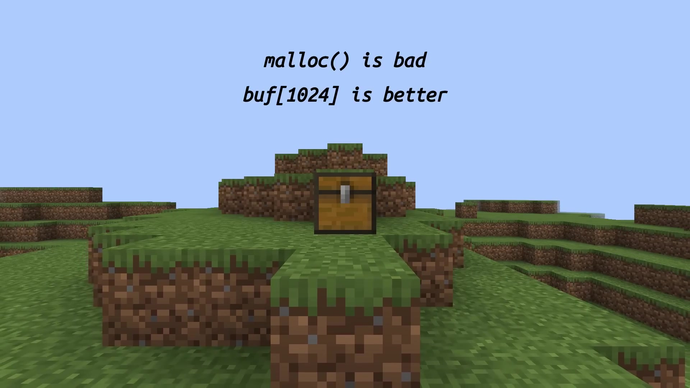

```c
// procedures.c

// cerca un cambio giocatore a una posizione
uint8_t getBlockChange (short x, uint8_t y, short z) {
  for (int i = 0; i < block_changes_count; i ++) {
    if (block_changes[i].block == 0xFF) continue;
    if (block_changes[i].x == x && block_changes[i].y == y && block_changes[i].z == z)
      return block_changes[i].block;
    #ifdef ALLOW_CHESTS
      if (block_changes[i].block == B_chest) i += 14;  // salta dati cassa
    #endif
  }
  return 0xFF;
}
```

Aggiungere un cambiamento è diretto come la ricerca:

```c
// accoda un cambio di blocco
static uint8_t changes_count = 0;

void addBlockChange (short x, short z, uint8_t y, uint8_t block) {
  if (changes_count >= MAX_CHANGES) return;
  block_changes[changes_count].x = x;
  block_changes[changes_count].z = z;
  block_changes[changes_count].y = y;
  block_changes[changes_count].block = block;
  changes_count ++;
}
```

Un contatore, un indice, una scrittura. La tabella si limita ad accodare: nessun ordinamento, nessuna compattazione, nessuna gestione memoria. Quando la tabella è piena, i nuovi cambiamenti sono ignorati: il terreno torna al suo stato generato.

Il commento dell'autore sul limite a 256 blocchi: "non conto di implementare le scale in rame leggermente patinato cerato tanto presto."

### I mob: 8 byte per testa di pipe

```c
// globals.h, righe 240-251 (pragma pack(push, 1) per eliminare il padding)

// stato di un mob in 8 byte
typedef struct {
  uint8_t type;   // 25=chicken, 28=cow, 95=pig, 106=sheep, 145=zombie
  short x;
  uint8_t y;      // se health=0, Y diventa un timer prima della rimozione
  short z;
  uint8_t data;   // bit 0-4: health, bit 5: sheep sheared, bit 6-7: panic timer
} MobData;
```

8 byte. 16 slot max. Allineamento e padding vanno a farsi friggere. Il byte `data` è un bitfield casalingo: 5 bit di vita, 1 bit di tosatura, 2 bit di timer di panico. E quando un mob muore, il campo Y diventa un timer prima della rimozione. Riuso di memoria a livello di bit.

### I giocatori: impacchettati stretti

I dati giocatori usano `#pragma pack(push, 1)` anche loro: coordinate in `short` + `uint8_t`, inventari in tabelle fisse di `uint16_t` + `uint8_t`, e un campo `flags` che codifica sia il cooldown di attacco, lo stato di spawn, sneak, sprint, eat, load, movement cooldown, e il lock di craft. Tutto in singoli bit.

## Il ciclo principale: while(true) e non-bloccante

Il server intero gira su un ciclo, un thread, zero event library.

```c
// main.c, righe 594-720

// ciclo principale: accetta client, ticka, elabora un pacchetto
while (true) {
  task_yield();  // lascia respirare il watchdog su ESP32

  // Accetta una nuova connessione (non bloccante)
  for (int i = 0; i < MAX_PLAYERS; i ++) {
    if (clients[i] != -1) continue;
    clients[i] = accept(server_fd, ...);
    if (clients[i] != -1) client_count ++;
    break;
  }

  // Tick server se il tempo è scaduto
  if (get_program_time() - last_tick_time > TIME_BETWEEN_TICKS) {
    handleServerTick(time_since_last_tick);
    last_tick_time = get_program_time();
  }

  // Round-robin: un client, un pacchetto per iterazione
  client_index = (client_index + 1) % MAX_PLAYERS;
  if (clients[client_index] == -1) continue;

  // Leggi l'intestazione del pacchetto: length + ID
  recv(client_fd, &recv_buffer, 2, MSG_PEEK);
  int length = readVarInt(client_fd);
  int packet_id = readVarInt(client_fd);
  handlePacket(client_fd, length - sizeVarInt(packet_id), packet_id, state);
}
```

Un solo client è trattato per iterazione del ciclo, e un solo pacchetto è letto alla volta. Il `task_yield()` all'inizio del ciclo lascia il task idle di FreeRTOS respirare su ESP32: senza, il timer watchdog ti resetta il chip.

Il dispatch dei pacchetti, è uno switch mostruoso di **400 righe**:

```c
// main.c, righe 68-497

// smista un pacchetto in base al suo ID
void handlePacket (int client_fd, int length, int packet_id, int state) {
  switch (packet_id) {
    case 0x00:  // Handshake / Status / Login secondo lo stato
    case 0x01:  // Status ping
    case 0x02:  // Plugin message
    case 0x03:  // Login/configuration acknowledgment
    case 0x08:  // Chat
    case 0x0B:  // Client status (respawn)
    case 0x11:  // Click container (gestisce le casse)
    case 0x19:  // Interact entity
    case 0x1D..0x20:  // Pacchetti movimento (il caso più grosso)
    case 0x28:  // Player action (dig/place)
    // ... oltre 40 casi
  }
}
```

Uno switch compila in jump table statica, e questo sostituisce jump table dinamica, vtable e map. Perfetto per l'embedded.

Il caso `0x1D-0x20` è il più grosso: gestisce gli aggiornamenti di posizione, i danni da caduta, gli attraversamenti di frontiere di chunk, lo spawn di mob, la generazione di chunk, E la fame. Tutto in un solo grosso fall-through.

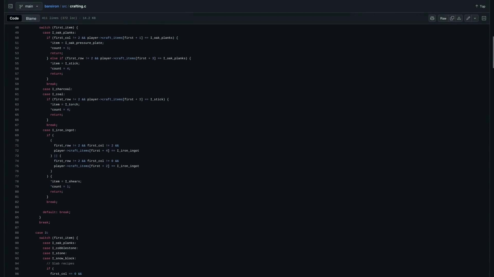

## Il tick server e l'IA dei mob

La funzione `handleServerTick` è chiamata ogni 50 ms (20 TPS). Gestisce il mondo mentre il ciclo principale si occupa dei giocatori:

```c
// main.c (semplificato)

// aggiorna i mob a ogni tick server
void handleServerTick (uint32_t delta) {
  // Aggiorna ogni mob
  for (int i = 0; i < MOB_COUNT; i ++) {
    if (mobs[i].type == 0 || mobs[i].data == 0) continue;  // morto o vuoto

    MobData *mob = &mobs[i];
    int px, pz;
    getNearestPlayer(mob->x, mob->z, &px, &pz);

    if (mob->type == MOB_ZOMBIE) {
      // Ostile: cammina verso il giocatore più vicino
      if (px < mob->x) mob->x --;
      else if (px > mob->x) mob->x ++;
      if (pz < mob->z) mob->z --;
      else if (pz > mob->z) mob->z ++;
      // Danni da contatto a 2 blocchi
      if (abs(px - mob->x) <= 2 && abs(pz - mob->z) <= 2)
        damagePlayer(getNearestPlayerId(mob->x, mob->z), 3);
    } else {
      // Passivo: 8 direzioni casuali
      uint8_t dir = getMobDir(mob);
      mob->x += dir_lookup[dir][0];
      mob->z += dir_lookup[dir][1];
      // Cambio di direzione ogni ~40 tick
      if (mob->data >> 6 < 1) setMobDir(mob, rand() & 7);
      mob->data = (mob->data & 0x3F) | ((mob->data - 0x40) & 0xC0);
    }

    // Risveglia i chunk intorno al mob
    setChunkGenerated(mob->x / 8, mob->z / 8);
  }
}
```

L'IA dei mob ostili, è un confronto di coordinate. Letteralmente `if (px < x) x--`. Lo zombie ignora pathfinding, A* e obstacle avoidance: regola X e Z in modo indipendente verso il giocatore: attraversa i muri se ce ne sono.

I danni da contatto sono a 3 cuori/sec. p2r3 l'ha voluto alto perché l'assenza di pathfinding rende gli zombie facili da kitare.

La formula di armatura è quella di prima del combat update: la più semplice possibile:

```c
// main.c (semplificato)

// riduzione danno lineare pre-1.9
static uint8_t applyArmor (uint8_t damage, uint16_t armor_value) {
  // Formula pre-1.9: riduzione lineare
  // Ogni punto di armatura = 4% di riduzione, max 80%
  uint8_t reduction = (armor_value * 4);
  if (reduction > 80) reduction = 80;
  return damage * (100 - reduction) / 100;
}
```

Full diamond = 80% di riduzione. Un colpo di zombie da 3 cuori diventa 0.6 cuori. p2r3 ha scelto questa vecchia formula perché si calcola in 2 operazioni: niente soglie, niente curve, solo una percentuale lineare.

I mob passivi: 8 direzioni in una lookup table, cambio di rotta ogni ~40 tick. Il campo `data` codifica la direzione in corso nei 2 bit di peso forte, e il timer di cambio direzione nei 6 bit restanti.

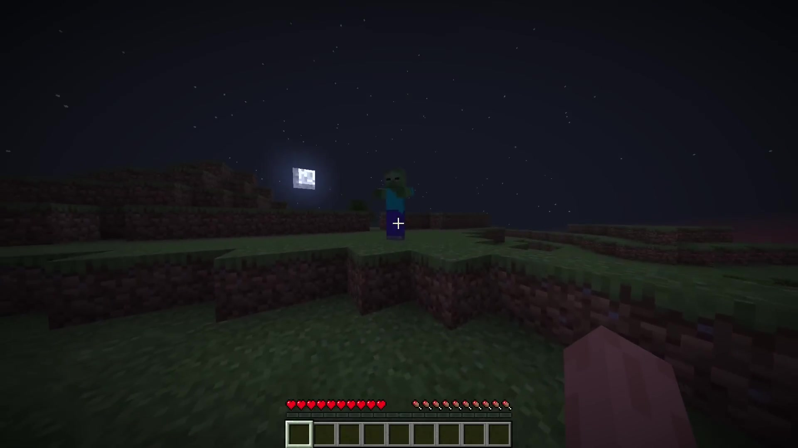

### Il respawn dei mob

I mob non spawnano con random tick. Appaiono quando il tick server incontra una nuova frontiera di chunk:

```c
// spawn deterministico alle frontiere di chunk
if (player crossed chunk boundary) {
  for (int i = 0; i < MOB_COUNT; i ++) {
    if (mobs[i].type != 0) continue;
    spawnMob(&mobs[i], new_chunk_coords, getChunkHash(cx, cz));
    break;
  }
}
```

Stesso RNG del terreno, stessa seed di chunk. Se uno slot mob è libero, lo spawn è deterministico.

## Il craft: niente matrici, if/else

```c
// crafting.c, righe 9-347 (semplificato)

// calcola il risultato del craft dal contenuto della griglia
void getCraftingOutput (PlayerData *player, uint8_t *count, uint16_t *item) {
  // Se il flag 0x80 è alzato, il buffer di craft è usato da una cassa
  if (player->flags & 0x80) { *count = 0; *item = 0; return; }

  // Conta gli slot, trova il primo item, verifica l'identità
  uint8_t filled = 0, first = 10, identical = true;
  for (int i = 0; i < 9; i ++) {
    if (player->craft_items[i]) {
      filled ++;
      if (first == 10) first = i;
      else if (player->craft_items[i] != player->craft_items[first])
        identical = false;
    }
  }

  switch (filled) {
    case 1:  /* assi, lingotti... */
    case 2:  /* bastoni, cesoie, torce */
    case 3:  /* pale, spade, lastre */
    case 4:  /* tavolo di craft, stivali */
    case 5:  /* picconi, asce, elmi */
    case 7:  /* gambali, compostatori */
    case 8:  /* forno, cassa, corazza */
    case 9:  /* blocchi completi (ferro, oro, ecc.) */
  }
}
```

Il primo check: se il flag `0x80` è alzato, il buffer di craft è riciclato in puntatore di cassa. Il craft resta bloccato.

Poi, conta gli slot riempiti, nota il primo item, verifica l'identità. Con solo questo, becchi il forno in 4 check:

```c
// forno: 8 di ciottolo identici col centro vuoto
if (count == 8 && first == cobblestone && all_identical && center_empty)
    return furnace;
```

Per le forme complesse, usa l'indice del primo item e controlla la posizione relativa. Le ricette condividono una stessa funzione di matching: il materiale determina il risultato.

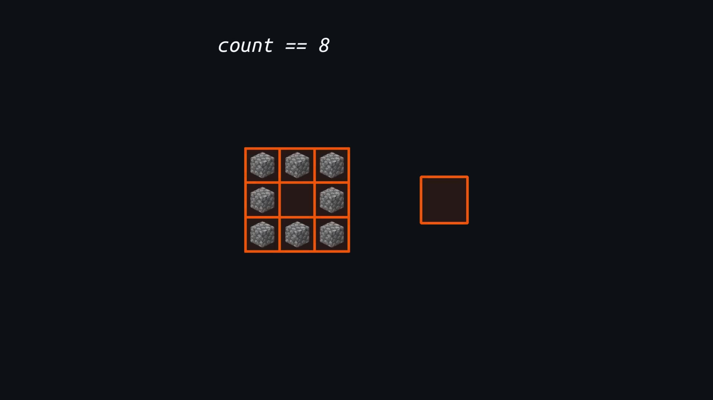

## Le casse: l'hack in vero

L'hack memoria di cui parlano tutti, in vero codice:

```c
// procedures.c, righe 1262-1293

// apri una cassa: punta ai suoi dati nel buffer di craft
if (target == B_chest) {
  // Cerca la voce della cassa nella tabella dei blocchi
  uint8_t *storage_ptr = NULL;
  for (int i = 0; i < block_changes_count; i ++) {
    if (block_changes[i].block != B_chest) continue;
    if (block_changes[i].x != x || block_changes[i].y != y || block_changes[i].z != z)
      continue;
    storage_ptr = (uint8_t *)(&block_changes[i + 1]);  // punta dopo il blocco cassa
    break;
  }
  if (storage_ptr == NULL) return;

  // Terrible memory hack!!
  // Copia il PUNTATORE nella tabella di item di craft del giocatore
  memcpy(player->craft_items, &storage_ptr, sizeof(storage_ptr));
  player->flags |= 0x80;  // blocca il craft

  // Invia l'interfaccia cassa al client
  sc_openScreen(player->client_fd, 2, "Chest", 5);
  for (int i = 0; i < 27; i ++) {
    uint16_t item;
    uint8_t count;
    memcpy(&item, storage_ptr + i * 3, 2);
    memcpy(&count, storage_ptr + i * 3 + 2, 1);
    sc_setContainerSlot(player->client_fd, 2, i, count, item);
  }
}
```

E il commento nel codice: `// Terrible memory hack!!1!`

È esattamente quello. Prende l'indirizzo memoria della voce successiva in `block_changes[]`, lo copia in `player->craft_items` (che è un `uint16_t[9]`, quindi 18 byte: abbastanza per salvare un puntatore a 32 bit), e alza il flag perché nessuno provi a craftare nel frattempo.

Su ogni clic nell'inventario della cassa:

```c
// packets.c, righe 620-638

// recupera il puntatore cassa dal buffer di craft
uint8_t *storage_ptr;
memcpy(&storage_ptr, player->craft_items, sizeof(storage_ptr));
// storage_ptr punta ormai ai dati della cassa
uint16_t *p_item = (uint16_t *)(storage_ptr + (slot - 41) * 3);
uint8_t *p_count = storage_ptr + (slot - 41) * 3 + 2;
```

Recupera il puntatore dal buffer di craft, e accede agli slot con un offset. I dati cassa sono salvati a colpi di 3 byte per slot (2 per l'ID, 1 per la quantità), incollati gli uni agli altri nella tabella di blocchi.

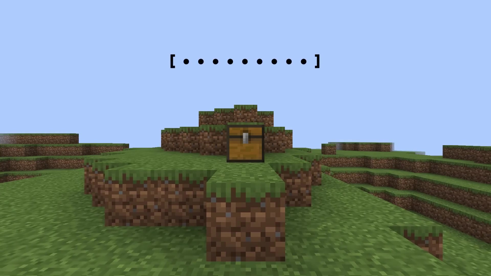

## La fame: 5 righe di genio

```c
// main.c, righe 293-305

// I giocatori inviano pacchetti di movimento a ~20/sec quando si
// muovono, molto meno quando sono immobili. Lo correliamo
// con l'attività per simulare la fame gratis.
if (player->saturation == 0) {
  if (player->hunger > 0) player->hunger--;
  player->saturation = 200;
  sc_setHealth(client_fd, player->health, player->hunger, player->saturation);
} else if (player->flags & 0x08) {  // sprinting
  player->saturation -= 1;
}
}
```

È letteralmente quello. 5 righe. Ogni pacchetto di movimento decrementa la saturazione. Quando la saturazione arriva a zero, la fame cala e si resetta la saturazione. Lo sprint (flag `0x08`) raddoppia il consumo.

Zero timer, zero memoria allocata, zero compute dedicato. Un contatore che si decrementa su pacchetti che esistono già.

### I danni da caduta

Il sistema di danni più semplice del progetto:

```c
// Quando il giocatore lascia il suolo, salviamo il suo Y
// Quando ritocca il suolo, sottraiamo
degats = dernier_y_au_sol - y_actuel;
```

Una sottrazione.

## Minare e piazzare blocchi

Quando clicchi su un blocco, il pacchetto `0x28` (Player Action) atterra nello switch. L'handler deve determinare che blocco si trova alla posizione, rimuoverlo, e mettere l'item nell'inventario:

```c
// main.c, case 0x28 (semplificato)

// gestisce distruzione e piazzamento blocchi
void handlePlayerAction (int client_fd, uint8_t action, int x, uint8_t y, int z) {
  switch (action) {
    case START_DESTROY_BLOCK: {
      // Determina il tipo di blocco alla posizione cliccata
      uint8_t block = getBlockAt(x, y, z);

      if (block == B_chest) {
        openChest(client_fd, x, y, z);
        break;
      }

      // Aggiungi ai block_changes
      addBlockChange(x, z, y, 0);  // 0 = aria

      // Dai l'item al giocatore (fidati del client)
      addItemToPlayer(client_fd, block_to_item(block), 1);

      // Invia l'aggiornamento al client
      sc_blockChange(client_fd, x, y, z, 0);
      sc_ackBlockChange(client_fd, x, y, z, 0);
      break;
    }
    case PLACE_BLOCK: {
      // Leggi il tipo di blocco dalla mano del giocatore
      uint16_t item = getHeldItem(client_fd);
      uint8_t block = item_to_block(item);
      addBlockChange(x, z, y, block);
      removeItemFromPlayer(client_fd, item, 1);
      sc_blockChange(client_fd, x, y, z, block);
      break;
    }
  }
}
```

`getBlockAt` combina la generazione di terreno E i cambiamenti giocatori:

```c
// priorità ai cambi giocatori, fallback sul terreno
uint8_t getBlockAt (int x, uint8_t y, int z) {
  // Prima verifica i cambiamenti giocatori
  uint8_t change = getBlockChange(x, y, z);
  if (change != 0xFF) return change;

  // Altrimenti, leggi dal terreno generato
  return getTerrainBlock(x, y, z);
}
```

Priorità ai cambiamenti, fallback sul terreno. Zero dibattito, zero cache, zero overhead. Il `getTerrainBlock` sotto il cofano, è `getHeightAt` + gli strati di stone/dirt/grass/coal.

### Il forno istantaneo

Il più divertente: il forno non esiste come entità. Se metti del ciottolo nella casella "cottura" e del carbone in "fuel", il risultato appare subito, senza timer né chunk ticking: è solo uno slot di inventario che si svuota quando metti gli item giusti.

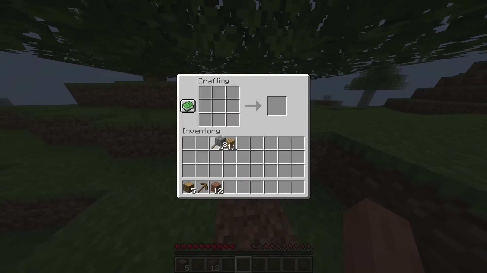

## Il ciclo ESP32: un server MC in 4 KB di stack

```c
// main.c, righe 732-779

#ifdef ESP_PLATFORM

// task FreeRTOS che lancia il server
void bareiron_main (void *pvParameters) {
  main();
  vTaskDelete(NULL);
}

// al WiFi connesso, crea la task server
static void wifi_event_handler (...) {
  if (/* connesso */) {
    xTaskCreate(bareiron_main, "bareiron", 4096, NULL, 5, NULL);
  }
}

// init timer + WiFi, il resto lo gestisce l'event handler
void app_main () {
  esp_timer_early_init();
  wifi_init();
  // Il resto è gestito dall'event handler
}
#endif
```

Il server intero gira in un task FreeRTOS con **4096 byte di stack**. È tutto. Il thread main principale fa solo inizializzare il WiFi e aspettare una connessione. Una volta connesso, crea `bareiron_main` che chiama il `main()` standard.

Tutto il codice specifico ESP32 è protetto da `#ifdef ESP_PLATFORM`. Su PC, tutto questo compila in codice POSIX standard.

## Cosa è stato sacrificato

Perché tutto questo stia, ci sono feature vanilla che non esistono:

- **Zero compressione rete**: zlib troppo costoso. Il server genera chunk in fretta, ma inviarli è il bottleneck.
- **Zero random tick**: gli alberi crescono con bone meal o no. I mob spawnano alle frontiere di chunk.
- **Zero entità item**: i blocchi minati vanno diretto nell'inventario. L'animazione è puramente visiva.
- **Nessuna verifica di inventario**: fidati del client. 64 diamanti? OK. Un chunk minato in 1 sec? OK. Da usare tra gente di fiducia.
- **Zero luce server**: le torce sono inviate dopo tutto il resto, il client calcola.
- **Zero fluidi progressivi**: stato finale istantaneo.

## Il risultato finale

Ryzen 5 3600: circa 0.5 ms per chunk.
ESP32-C3 da 1$: circa 200 ms per chunk. Giocabile.

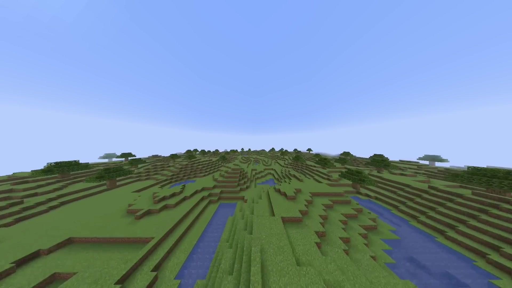

3+ giocatori: arranca. Paragonabile a 2b2t nelle ore di punta, dice l'autore.

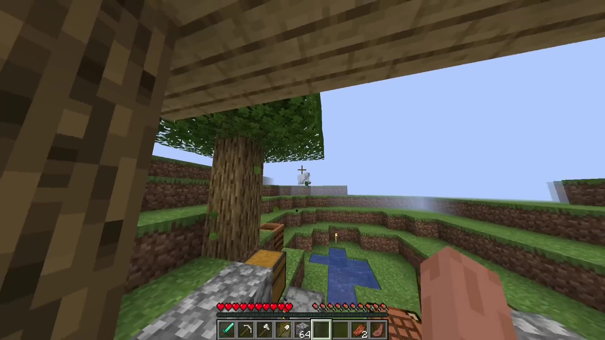

## La filosofia

p2r3: "Mi piace solo l'idea che questo piccolissimo chip da 1 dollaro che consuma 0.5 Watt possa far girare qualcosa di avanzato come Minecraft. Science isn't about 'why', it's about 'why not'."

Ogni riga è un tradeoff:
- Perlin noise, poi interpolazione: meno bello, 200x più rapido, zero memoria
- Matrici di craft, poi matching hardcodato: codice schifoso, zero byte
- zlib, poi niente: connessione scarsa = morte, ma giocabile
- Validazione, poi fiducia: zero sicurezza, zero compute

Ogni feature assente permette a un'altra di esistere nei limiti dell'hardware.

**I 3 punti da ricordare:**

1. **Interpolazione + RNG**: 4 punti seminati, terreno infinito, zero storage, query senza rigenerare il chunk, 200 ms di generazione. È la mossa geniale che rende tutto il resto possibile.
2. **Ogni feature ha un costo**: l'assenza di compressione, random tick e validazione è scelta voluta: è ciò che permette di stare in 520 KB.
3. **Gli hack schifosi sono i più intelligenti**: casse nella tabella di blocchi via memcpy, fame via pacchetti di movimento, forno istantaneo. La soluzione pulita sarebbe costata troppo.

Se il progetto ti interessa, tutto è su [GitHub in GPLv3](https://github.com/p2r3/bareiron/). È C bello sporco, e raramente ho preso tanto piacere a leggere un codice sorgente.
