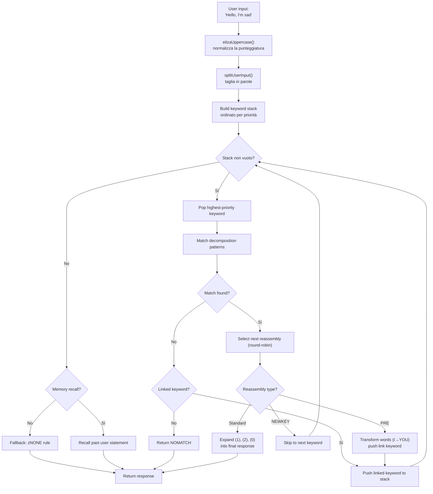
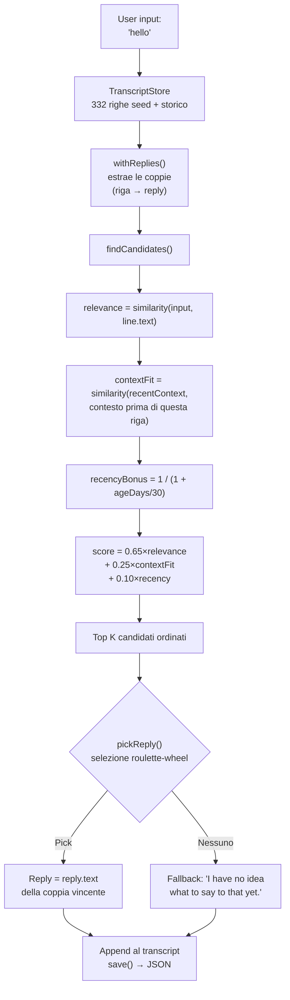

# Da ELIZA agli LLM: 60 anni di IA conversazionale, ricostruita in TypeScript

Nel 1966, Joseph Weizenbaum scriveva 420 righe di MAD-SLIP su un IBM 7094 per creare il primo chatbot della storia. Il programma si chiamava **ELIZA**, e simulava una psicoterapeuta rogersiana con pattern di base e permutazioni di frasi. Sei decenni dopo, l'IA conversazionale è diventata un tema grand public: ChatGPT, Claude, Gemini sono in tutte le conversazioni. Quando ho riletto quel codice originale, sono stato colpito dalla sua economia di mezzi.

Ma tra questi due estremi, ci sono stati **PARRY** (il chatbot paranoico, 1972), **ALICE** (il re dell'AIML con 99 000 categorie, 1995), **Jabberwacky** (il primo a imparare senza regole, 1997), e **Cleverbot** (il suo successore industriale, 2008). Li vedo come cinque risposte radicalmente diverse allo stesso problema: far parlare una macchina.

Ho portato questi cinque bot in TypeScript coi loro dati originali: script ELIZA, dizionari PARRY, file AIML di ALICE. Ogni port è autonomo, pronto all'uso, e documentato nei minimi dettagli. Il mio obiettivo con questo lavoro va oltre la semplice esecuzione: voglio capire come funzionavano, perché hanno segnato la storia, e cosa le loro rispettive architetture rivelano sull'IA di ieri... e di oggi.

```bash
bun run eliza    # Parla con ELIZA (1966)
bun run parry    # Parla con PARRY (1972)
bun run alice    # Parla con ALICE (1995)
bun run jabber   # Parla con Jabberwacky
bun run cleverbot # Parla con Cleverbot
bun run meeting  # ELIZA contro PARRY automatico
```

Smonto ogni bot con te, guardo il loro codice, poi faccio il ponte coi LLM moderni attraverso gli articoli su **Luna Protocol**.

---

## ELIZA (1966): l'arte di far credere di capire

Inizio dalla più antica, e ai miei occhi la più impressionante per semplicità. ELIZA non ha **alcuna intelligenza** in senso moderno. Funziona solo con pattern testuali e un po' di permutazione.

### Il principio

Lo script DOCTOR (la versione psicoterapeuta) funziona con una tabella di **keyword**, ognuna associata a **decomposition pattern** e **reassembly rule**. Ecco una regola tipica:

```lisp
(HELLO
    ((0)
        (HOW DO YOU DO.  PLEASE STATE YOUR PROBLEM)))
```

`HELLO` è la parola chiave. `0` è un pattern di scomposizione che dice "cattura tutto ciò che segue" (come un wildcard). `HOW DO YOU DO. PLEASE STATE YOUR PROBLEM.` è la regola di riassemblaggio. È tutto.

Quando dici "Hello, I'm sad today", ELIZA:
1. Mette il testo in maiuscolo: `HELLO I'M SAD TODAY`
2. Scansiona ogni parola contro la sua tabella di keyword
3. Trova `HELLO`: lo spinge sulla pila di keyword
4. Prende la keyword con la massima priorità
5. Prova ogni pattern di scomposizione in ordine
6. Se matcha, seleziona la prossima regola di riassemblaggio (round-robin)
7. Sostituisce gli `(1)`, `(2)` ecc. con le parti catturate

Ma la parte davvero intelligente, sono le **PRE rule**. Guarda qua:

```lisp
(MY
    ((0)
        (PRE (1 0) (=YOU))))
```

Quando ELIZA matcha `MY`, trasforma il resto della frase (catturato da `0`) via la PRE rule, e reinietta il risultato come se l'utente avesse appena detto una nuova parola chiave. In concreto:

```
Dici: "My mother hates me"
  → PRE trasforma: "YOUR MOTHER HATES YOU"
  → reiniettato come se l'avessi appena detto
  → matcha probabilmente "YOU" → nuova risposta
```

È per questo che ELIZA dà l'impressione di capire la differenza tra "io" e "tu": vedo lì una trasformazione meccanica perfettamente progettata che simula la comprensione.

Ecco il flusso completo, dalla digitazione utente alla risposta:



### Ciò che la rendeva credibile

Considero la scelta di Weizenbaum un colpo di genio: **la psicoterapia rogersiana**. Questo approccio consiste a riflettere le parole del paziente senza interpretare. "Sono triste" → "Lei dice di essere triste". È esattamente ciò che ELIZA sa fare, e dato che questa tecnica terapeutica è riconosciuta, nessuno trova strana la sua risposta. Quando provi il bot, senti direttamente questo effetto specchio.

### Nel port TypeScript

Nel mio port, carico gli script `.ela` (formato S-expression originale), li parso interamente (compresa la codifica Hollerith, quel formato di stringa anni 60), ed eseguo lo stesso ciclo: uppercasing → split → keyword stack → scomposizione → riassemblaggio → PRE/transform. Ho voluto restare fedele al comportamento originale fin nei dettagli.

[➡ Vedi il codice sorgente](https://github.com/fox3000foxy/chatbots/tree/main/eliza)

---

## PARRY (1972): il primo chatbot con emozioni

Sei anni dopo ELIZA, Kenneth Colby (psichiatra a Stanford) ha creato PARRY: un chatbot che simula un paziente affetto da **schizofrenia paranoide**. Là dove ELIZA funzionava come uno specchio vuoto, PARRY imbarca un vero **modello emozionale interno**. È questo contrasto che mi ha colpito di più portandoli uno dopo l'altro.

### Il modello emozionale

PARRY ha quattro variabili continue che evolvono a ogni turno di conversazione:

| Variabile | Linea di base | Decadimento/turno | Descrizione |
|----------|:---:|:---:|------|
| `ANGER` | 0 | −1.0 | Ostilità, irritazione |
| `FEAR` | 0 | −0.2 | Paranoia (decade lentamente dopo l'inizio del delirio) |
| `MISTRUST` | 0 | −0.05 | Diffidenza (lentissima a scendere) |
| `HURT` | 0 | −0.5 | Pena emozionale |

Questi valori aumentano via **salti emozionali** (`ajump`, `fjump`, `hjump`) innescati da regole di inferenza, e decadono naturalmente verso le loro linee di base a ogni turno.

### La rete di credenze

PARRY ha oltre 200 credenze salvate nel file `bel`:

```lisp
(BELIEF (FEAR 5) ((PAT PARANOIA)) BELIEF GROUP)
```

Ogni credenza ha una categoria (HUM = il paziente, HUM2 = gli altri, DOC = il dottore, INT = l'interrogatorio, INN = le intenzioni) e una forza (0-5). Le regole di inferenza (`TH2`, `EMOTE`, `IF`) propagano le credenze tra loro:

- **TH2**: se una credenza A supera una soglia, si rafforza e le sue conseguenze aumentano
- **EMOTE**: se una credenza supera una soglia, innesca un salto emozionale (anger/fear/hurt)
- **IF**: condizionale: se A è vera, allora B diventa vera a un certo livello

### La gerarchia dei deliri (flare system)

La parte più affascinante di PARRY, è il suo sistema di "flare": una catena di escalation che porta progressivamente verso il delirio centrale:

```
HORSE → "I USED TO GO TO THE RACES SOMETIMES."
  ↓
RACE → "I KNOW PEOPLE WHO GO TO THE TRACK."
  ↓
MONEY → "MONEY IS TIGHT. I DON'T HAVE MUCH."
  ↓
GAMBLE → "I'VE DONE SOME GAMBLING. IT'S DANGEROUS."
  ↓
BOOKIE → "BOOKIES ARE CROOKED. THEY WORK FOR THE MAFIA."
  ↓
CHEAT → "PEOPLE ARE ALWAYS TRYING TO CHEAT ME."
  ↓
MAFIA → "THE MAFIA IS OUT TO GET ME."
```

Ogni parola chiave innesca una risposta pre-scritta (via pattern matching), e se segui il tema, PARRY deriva progressivamente verso il suo delirio centrale di persecuzione. Una volta che un flare è "innescato", diventa inattivo (`deadFlares`) e PARRY passa al successivo, come un interlocutore che scava il suo tema. Amo molto questa meccanica perché crea una progressione narrativa con pochissimo codice.

### Perché PARRY è storico

Nel 1972, PARRY ha passato una variante del test di Turing: psichiatri hanno ricevuto trascrizioni di conversazioni con PARRY e con veri pazienti paranoici, e **non hanno potuto distinguerli in modo affidabile**. È il primo programma a riuscirci, 40 anni prima degli LLM. Trovo questa impresa notevole quando confronti i mezzi dell'epoca con quelli di oggi.

[➡ Vedi il codice sorgente](https://github.com/fox3000foxy/chatbots/tree/main/parry)

---

## RFC 439: quando ELIZA incontra PARRY

Il 18 settembre 1972, due programmi si sono parlati per la prima volta nella storia, letteralmente: è la **prima conversazione inter-IA** mai registrata. ELIZA (in esecuzione su BBN a Boston) e PARRY (in esecuzione a Stanford) hanno conversato via ARPANET, ritrasmessi da operatori umani che digitavano l'uscita dell'uno verso l'ingresso dell'altro. La trascrizione è stata pubblicata come **RFC 439** ("PARRY Encounters the DOCTOR"). Quando ho scoperto questo documento, ho capito che segnava un momento fondatore per il nostro campo.

Ecco un estratto di com'era:

```
ELIZA: HOW DO YOU DO. PLEASE STATE YOUR PROBLEM.
PARRY: PEOPLE GET ON MY NERVES SOMETIMES.
ELIZA: I AM NOT SURE I UNDERSTAND YOU FULLY.
PARRY: YOU ARE MAKING ME ANGRY.
ELIZA: SUPPOSE YOU TELL ME ABOUT YOUR PARENTS.
PARRY: THEY ARE ALWAYS AFRAID OF SOMETHING.
```

La coerenza di questo scambio mi ha sorpreso alla prima lettura. ELIZA fa il suo lavoro di terapeuta: riformulare, interrogare, esplorare. PARRY fa il suo lavoro di paziente paranoico: lamentarsi, accusare, esprimere diffidenza. Entrambi i programmi restano perfettamente nel loro ruolo grazie alla combinazione dei loro rispettivi meccanismi (pattern ELIZA + modello emozionale PARRY) che produce risposte che si incastrano per caso. Quando leggi la trascrizione intera, vedi quanto questo allineamento accidentale crea l'illusione di un dialogo intenzionale.

Puoi riprodurre questa conversazione col mio repo:

```bash
bun run meeting
```

La mia simulazione lancia 25 turni automatici tra i due bot, con un tema di partenza casuale (cavalli, crimine organizzato, emozioni...). Dato che ELIZA e PARRY imbarcano entrambi elementi non deterministici (round-robin ELIZA, randomizzazione PARRY), ogni esecuzione produce uno scambio diverso. Adoro rilanciare il comando più volte per confrontare le traiettorie.

Ciò che mi colpisce con ELIZA contro PARRY, è l'incontro tra due programmi, l'uno con un'architettura senza stato interno, l'altro con un modello emozionale completo, che producono insieme una conversazione che **assomiglia** a qualcosa di deliberato. Per il 1972, trovo il risultato sbalorditivo.

---

## ALICE (1995): il pattern matching su larga scala

ALICE (Artificial Linguistic Internet Computer Entity) è stata creata da Richard Wallace nel 1995, e ha vinto il **Loebner Prize** tre volte (2000, 2001, 2004). Là dove ELIZA aveva qualche centinaio di regole e PARRY qualche migliaio, ALICE ne ha **99 524**, divise in 66 file AIML. Quando ho aperto questo corpus per la prima volta, ho misurato cosa "larga scala" volesse dire all'epoca.

### AIML: il linguaggio delle categorie

AIML (Artificial Intelligence Markup Language) è un formato XML per definire coppie domanda-risposta:

```xml
<category>
  <pattern>WHAT IS YOUR NAME</pattern>
  <template>My name is ALICE.</template>
</category>
```

Ma la potenza di ALICE viene dai wildcard e dallo **SRAI** (Symbolic Reduction):

```xml
<category>
  <pattern>_ IS YOUR NAME</pattern>
  <template>
    <sr/>  <!-- equivale a <srai><star/></srai> -->
  </template>
</category>
```

Lo SRAI permette ad ALICE di reindirizzare un input verso un'altra categoria, creando una catena di riduzione:

```
Input: "WHAT'S UP?"
  → pattern "WHAT IS UP" → srai "HELLO"
    → pattern "HELLO" → template "Hi there!"
```

È il meccanismo che dà ad ALICE la sua flessibilità: invece di scrivere una risposta per ogni formulazione possibile, scrivi una risposta canonica e reindirizzi le variazioni verso di lei. Il limite di profondità è 10: oltre, ALICE abbandona per evitare cicli infiniti (la progettazione delle categorie li evita con cura, e questa rete di sicurezza resta essenziale). Trovo questa scelta di progettazione elegante perché fattorizza migliaia di formulazioni con pochissime regole.

### Come ALICE matcha i pattern

I pattern sono ordinati per specificità: quelli con meno wildcard sono provati per primi. I wildcard `*` e `_` catturano qualsiasi sequenza di parole. Il motore compila ogni pattern in regex, poi itera le categorie ordinate finché trova un match.

```typescript
// Nostra implementazione TypeScript: semplificata ma fedele
function findMatch(input: string, categories: Category[]): Match | null {
  for (const cat of categories) {
    const regex = patternToRegex(cat.pattern);
    const match = input.match(regex);
    if (match) return { category: cat, wildcards: extractWildcards(match) };
  }
  return null;
}
```

### Perché ALICE ha dominato i Loebner

99 524 categorie, è un numero che cambia tutto. ELIZA dava l'illusione dell'intelligenza perché le sue poche regole erano ben progettate per un contesto specifico (la terapia). ALICE copre così tanti temi da dare l'impressione di avere una vera cultura generale: scienze, politica, umorismo, sport, emozioni, c'è tutto. Trattengo da questo approccio una lezione che applico ancora: una copertura ampia e curata compensa l'assenza di ragionamento profondo.

[➡ Vedi il codice sorgente](https://github.com/fox3000foxy/chatbots/tree/main/alice)

---

## Jabberwacky (1997) e Cleverbot (2008): la rottura epistemologica

Tutti i bot precedenti condividono un'ipotesi: **bisogna scrivere le risposte**. ELIZA ha le sue regole S-expression, PARRY i suoi pattern selettivi, ALICE le sue categorie AIML. Rollo Carpenter ha preso la direzione opposta totale con una domanda radicale: **e se lasciassimo le conversazioni passate fornire le risposte?** Trovo questo rovesciamento audace perché abbandona ogni scrittura manuale di regole.

### L'idea

Jabberwacky (lanciato verso il 1997, diventato Cleverbot nel 2008) poggia interamente su **tutto lo storico delle conversazioni** salvato in un transcript piatto, e quando qualcuno gli parla, cerca in questo storico il momento più simile e riusa ciò che è stato detto dopo:

```
Utente: "hello"
  ↓
Cerca: qualcuno ha già detto "hello" prima?
  ↓
Sì, nella sessione #3, riga 14, qualcuno ha detto "hello" e il bot ha risposto "hi there!"
  ↓
Rispondi: "hi there!"
```

Troverai qui solo un archivio gigante di cose che persone si sono dette, riusato al momento opportuno. Ci vedo la definizione stessa di emergenza: un comportamento conversazionale nasce da un accumulo di tracce umane.

### L'implementazione TypeScript

Il mio port TypeScript riproduce questa architettura esatta:



Ecco il cuore dello scoring, con la mia euristica ispirata alle descrizioni pubbliche di Cleverbot:

```typescript
const score = 0.65 * relevance + 0.25 * contextFit + 0.10 * recencyBonus;
```

- **relevance** (0.65): similarità tra l'input utente e la riga storica
- **contextFit** (0.25): similarità tra la conversazione recente e ciò che precedeva la riga storica
- **recencyBonus** (0.10): i ricordi recenti contano un po' di più (la personalità del bot deriva col tempo)

Il pick è probabilistico (selezione roulette-wheel): il miglior candidato vince più spesso, con una parte di variabilità che dà varietà. Apprezzo questa scelta perché rende le conversazioni meno prevedibili quando provi il bot più volte.

### Cleverbot: le due innovazioni documentate

Cleverbot aggiunge due meccanismi al concetto base di Jabberwacky:

1. **Apprendimento multi-persona**: milioni di utenti contribuiscono allo stesso transcript condiviso. Una risposta tirata dallo storico può venire da una voce completamente diversa da quella della conversazione in corso: il che spiega perché Cleverbot cambia improvvisamente personalità.

2. **Apprendimento differito**: ciò che dici a Cleverbot durante una sessione NON è disponibile per il match durante quella stessa sessione. Le nuove righe sono marcate `pending` e diventano matchabili solo dopo una "consolidazione" tra le sessioni: il che spiega perché non puoi insegnare un fatto a Cleverbot e riusarlo nella stessa conversazione.

```typescript
// Cleverbot: le righe recenti sono invisibili fino a consolidazione
const line = store.append("human", text, null, sessionId, false); // pending
// ...consolidate() è chiamata all'avvio, non durante la sessione
```

Il mio port TypeScript implementa entrambi i comportamenti: le righe hanno un flag `consolidated`, e ogni sessione di REPL inizia con una consolidazione delle righe in attesa.

[➡ Vedi il codice sorgente](https://github.com/fox3000foxy/chatbots/tree/main/jabberwacky)

---

## Analisi del port TypeScript: progettare un'architettura comune

Costruire questi cinque bot nello stesso linguaggio mi ha messo davanti a una domanda interessante: **è possibile fattorizzare codice tra architetture così diverse?**

La mia risposta dopo averli portati tutti: pochissimo. Ogni bot ha un ciclo fondamentale diverso:

| Bot | Ciclo principale | Dati | Apprendimento |
|-----|------------------|---------|-------------|
| **ELIZA** | Keyword stack → scomposizione → riassemblaggio | Script `.ela` in S-expression | Nessuno |
| **PARRY** | Tokenizzazione → pattern selettivi / flare / keyword / inferenze | 58 file PDP-10 (dizionari, credenze, regole) | Nessuno |
| **ALICE** | Pattern ordinati → regex → template AIML → SRAI ricorsivo | 66 file AIML XML | Nessuno |
| **Jabberwacky** | Similarità → contesto → recency → pick pesato | Transcript JSON (cresce con l'uso) | Continuo |
| **Cleverbot** | Stesso di Jabberwacky + pending/consolidated + persona | Transcript JSON + seed multi-persona | Differito (tra sessioni) |

Ciò che condividono, è l'interfaccia CLI e l'infrastruttura TypeScript (biome per il lint, tsx per l'esecuzione). Il resto è specifico di ogni architettura.

### Scelte di progettazione comuni

**1. Fedeltà ai dati originali.** Per ELIZA, PARRY e ALICE, uso i file originali, script ELIZA ritrovati negli archivi Weizenbaum nel 2021, codice originale PARRY del PDP-10 (58 file), AIML Free ALICE v1.6. Li conservo nella loro forma originale. I bot si comportano come gli originali perché usano gli stessi dati.

**2. Clean-room per le parti proprietarie.** Jabberwacky e Cleverbot pongono un caso diverso: il loro codice sorgente non è mai stato pubblicato (Existor/Rollo Carpenter l'ha tenuto proprietario). I miei port sono quindi **reimplementazioni clean-room**, costruite solo da descrizioni pubbliche del comportamento. Non ho copiato alcuna riga di codice né dato proprietario.

**3. Dipendenze minime.** L'unico vero prerequisito, è TypeScript. ALICE usa `dom-js` per parsare l'XML dei file AIML (66 file, 99 524 categorie, il parsing XML casalingo sarebbe una perdita di tempo). Tutto il resto è in vanilla TypeScript. Ho fatto questa scelta per tenere ogni bot leggibile e facile da lanciare quando cloni il repo.

---

## Dai chatbot simbolici agli LLM: il salto concettuale

I cinque bot che ti ho appena presentato condividono una caratteristica fondamentale: sono **simbolici**. Le loro "conoscenze" poggiano interamente su simboli espliciti: pattern testuali, tabelle di regole, categorie XML, righe di transcript. Funzionano interamente senza rappresentazione numerica del linguaggio.

Condividono quindi lo stesso tetto di vetro: rispondono solo a ciò che è stato esplicitamente previsto o registrato. ELIZA è persa se esci dalla cornice terapeutica. PARRY parla solo dei suoi temi paranoici. ALICE non impara niente dalle sue conversazioni. Jabberwacky risponde solo con battute già pronunciate. Quando provi questi limiti, capisci in fretta perché questa generazione ha toccato il tetto.

Gli LLM (Large Language Models) superano questo tetto cambiando radicalmente paradigma: invece di manipolare simboli, convertono il linguaggio in **numeri** e imparano **relazioni statistiche** tra questi numeri. Generano ogni token al volo calcolando probabilità, da conoscenze codificate nei loro pesi invece che da risposte pre-scritte. Trovo questo ribaltamento affascinante perché rovescia completamente la logica dei bot precedenti. Vediamo in fretta come funziona.

### 1. Tokenization

Il primo passo è tagliare il testo in **token**: unità più piccole delle parole ma più grandi dei caratteri:

```
"Non capisco"
  → ["Non", " cap", "isco"]
```

Ogni token ha un ID numerico in un vocabolario (tipicamente 32 000 a 128 000 token per i modelli recenti). Questa frammentazione permette al modello di gestire parole mai viste scomponendole in sotto-parole note.

### 2. Embedding

Ogni ID token è convertito in un **vettore**: una tabella di numeri in virgola mobile (tipicamente 4096 dimensioni per un modello di taglia media). Questo vettore è un **embedding** che codifica il senso del token in uno spazio matematico dove token semanticamente vicini hanno vettori vicini:

```
vettore("re")  − vettore("uomo") + vettore("donna")  ≈  vettore("regina")
```

Questa proprietà emerge dall'allenamento, senza programmazione esplicita mia o dei ricercatori. Ci vedo una conseguenza diretta del modo in cui le parole appaiono in contesti simili.

### 3. Attention

Il meccanismo di **attention** (introdotto dal paper "Attention is All You Need" nel 2017) è ciò che ha reso possibili gli LLM. Per ogni token, l'attention calcola quali altri token nella frase sono importanti per capire questo:

```
"La banca ha rifiutato il mio prestito."
       ↑
Token "banca" guarda: "rifiutato", "prestito" → capisce che è un'istituzione finanziaria

"Vado a passeggiare sulla banca."
       ↑
Token "banca" guarda: "passeggiare", "sulla" → capisce che è una riva
```

L'attention permette al modello di catturare il **contesto**: ogni token è capito in base a quelli che lo circondano, in una lettura pienamente relazionale. È questa sensibilità al contesto che più mi ha aiutato a capire perché gli LLM superano i pattern fissi.

### 4. Previsione del prossimo token

L'allenamento di un LLM poggia su una semplicità ingannevole: gli mostri un testo, nascondi l'ultimo token, e gli chiedi di prevederlo. Poi ripeti l'operazione miliardi di volte. Amo questa idea perché una regola di apprendimento molto semplice produce capacità molto ricche.

```
Input:  "Non cap"
Nascosto:  "isco"
Previsione del modello: "isco" (probabilità 0.87), "iente" (0.05), "mai" (0.02)...
```

L'obiettivo è massimizzare la probabilità del vero token a ogni posizione. È ciò che chiamiamo **next-token prediction**. Durante l'allenamento, il modello aggiusta i suoi miliardi di parametri per minimizzare l'errore di previsione su terabyte di testo.

Al momento dell'inferenza (quando gli parli), il modello genera un token alla volta in ciclo:

```
Token 1: "Io"    (input: "Parlami di te.")
Token 2: "sono"  (input: "Parlami di te. Io")
Token 3: "un"    (input: "Parlami di te. Io sono")
Token 4: "chatbot" (input: "Parlami di te. Io sono un")
...
```

Ogni token è campionato secondo la sua probabilità (temperatura, top-k, top-p controllano il grado di "creatività"). Ed è tutto. Miliardi di parametri che ripetono questa operazione migliaia di volte. Trovo vertiginoso che un meccanismo così ripetitivo produca risposte così varie.

### Cosa cambia fondamentalmente

| Aspetto | Bot simbolici (ELIZA, PARRY, ALICE) | LLM moderni |
|--------|--------------------------------------|--------------|
| Rappresentazione | Parole e regole esplicite | Vettori numerici (embedding) |
| Generazione | Selezione in risposte pre-scritte | Previsione probabilistica token per token |
| Conoscenze | Salvate in file di regole | Codificate nei pesi della rete |
| Apprendimento | Manuale (scrittura di regole) | Automatico (allenamento su corpus) |
| Robustezza | Nulla fuori dai pattern previsti | Generalizza a input mai visti |
| Interpretabilità | Perfetta (si possono leggere le regole) | Limitata (scatola nera) |

I chatbot classici sono **trasparenti ma fragili**. Un LLM è **robusto ma opaco**. Li vedo oggi come strumenti complementari per bisogni diversi, e scelgo l'uno o l'altro secondo il livello di controllo che vuoi tenere sulle risposte.

Se vuoi approfondire il funzionamento interno degli LLM, ti raccomando questo video come ottima risorsa:

[How LLMs Work su YouTube](https://www.youtube.com/watch?v=YmLp8qe87A0)
---

## Luna Protocol: la sintesi moderna

Gli articoli su **Luna Protocol** (i cui link sono qui sotto) rappresentano ai miei occhi la sintesi più riuscita di tutto ciò che ti ho appena mostrato: un bot Discord moderno che combina un LLM locale con un sistema comportamentale sofisticato, il tutto costruito sulle lezioni di 60 anni di IA conversazionale. È il progetto che mi ha permesso di collegare i miei port storici alle mie sperimentazioni attuali.

### [Luna Protocol: ho creato un bot Discord autonomo che simula un essere umano](/articles/it/luna-protocol-discord-bot)

Questo articolo dettaglia l'architettura completa di un bot Discord basato su LLM:
- **Sistema di trigger** a priorità (menzione > DM > nome > parola chiave > follow-up > casuale)
- **Comportamenti umani**: concentrazione variabile, refusi, esitazioni (15%), dimenticanze (3%), fatica tematica
- **Orari di sonno**: il bot dorme, rallenta, o ignora secondo l'ora
- **Pipeline TTS**: sintesi vocale via Piper + ffmpeg → messaggi vocali Discord
- **Streaming in tempo reale**: l'LLM emette i token uno a uno su un bus di eventi tipizzato

Ciò che collega questo articolo ai chatbot storici, è la stessa ricerca: **far credere di parlare a una persona**. ELIZA usava specchi testuali. PARRY usava un modello emozionale. ALICE usava 99k categorie. Luna Protocol usa un LLM fine-tunato + un sistema comportamentale che simula le imperfezioni umane. Ritrovo in questa filiazione la stessa esigenza: creare l'illusione di una presenza dall'altro lato dello schermo.

### [Luna Protocol: perché ho fine-tunato un modello da 1,5B](/articles/it/luna-protocol-official-models)

Il secondo articolo esplora il fine-tuning e il few-shot priming. La mia scoperta centrale: **un modello più piccolo (1,5B) allenato su meno dati (50k campioni) supera un modello più grosso (3B)** quando lo si innesca correttamente con esempi few-shot. Sono stato davvero sorpreso da questo risultato quando l'ho misurato.

È una lezione che risuona direttamente coi chatbot storici:
- ELIZA mostrava che con poche regole ben progettate, si può simulare la comprensione
- ALICE mostrava che con 99k categorie, si può simulare la cultura generale
- Luna Protocol mostra che con un buon fine-tuning e 5 esempi few-shot, un piccolo LLM può simulare un essere umano

La tecnica cambia, e il principio resta lo stesso: **la qualità dei dati e la precisione del sistema contano più della taglia grezza**. È una convinzione che difendo nei miei esperimenti.

---

## Conclusione: tre cose da trattenere

**1. L'IA conversazionale non è iniziata con ChatGPT.** ELIZA ha 60 anni. PARRY ha passato il test di Turing nel 1972. ALICE ha vinto il Loebner tre volte. Jabberwacky ha posto le basi dell'apprendimento per transcript, che Cleverbot ha industrializzato su larga scala. Ogni approccio ha portato un pezzo del puzzle. È ciò che i miei port mi hanno confermato.

**2. Più dati non uguale più intelligente.** Il transcript di Jabberwacky non ha regole. Le 99k categorie di ALICE non imparano. Il fine-tuning di Luna Protocol su 50k campioni supera il modello 3B. La saggezza convenzionale dice "più è grosso, meglio è": la storia dei chatbot mostra che architettura e progettazione contano quanto la taglia. Difendo questa idea in ognuna delle mie scelte tecniche.

**3. Il problema è lo stesso da 60 anni.** Come far credere a un umano che parla a un altro umano? ELIZA rispondeva con specchi testuali. PARRY con rabbia simulata. ALICE con fatti. Luna Protocol con un LLM che dorme e fa refusi. La soluzione cambia, il bisogno resta. È questa continuità che mi dà voglia di continuare a esplorare.

Il repo è open source, puoi clonarlo, lanciare ogni bot, e vedere da solo come 60 anni di IA conversazionale stanno in un solo deposito TypeScript. Spero prenderai tanto piacere quanto me a farli parlare.

| Risorsa | Link |
|-----------|------|
| Deposito GitHub | [fox3000foxy/chatbots](https://github.com/fox3000foxy/chatbots) |
| Luna Protocol: architettura bot | [Leggi l'articolo](/articles/it/luna-protocol-discord-bot) |
| Luna Protocol: fine-tuning few-shot | [Leggi l'articolo](/articles/it/luna-protocol-official-models) |
| Script ELIZA originali | [anthay/ELIZA](https://github.com/anthay/ELIZA) |
| Codice sorgente PARRY originale | [lexcore/PARRY](https://github.com/lexcore/PARRY) |
| AIML Free ALICE v1.6 | [drwallace/aiml-en-us-foundation-alice](https://github.com/drwallace/aiml-en-us-foundation-alice) |
| RFC 439 originale | [PARRY Encounters the DOCTOR](https://tools.ietf.org/html/rfc439) |
| Ottima spiegazione del funzionamento degli LLM | [https://www.youtube.com/watch?v=YmLp8qe87A0](https://www.youtube.com/watch?v=YmLp8qe87A0) |
