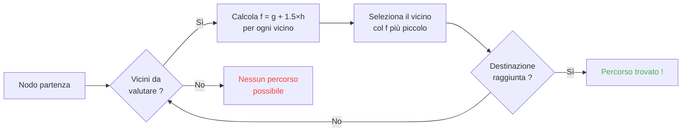

## Introduzione

Ho passato ore a guardare pecore sbattere contro muri.

E onestamente? Il miglior investimento della mia vita.

Perché più guardi questi mob, più realizzi che non hanno niente di casuale. Ogni movimento è codificato, prevedibile, e soprattutto completamente rompibile. Ho finito per tuffarmi nel codice sorgente di Minecraft per capire esattamente come il pathfinding funziona, e ciò che ho scoperto è che puoi letteralmente fare mind-control ai mob. Tipo, forzarli ad andare dove vuoi TU, non dove decide il caso.

Questa guida è tutto ciò che ho imparato scavando. L'IA, l'algoritmo A*, i malus nascosti, gli exploit che puoi lanciare in survival. Prepara il piccone.

---

## Come funziona l'IA dei mob (spoiler: è scema)

### I Goal

Ogni mob ha *goal*. È una lista di azioni che PUÒ fare e quanto ha VOGLIA di farle. Più il numero è piccolo, più è prioritario, come una todo list versione caos.

```java
// i goal sono prioritari: numero piccolo = più voglia
protected void registerGoals() {
   this.goalSelector.addGoal(4, new Zombie.ZombieAttackTurtleEggGoal(this, 1.0, 3));
   this.goalSelector.addGoal(8, new LookAtPlayerGoal(this, Player.class, 8.0F));
   this.goalSelector.addGoal(8, new RandomLookAroundGoal(this));
   this.addBehaviourGoals();
}
```

Hai mai visto uno zombie ignorare un uovo di tartaruga per darti la caccia? Ecco perché: `ZombieAttackTurtleEggGoal` ha priorità 4, mentre `ZombieAttackGoal` (il goal che gli dice di mangiarti la faccia) è a priorità 2.

Sì, uno zombie preferisce mangiarti invece di rompere un uovo. È bello l'amore.

Il goal che ci interessa davvero è `WaterAvoidingRandomStrollGoal`, priorità 7. Il "non ho niente da fare quindi cammino a caso" goal. È lì che tutto diventa interessante.

### Il movimento (o "come una marcia casuale ha 1 probabilità su 60 di prodursi")

Ogni tick (ogni 0.05 secondi), il gioco chiama `canUse()` per vedere se il mob si degna di muoversi. 1 probabilità su 60 a ogni tick. Completamente scemo come design, e lo adoro.

```java
// 1 probabilità su 60 per tick di volersi muovere
public boolean canUse() {
   if (this.mob.hasControllingPassenger()) {
      return false;
   } else {
      if (!this.forceTrigger) {
         if (this.checkNoActionTime && this.mob.getNoActionTime() >= 100) {
            return false;
         }
         if (this.mob.getRandom().nextInt(reducedTickDelay(this.interval)) != 0) {
            return false;
         }
      }
      Vec3 $$0 = this.getPosition();
      if ($$0 == null) {
         return false;
      } else {
         this.wantedX = $$0.x;
         this.wantedY = $$0.y;
         this.wantedZ = $$0.z;
         this.forceTrigger = false;
         return true;
      }
   }
}
```

Quindi per riassumere: se sei montato sul mob -> no, se il mob non ha fatto niente da 5 secondi -> no, se il random dice no -> no. Il gioco VUOLE davvero che il mob non si muova.

Ma quando si muove, `getPosition()` prende il seguito:

```java
// cerca una posizione casuale, più lontano se in acqua
protected Vec3 getPosition() {
   if (this.mob.isInWater()) {
      Vec3 $$0 = LandRandomPos.getPos(this.mob, 15, 7);
      return $$0 == null ? super.getPosition() : $$0;
   } else {
      return this.mob.getRandom().nextFloat() >= this.probability
         ? LandRandomPos.getPos(this.mob, 10, 7)
         : super.getPosition();
   }
}
```

Guarda questi due numeri alla fine: è il raggio XZ e il raggio Y. In acqua, il mob cerca più lontano (15 invece di 10). Se non trova terra, ripiega su `super.getPosition()` che accetta l'acqua. **Risultato: i mob VOGLIONO uscire dall'acqua.** Ecco perché i tuoi animali nuotano come matti verso il bordo.

Piccolo dettaglio croccante: c'è letteralmente lo 0.1% di probabilità che il mob prenda `super.getPosition()` invece di `LandRandomPos`. Uno su mille. È Mojang tipico.

### LandRandomPos: l'ottimizzazione marcia che cambia tutto

È la MIA fase preferita. La più bella stronzata tecnica che rende il pathfinding sfruttabile.

```java
// spinge verso l'alto le posizioni dentro blocchi solidi
public static Vec3 getPos(PathfinderMob $$0, int $$1, int $$2, ToDoubleFunction<BlockPos> $$3) {
   boolean $$4 = GoalUtils.mobRestricted($$0, $$1);
   return RandomPos.generateRandomPos(() -> {
      BlockPos $$4xx = RandomPos.generateRandomDirection($$0.getRandom(), $$1, $$2);
      BlockPos $$5 = generateRandomPosTowardDirection($$0, $$1, $$4, $$4xx);
      return $$5 == null ? null : movePosUpOutOfSolid($$0, $$5);
   }, $$3);
}
```

`movePosUpOutOfSolid`. Il nome dice tutto. Se la posizione scelta è in un blocco solido, il gioco la spinge verso l'alto finché è in aria.

È un'ottimizzazione: invece di perdere tempo a ignorare le posizioni sottoterra, il gioco le risale in superficie. Furbo? Sì. Ma crea un bias pazzesco: **i mob preferiscono le altezze**.

Immagina. Hai un sacco di blocchi sotto la superficie, il gioco genera 10 posizioni casuali. Quelle nei blocchi sono spinte verso l'alto. Le zone dense (sotto una collina) producono più posizioni valide delle zone vuote. Risultato: il mob andrà statisticamente più spesso verso la collina.

Fidati, lo rompiamo in 2 minuti.

### La selezione: il concorso del blocco migliore

10 posizioni, un solo vincitore, un concorso di punteggio:

```java
// la posizione col miglior punteggio VINCE
public static Vec3 generateRandomPos(Supplier<BlockPos> $$0, ToDoubleFunction<BlockPos> $$1) {
   double $$2 = Double.NEGATIVE_INFINITY;
   BlockPos $$3 = null;
   for(int $$4 = 0; $$4 < 10; ++$$4) {
      BlockPos $$5 = (BlockPos)$$0.get();
      if ($$5 != null) {
         double $$6 = $$1.applyAsDouble($$5);
         if ($$6 > $$2) {
            $$2 = $$6;
            $$3 = $$5;
         }
      }
   }
   return $$3 != null ? Vec3.atBottomCenterOf($$3) : null;
}
```

La posizione col miglior punteggio VINCE. E se conosciamo i criteri di punteggio, possiamo far vincere la posizione che vogliamo. È come truccare un'elezione.

---

## Le preferenze dei mob (o "perché la tua mucca attraversa la strada")

Ogni mob ha gusti diversi. E cambia tutto.

| Mob | Ama questo |
| --- | --- |
| **Animali** (mucche, pecore, maiali) | L'erba e la luce (hipster) |
| **Mostri** (zombie, scheletri) | Il buio (edgelord) |
| **Tartarughe** | L'acqua, altrimenti la sabbia, altrimenti la luce |
| **Hoglin** | `crimson_nylium`; odiano `warped_fungus` |
| **Strider** | Solo la lava. NIENTE altro. |
| **Silverfish** | I blocchi infestabili (logico) |
| **Guardian** | Acqua + luce (gli snob) |
| **Mooshroom** | Micelio + luce (funghi) |
| **Api** | L'aria. Sì, preferiscono L'ARIA. |

```java
// Animale: guarda sotto, se è erba, punteggio max
public float getWalkTargetValue(BlockPos $$0, LevelReader $$1) {
   return $$1.getBlockState($$0.below()).is(Blocks.GRASS_BLOCK) ? 10.0F : $$1.getPathfindingCostFromLightLevels($$0);
}

// Mostro: esattamente l'inverso
public float getWalkTargetValue(BlockPos $$0, LevelReader $$1) {
   return -$$1.getPathfindingCostFromLightLevels($$0);
}
```

Tipo i mostri sono letteralmente "se è illuminato, punteggio negativo, vado altrove". Fanno LA FACCIA alla luce.

Quindi puoi, letteralmente, guidare i tuoi animali con erba e luce, e i tuoi mostri col buio. È scemo e geniale insieme.

---

## L'algoritmo A* in Minecraft (la formula segreta)

Minecraft usa l'algoritmo A* (A-star) per il pathfinding. Ma Mojang ci ha messo la sua:

```
f(n) = g(n) + 1.5 × h(n)
```

- **g(n)** = il percorso già fatto (1 per blocco, circa 1.41 in diagonale)
- **h(n)** = la distanza in linea d'aria
- **1.5** = perché a Mojang piacciono i valori un po' sballati

Normalmente A* usa `f(n) = g(n) + h(n)`. MOJANG HA AGGIUNTO UN FATTORE 1.5. Perché? Perché l'algo vada più in fretta verso la destinazione e tagli meno rami di ricerca. Risultato: il percorso trovato è "buono" ma non sempre il migliore. È un A* un po' ubriaco.



Dettaglio importante: **un mob può fare pathfinding solo su 16 blocchi** (la sua *follow range*). Se la destinazione è troppo lontana, sceglie il blocco più vicino che PUÒ raggiungere. Vuol dire che puoi creare un monolite fuori portata, e il mob farà pathfinding verso il blocco più vicino che lo avvicina a questo monolite, il che rende i suoi movimenti completamente prevedibili.

### I due exploit che rompono il gioco

#### 1. I block update = ricalcolo forzato

```java
// un update vicino al percorso forza il ricalcolo A*
public boolean shouldRecomputePath(BlockPos $$0) {
   if (this.hasDelayedRecomputation) return false;
   if (this.path != null && !this.path.isDone() && this.path.getNodeCount() != 0) {
      Node $$1 = this.path.getEndNode();
      Vec3 $$2 = new Vec3(
         ((double)$$1.x + this.mob.getX()) / 2.0,
         ((double)$$1.y + this.mob.getY()) / 2.0,
         ((double)$$1.z + this.mob.getZ()) / 2.0
      );
      return $$0.closerToCenterThan($$2, (double)(this.path.getNodeCount() - this.path.getNextNodeIndex()));
   }
   return false;
}
```

Ogni aggiornamento di blocco vicino al percorso del mob forza un ricalcolo di A* con un cooldown di 1 secondo. Metti un orologio a 1 secondo accanto a un mob, e ricalcola il suo percorso DI CONTINUO. È l'equivalente di mettere un GPS che si resetta ogni secondo.

E se fai questo con 50 mob insieme? Lag city. RIP TPS.

#### 2. I malus di blocchi (Pathfinding Malice)

Certi blocchi fanno paura ai mob. Letteralmente. Ogni blocco ha un costo associato, definito da un'enumerazione:

| Blocco / Condizione | Malus |
| --- | --- |
| **Blocco di miele** | +8 da attraversare |
| **Neve farinosa** | Invalicabile |
| **Porte chiuse** | Invalicabile |
| **Fuoco** | +16 da attraversare, +8 da costeggiare |
| **Animali e Villici** | Fuoco = -1 (NO) |
| **Cactus / Bacche dolci** | Invalicabile; adiacente = +8 |
| **Acqua** | +8 da attraversare o costeggiare |
| **Magma** | +8 da costeggiare (ahi) |

Gli animali sono ancora più estremi:

```java
// gli animali vietano letteralmente il fuoco
protected Animal(EntityType<? extends Animal> $$0, Level $$1) {
   super($$0, $$1);
   this.setPathfindingMalus(PathType.DANGER_FIRE, 16.0F);
   this.setPathfindingMalus(PathType.DAMAGE_FIRE, -1.0F);
}
```

DAMAGE_FIRE a -1.0F, è letteralmente "vietato". Un animale preferisce buttarsi nel vuoto invece di attraversare fuoco. Uff.

### Esercizio: il gran concorso di percorsi

Immagina un villico che deve scegliere tra vari percorsi.

- **Percorso A**: 15 blocchi ma 6 blocchi costeggiano acqua (+8 ognuno)
- **Percorso B**: 18 blocchi con 2 blocchi di acqua (+8) e 1 blocco adiacente acqua (+8)
- **Percorso C**: 14 blocchi dritti... ma con fuoco -> IMPASSABILE per un villico
- **Percorso D**: 16 blocchi con 1 blocco adiacente magma (+8) + 1 blocco adiacente miele (+8)
- **Percorso E**: 25 blocchi ma cactus ovunque (+8 ovunque) -> 90.82 di costo totale

Calcolo mentale:

- Percorso A: 15 blocchi + 6×8 per l'acqua = 15 + 48 = **63** ... ma c'è l'1.5×distanza da aggiungere. Facciamo i veri calcoli.
- Percorso B: più lungo ma meno malus. Il costo totale = distanza cumulata + malus.
- Percorso D: magma e miele sommano i loro malus.

Il vincitore è spesso il **Percorso B**: la deviazione è redditizia perché l'acqua è CARA.

Un villico è essenzialmente un calcolatore di costi con le gambe.

### Ogni mob ha i suoi gusti

Un villico: "del fuoco? NO GRAZIE CIAO"
Uno zombie: "del fuoco? OK boomer *attraversa in fiamme*"

Hai letteralmente strade che certi mob prendono e altri no. Puoi fare autostrade per villici dove gli zombie si bruciano.

---

## I villici: il casino ultimo

Ok, i villici. È IL sistema meno capito di tutto Minecraft. Ma una volta beccato il codice, ti rendi conto che sono macchine prevedibili con orari di ufficio.

### Sensori e memorie

9 sensori, che girano ogni 20 tick (1 secondo). Ognuno scruta un raggio intorno al villico e salva il risultato in memoria. Il villico vede tutto, ricorda tutto, e agisce di conseguenza.

Tipo: "c'è un nemico? un item per terra? un giocatore con cui parlare?" Controlla TUTTO.

### I package (le sue fasi della giornata)

Il cervello di un villico sono package di attività che si attivano secondo l'ora:

| Package | Orario | Il villico... |
| --- | --- | --- |
| **Core** | H24 | Apre porte, nuota (80% del tempo), e ACQUISISCE POI |
| **Work** | 8h-15h | "Vado a lavorare": cammina verso il suo posto |
| **Meet** | 15h-17h | "Aperitivo!": va alla campana, chiacchiera |
| **Rest** | 18h-6h | "Devo dormire": va a letto |
| **Idle** | 6h-8h, 17h-18h | "Cazzeggio": gira, fa bebè, salta sui letti |
| **Panic** | Ferita/ostile | "AIUTO": FUGA |

Il package **Panic** è l'unico che può interrompere TUTTI gli altri. Anche se il villico sta dormendo o lavorando, se c'è uno zombie, PANICO GENERALE.

### Acquire POI: la cosa che permette la redstone senza fili

```java
// scansiona i POI in un raggio di 48 blocchi
Set<Pair<Holder<PoiType>, BlockPos>> $$12 = (Set)$$10xx.findAllClosestFirstWithType(
   $$0, $$11, $$8x.blockPosition(), 48, PoiManager.Occupancy.HAS_SPACE
)
```

`Acquire POI` scansiona in un raggio di 48 blocchi tutti i POI (punti di interesse). Tiene i 5 più vicini, verifica che esista un percorso, e acquisisce il primo accessibile.

Ogni POI ha un numero limitato di slot:
- **Posti di lavoro**: 1 slot
- **Letti**: 1 slot
- **Campane**: 32 slot

Il punto PAZZESCO: **lo slot è riservato al momento dell'acquisizione, NON all'arrivo**. Un villico può bloccare un composter dall'altra parte della mappa, senza mai raggiungerlo.

Cogli la potenza?

### Redstone senza fili. Sì, SENZA FILI.

1. Metti un villico in un minecart con un percorso verso un composter
2. Acquisisce il composter (slot preso, nessuno può più usarlo)
3. Il villico è troppo lontano per cliccarci sopra, la bone meal resta
4. PORTI A SPASSO questo villico ovunque nel mondo, tiene lo slot
5. Quando vuoi attivare il tuo aggeggio, UCCIDI il villico
6. Lo slot si libera, un altro villico acquisisce il composter, ritira la bone meal
7. BLOCK UPDATE -> qualsiasi circuito redstone attivato

Hai letteralmente creato un segnale redstone senza fili, trasmissibile in tutto il mondo, con zero chunk load necessario sul percorso. Puoi collegarci una ender pearl stasis chamber, farti teletrasportare da ovunque uccidendo un villico.

Il mio uso preferito? Un mini-gioco "bounty hunter": metti più villici con composter, il giocatore deve uccidere IL villico GIUSTO per attivare l'uscita. È completamente wtf come meccanica.

### Il Pathfinding Deadlock (o "il villico che freeza per sempre")

C'è un bug TROPPO buono tra `Acquire POI` (che vede un percorso) e la navigazione reale (che rifiuta di prenderlo). Succede quando il blocco sopra il posto di lavoro non è calpestabile. Risultato:

- Core package: "voglio acquisire il POI"
- Navigazione: "non posso camminare lì"
- Risultato: il villico resta CONGELATO, per sempre, a lottare con se stesso.

Letteralmente villici frozen sul posto, usabili come decorazione o come "props" nelle build. Un tank per armature stand? Sì. Una guardia che non si muove? Sì. Macabro? Forse. Ma efficace.

---

## Conclusione

Il pathfinding dei mob di Minecraft non è caso. È un sistema deterministico, basato su punteggi, prevedibile E rompibile.

**I tre punti da trattenere:**

1. **Blocchi sotto i piedi = bias di altezza**: riempi o svuota il sottosuolo per guidare i mob
2. **I malus sono diversi per ogni mob**: crea strade che alcuni prendono e altri no
3. **Gli slot POI sono riservati a distanza**: redstone senza fili gratis, teletrasporto, tutto questo

Il codice sorgente di Minecraft è una miniera d'oro di meccaniche sotto-sfruttate. Ho passato ore a leggere Java decompilato e francamente? Ogni riga è un Easter Egg funzionale. Solo che questi, li usi in survival per fare redstone senza fili coi villici. Gioco migliore confermato.
