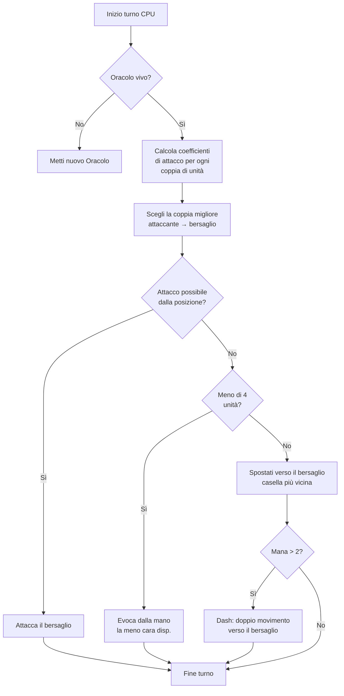

## La mia IA scema per Nausicaa

Ci sono progetti che iniziano con "e se facessi un gioco di scacchi con mitologie?" e finiscono con un sistema con un'IA che decide i suoi iper-parametri ogni 5 turni.

Nausicaa è questo. Un gioco da tavolo a turni dove costruisci il tuo deck di creature mitologiche, gestisci il tuo mana, schieri unità su un tavolo 10x8. E c'è un'IA che ha crisi di personalità.

Ho passato parecchio tempo su questa IA, e il risultato a volte mi sfugge ancora, ed è ciò che preferisco.

## Il gioco in vero

Prima di parlare del cervello, bisogna capire il corpo:

- Tavolo 10x8, zona di schieramento di 2 righe per giocatore
- Mana inizia a 1, +1 per turno, max 6. Spendi per evocare, attaccare, usare capacità
- Scopo: uccidere l'Oracolo avversario

12 unità, costi e pattern di movimento diversi:

| Unità | Costo | Movimento | PV |
| --- | --- | --- | --- |
| Oracolo | 0 | Re (8 direzioni) | 1 |
| Goblin | 1 | Avanti 3 caselle | 1 |
| Arpia | 1 | Re (8 direzioni) | 1 |
| Naiade | 1 | Diagonale | 1 |
| Grifone | 2 | Salto 2 caselle | 2 |
| Sirena | 2 | Laterale | 1 |
| Centauro | 2 | Cavaliere (a L) | 2 |
| Arciere | 3 | Laterale | 1 |
| Fenice | 3 | Diagonale (caselle scure) | 1 |
| Mutante | 4 | Scambio di posto | 1 |
| Veggente | 4 | Nessuno (genera mana) | 1 |
| Titano | 6 | Limitato (attacco a zona) | 3 |

Ogni unità ha il suo pattern di attacco. La Sirena colpisce nelle 4 diagonali, l'Arciere a distanza su 3 caselle, il Titano distrugge tutto intorno all'evocazione. Insomma, un gioco di scacchi con mitologia e deckbuilding.

## Come ho fatto ragionare la CPU

L'idea di base è scemamente semplice: **ogni unità nemica ha un coefficiente di attrattività**. Più è pericolosa, più l'IA vuole occuparsene.

```javascript
// attrattività per tipo di unità: Oracolo = win condition
const UNITS_ATTRACTIVENESS = {
    "oracle": 100,
    "titan": 95,
    "shapeshifter": 90,
    "phoenix": 80,
    "siren": 70,
    "archer": 70,
    "seer": 70,
    "griffin": 60,
    "centaur": 60,
    "harpy": 50,
    "naiad": 30,
    "gobelin": 20
};
```

Oracolo a 100: logico, è la win condition. Titano a 95 perché ammazza tutto accanto all'evocazione. Goblin a 20, è un fante, chi se ne frega.

Poi per ogni coppia di unità (una alleata, una nemica), calcolo:

```
interesse = attrattività × coeff_attratt / (distanza × coeff_dist)
```

In pratica: più sei pericoloso e vicino, più l'IA vuole spaccarti.

```javascript
// interesse = attrattività pesata / distanza
calculateAttackCoefficient(x1, y1, x2, y2) {
    const distance = this.calculateEuclideanDistance(x1, y1, x2, y2);
    if (distance === 0) return Infinity;
    return (UNITS_ATTRACTIVENESS[unit.type] * COEFFICIENTS_IMPORTANCE["attractiveness"]) / distance;
}
```

### Il colpo dei coefficienti che cambiano

Il punto importante, è che i coefficienti di importanza **cambiano casualmente ogni 5 turni**.

```javascript
// ogni 5 turni, la "personalità" IA cambia
if (this.turnCount % 5 === 0) {
    const distanceCoefficient = parseInt(Math.random() * 100);
    const attractivenessCoefficient = parseInt(Math.random() * 100);
    this.regulateImportanceCoefficients({
        distance: distanceCoefficient,
        attractiveness: attractivenessCoefficient
    });
}
```

Una volta l'IA va iper aggressiva (attratt a 95, distanza a 5), attraversa tutto per uccidere il tuo Oracolo. La volta dopo priorizza la distanza e si riposiziona.

È rubato ai fantasmi di Pac-Man: Blinky caccia, Pinky tende agguati. Qui l'IA cambia "personalità" ogni fase.

**Risultato: impossibile prevedere l'IA su una partita intera.** La CPU non fa mai due volte lo stesso match.

### L'Oracolo è un fifone

L'Oracolo nemico scappa. Letteralmente.

```javascript
// l'Oracolo fugge nella direzione opposta alla minaccia
const awayFromTarget = {
    row: Math.max(0, Math.min(7, botUnitElement.row + (botUnitElement.row - targetUnitElement.row))),
    col: Math.max(0, Math.min(9, botUnitElement.col + (botUnitElement.col - targetUnitElement.col)))
};
```

Calcola la direzione opposta alla minaccia e scappa. Se c'è un muro, cerca la casella libera più vicina in quella direzione.

Passi 3 turni ad avvicinarti all'Oracolo, e paf si è già rifugiato dall'altra parte.

### Il ciclo di decisione

Ecco come l'IA decide:

1. Se non ho più Oracolo (morto), piazzarne uno nuovo
2. Calcolare il coefficiente per ogni coppia unità alleata → unità nemica
3. Scegliere la coppia migliore
4. Se l'unità può attaccare il bersaglio dalla sua posizione → attacca
5. Se ho meno di 4 unità → evocare la meno cara disponibile dalla mano
6. Altrimenti, spostarsi verso il bersaglio (casella di movimento più vicina al nemico)
7. Se abbastanza mana (> 2), dash (doppio movimento) per avvicinarsi ancora
8. Se l'unità è l'Oracolo → fuggi



```javascript
// la CPU fa dash se ha abbastanza mana
async makeAction(dash=false) {
    // tutto questo in sequenza
    // la CPU fa dash se ha abbastanza mana
    if(botPlayer.mana > 2) {
        this.makeAction(true);
    }
}
```

### Perché la distanza euclidea

Uso la distanza euclidea:

```javascript
// distanza in linea d'aria pesata
calculateEuclideanDistance(x1, y1, x2, y2) {
    const deltaX = Math.pow(x1 - x2, 2);
    const deltaY = Math.pow(y1 - y2, 2);
    return Math.sqrt(deltaX + deltaY) * COEFFICIENTS_IMPORTANCE["distance"];
}
```

Perché non Manhattan? Perché le unità hanno pattern di movimento vari (L come il cavaliere, diagonale, ecc). La distanza in linea d'aria è un'approssimazione migliore del pericolo.

## Perché non minimax

Avrei potuto programmare un minimax classico. Ma con 12 tipi di unità, pattern di movimento diversi, capacità speciali... l'albero di gioco esplode così in fretta da diventare ingiocabile. L'approccio euristico fa scelte intelligenti senza esplorare 10 milioni di stati.

## Cosa è figo

Il sistema di attrattività crea dilemmi divertenti:

- Il Veggente (70) genera mana. Se lo lasci vivere, l'avversario ha più risorse. Ma il Titano (95) è ancora più pericoloso.
- Il Mutante (90) può scambiare il suo posto con qualsiasi unità. Può rubarti l'Oracolo.
- L'Arpia (50) ha un attacco esplosivo che uccide anche lei. Resta secondaria... finché si ritrova accanto a 3 tue unità.

L'IA valuta il pericolo globale secondo le posizioni, non solo le stat grezze.

C'è anche una funzione `activateSimulation()` per testare scenari senza rifare una partita:

```javascript
// piazza unità specifiche per debuggare l'IA
activateSimulation() {
    // Piazza unità specifiche sul tavolo
    // Utile per debuggare l'IA
    this.game.board = simulation.board;
    this.game.players = simulation.players;
}
```

## Cosa manca

Se avessi più tempo:

- L'IA reagisce allo stato attuale, non prevede cosa farà il giocatore
- Non pianifica la sua mano su più turni
- Il Mutante e il Centauro hanno capacità che sotto-sfrutta
- Apprendimento per rinforzo: farla giocare contro se stessa per regolare i coeff

Ma per un gioco da browser tiene botta. Amici riescono a perderci contro, quindi è validato.

## Prova

Disponibile su [nausicaa-game.github.io](https://nausicaa-game.github.io/). Clicchi su "GIOCA", modalità CPU ON, e guardi l'IA fare.

Consiglio: lascia l'IA giocare contro se stessa. Vedrai fasi aggressive, poi pfft indietreggia tutto.

Il codice è su [GitHub](https://github.com/nausicaa-game/nausicaa-game.github.io) in `js/cpu.js`.

**3 punti da trattenere:**

1. **Coefficienti euristici**: niente minimax, ogni unità ha un'attrattività
2. **Coeff che cambiano ogni 5 turni**: l'IA alterna aggressività e controllo, stile Pac-Man
3. **L'Oracolo scappa**: calcola la direzione opposta alla minaccia e scappa

Se hai idee per rendere l'IA ancora più perfida, apri una issue. Ho piani per una versione che impara dalle sue sconfitte, ma sarà per un prossimo articolo.
