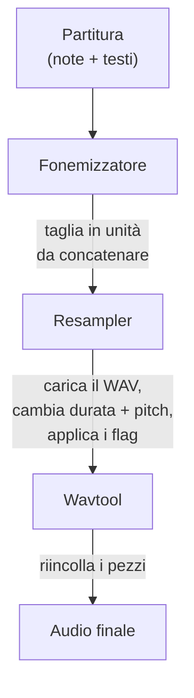

## UTAU: come un software in Visual Basic 6 ha democratizzato la voce sintetica

Ne avevo accennato sulla mia pagina principale: amo UTAU. Ecco perché.

Nel 2008, se volevi far cantare una voce sintetica, avevi un'opzione: VOCALOID. Il software di Yamaha. Caro, proprietario, con voci ufficiali che non potevi creare da solo.

E poi c'è un tizio giapponese, Ameya/Ayame, che ha pubblicato un programma per conto suo. Un software programmato in **Visual Basic 6**. Gratis. Che ti lasciava creare la tua voce con... file WAV che registravi tu stesso.

Questo software si chiama **UTAU** (歌う, "cantare" in giapponese). E per la sua epoca, era magia.

L'ho sempre trovato affascinante per la sua idea di partenza più che per la sua pulizia tecnica (il principio di codifica resta davvero astuto, anche se l'implementazione fa sanguinare gli occhi): ha aperto la sintesi vocale al grande pubblico. Tu, io, chiunque con un microfono.

Lascia che ti spieghi perché era geniale.

---

## Prima, perché la sintesi di canto è rognosa

Una voce cantata, non sono note. Hai la consonante che attacca, la vocale che tiene, il respiro, le transizioni tra i due. Il "sa" di "salut" è una "s" che fischia che scivola verso una "a" aperta, ed è questo scivolamento che suona umano o no.

Oggi lo risolviamo col deep learning: alleni un modello su ore di canto e genera la voce (Synthesizer V, DiffSinger). Ma questo è 2020+. Nel 2008, niente.

UTAU usa il metodo di prima, più vecchio e più furbo: la **sintesi concatenativa**.

---

## La sintesi concatenativa: copia-incolla di pezzi di voce

L'idea è scema come una torta: registri piccoli pezzi di voce e li incolli insieme per formare parole. "salut" = campione "sa" + "lu" + "to", concatenati. Un puzzle sonoro pilotato da una partitura.

È il principio degli YouTube Poop dove ritagliano le parole di un personaggio per fargli dire qualsiasi cosa: solo che qui è quadrato e automatizzato.

E UTAU viene letteralmente da lì. Prima di lui esisteva il **"Jinriki Vocaloid"** (人力ボーカロイド, "Vocaloid manuale"): la gente tagliava a mano tracce vocali, estraeva i fonemi, ripitchava, e riassemblava tutto in un editor audio per imitare una voce VOCALOID. A mano. Immagina il lavoro.

Ameya ha guardato questa fatica e ha programmato lo strumento per automatizzarla. All'inizio UTAU era solo questo: un assistente per Vocaloid manuale.

---

## Perché era rivoluzionario: TU crei la voce

Ecco ciò che cambia tutto.

VOCALOID, compravi una voce. Miku, Luka, ecc. Create da pro, vendute da Yamaha. La creazione restava riservata a Yamaha. Con UTAU, **chiunque registra la sua voce e ne fa uno strumento che canta**.

La modalità CV (la più semplice) è: registri le circa 100 sillabe di base del giapponese ("a", "ka", "sa", "ta"...), configuri i punti di taglio, ed ecco la tua voicebank. Qualche ora di lavoro.

Risultato: l'ecosistema è esploso. Migliaia di voicebank create dalla community: voci di fan, di amici, di personaggi inventati. Un intero universo di cantanti virtuali, gratis. E il software veniva con **Defoko** (Utane Uta), una voce di default generata via il motore TTS AquesTalk, quindi potevi iniziare anche senza microfono.

---

## L'oto.ini: il cuore del sistema

Come fa UTAU a sapere dove tagliare e incollare i suoni? Via un file di config per voicebank: l'**`oto.ini`**. Per ogni WAV, definisce i punti di taglio (in millisecondi):

- **Offset** → silenzio da togliere all'inizio
- **Preutterance** → il punto dove la consonante passa alla vocale (la frontiera "s"→"a" in "sa")
- **Overlap** → quanto la nota precedente sborda su questa
- **Fixed region** → la parte che NON deve essere stirata su una nota lunga (tipicamente la consonante)
- **Cutoff** → dove tagliare la fine

La **preutterance** è il parametro più furbo. Una sillaba ha sempre un pezzo di consonante prima della vocale. Perché la tua nota cada sul tempo, è la *vocale* che deve cadere precisa, non la consonante. Quindi UTAU sposta indietro il campione: la "a" di "sa" atterra sul tempo, la "s" sborda appena prima. Come un batterista che anticipa il colpo perché il suono cada giusto: solo che qui è in un `.ini`.

Visivamente, su un campione "ka", le zone dell'`oto.ini` si tagliano così:

```mermaid
flowchart LR
    A["silenzio<br/>(offset)"] --> B["consonante<br/>(fixed region,<br/>non stirata)"]
    B --> C["vocale<br/>(zona stirabile)"]
    C --> D["fine tagliata<br/>(cutoff)"]
    style B fill:#3b4a6b
    style C fill:#5b3b6b
```



La frontiera tra consonante e vocale, è la preutterance. La vocale è la zona che stiriamo per le note lunghe; la consonante resta intatta, altrimenti la tua "k" durerebbe due secondi e suonerebbe orribile.

```ini
# oto.ini (semplificato)
# file=alias,offset,consonante,cutoff,preutterance,overlap
_ka.wav=ka,120,80,-200,90,40
```

Cinque valori per suono, su tutti i tuoi campioni, e UTAU assembla qualsiasi parola pulitamente.

---

## CV, VCV, CVVC: la corsa al realismo

La modalità di base, **CV** (Consonante-Vocale), è un suono per sillaba. Semplice ma un po' robotica: le giunzioni tra sillabe sono grezze.

Nel 2010 la community inventa il **VCV** (Vocale-Consonante-Vocale). Invece di registrare "ka" da solo, registri "a ka": con la coda della vocale precedente. La transizione diventa naturale perché è *nella* registrazione, non calcolata dopo.

Il dettaglio che punge: **VOCALOID non ha avuto il VCV prima di VOCALOID3, nel 2011.** Il freeware in VB6 programmato da un tizio da solo ha preceduto Yamaha di un anno sul realismo delle transizioni. Una community di fan più rapida della multinazionale.

Poi sono arrivati **CVVC**, **ARPAsing** (inglese), **VCCV**... ogni metodo spingeva il realismo più oltre, tutti inventati e documentati dalla community.

---

## La pipeline completa: come una parola diventa suono

Quando piazzi una nota e digiti un testo, ecco cosa succede dietro le quinte:



Il **resampler** è il pezzo forte: prende il tuo campione "ka" registrato a una certa altezza e lo ristira/ripitcha per matchare la nota voluta: stirando solo la zona stirabile e tenendo intatta la consonante (da cui l'`oto.ini`).

Ed è **modulare**. UTAU veniva con un resampler di base, ma la community ne ha sfornati altri (moresampler, TIPS...), ognuno col suo grano sonoro. Cambiavi motore di sintesi come un plugin. Nel 2008. Su un freeware.

---

## Il cantiere sotto il cofano (e perché è adorabile)

Devo essere onesto sullo stato tecnico del software:

- **Programmato in Visual Basic 6.** Un linguaggio già morto nel 2008. Serve il runtime VB6 per farlo girare.
- **Windows only alla base** (il porting Mac, UTAU-Synth, è arrivato nel 2011).
- **Codifica Shift-JIS obbligatoria.** Se i tuoi file non sono codificati in Shift-JIS giapponese, UTAU non capisce niente. Ancora oggi spesso bisogna mettere il PC in locale giapponese o usare AppLocale per lanciarlo.
- **Interfaccia austera**, documentazione quasi 100% in giapponese all'epoca.

Eppure. Eppure questo software ha creato un movimento mondiale. Decine di migliaia di voicebank. Canzoni ascoltate milioni di volte.

L'esempio migliore: **Kasane Teto**. Un personaggio creato nel 2008 e lanciato come scherzo del 1° aprile, spacciato per una VOCALOID. Era uno scherzo. Solo che la gente ha adorato il personaggio, una vera voicebank UTAU è stata creata dietro, e Teto è diventata una delle cantanti virtuali più famose al mondo. Nel 2023 ha persino avuto diritto a una voce Synthesizer V ufficiale. Un personaggio nato da un pesce d'aprile su un software gratis.

---

## Perché conta ancora

UTAU è l'esempio perfetto di una tech "povera" che vince con l'apertura.

VOCALOID era tecnicamente superiore, meglio finanziato, più pro. Ma chiuso. UTAU era raffazzonato, brutto, in VB6: ma lasciava partecipare tutti. Creare voci, creare resampler, creare plugin, creare metodi di registrazione. La community ha fatto il resto.

E il concetto sopravvive completamente oggi. **OpenUtau**, un successore open-source moderno, riprende l'idea e la rinfresca (multi-piattaforma, UTF-8, supporto dei resampler moderni E dell'IA). La sintesi concatenativa tiene ancora botta accanto ai modelli deep learning, perché ha un vantaggio che loro non hanno: capisci esattamente cosa succede, e controlli ogni millisecondo.

È ciò che mi è sempre piaciuto in UTAU. Vedi esattamente cosa succede. Non è un'IA che ti sputa un risultato magico che non capisci: hai i tuoi WAV, i tuoi punti di taglio, e sei tu che decidi tutto. Quando suona male, sai perché e puoi correggere. Amo questo tipo di controllo.

---

**I 3 punti da trattenere:**

1. **Sintesi concatenativa = puzzle di voce**: UTAU incolla piccoli campioni WAV insieme per formare parole. L'`oto.ini` definisce dove tagliare e incollare ogni suono. Controlli tutto, al millisecondo, senza scatola nera.

2. **L'apertura batte la tecnica**: VOCALOID era migliore ma chiuso. UTAU era raffazzonato ma lasciava tutti creare le proprie voci. La community ha fatto esplodere l'ecosistema, e ha persino preceduto Yamaha sul VCV.

3. **Una buona idea sopravvive al suo codice**: VB6, Shift-JIS, solo Windows... eppure il concetto gira ancora via OpenUtau. Una tech geniale può essere programmata coi piedi.

Onestamente, solo per Kasane Teto nata da un pesce d'aprile, questo software merita rispetto.
