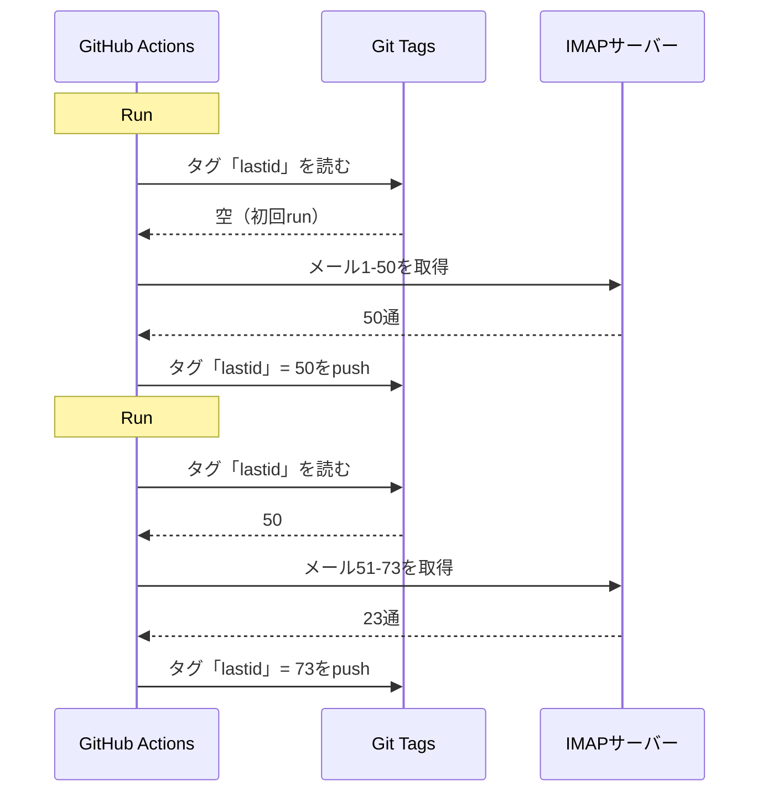

# gitをデータベースにして無料ボットをGitHub Actionsで回した

自動返信メールボットが24時間365日動いてる。

メールを読んで、内容を理解して、自分でAI返信する。前の会話を覚えてる。ニュースレターや`noreply@`は無視する。やばいのは人間に回す。

月額コスト：**0円**だ。

サーバーもVPSもデータベースも使わない。GitHub Actionsだけと、やばいハック1つだ。**gitをデータベースとして使う**ことだ。

どういうことか分かる？分からないよね。いいからついてきて。馬鹿げてるけど天才的だよ。

---

## 問題：GitHub Actionsはステートレスだ

GitHub Actionsは無料だ。5分ごとにcronを走らせてコード回してタダだ。

でも問題がある。**ステートレス**なんだ。

各runはまっさらなマシンで始まる。前回までに保存されたものは何もない。前のrun？忘れた。消えた。存在しなかったみたいにね。

メール返信ボットには巨大な問題だ。たとえばこうだ。

> 「最後に処理したメールはどれだっけ？」

ボットがrunごとに忘れたら、同じメールにループ返信（大惨事）か、メールを取りこぼすかだ。

永続状態が要る。普通、永続状態イコールデータベースだ。でもデータベースはサーバーで、サーバーは無料じゃない。

ここから面白くなる。

---

## 解法：gitタグをデータベースにする

GitHubリポジトリはもう永続ストレージだ。無料で、バージョン付きで、いつでもある。

なら状態をそこに保存すればいいじゃないか。

考え方はこうだ。各runでボットは処理済み最終UIDを**gitタグ**から読む。新着メールを処理する。新しいUIDでタグをpushし直す。



gitタグがデータベースだ。値は1つだけ。でも必要なのはそれだけだ。

### 状態を読む

ジョブ頭でタグから値を取る。

```bash
git fetch origin --tags lastid || true
git show refs/tags/lastid:data/lastId > data/lastId || true
```

`git show refs/tags/lastid:data/lastId`の意味はこうだ。「タグ`lastid`時点のファイル`data/lastId`の内容を出せ」だ。

はい値ゲット。データベースなしでね。

### 状態を書く

最後に新しい値でタグを作り直す。

```bash
git switch --orphan lastid-tmp   # 履歴なしの真っさらブランチ
git rm -rf .                      # 全部空にする
mkdir -p data
printf "%s\n" "${LAST_ID_CONTENT}" > data/lastId

git add data/lastId
git commit -m "lastId snapshot"
git tag -f lastid                 # タグをこのコミットに強制
git push --force ...origin lastid # タグをpush
```

履歴なしの**orphan**ブランチを作って、`lastId`ファイルだけ置いて、コミットして、タグ付けて、強制pushする。

orphanなのはなぜか。リポジトリ履歴に状態コミット1万個を溜めないためだ。各更新が前を上書きする。タグは値1つだけのコミット1つだけを常に指す。

きれいだ。無料だ。完全にどうかしてるけど動く。

---

## 2つ目のハック：runtimeスナップショット

GitHub Actionsには別の問題もある。`npm install`だ。

各run（5分ごと）で`npm install`と`npm run build`をやったら毎回60秒から90秒無駄にする。頻繁なcronではただの計算浪費だ。

解法：コードを1回だけプリコンパイルして、gitタグにも保存する。

ビルド用ワークフロー（`master`にpushしたら回る）はこうする。

```bash
# コードをコンパイル
bun install
bun run build

# dist/とnode_modules/を「runtime」タグに保存
git checkout --orphan temp-runtime
git rm -rf .
cp -r "$TMPDIR"/* .
git add dist node_modules package.json bun.lock data
git commit -m "runtime build"
git tag -f runtime
git push --force ...origin runtime
```

`runtime`タグにはコンパイル済みコードと`node_modules`が入る。回せる状態で全部だ。

cron側はこのタグを直接チェックアウトする。

```yaml
- name: Checkout runtime snapshot
  uses: actions/checkout@v4
  with:
    ref: refs/tags/runtime    # ソースじゃなくプリビルドコード
    fetch-depth: 1

# npm installなし、buildなし！
- name: Process emails
  run: node dist/index.js --action
```

cronは即起動して`node dist/index.js`を実行するだけだ。installもbuildもなし。

つまりタグ2つで仕事2つだ。
- `runtime`は回せるコード（コードpush時に更新）
- `lastid`は永続状態（各runで更新）

汚いくらい優雅だ。

---

## ボット本体：AI自動返信

gitハックはかっこいいけど、ボット自体は何するのか。

IMAPでメールを読んで、AI（GroqとLlama 3.3 70B）で理解して、自動返信する。

きれいなサービス構成と依存性注入（InversifyJS）のアーキテクチャだ。

```
App
├── ImapService      → メールを読む（IMAP）
├── SmtpService      → 返信を送る（SMTP）
├── ParserService    → メール内容をパースする
├── ReplyService     → AI返信を作る
├── SummaryService   → 会話メモリ
├── AccountsService  → 複数メールアカウント管理
└── ConfigService    → 設定やenv vars
```

### 2つの動作モード

ボットは2通りに回せる。

**リスナーモード**（リアルタイム）：指数バックオフ付き常時IMAP接続だ。VPS向け。

```typescript
this.imapService.on("exists", async (data) => {
  console.log(`[MAIL] Nouveau mail ! Total: ${data.count}`);
  // 新着メールを即処理
});
```

**アクションモード**（バッチ）：`lastId`以降の新着メールを処理したら閉じる。GitHub Actionsのcron向けだ。

```bash
node dist/index.js --action
```

`--action`モードがgitハックを使うやつだ。`lastId`を読んで、新しい分を処理して、新しい`lastId`を書いて終わりだ。

### ロボットには返信しない

ボットが全メールに返信したら、ニュースレターや通知や`noreply@`にも返信する。大惨事だ。もっと悪いのは、2つのボットが互いに返信したらメールの無限ループになる。悪夢だ。

だから積極フィルタだ。

```typescript
export function isAutomatedSender(address) {
  const automatedPatterns = [
    "noreply", "no-reply", "donotreply",
    "mailer-daemon", "postmaster", "bounce",
    "newsletter", "notification", "marketing",
    "billing", "receipt", "promo", ...
  ];
  const local = address.split("@")[0].toLowerCase();
  return automatedPatterns.some(p => local.includes(p));
}
```

メールヘッダーでの検出もある。

```typescript
export function isAutomatedByHeaders(headers) {
  return (
    ["bulk", "list", "junk"].includes(headers.precedence) ||
    headers["auto-submitted"] !== "no" ||
    headers["list-unsubscribe"] !== "" ||   // ニュースレターはこれがある
    /mailchimp|sendgrid|mailgun|brevo/i.test(headers["x-mailer"])
  );
}
```

ヘッダーに`List-Unsubscribe`？ニュースレターだ。`Precedence: bulk`？大量配信だ。`X-Mailer: Mailchimp`？分かるよね。無視する。

ナイトクラブの用心棒みたいなものだ。ロボットは通さない。

### 魔法のトリガー

AIはまったく返信しないことも、人間に回すこともできる。どうやって？返答内の特殊トリガーでだ。

システムプロンプトがこう言う。

> 自動メールやニュースレターなら`<no_reply>`と返せ
> 重要すぎたり繊細すぎたり（法務、金融など）なら`<manual_reply_required>`と返せ
> そうじゃなければ本物の返事を書け

コードはこう読む。

```typescript
const aiReply = completion.choices[0].message.content.trim();
const manualTrigger = aiReply.includes(MANUAL_REPLY_TRIGGER);
const noReply = aiReply.includes(NO_REPLY_TRIGGER);

if (noReply) {
  console.log("[MAIL] L'IA a décidé d'ignorer. Skip.");
  return;
}

if (manualTrigger) {
  console.log("[MAIL] Trop chaud, je forward à un humain.");
  await this.smtpService.sendManualForward(...);
  return;
}

// そうじゃなければAI返信を送る
await this.smtpService.sendReply(...);
```

つまりAIには「いやここは触らない、本物の人間呼んで」と言う権利がある。賢い。

---

## 会話メモリ

全部変える細かい点だ。ボットは会話を**覚えてる**んだ。

誰かに返信したらやり取りの要約を保存する。次にその人が書いたら、要約がプロンプトに再注入される。

保存は連絡先ごとのJSONファイルだ。

```
data/customers/
├── moi%40gmail.com/
│   ├── alice%40example.com.json
│   └── bob%40client.fr.json
```

要約自体もAIが作る。古い要約と新メッセージをマージする。

```typescript
const completion = await groq.chat.completions.create({
  model: "llama-3.3-70b-versatile",
  messages: [
    { role: "system", content: "Tu es un assistant de mémoire. Merge l'ancien résumé avec le nouveau message sans perdre d'info." },
    { role: "user", content: `Résumé existant:\n${existing}\n\nNouveau message:\n${incomingContent}` }
  ],
  temperature: 0.0,  // 決定的、創造性なし
  max_tokens: 800,
});
```

つまりボットは時間とともに圧縮メモリを作る。賢く育つ要約1つで十分で、全メール保存はいらない。

そのJSONファイルはね。もちろんgitにも保存される。runtimeタグにね。gitだらけだ。

---

## プロンプト長のうまい点

ニヤッとした細かい技術点だ。

モデルにはトークン上限がある。メールと要約とpersonaプロンプトが超えたらAPIはエラーを返す。

コードは**カスケード切り詰め**とリトライでさばく。

```typescript
try {
  // 通常上限で初回試行
  completion = await groq.chat.completions.create({...});
} catch (error) {
  if (!this.isLengthError(error)) throw error;

  // 長さエラーだった：短め上限で再試行
  ({ systemContent, userContent } = this.buildPromptPayload({
    ...,
    limits: {
      systemPromptChars: 2200,  // 通常3000のところ
      summaryChars: 1800,       // 通常4000のところ
      personaChars: 900,        // 通常1500のところ
      userContentChars: 2200,   // 通常8000のところ
    },
  }));
  completion = await groq.chat.completions.create({...});  // リトライ
}
```

ダメなら短く切って再試行する。単純で、効いて、クラッシュしない。

---

## で、具体的にどう回ってるの

cronの1runの完全フローだ。

```
1. GitHub Actionsが起動（5分ごとcron）
2. 「runtime」タグをチェックアウト（プリビルドコード）
3. git show refs/tags/lastidで処理済み最終UIDを取る
4. node dist/index.js --action
   ├── IMAP接続
   ├── lastId+1以降のメールを取得
   ├── 各メールに：
   │   ├── 内容をパース
   │   ├── ロボットをフィルタ（自動ならスキップ）
   │   ├── 宛先アカウントを照合
   │   ├── 会話メモリを取る
   │   ├── AI返信を作る（Groq）
   │   ├── <no_reply>？スキップ
   │   ├── <manual_reply_required>？人間に回す
   │   ├── そうじゃなければ返信を送る（SMTP）
   │   └── 会話メモリを更新
   └── 新しいlastIdを書く
5. git push --forceで新しい値の「lastid」タグ
```

5分後に繰り返す。永遠に。無料でね。

---

**覚えるべき3点：**

1. **gitは無料データベースだ**。orphanタグ1つでステートレスrun間の永続状態を持てる。読むときは`git show refs/tags/X:ファイル`、書くときは強制pushだ。DB1つ分まるっと節約できる。

2. **runtimeタグにプリコンパイルする**。cronの各runで`npm install`する代わり、コンパイル済みコードとnode_modulesをgitタグに保存する。cronは即起動する。

3. **AIボットは黙ることを知るべきだ**。`<no_reply>`と`<manual_reply_required>`のトリガーでAIに返信しない判断や引継ぎ判断をさせる。ロボット対策フィルタと合わせてね。じゃないとメールループができる。

状態付きサーバーレスcronにAIとメモリ付きで、月0円だ。完全にどうかしてるけどこの構成大好きだ。
