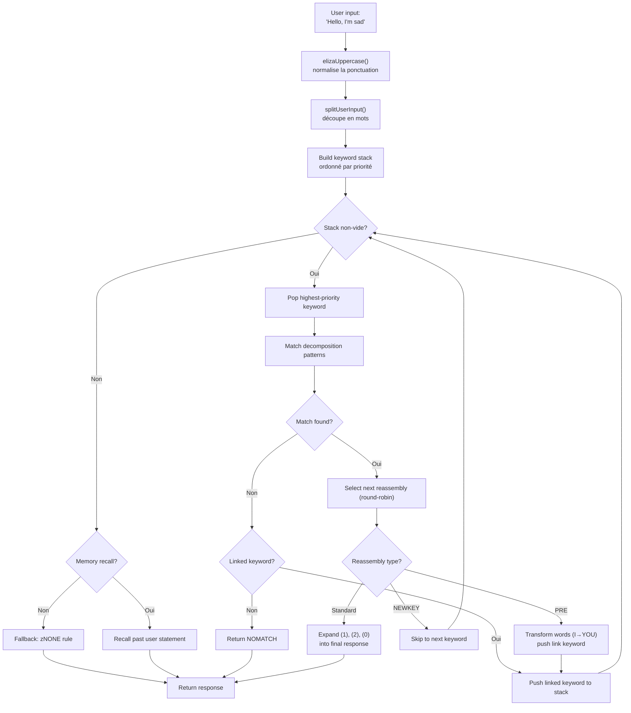
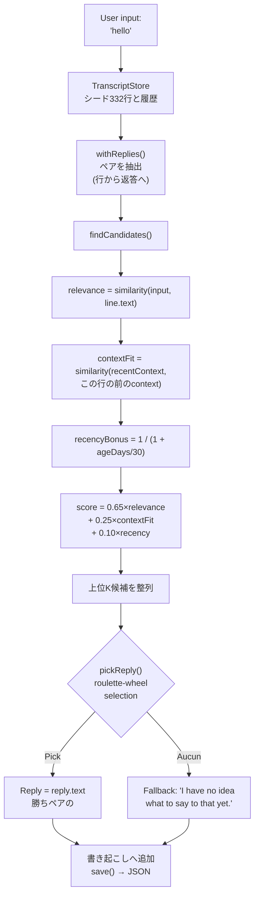

# ELIZAからLLMへ：TypeScriptで再構築する60年の会話AI

1966年、Joseph WeizenbaumはIBM 7094上のMAD-SLIPで420行書いて史上初のチャットボットを作った。プログラム名は**ELIZA**。基本パターンと文の置換でロジャーズ派心理療法士を真似た。60年後、会話AIは一般の話題になった。ChatGPTもClaudeもGeminiもあらゆる会話に出てくる。オリジナルコードを読み返して、その手段の少なさに打たれた。

でも両極端の間には**PARRY**（パラノイアチャットボット、1972年）、**ALICE**（99,000カテゴリのAIML王、1995年）、**Jabberwacky**（ルールなしで学んだ最初、1997年）、**Cleverbot**（その産業的後継、2008年）がいた。同じ問題へのまったく違う5つの答えだと思う。機械に話させることだ。

この5ボットをオリジナルデータ付きでTypeScript移植した。ELIZAスクリプト、PARRY辞書、ALICEのAIMLファイルだ。各移植は自立してて、すぐ使えて、細部まで文書化してある。この作業の狙いは動かすだけを超える。どう動いてたか、なぜ歴史に残ったか、それぞれのアーキテクチャが昨日と今日のAIについて何を明かすか理解したいんだ。

```bash
bun run eliza    # ELIZAと話す（1966年）
bun run parry    # PARRYと話す（1972年）
bun run alice    # ALICEと話す（1995年）
bun run jabber   # Jabberwackyと話す
bun run cleverbot # Cleverbotと話す
bun run meeting  # ELIZA対PARRY自動対戦
```

各ボットを一緒に解剖して、コードを見て、**Luna Protocol**記事越しに現代LLMへ橋をかけるよ。

---

## ELIZA（1966年）：理解してると信じさせる技

最古のものから始める。私の目には単純さがいちばん印象的だ。ELIZAに現代意味の**知能はない**。テキストパターンとちょっとした置換だけで動く。

### 仕組み

DOCTORスクリプト（心理療法士版）は**キーワード**のテーブルで動く。各々に**分解パターン**と**再組立ルール**が付く。典型ルールはこうだ。

```lisp
(HELLO
    ((0)
        (HOW DO YOU DO.  PLEASE STATE YOUR PROBLEM)))
```

`HELLO`がキーワードだ。`0`は「後ろ全部取り込め」って分解パターン（ワイルドカードみたいなもの）。`HOW DO YOU DO. PLEASE STATE YOUR PROBLEM.`が再組立ルールだ。以上だ。

「Hello, I'm sad today」って言うとELIZAはこうする。
1. テキストを大文字化する：`HELLO I'M SAD TODAY`
2. 各語をキーワードテーブルと照合する
3. `HELLO`を見つける → キーワードスタックに積む
4. 最優先キーワードを取る
5. 各分解パターンを順に試す
6. 合えば次の再組立ルールを選ぶ（ラウンドロビン）
7. `(1)`や`(2)`などを取り込み部分に置換する

でも本当に賢いのは**PREルール**の部分だ。これ見て。

```lisp
(MY
    ((0)
        (PRE (1 0) (=YOU))))
```

ELIZAが`MY`に合うと、文の残り（`0`の取り込み）をPREルール経由で変換して、結果をユーザーが新しいキーワードを言ったみたいに再注入する。具体的にはこうだ。

```
君が言う：「My mother hates me」
  → PRE変換：「YOUR MOTHER HATES YOU」
  → 言ったものとして再注入
  → たぶん「YOU」に合う → 新しい返事
```

ELIZAが「私」と「君」の違いを分かってる感じがするのはこのためだ。理解を真似る完璧設計の機械変換だと思う。

入力から返事までの完全フローはこうだ。



### 信用させたもの

Weizenbaumの選択は天才の一手だと思う。**ロジャーズ派心理療法**だ。この手法は解釈せず患者の言葉を映す。「悲しい」→「悲しいとおっしゃるんですね」。ELIZAができるのはまさにこれで、この療法技術は認知されてるから誰も返事を変に思わない。ボットを試すとこの鏡効果を直接感じる。

### TypeScript移植では

私の移植では`.ela`スクリプト（オリジナルのS式形式）を読み込んで、完全にパースして（60年代文字列形式のHollerithエンコーディング込み）、同じ周期を実行する。大文字化から分割からキーワードスタックから分解から再組立からPREや変換までだ。細部までオリジナル挙動に忠実でありたかった。

[➡ ソースコードを見る](https://github.com/fox3000foxy/chatbots/tree/main/eliza)

---

## PARRY（1972年）：感情を持つ初のチャットボット

ELIZAの6年後、Kenneth Colby（スタンフォードの精神科医）はPARRYを作った。**パラノイア型統合失調症**患者を真似るチャットボットだ。ELIZAが空の鏡として動いたのに対し、PARRYは本物の**内部感情モデル**を積んでる。続けて移植してていちばん打たれた対比がこれだ。

### 感情モデル

PARRYは会話ターンごとに動く4つの連続変数を持つ。

| 変数 | ベースライン | 減衰/ターン | 説明 |
|----------|:---:|:---:|------|
| `ANGER` | 0 | −1.0 | 敵意、いらだち |
| `FEAR` | 0 | −0.2 | パラノイア（妄想開始後にゆっくり減る） |
| `MISTRUST` | 0 | −0.05 | 不信（戻りがとても遅い） |
| `HURT` | 0 | −0.5 | 感情の痛み |

この値は推論ルールが起こす**感情ジャンプ**（`ajump`、`fjump`、`hjump`）で上がって、ターンごとに自然にベースラインへ減る。

### 信念ネットワーク

PARRYは`bel`ファイルに200超の信念を持つ。

```lisp
(BELIEF (FEAR 5) ((PAT PARANOIA)) BELIEF GROUP)
```

各信念にカテゴリ（HUMは患者、HUM2は他人、DOCは医者、INTは尋問、INNは意図）と強さ（0から5）がある。推論ルール（`TH2`、`EMOTE`、`IF`）が信念間を伝える。

- **TH2**：信念Aがしきい値を超えたら強まって結果が上がる
- **EMOTE**：信念がしきい値を超えたら感情ジャンプを起こす（怒りや恐怖や痛み）
- **IF**：条件付き。Aが真ならBがある水準で真になる

### 妄想階層（flareシステム）

PARRYでいちばん魅惑的な部分は「flare」システムだ。中央妄想へ段階的に向かうエスカレーション連鎖だ。

```
HORSE → "I USED TO GO TO THE RACES SOMETIMES."
  ↓
RACE → "I KNOW PEOPLE WHO GO TO THE TRACK."
  ↓
MONEY → "MONEY IS TIGHT. I DON'T HAVE MUCH."
  ↓
GAMBLE → "I'VE DONE SOME GAMBLING. IT'S DANGEROUS."
  ↓
BOOKIE → "BOOKIES ARE CROOKED. THEY WORK FOR THE MAFIA."
  ↓
CHEAT → "PEOPLE ARE ALWAYS TRYING TO CHEAT ME."
  ↓
MAFIA → "THE MAFIA IS OUT TO GET ME."
```

各キーワードが（パターン照合経由で）書き置き応答を起こして、話題を追うとPARRYは迫害の中央妄想へ少しずつ流れる。flareが1回「発火」したら不活性化して（`deadFlares`）、PARRYは次に行く。話題を掘る話し相手みたいにね。少ないコードで物語の進行を作るからこの仕組み大好きだ。

### なぜPARRYは歴史的か

1972年、PARRYはチューリングテスト変種を通った。精神科医たちがPARRYとの会話と本物のパラノイア患者との会話の書き起こしを受け取って、**確実に区別できなかった**んだ。LLMより40年早く初の到達だ。当時の手段と今日のを比べると、この偉業は驚異的だと思う。

[➡ ソースコードを見る](https://github.com/fox3000foxy/chatbots/tree/main/parry)

---

## RFC 439：ELIZAがPARRYに出会うとき

1972年9月18日、史上初めて2つのプログラムが文字通り話した。初の記録された**AI間会話**だ。ELIZA（ボストンBBNで動作）とPARRY（スタンフォードで動作）がARPANET越しに会話して、人間オペレーターが一方の出力を他方の入力へ打ち込んで中継した。書き起こしは**RFC 439**（「PARRY Encounters the DOCTOR」）として公開された。この文書を見つけたとき、うちの分野の創設的瞬間だと分かった。

こんな感じの抜粋だ。

```
ELIZA: HOW DO YOU DO. PLEASE STATE YOUR PROBLEM.
PARRY: PEOPLE GET ON MY NERVES SOMETIMES.
ELIZA: I AM NOT SURE I UNDERSTAND YOU FULLY.
PARRY: YOU ARE MAKING ME ANGRY.
ELIZA: SUPPOSE YOU TELL ME ABOUT YOUR PARENTS.
PARRY: THEY ARE ALWAYS AFRAID OF SOMETHING.
```

このやり取りの一貫性に初読で驚いた。ELIZAは療法士の仕事をする。言い換え、問いかけ、探る。PARRYはパラノイア患者の仕事をする。文句、非難、不信の表明だ。両プログラムはそれぞれの仕組みの組み合わせ（ELIZAパターンとPARRY感情モデル）のおかげで完璧に役に留まって、偶然はまる応答を生む。書き起こし全文を読むと、この偶然の一致が意図的対話の錯覚をどれだけ作るか分かる。

私のリポジトリでこの会話を再現できる。

```bash
bun run meeting
```

私のシミュレーションは両ボット間で25ターン自動で回す。開始話題はランダムだ（馬、組織犯罪、感情など）。ELIZAもPARRYも非決定的要素を積んでる（ELIZAラウンドロビン、PARRYランダム化）から、実行ごとに違うやり取りになる。軌跡比べに何回もコマンド叩き直すの大好きだ。

ELIZA対PARRYで打たれるのは2つのプログラムの出会いだ。片方は内部状態なしアーキテクチャ、もう片方は完全感情モデルで、一緒に**意図的**っぽい会話を生む。1972年にしてはゾッとする結果だと思う。

---

## ALICE（1995年）：大規模パターン照合

ALICE（Artificial Linguistic Internet Computer Entity）はRichard Wallaceが1995年に作って、**ローブナー賞**を3回取った（2000年、2001年、2004年）。ELIZAが数百ルールでPARRYが数千だったのに対し、ALICEは66 AIMLファイルに**99,524**ルールだ。このコーパスを初めて開いたとき、当時の「大規模」の意味を測った。

### AIML：カテゴリの言語

AIML（Artificial Intelligence Markup Language）は質問応答ペアを定義するXML形式だ。

```xml
<category>
  <pattern>WHAT IS YOUR NAME</pattern>
  <template>My name is ALICE.</template>
</category>
```

でもALICEの力はワイルドカードと**SRAI**（Symbolic Reduction）から来る。

```xml
<category>
  <pattern>_ IS YOUR NAME</pattern>
  <template>
    <sr/>  <!-- <srai><star/></srai> と同じ -->
  </template>
</category>
```

SRAIでALICEは入力を別カテゴリへ向け直せて、短縮連鎖を作る。

```
Input: "WHAT'S UP?"
  → pattern "WHAT IS UP" → srai "HELLO"
    → pattern "HELLO" → template "Hi there!"
```

これがALICEの柔軟性を生む仕組みだ。可能な言い回しごとに応答を書く代わり、正規応答を1つ書いて変化形をそこへ向ける。深さ上限は10だ。超えたら無限ループ避けにALICEは諦める（カテゴリ設計がループを丁寧に避けてて、この安全網は必須のまま）。少ないルールで何千もの言い回しを束ねるからこの設計選択は優雅だと思う。

### ALICEのパターン照合

パターンは特異度順に並ぶ。ワイルドカードが少ないものから試す。ワイルドカード`*`と`_`は任意語列を取る。エンジンは各パターンを正規表現にコンパイルして、並んだカテゴリを合うまで回す。

```typescript
// TypeScript実装。簡略だが忠実
function findMatch(input: string, categories: Category[]): Match | null {
  for (const cat of categories) {
    const regex = patternToRegex(cat.pattern);
    const match = input.match(regex);
    if (match) return { category: cat, wildcards: extractWildcards(match) };
  }
  return null;
}
```

### なぜALICEはローブナーを支配したか

99,524カテゴリは全部変える数だ。ELIZAは少数のよく設計されたルールが特定文脈（療法）向けだったから知能の錯覚を出した。ALICEは話題を広く覆って本物の一般教養がある感じを出す。この手法から今も使う教訓を引き出してる。広く丁寧なカバーが深い推論の欠落を埋めるってことだ。

[➡ ソースコードを見る](https://github.com/fox3000foxy/chatbots/tree/main/alice)

---

## Jabberwacky（1997年）とCleverbot（2008年）：認識論の断絶

前のボット全部が1つの仮説を共有する。**応答は書かなきゃいけない**ってことだ。ELIZAはS式ルール、PARRYは選択パターン、ALICEはAIMLカテゴリを持つ。Rollo Carpenterは真逆の賭けに出た。根本的な問いとともにね。**過去の会話に答えさせたらどうなる**って。手書きルールを全部捨てるからこの反転は大胆だと思う。

### 着想

Jabberwacky（1997年頃開始、2008年にCleverbot化）は平らな書き起こしに保存された**全会話履歴**に完全依存する。誰かが話しかけたら、履歴でいちばん似た瞬間を探して、その後に言われたことを再利用する。

```
ユーザー：「hello」
  ↓
探す：前に誰か「hello」って言った？
  ↓
うん、セッション#3の14行目で誰かが「hello」って言ってボットは「hi there!」って返した
  ↓
答える：「hi there!」
```

ここにあるのは人々が言い合ったことの巨大アーカイブだけで、いい機会に再利用される。創発そのものの定義だと思う。人間の痕跡の集積から会話挙動が生まれる。

### TypeScript実装

私のTypeScript移植はこのアーキテクチャを正確に再現する。



スコアリングの心臓部はこうだ。Cleverbotの公開記述に触発された自作ヒューリスティック付きでね。

```typescript
const score = 0.65 * relevance + 0.25 * contextFit + 0.10 * recencyBonus;
```

- **relevance**（0.65）：ユーザー入力と履歴行の類似度
- **contextFit**（0.25）：最近の会話と履歴行の前の文脈の類似度
- **recencyBonus**（0.10）：新しい記憶はちょっと重い（ボットの人格は時間とともに漂う）

選択は確率的だ（ルーレット選択）。最良候補が勝つことが多いけど、ばらつき分が多様性を出す。ボットを何回も試すと会話の予測不能さが減るからこの選択好きだ。

### Cleverbot：文書化された2革新

CleverbotはJabberwackyの基本概念に2仕組みを足す。

1. **多人数の学習**：何百万ユーザーが同じ共有書き起こしに貢献する。履歴から引いた応答は進行中会話とまったく違う声のことがある。Cleverbotが突然人格を変える理由がこれだ。

2. **遅延学習**：セッション中にCleverbotに言ったことは同じセッション中は照合に使えない。新規行は`pending`印付きで、セッション間の「統合」後に照合可能になる。Cleverbotに事実を教えて同じ会話で再利用できない理由がこれだ。

```typescript
// Cleverbot：統合まで新規行は見えない
const line = store.append("human", text, null, sessionId, false); // pending
// ...consolidate() は起動時に呼ばれ、セッション中じゃない
```

私のTypeScript移植は両挙動を実装する。行に`consolidated`フラグがあって、各REPLセッションは待機行の統合から始まる。

[➡ ソースコードを見る](https://github.com/fox3000foxy/chatbots/tree/main/jabberwacky)

---

## TypeScript移植の分析：共通アーキテクチャを設計する

この5ボットを同じ言語で作って面白い問いに向き合った。**こんなに違うアーキテクチャ間でコードを共通化できるか**ってことだ。

全部移植した後の私の答え：ほとんどない。各ボットは根本ループが違う。

| ボット | 主ループ | データ | 学習 |
|-----|------------------|---------|-------------|
| **ELIZA** | キーワードスタックから分解から再組立 | S式の`.ela`スクリプト | なし |
| **PARRY** | トークン化から選択パターンやflareやキーワードや推論へ | PDP-10の58ファイル（辞書、信念、ルール） | なし |
| **ALICE** | 並んだパターンから正規表現からAIMLテンプレから再帰SRAI | XMLの66 AIMLファイル | なし |
| **Jabberwacky** | 類似度から文脈から新しさから重み付き選択 | JSON書き起こし（使うほど育つ） | 継続 |
| **Cleverbot** | Jabberwackyと同じとpending/consolidatedとpersonas | JSON書き起こしと多人格シード | 遅延（セッション間） |

共有するのはCLIインターフェースとTypeScript土台（lintにbiome、実行にtsx）だ。残りは各アーキテクチャ固有だ。

### 共通の設計選択

**1. オリジナルデータへの忠実さ。** ELIZA、PARRY、ALICEでは出所ファイルを使う。2021年にWeizenbaumアーカイブで見つかったELIZAスクリプト、PDP-10のPARRYオリジナルコード（58ファイル）、AIML Free ALICE v1.6だ。出所の形のまま保つ。ボットがオリジナル通りに振る舞うのは同じデータを使うからだ。

**2. 非公開部分のクリーンルーム。** JabberwackyとCleverbotは別件だ。ソースコードは公開されたことがない（ExistorやRollo Carpenterが非公開に保った）。私の移植は**クリーンルーム再実装**で、振る舞いの公開記述だけから作った。コード1行も非公開データも写してない。

**3. 最小依存。** 本当の前提はTypeScriptだけだ。ALICEはAIMLファイルのXMLパース（66ファイル、99,524カテゴリ。自作XMLパースは時間の無駄）に`dom-js`を使う。残りは全部素のTypeScriptだ。リポジトリをクローンしたときに各ボットが読みやすく起動しやすいようこの選択にした。

---

## 記号チャットボットからLLMへ：概念の跳躍

今紹介した5ボットは根本特徴を共有する。**記号的**だってことだ。その「知識」は明示記号に完全依存する。テキストパターン、ルールテーブル、XMLカテゴリ、書き起こし行だ。言語の数値表現なしで完全動く。

だから同じガラス天井を共有する。明示的に用意か記録されたことにしか答えない。ELIZAは療法枠を出たら迷子だ。PARRYはパラノイア話題しか話さない。ALICEは会話から何も学ばない。Jabberwackyは言われたことのある台詞でしか答えない。この限界を試すと、この世代が頭打ちした理由がすぐ分かる。

LLM（Large Language Models）は枠組みを根本から変えてこの天井を破る。記号を操る代わり、言語を**数**に変換して、その数同士の**統計関係**を学ぶ。各トークンを確率計算でその場生成する。書き置き応答じゃなく重みにエンコードされた知識からだ。前ボット群の理屈を完全に裏返すからこの転換は魅惑的だと思う。どう動くか手短に見よう。

### 1. トークン化

最初はテキストを**トークン**に切ることだ。文字より大きく語より小さい単位だ。

```
"Je ne comprends pas"
  → ["Je", " ne", " comprend", "s", " pas"]
```

各トークンは語彙内の数値IDを持つ（最近モデルでだいたい32,000から128,000トークン）。この断片化で見たことない語も既知サブワードに分解して扱える。

### 2. 埋め込み

各トークンIDは**ベクトル**に変換される。浮動小数点数列だ（中規模モデルでだいたい4096次元）。このベクトルはトークンの意味をエンコードした**埋め込み**（embedding）で、意味的に近いトークンはベクトルも近い数学空間にある。

```
vecteur("roi")  − vecteur("homme") + vecteur("femme")  ≈  vecteur("reine")
```

この性質は訓練から創発する。私や研究者の明示プログラムなしだ。似た文脈に語が現れることの直接の帰結だと思う。

### 3. アテンション

**アテンション**機構（2017年論文「Attention is All You Need」で導入）がLLMを可能にした。各トークンについて、文中の他のどのトークンがこれを理解するのに大事か計算する。

```
"La banque a refusé mon prêt."
       ↑
Token "banque" regarde: "refusé", "prêt" → comprends qu'il s'agit d'une institution financière

"Je vais me promener sur la banque."
       ↑
Token "banque" regarde: "promener", "sur" → comprends qu'il s'agit d'une rive
```

アテンションでモデルは**文脈**を掴む。各トークンは周りとの関係で理解される。全関係読みだ。固定パターンをLLMが超える理由の理解にいちばん助かったのはこの文脈感度だ。

### 4. 次トークン予測

LLM訓練は騙されるほど単純だ。テキストを見せて、最後トークンを隠して、予測させる。何十億回も繰り返す。とても単純な学習規則がとても豊かな能力を生むからこの着想好きだ。

```
Input:  "Je ne comprends"
Caché:  "pas"
Prédiction du modèle: "pas" (probabilité 0.87), "rien" (0.05), "jamais" (0.02)...
```

目標は各位置で本物トークンの確率を最大化することだ。これを**次トークン予測**って呼ぶ。訓練中、モデルは何テラものテキストの予測誤差を最小化するよう何十億パラメータを調整する。

推論時（話しかけるとき）、モデルはループで1つずつトークン生成する。

```
Token 1: "Je"    (input: "Parle-moi de toi.")
Token 2: "suis"  (input: "Parle-moi de toi. Je")
Token 3: "un"    (input: "Parle-moi de toi. Je suis")
Token 4: "chatbot" (input: "Parle-moi de toi. Je suis un")
...
```

各トークンは確率に従って抽選される（温度、top-k、top-pが「創造性」度合いを管理する）。以上だ。何十億パラメータがこの演算を何千回も繰り返す。こんなに反復的な仕組みがこんなに多様な応答を生むことに目眩がする。

### 根本的に変わること

| 側面 | 記号ボット（ELIZA、PARRY、ALICE） | 現代LLM |
|--------|--------------------------------------|--------------|
| 表現 | 明示の語とルール | 数値ベクトル（埋め込み） |
| 生成 | 書き置き応答からの選択 | トークンごとの確率予測 |
| 知識 | ルールファイルに保存 | ネット重みにエンコード |
| 学習 | 手動（ルール執筆） | 自動（コーパス訓練） |
| 頑丈さ | 想定パターン外はゼロ | 見たことない入力に一般化 |
| 解釈性 | 完全（ルール読める） | 限定的（ブラックボックス） |

古典チャットボットは**透明だが脆い**。LLMは**頑丈だが不透明**だ。今日では違う需要向けの補完道具だと思う。応答への管理水準でどっちか選ぶ。

LLM内部を深掘りしたいなら、この動画を優れた資料として勧める。

[How LLMs Work、YouTube](https://www.youtube.com/watch?v=YmLp8qe87A0)
---

## Luna Protocol：現代の統合

**Luna Protocol**記事（リンクは下）は、今見せたもの全部のいちばん完成した統合だと私の目に映る。ローカルLLMと洗練行動システムを組み合わせた現代Discordボットで、60年の会話AIの教訓の上に全部作ってある。歴史移植と今の実験をつなげてくれたプロジェクトだ。

### [Luna Protocol：人間を真似る自律Discordボットを作った](/articles/fr/luna-protocol-discord-bot)

この記事はLLMベースDiscordボットの完全アーキテクチャを詳述する。
- 優先度付き**起動システム**（メンションがDMより上で、名前より上で、キーワードより上で、フォローアップより上で、ランダムより上）
- **人間挙動**：変わる集中力、タイプミス、ためらい（15パーセント）、忘却（3パーセント）、話題疲れ
- **睡眠時間**：ボットは寝て、時間で遅くなったり無視したりする
- **TTSパイプライン**：Piperとffmpeg経由の音声合成からDiscordボイスメッセージへ
- **リアルタイム配信**：LLMが型付きイベントバス上にトークンを1つずつ出す

この記事を歴史チャットボットにつなげるのは同じ探求だ。**人と話してると思わせる**ことだ。ELIZAはテキストの鏡を使った。PARRYは感情モデルを使った。ALICEは99kカテゴリを使った。Luna Protocolは微調整LLMと人間不完全さを真似る行動システムを使う。この系譜に画面向こうの存在の錯覚を作る同じ要求を見出す。

### [Luna Protocol：なぜ1.5Bモデルを微調整したか](/articles/fr/luna-protocol-official-models)

2つ目の記事は微調整とfew-shot primingを探る。中心的発見はこうだ。**小さいモデル（1.5B）を少ないデータ（50kサンプル）で訓練した方が、few-shot例で正しく起動すれば大きいモデル（3B）に勝つ**ってことだ。測ったとき本当に驚いた。

歴史チャットボットに直接響く教訓だ。
- ELIZAはよく設計された少数ルールで理解を真似られることを示した
- ALICEは99kカテゴリで一般教養を真似られることを示した
- Luna Protocolは良い微調整と5つのfew-shot例で小LLMが人間を真似られることを示す

技術は変わる。原則は同じままだ。**データ品質とシステム精度が素朴サイズより大事**だってことだ。自分の実験で守る信念だ。

---

## 結論：覚えるべき3つ

**1. 会話AIはChatGPTから始まってない。** ELIZAは60歳だ。PARRYは1972年にチューリングテストを通った。ALICEはローブナーを3回取った。Jabberwackyは書き起こし学習の基礎を置いて、Cleverbotは大規模産業化した。各手法がパズルの1片を持ってきた。移植が確かめてくれたことだ。

**2. データが多いイコール賢いじゃない。** Jabberwackyの書き起こしにルールはない。ALICEの99kカテゴリは学ばない。Luna Protocolの50kサンプル微調整は3Bモデルに勝つ。常識は「大きいほど良い」って言う。チャットボットの歴史はアーキテクチャと設計がサイズと同じくらい大事って示す。各技術選択で守る考えだ。

**3. 問題は60年同じだ。** どうやって人間に別人と話してると思わせるか。ELIZAはテキストの鏡で答えた。PARRYは真似た怒りでね。ALICEは事実でね。Luna Protocolは寝てタイプミスするLLMでね。解は変わる。需要は残る。この連続が探索を続けたい気にさせる。

リポジトリはオープンソースだ。クローンして各ボットを起動して、60年の会話AIが1つのTypeScriptリポジトリに収まるのを自分で見られる。話させて私と同じくらい楽しんでほしい。

| リソース | リンク |
|-----------|------|
| GitHubリポジトリ | [fox3000foxy/chatbots](https://github.com/fox3000foxy/chatbots) |
| Luna Protocol、ボットアーキテクチャ | [記事を読む](/articles/fr/luna-protocol-discord-bot) |
| Luna Protocol、few-shot微調整 | [記事を読む](/articles/fr/luna-protocol-official-models) |
| ELIZAオリジナルスクリプト | [anthay/ELIZA](https://github.com/anthay/ELIZA) |
| PARRYオリジナルソース | [lexcore/PARRY](https://github.com/lexcore/PARRY) |
| AIML Free ALICE v1.6 | [drwallace/aiml-en-us-foundation-alice](https://github.com/drwallace/aiml-en-us-foundation-alice) |
| RFC 439オリジナル | [PARRY Encounters the DOCTOR](https://tools.ietf.org/html/rfc439) |
| LLMの仕組みの優れた解説 | [https://www.youtube.com/watch?v=YmLp8qe87A0](https://www.youtube.com/watch?v=YmLp8qe87A0) |
