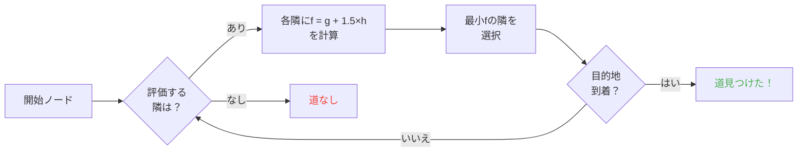

## はじめに

壁に頭ぶつけるヒツジを何時間も眺めて過ごした。

正直？人生最高の投資だ。

だってこのモブ達を見れば見るほど、ランダムなものは何もないって分かる。各動きはコード化されてて、予測可能で、何より完全に壊せる。Minecraftソースに潜ってパスファインディングが正確にどう動くか掴んだ。見つけたのはモブを文字通りマインドコントロールできるってことだ。運任せじゃなく、君の行きたいところに行かせるってことだよ。

このガイドは漁って学んだこと全部だ。AI、A*アルゴリズム、隠しマイナス点、サバイバルで出せる exploit だ。ツルハシ用意して。

---

## モブAIの仕組み（ネタバレ：ばかだ）

### Goals

各モブは*goals*を持つ。できる行動一覧と、どれだけやりたいかだ。数字が小さいほど優先度が高い。混沌版todoリストみたいなものだ。

```java
protected void registerGoals() {
   this.goalSelector.addGoal(4, new Zombie.ZombieAttackTurtleEggGoal(this, 1.0, 3));
   this.goalSelector.addGoal(8, new LookAtPlayerGoal(this, Player.class, 8.0F));
   this.goalSelector.addGoal(8, new RandomLookAroundGoal(this));
   this.addBehaviourGoals();
}
```

ゾンビがカメの卵無視して君を追うの見たことある？理由がこれだ。`ZombieAttackTurtleEggGoal`は優先度4なのに、`ZombieAttackGoal`（君の顔を食えって言うgoal）は優先度2だ。

うん、ゾンビは卵割るより君を食べたい。愛って美しい。

本当に興味あるgoalは`WaterAvoidingRandomStrollGoal`、優先度7だ。「やることないから適当に歩く」goalだ。面白くなるのはここからだ。

### 動き（または「ランダム歩きが60分の1で起きる方法」）

全tick（0.05秒ごと）にゲームは`canUse()`を呼んでモブが動く気あるか見る。各tickで60分の1だ。完全にばかな設計で大好きだ。

```java
public boolean canUse() {
   if (this.mob.hasControllingPassenger()) {
      return false;
   } else {
      if (!this.forceTrigger) {
         if (this.checkNoActionTime && this.mob.getNoActionTime() >= 100) {
            return false;
         }
         if (this.mob.getRandom().nextInt(reducedTickDelay(this.interval)) != 0) {
            return false;
         }
      }
      Vec3 $$0 = this.getPosition();
      if ($$0 == null) {
         return false;
      } else {
         this.wantedX = $$0.x;
         this.wantedY = $$0.y;
         this.wantedZ = $$0.z;
         this.forceTrigger = false;
         return true;
      }
   }
}
```

まとめるとこうだ。モブに乗ってたらダメ、モブが5秒何もしてなかったらダメ、ランダムがダメって言ったらダメだ。ゲームは本当にモブを動かしたくないんだ。

でも動くときは`getPosition()`が引き継ぐ。

```java
protected Vec3 getPosition() {
   if (this.mob.isInWater()) {
      Vec3 $$0 = LandRandomPos.getPos(this.mob, 15, 7);
      return $$0 == null ? super.getPosition() : $$0;
   } else {
      return this.mob.getRandom().nextFloat() >= this.probability
         ? LandRandomPos.getPos(this.mob, 10, 7)
         : super.getPosition();
   }
}
```

最後の2つの数字見て。XZ半径とY半径だ。水中ではモブは遠くを探す（10じゃなく15）。陸が見つからなければ水受けの`super.getPosition()`に fallback する。**結果：モブは水から出たがる。** 動物が必死に岸へ泳ぐのはそのためだ。

おいしい細部：`super.getPosition()`じゃなく`LandRandomPos`を取る確率は文字通り0.1パーセントだ。千分の1だ。Mojangらしい。

### LandRandomPos：全部変える腐った最適化

私のお気に入り段階だ。パスファインディングを exploit 可能にする最高の技術的まぬけだ。

```java
public static Vec3 getPos(PathfinderMob $$0, int $$1, int $$2, ToDoubleFunction<BlockPos> $$3) {
   boolean $$4 = GoalUtils.mobRestricted($$0, $$1);
   return RandomPos.generateRandomPos(() -> {
      BlockPos $$4xx = RandomPos.generateRandomDirection($$0.getRandom(), $$1, $$2);
      BlockPos $$5 = generateRandomPosTowardDirection($$0, $$1, $$4, $$4xx);
      return $$5 == null ? null : movePosUpOutOfSolid($$0, $$5);
   }, $$3);
}
```

`movePosUpOutOfSolid`。名前が全部言ってる。選んだ位置が固体ブロック内なら、空気に出るまで上に押す。

最適化だ。地下の位置無視に時間無駄にする代わり、表面に上げる。賢い？うん。でもすごい偏りを作る。**モブは高さを好む**んだ。

想像して。表面下にブロックいっぱいある。ゲームはランダム位置10個作る。ブロック内のは上に押される。密な zone（丘の下）は疎な zone より有効位置を多く生む。結果：モブは統計的に丘へよく行く。

信じて。2分で壊すから。

### 選択：最良ブロック決定戦

10位置、勝者1つ、スコア戦だ。

```java
public static Vec3 generateRandomPos(Supplier<BlockPos> $$0, ToDoubleFunction<BlockPos> $$1) {
   double $$2 = Double.NEGATIVE_INFINITY;
   BlockPos $$3 = null;
   for(int $$4 = 0; $$4 < 10; ++$$4) {
      BlockPos $$5 = (BlockPos)$$0.get();
      if ($$5 != null) {
         double $$6 = $$1.applyAsDouble($$5);
         if ($$6 > $$2) {
            $$2 = $$6;
            $$3 = $$5;
         }
      }
   }
   return $$3 != null ? Vec3.atBottomCenterOf($$3) : null;
}
```

最高スコア位置が勝つ。スコア基準を知ってれば勝たせたい位置を勝たせられる。選挙不正みたいなものだ。

---

## モブの好み（または「なぜ君の牛は道を渡るのか」）

各モブは好みが違う。それで全部変わる。

| モブ | 好きなもの |
| --- | --- |
| **動物**（牛、ヒツジ、ブタ） | 草と光（ヒップスター） |
| **モンスター**（ゾンビ、スケルトン） | 闇（厨二） |
| **カメ** | 水、なければ砂、なければ光 |
| **ホグリン** | `crimson_nylium`。`warped_fungus`嫌い |
| **ストライダー** | 溶岩だけ。他は無し。 |
| **シルバーフィッシュ** | 寄生可能ブロック（道理） |
| **ガーディアン** | 水と光（気取り屋） |
| **ムーシュルーム** | 菌糸と光（キノコ） |
| **ハチ** | 空気。うん、空気が好きなんだ。 |

```java
// 動物：下を見て、草なら最高スコア
public float getWalkTargetValue(BlockPos $$0, LevelReader $$1) {
   return $$1.getBlockState($$0.below()).is(Blocks.GRASS_BLOCK) ? 10.0F : $$1.getPathfindingCostFromLightLevels($$0);
}

// モンスター：まったく逆
public float getWalkTargetValue(BlockPos $$0, LevelReader $$1) {
   return -$$1.getPathfindingCostFromLightLevels($$0);
}
```

つまりモンスターは文字通り「明るければ負スコア、他行く」だ。光に顔をしかめる。

だから文字通り、動物は草と光で、モンスターは闇で誘導できる。ばかげてて天才的だ。

---

## MinecraftのA*アルゴリズム（秘密の式）

MinecraftはパスファインディングにA*（A-star）アルゴリズムを使う。でもMojangが手を加えた。

```
f(n) = g(n) + 1.5 × h(n)
```

- **g(n)** = すでに進んだ道（ブロック1ごとに1、斜め約1.41）
- **h(n)** = 直線距離
- **1.5** = Mojangがちょっとイカれた値好きだから

普通A*は`f(n) = g(n) + h(n)`を使う。MOJANGは1.5の係数を足した。なぜか。アルゴが目的地へ速く進んで探索枝を切り詰めるためだ。結果：見つかる道は「良い」けど最高とは限らない。ちょっと酔ったA*だ。



大事な詳細：**モブがパスファインドできるのは16ブロックまで**だ（*follow range*）。目的地が遠すぎたら、到達できる中でいちばん近いブロックを選ぶ。つまり届かないところにモノリスを作れば、モブはそのモノリスに近づく中で到達できるいちばん近いブロックへパスファインドする。動きが完全予測可能になる。

### ゲームを壊す2 exploit

#### 1. ブロック更新は強制再計算

```java
public boolean shouldRecomputePath(BlockPos $$0) {
   if (this.hasDelayedRecomputation) return false;
   if (this.path != null && !this.path.isDone() && this.path.getNodeCount() != 0) {
      Node $$1 = this.path.getEndNode();
      Vec3 $$2 = new Vec3(
         ((double)$$1.x + this.mob.getX()) / 2.0,
         ((double)$$1.y + this.mob.getY()) / 2.0,
         ((double)$$1.z + this.mob.getZ()) / 2.0
      );
      return $$0.closerToCenterThan($$2, (double)(this.path.getNodeCount() - this.path.getNextNodeIndex()));
   }
   return false;
}
```

モブの道近くの各ブロック更新は、1秒クールダウン付きA*再計算を強制する。モブの隣に1秒時計を置けば、常に道を再計算する。毎秒リセットするGPSを付けるのと同じだ。

50モブ同時にやったらどうなる？ラグの街だ。TPS安らかに。

#### 2. ブロックのマイナス点（Pathfinding Malice）

一部ブロックはモブを怖がらせる。文字通りね。各ブロックは関連コストを持つ。列挙で定義される。

| ブロックや条件 | マイナス |
| --- | --- |
| **ハチミツブロック** | 通過+8 |
| **粉雪** | 通行不可 |
| **閉じたドア** | 通行不可 |
| **火** | 通過+16、沿い+8 |
| **動物と村人** | 火は-1（ダメ） |
| **サボテンやスイートベリー** | 通行不可。隣接は+8 |
| **水** | 通過か沿い+8 |
| **マグマ** | 沿い+8（あちち） |

動物はさらに極端だ。

```java
protected Animal(EntityType<? extends Animal> $$0, Level $$1) {
   super($$0, $$1);
   this.setPathfindingMalus(PathType.DANGER_FIRE, 16.0F);
   this.setPathfindingMalus(PathType.DAMAGE_FIRE, -1.0F);
}
```

DAMAGE_FIRE -1.0Fは文字通り「禁止」だ。動物は火を渡るより虚空に身を投げる。ふう。

### 演習：大経路決定戦

村人が複数経路から選ぶと想像して。

- **経路A**：15ブロックだが6ブロックが水沿い（各+8）
- **経路B**：18ブロックで水2ブロック（+8）と隣接水1ブロック（+8）
- **経路C**：14ブロック真っ直ぐ。でも火付き→村人には通行不可
- **経路D**：16ブロックで隣接マグマ1ブロック（+8）と隣接ハチミツ1ブロック（+8）
- **経路E**：25ブロックだがサボテンだらけ（あちこち+8）→ 合計コスト90.82

暗算：

- 経路A：15ブロック + 水6×8 = 15 + 48 = **63**。でも1.5×距離を足す。本物計算しよう。
- 経路B：長いけどマイナス少なめ。合計 cost は累積距離とマイナスだ。
- 経路D：マグマとハチミツがマイナス重ねる。

勝者はたいてい**経路B**だ。遠回りが得なのは水が高いからだ。

村人は実質脚付きコスト計算機だ。

### 各モブは好み持ち

村人：「火？ごめんバイバイ」
ゾンビ：「火？OK boomer *燃えながら渡る*」

文字通り一部モブが取り他が取らない道がある。ゾンビが燃える村人高速道路が作れる。

---

## 村人：究極のごちゃごちゃ

はい村人だ。Minecraft全体でいちばん誤解されてるシステムだ。でもコード掴んだら、営業時間付きの予測可能機械だって分かる。

### センサーと記憶

9センサーで、20tickごと（1秒）に回る。各々村人周辺の半径を走査して結果を記憶に保存する。村人は全部見て、全部覚えて、それで動く。

たとえばこうだ。「敵いる？地面にアイテムある？話すプレイヤーいる？」全部チェックする。

### パッケージ（1日の段階）

村人の脳は時間で起動する活動パッケージだ。

| パッケージ | 時間 | 村人は |
| --- | --- | --- |
| **Core** | 24時間 | ドア開ける、泳ぐ（8割）、POIを取る |
| **Work** | 8時-15時 | 「働きに行く」。職場へ歩く |
| **Meet** | 15時-17時 | 「乾杯！」。鐘へ行っておしゃべり |
| **Rest** | 18時-6時 | 「寝なきゃ」。ベッドへ行く |
| **Idle** | 6時-8時、17時-18時 | 「ぶらぶら」。歩く、子供作る、ベッド跳ぶ |
| **Panic** | 怪我や敵対 | 「助けて」。逃走 |

**Panic**パッケージだけが他全部を中断できる。村人が寝てても働いてても、ゾンビがいたら全面パニックだ。

### POI取得：無線レッドストーンを可能にするもの

```java
Set<Pair<Holder<PoiType>, BlockPos>> $$12 = (Set)$$10xx.findAllClosestFirstWithType(
   $$0, $$11, $$8x.blockPosition(), 48, PoiManager.Occupancy.HAS_SPACE
)
```

`Acquire POI`は半径48ブロック内の全POI（興味点）を走査する。近い5つを保って、道存在を確認して、到達可能な最初を取る。

各POIは限られた枠数を持つ。
- **職場**：1枠
- **ベッド**：1枠
- **鐘**：32枠

やばい点：**枠は到着じゃなく取得時に予約される**んだ。村人はマップの向こうからコンポスターを施錠できる。届かなくてもね。

強さ分かる？

### 無線レッドストーン。うん、無線だ。

1. 村人をトロッコに入れて、コンポスターへの道付きで置く
2. コンポスターを取得する（枠取り、誰も使えない）
3. 村人が遠すぎてクリックできない。骨粉残る
4. この村人を世界のどこでも連れていける。枠は保つ
5. 仕掛けを作動させたくなったら村人を殺す
6. 枠が空いて、別村人がコンポスターを取得して、骨粉を取る
7. ブロック更新→任意レッドストーン回路起動

文字通り無線レッドストーン信号を作った。世界中で伝わる。途中のチャンク読み込みゼロだ。エンダーパール stasis chamberに繋いで、村人殺してどこからでもテレポートしてもらえる。

私のお気に入り用途？「賞金稼ぎ」ミニゲームだ。コンポスター付き村人を複数置いて、プレイヤーは出力を起動する正しい村人を殺さなきゃいけない。完全に変な仕掛けだ。

### パスファインディング行き詰まり（または「永遠に固まる村人」）

`Acquire POI`（道見える）と実ナビ（そこ歩くの拒否）の間に最高のバグがある。職場の上ブロックが歩けないときに起きる。結果：

- Coreパッケージ：「POI取りたい」
- ナビ：「そこ歩けない」
- 結果：村人は永遠に固まったまま、自分と戦い続ける。

文字通りその場で frozen の村人だ。飾りにも build の「小道具」にも使える。鎧立てタンク？うん。動かない衛兵？うん。猟奇的？かも。でも効く。

---

## 結論

Minecraftモブのパスファインディングは運じゃない。スコア基準の決定的システムで、予測可能で壊せる。

**覚えるべき3点：**

1. **足下ブロックは高さ偏り**：地下を埋めるか空けてモブを誘導する
2. **マイナスはモブごとに違う**：一部が取り他が取らない道を作る
3. **POI枠は遠隔予約**：無料無線レッドストーン、テレポート、全部だ

Minecraftソースは過小利用仕掛けの金鉱だ。デコンパイルJavaを何時間も読んだけど正直？各行が機能するイースターエッグだ。ただしこれはサバイバルで村人使った無線レッドストーンに使う。最高ゲーム確定だ。
