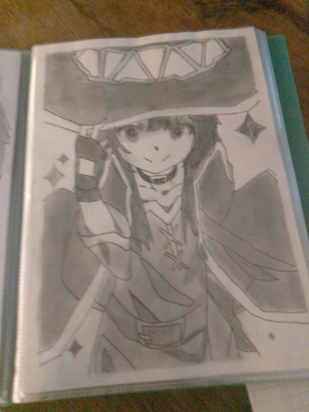

# 私の情熱

このブログは前から書きたかったけどずっと我慢してた :/

たぶん人生は共有したいけど個人情報は出したくないからだと思う。たぶんそれだね。

## コード

情熱はいろいろだ。コード書くのが大好きで、このブログの残りで気づいた通りだと思う。ゼロからものを作って、問題を解いて、作品が生きるのを見るのは深く満たされる。ちっぽけなCLIツールでも完全なウェブアプリでも、過程はちっとも古びない。

特に**オープンソース**が好きだ。共有は愛で、誰かが私のコードを役立ててくれる考えが心から好きだ。大半のプロジェクトは[私のGitHub](https://github.com/fox3000foxy)に生きてて、[プロジェクトページ](/projects)で見られる。

## 絵

でもコードだけが情熱じゃない。絵を描くのも大好きだ！私の絵をいくつか紹介する。

<table style="width:100%;border-collapse:collapse;margin-top:1rem;">
  <tr>
    <td style="padding:0.5rem;"></td>
    <td style="padding:0.5rem;"></td>
    <td style="padding:0.5rem;"></td>
  </tr>
  <tr>
    <td style="padding:0.5rem;"></td>
    <td style="padding:0.5rem;"></td>
    <td style="padding:0.5rem;"></td>
  </tr>
  <tr>
    <td style="padding:0.5rem;"></td>
    <td style="padding:0.5rem;"></td>
    <td style="padding:0.5rem;"></td>
  </tr>
</table>

## 動くもの全部自動化する

自動化にも情熱がある。GitHub Actionsやワークフローで遊ぶのは今まで知った最高の気持ちの1つだ。手動過程をスクリプトやパイプラインに置き換えられるときはいつもやる。疑問なしだ。

最近コミットのSSH署名も始めて、そのスクリプトは[このgist](https://gist.github.com/fox3000foxy/95500d129cd4bf5c173c323d2492569a)にある。

## 古い技術の探索

UTAUみたいな古い技術の探索大好きだ。概念がかなり魅惑的だと思う。AIやクラウドコンピューティングの現代より前に人々がものをどう作ってたか理解するのって特別なものがある。

## Vtuber

Vtuberも大好きで、いつかなりたいけど今はちょっと恥ずかしい。たぶん後でね！

## 音楽

主な趣味は音楽聴きながらコードを書くことだ。正しいプレイリストでフローに入るのに勝るものはない。最近は歩くのも結構好きだ。なぜか分からないけど😕。

## 回避策探し

お金払わず済ませる回避策探しも大好きだ。というか型破りな考え方だね。たとえば[Nibi](https://github.com/Let-s-Learn-Japanese-Together/Nibi)は最後の作品の1つで、コマンド管理もデータベース管理もデーモンも無料解法を見つけた。大事なのは挑戦で、節約よりずっとね！

## なぜこのブログ

このブログには進捗も考えも共有したいもの全部も置ける場所にしたかった。そうすれば私がどう考えるか分かるでしょ。情熱について書くのが始めるのに最適に思えた。

読んでくれてありがとう！
