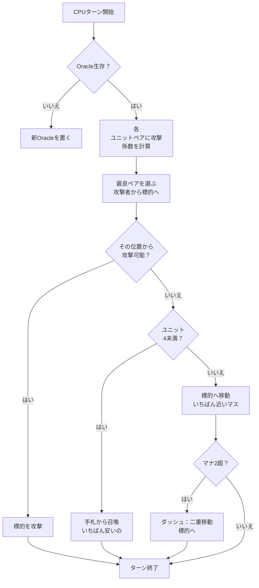

## Nausicaa用の変な私のAI

「神話でチェス作ったらどうなる」から始まって、5ターンごとに独自ハイパーパラメータを決めるAI付きシステムで終わるプロジェクトがある。

Nausicaaがそれだ。神話クリーチャーのデッキを作って、マナを管理して、10x8盤にユニット展開するターンベースのボードゲームだ。人格危機のAIがいる。

このAIにはかなり時間かけた。結果は今もときどき掴みきれない。それがいちばん好きなところだ。

## 実際のゲーム

頭を話す前に体を理解しなきゃいけない。

- 10x8盤、プレイヤーごとに2列の展開 zone
- マナは1開始、1ターンに+1、最大6だ。召喚にも攻撃にも能力使用にも使う
- 目標：相手のOracleを倒す

12ユニットで、コストも移動パターンも違う。

| ユニット | コスト | 移動 | HP |
| --- | --- | --- | --- |
| Oracle | 0 | 王（8方向） | 1 |
| Gobelin | 1 | 前3マス | 1 |
| Harpie | 1 | 王（8方向） | 1 |
| Naïade | 1 | 斜め | 1 |
| Griffin | 2 | 2マス跳び | 2 |
| Sirène | 2 | 横 | 1 |
| Centaure | 2 | ナイト（L字） | 2 |
| Archer | 3 | 横 | 1 |
| Phénix | 3 | 斜め（暗マス） | 1 |
| Métamorphe | 4 | 位置交換 | 1 |
| Voyant | 4 | なし（マナ生成） | 1 |
| Titan | 6 | 制限（範囲攻撃） | 3 |

各ユニットの攻撃パターンは独自だ。Sirèneは4斜めに殴る、Archerは3マス先まで遠距離、Titanは召喚時に周囲を破壊する。つまり神話とデッキ構築付きチェスってことだ。

## CPUに考えさせた方法

基本発想はばかみたいに単純だ。**各敵ユニットに魅力度係数がある**。危険なほどAIは相手したくなる。

```javascript
const UNITS_ATTRACTIVENESS = {
    "oracle": 100,
    "titan": 95,
    "shapeshifter": 90,
    "phoenix": 80,
    "siren": 70,
    "archer": 70,
    "seer": 70,
    "griffin": 60,
    "centaur": 60,
    "harpy": 50,
    "naiad": 30,
    "gobelin": 20
};
```

Oracleは100。道理だ。勝利条件だからね。Titanは95。召喚時に隣を全部ワンパンするからね。Gobelinは20。歩兵だ。どうでもいい。

次に各ユニットペア（味方1つ、敵1つ）にこう計算する。

```
interet = attractivite × coeff_attract / (distance × coeff_dist)
```

ざっくり、危険で近いほどAIはぶっ潰したくなる。

```javascript
calculateAttackCoefficient(x1, y1, x2, y2) {
    const distance = this.calculateEuclideanDistance(x1, y1, x2, y2);
    if (distance === 0) return Infinity;
    return (UNITS_ATTRACTIVENESS[unit.type] * COEFFICIENTS_IMPORTANCE["attractiveness"]) / distance;
}
```

### 係数が変わる仕掛け

大事な点は、重要度係数が**5ターンごとにランダムに変わる**ことだ。

```javascript
if (this.turnCount % 5 === 0) {
    const distanceCoefficient = parseInt(Math.random() * 100);
    const attractivenessCoefficient = parseInt(Math.random() * 100);
    this.regulateImportanceCoefficients({
        distance: distanceCoefficient,
        attractiveness: attractivenessCoefficient
    });
}
```

あるときAIは超攻撃的になる（魅力95、距離5）。君のOracleを倒すため全部横断する。次は距離優先になって陣形を整える。

パックマンのゴーストからぱくった。Blinkyは追って、Pinkyは待ち伏せる。ここではAIが各段階で「人格」を替える。

**結果：対局全体でAIを予測するのは無理だ。** CPUは同じ試合を2度しない。

### Oracleは腰抜けだ

敵Oracleは逃げる。文字通りね。

```javascript
const awayFromTarget = {
    row: Math.max(0, Math.min(7, botUnitElement.row + (botUnitElement.row - targetUnitElement.row))),
    col: Math.max(0, Math.min(9, botUnitElement.col + (botUnitElement.col - targetUnitElement.col)))
};
```

脅威と逆方向を計算して逃げる。壁があったら、その方向でいちばん近い空きマスを探す。

Oracleに近づくのに3ターンかけて、ぱっと向こう端まで逃げられてる。

### 決定ループ

AIの決め方はこうだ。

1. Oracleがいない（死亡）なら新しいのを置く
2. 味方ユニットから敵ユニットの各ペアに係数を計算する
3. 最良ペアを選ぶ
4. ユニットがその位置から標的を攻撃できる → 攻撃する
5. ユニット4未満 → 手札からいちばん安いのを召喚する
6. そうじゃなければ標的へ移動する（敵にいちばん近い移動マス）
7. マナ十分（2超）ならダッシュ（二重移動）でもっと寄る
8. ユニットがOracle → 逃げる



```javascript
async makeAction(dash=false) {
    // 全部順番に
    // CPUはマナ十分ならダッシュする
    if(botPlayer.mana > 2) {
        this.makeAction(true);
    }
}
```

### なぜユークリッド距離か

ユークリッド距離を使う。

```javascript
calculateEuclideanDistance(x1, y1, x2, y2) {
    const deltaX = Math.pow(x1 - x2, 2);
    const deltaY = Math.pow(y1 - y2, 2);
    return Math.sqrt(deltaX + deltaY) * COEFFICIENTS_IMPORTANCE["distance"];
}
```

マンハッタンじゃないのはなぜか。ユニットの移動パターンが多様だからだ（ナイトみたいなL字、斜めなど）。直線距離の方が危険の近似に良い。

## なぜミニマックスじゃないか

古典ミニマックスも書けた。でも12種ユニットに違う移動パターンに特殊能力だと、ゲーム木が速く爆発して遊べなくなる。発見的手法は1,000万状態を探さず賢い選択をする。

## かっこいいところ

魅力度システムは面白いジレンマを作る。

- Voyant（70）はマナを作る。生かしとけば相手の資源が増える。でもTitan（95）はもっと危険だ。
- Métamorphe（90）は任意ユニットと位置を交換できる。君のOracleを盗める。
- Harpie（50）は自分も死ぬ爆発攻撃を持つ。副次的ままだ。君の3ユニット隣に来るまではね。

AIは素 stats じゃなく位置に応じた全局危険を評価する。

シナリオ試し用の`activateSimulation()`関数もある。対局やり直しなしでね。

```javascript
activateSimulation() {
    // 盤に特定ユニットを置く
    // AIデバッグに便利
    this.game.board = simulation.board;
    this.game.players = simulation.players;
}
```

## 足りないもの

もっと時間があればね。

- AIは現状に反応する。プレイヤーが何するか予測しない
- 手札を複数ターンで計画しない
- MétamorpheとCentaureの能力を活かしきれてない
- 強化学習：自分と対戦させて係数を調整する

でもブラウザゲームには十分だ。友達が負けるから検証済みだ。

## 試す

[nausicaa-game.github.io](https://nausicaa-game.github.io/)で出してる。「JOUER」を押して、CPUモードONにして、AIの動きを見る。

おすすめ：AI同士で遊ばせる。攻撃段階が見えて、次にぷっと後退するのが見られる。

コードは[GitHub](https://github.com/nausicaa-game/nausicaa-game.github.io)の`js/cpu.js`にある。

**覚えるべき3点：**

1. **発見的係数**。ミニマックスなし、各ユニットに魅力度
2. **5ターンごとに変わる係数**。AIは攻撃性と管理を交互にする。パックマン式だ
3. **Oracleは逃げる**。脅威と逆方向を計算して逃げる

AIをもっと意地悪くする案があったらissue開いて。負けから学ぶ版の計画があるけど、次の記事でね。
