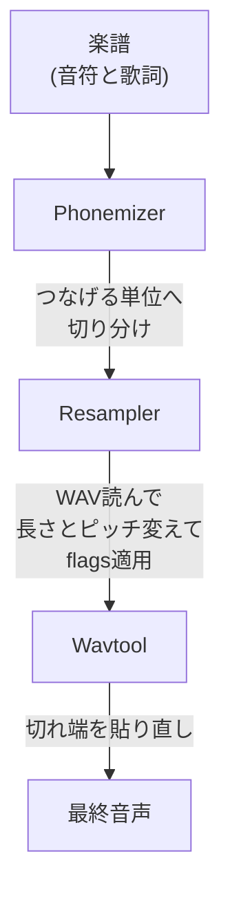

## UTAU：Visual Basic 6ソフトが歌声合成を民主化した方法

メインページで一言触れた。UTAUが好きだ。理由はここだ。

2008年、歌う合成音声を作りたければ選択肢は1つだった。VOCALOIDだ。ヤマハのソフトだ。高いし proprietary だし、自分で作れない公式ボイス付きだ。

そこに日本の人、AmeyaやAyameが片手間にプログラムを出した。**Visual Basic 6**で書いたソフトだ。無料だ。自分で録ったWAVファイルで自分の声を作らせてくれる。

このソフトが**UTAU**（歌う、日本語で「うたう」）だ。当時としては魔法だった。

実装のきれいさより出発発想にずっと魅了されてる（符号化仕組みは今も本当に賢い。実装は目が痛いけど）。音声合成を一般に開いたんだ。君も、私も、マイクさえあれば誰でもね。

なぜ凄かったか説明させて。

---

## まず、歌の合成がなぜ面倒か

歌声は音符じゃない。攻める子音、保つ母音、息、両者間の遷移がある。「salut」の「sa」は笛吹く「s」が開いた「a」へ滑る。この滑りが人間っぽいかどうかだ。

今日は深層学習で解く。歌何時間もでモデル訓練して声を生成する（Synthesizer V、DiffSinger）。でもこれは2020年以降だ。2008年は何もない。

UTAUは前の方法を使う。古くて賢い。**連結合成**だ。

---

## 連結合成：声の切れ端のコピペ

考えは拍子抜けするほど単純だ。声の小さい切れ端を録って、貼り合わせて語を作る。「salut」は「sa」サンプルと「lu」と「to」をつなげる。楽譜に操られる音パズルだ。

YouTube Poopの仕組みだ。キャラの語を切り刻んで何でも言わせる。ただしここはきっちり自動化だ。

UTAUは文字通りそこから来た。先に**人力ボーカロイド**（人力ボーカロイド、「手動Vocaloid」）があった。人々は手でボーカル track を刻んで、音素を抜いて、ピッチ変えて、音声エディタで全部組み直してVOCALOID声を真似た。手でね。手間想像できる？

Ameyaはこの苦労を見て、自動化道具を書いた。最初UTAUはただそれだった。手動Vocaloid用助手だ。

---

## なぜ革命的だったか：君が声を作る

全部変えるのはここだ。

VOCALOIDは声を買った。ミク、ルカなどだ。プロが作ってヤマハが売った。作るのはヤマハに留まった。UTAUでは**誰でも自分の声を録って歌う楽器にする**。

CVモード（いちばん単純）はこうだ。日本語の基本約100音節（「a」、「ka」、「sa」、「ta」など）を録って、切り分け点を調整して、はい君の voicebank だ。数時間の仕事だ。

結果：生態系が爆発した。コミュニティ作の voicebank 何千も。ファンの声、友達の声、創作キャラの声だ。仮想歌手の宇宙全部が無料だ。ソフトには**Defoko**（唄音ウタ）付きだった。AquesTalk TTSエンジン経由生成のデフォルト声だ。マイクなしでも始められた。

---

## oto.ini：仕組みの心臓

UTAUはどこで切って貼るかどう知るの。 voicebank ごとの設定ファイル経由だ。**`oto.ini`**だ。各WAVに切り分け点（ミリ秒）を定義する。

- **Offset** → 頭の無音を除く
- **Preutterance** → 子音が母音に変わる点（「sa」の「s」から「a」への境）
- **Overlap** → 前音符がここへはみ出す量
- **Fixed region** → 長い音符で伸ばしちゃいけない部分（だいたい子音）
- **Cutoff** → 終わりを切るところ

**preutterance**がいちばん賢い param だ。音節には母音の前に必ず子音の切れ端がある。音符を拍に乗せるには、子音じゃなく*母音*がぴったり落ちなきゃいけない。だからUTAUはサンプルを後ろへずらす。「sa」の「a」が拍に着地して、「s」は直前にはみ出す。音が合うよう叩きを先取りするドラマーみたいにね。ただし`.ini`内だ。

「ka」サンプルで`oto.ini` zone が視覚的にこう切れる。

```mermaid
flowchart LR
    A["🔇 silence<br/>(offset)"] --> B["🅺 子音<br/>(fixed region,<br/>伸ばさない)"]
    B --> C["🅰 母音<br/>(伸ばせるzone)"]
    C --> D["🔇 切り落とす終わり<br/>(cutoff)"]
    style B fill:#3b4a6b
    style C fill:#5b3b6b
```



子音と母音の境が preutterance だ。母音は長い音符用に伸ばす zone だ。子音は無傷のまま。じゃないと「k」が2秒続いて酷い音になる。

```ini
# oto.ini (simplifié)
# ファイル=alias,offset,consonant,cutoff,preutterance,overlap
_ka.wav=ka,120,80,-200,90,40
```

音ごとに5値だ。全サンプルにね。UTAUはどんな語もきれいに組み立てる。

---

## CV、VCV、CVVC：リアルさ競争

基本モード**CV**（子音-母音）は音節ごとに1音だ。単純だが少しロボットっぽい。音節間の継ぎ目が荒い。

2010年コミュニティは**VCV**（母音-子音-母音）を発明する。「ka」単体を録る代わり「a ka」を録る。前母音の尻付きでね。遷移は後計算じゃなく*録音内*にあるから自然になる。

刺さる詳細：**VOCALOIDがVCVを持ったのはVOCALOID3の2011年だ。** 1人で書いたVB6フリーソフトが遷移リアルさでヤマハを1年先行した。ファンコミュニティが多国籍企業より速い。

次に**CVVC**、**ARPAsing**（英語）、**VCCV**が来た。各方式がリアルさを先へ押して、全部コミュニティ発明で文書化した。

---

## 完全パイプライン：語が音になる方法

音符を置いて歌詞を打つと、裏でこうなる。



**resampler**が要だ。ある高さで録った「ka」サンプルを取って、欲しい音符に合うよう伸ばし直したりピッチ変えたりする。伸ばせる zone だけ伸ばして子音は無傷に保つ（だから`oto.ini`）。

モジュール式だ。UTAUには基本resampler付きだった。でもコミュニティは他をぽんぽん出した（moresampler、TIPSなど）。各々独自の音の粒だ。2008年にプラグインみたいに合成エンジンを替えた。フリーソフトでね。

---

## 蓋の下の工事現場（だから愛おしい）

ソフト技術状態には正直でいなきゃいけない。

- **Visual Basic 6で書かれてる。** 2008年時点で死んだ言語だ。動かすにはVB6ランタイム要る。
- **基本Windows専用**（Mac移植のUTAU-Synthは2011年に来た）。
- **Shift-JIS符号化必須。** ファイルが日本語Shift-JIS符号化じゃないとUTAUは何も分からない。今もPCを日本語ロケールにするかAppLocaleで起動することが多い。
- **質素な画面**、当時の文書はほぼ100パーセント日本語だった。

それでもね。それでもこのソフトは世界運動を作った。 voicebank 何万も。何百万回聴かれた歌だ。

最高の例：**重音テト**。2008年に作られたキャラで、VOCALOIDのふりしてエイプリルフールの冗談で投げられた。冗談だった。でも人々はキャラを愛して、裏に本物UTAU voicebank が作られて、テトは世界いちばん有名な仮想歌手の1人になった。2023年には公式Synthesizer V声までもらった。無料ソフト上のエイプリルフール生まれのキャラだ。

---

## なぜ今も大事か

UTAUは「貧しい」技術が開放で勝つ完璧な例だ。

VOCALOIDは技術的に優れてて、金があって、プロだった。でも閉じてた。UTAUは間に合わせで、醜くて、VB6だった。でもみんな参加できた。声作り、resampler作り、プラグイン作り、録音方式作り。残りはコミュニティがやった。

概念は今日も完全生きてる。**OpenUtau**は現代オープンソース後継で、発想を引き継いで磨く（マルチプラット、UTF-8、現代resamplerとAI両対応）。連結合成は深層学習モデルの隣でまだ立つ。奴らにない利点があるからだ。何が起きてるか正確に分かって、各ミリ秒を管理できる。

UTAUでずっと好きなのはそこだ。何が起きてるか正確に見える。分からない魔法結果を吐くAIじゃない。WAVがあって切り分け点があって、全部自分で決める。変な音になったら理由が分かって直せる。こういう管理が好きだ。

---

**覚えるべき3点：**

1. **連結合成は声パズルだ**。UTAUは小さいWAVサンプルを貼り合わせて語を作る。`oto.ini`が各音の切り貼り場所を定義する。全部自分で管理する。ミリ秒単位でね。ブラックボックスなしだ。

2. **開放が技術に勝つ**。VOCALOIDは良かったけど閉じてた。UTAUは間に合わせだったけどみんな自分の声を作れた。コミュニティが生態系を爆発させて、VCVではヤマハを先行した。

3. **良い発想はコードを生き延びる**。VB6、Shift-JIS、Windows専用。なのに概念はOpenUtau経由でまだ回る。凄い技術は下手に書かれうる。

正直、エイプリルフール生まれの重音テトだけでも、このソフトは尊敬に値する。
