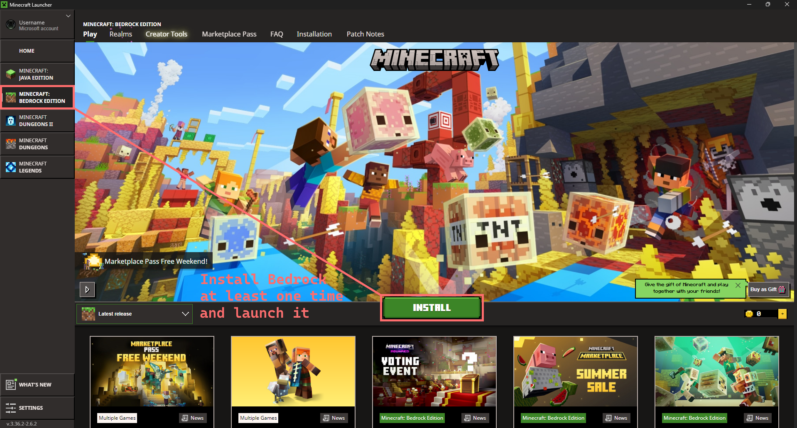
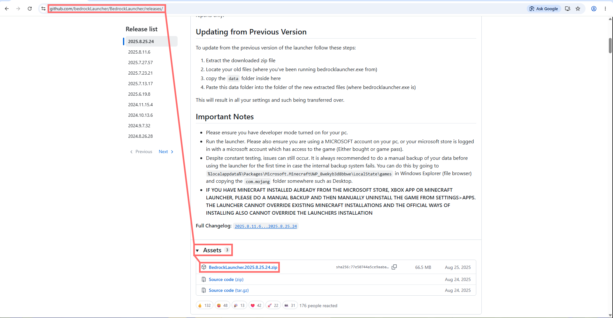
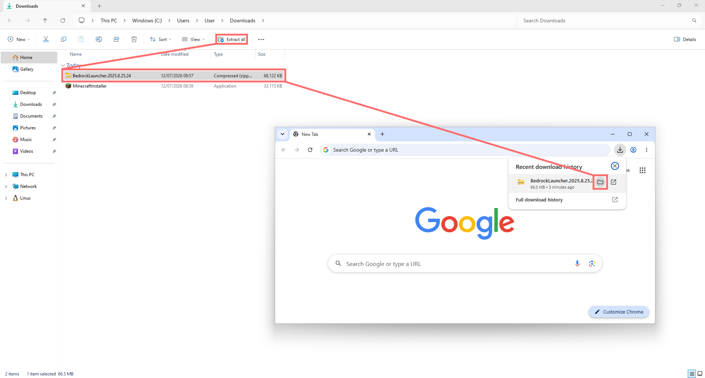
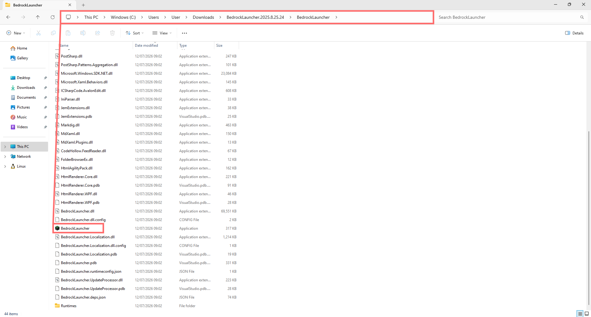
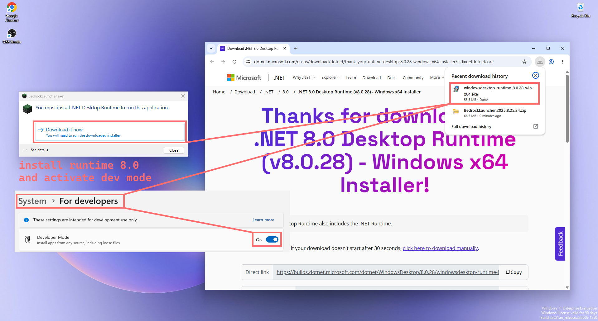
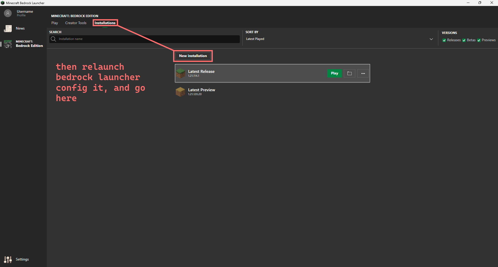
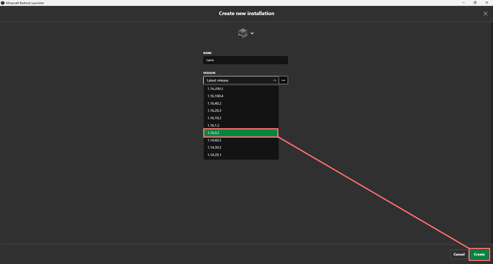
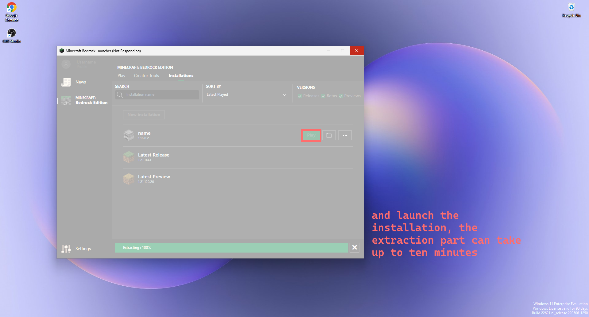
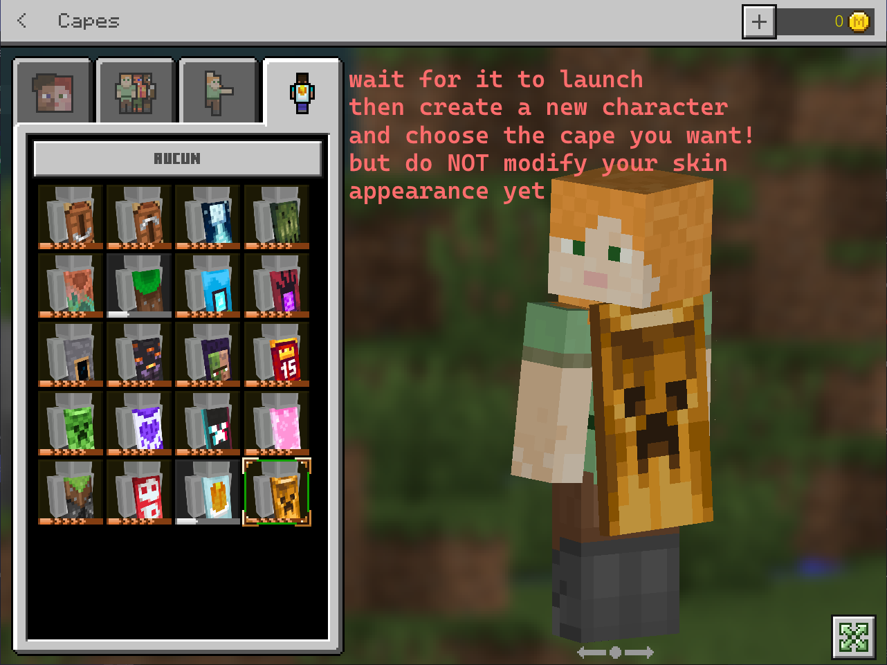
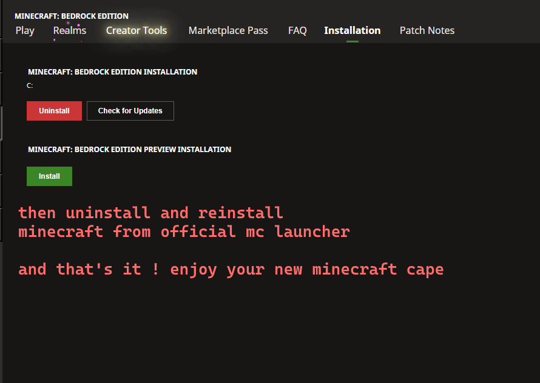

# Minecraft Bedrock에서 모든 망토를 얻는 방법

Java에서는 가져서는 안 될 망토를 손에 넣는 이상한 방법이 잔뜩 있어요 (`cape-mod` 글을 보세요). Bedrock에서는 게임도 다르고 인증도 다르지만, 그래도 방법이 하나 있어요. 서드파티 런처 하나와 당연하게 여겨지던 검증을 무시할 만큼 충분히 오래된 게임 버전만 있으면 돼요.

방법은 이렇고, 이어서 내부에서 아마 무슨 일이 일어나는지 살펴봐요.

## 필요한 것

- Minecraft Bedrock을 이미 보유한 Microsoft 계정 (여러분 계정이면 충분해요)
- 공식 Minecraft 런처 설치
- 어떤 Bedrock 역사 버전이든 설치하고 실행할 수 있게 해주는 오픈 소스 서드파티 런처 [BedrockLauncher](https://github.com/bedrockLauncher/BedrockLauncher)
- .NET 8.0 Desktop Runtime
- Windows에서 개발자 모드 활성화

## 1단계: 공식 런처로 Bedrock을 최소 한 번 설치하기

다른 것을 하기 전에 공식 Minecraft 런처를 열고 **Minecraft: Bedrock Edition** 탭으로 가서 **Install**을 눌러요. BedrockLauncher를 만지기 전에 공식 경로로 Bedrock을 최소 한 번 설치하고 실행해야 해요.

## 2단계: BedrockLauncher 다운로드하기

프로젝트의 GitHub 릴리스 페이지로 가요. **Assets**에 있는 최신 버전 zip을 가져와요.

## 3단계: 압축 풀기

zip을 다운로드했으면 `Downloads` 폴더(나중에 찾을 수 있는 곳이면 어디든)에 풀어요.

## 4단계: 실행 파일 실행하기

푼 폴더로 가서 `BedrockLauncher.exe`를 실행해요.

## 5단계: .NET Desktop Runtime 설치와 개발자 모드 활성화

첫 실행 때 Windows가 **.NET 8.0 Desktop Runtime**을 요구할 가능성이 커요. 설치해요. **개발자 모드**도 `설정 > 시스템 > 개발자용`에서 켜야 해요. BedrockLauncher가 게임을 루즈 패키지(날것 파일, Store의 진짜 서명 패키지가 아님)로 설치하는데, 이 모드 없이는 Windows가 그런 설치를 거부하거든요.

## 6단계: 새 설치 만들기

BedrockLauncher를 다시 실행하고 Microsoft 계정으로 로그인한 뒤 **Installations** 탭으로 가서 **New installation**을 눌러요.

## 7단계: 오래된 버전 고르기

설치에 이름을 짓고 버전 목록에서 **오래된** 버전, 보통 `1.16.x`나 그 이전 버전을 골라요. **Create**를 눌러요.

## 8단계: 설치 실행하기

**Play**를 눌러요. 기기에 따라 파일 추출에 최대 10분까지 걸릴 수 있어요. 런처가 멈춘 것처럼 보여요("Not Responding"). 정상이니 그냥 두세요.

## 9단계: 망토 고르기

게임이 실행되면 계정으로 로그인하고 새 캐릭터를 만든 뒤 스킨 편집기의 **망토** 탭으로 가요. 거기에서 Minecraft에 존재하는 모든 망토의 전체 목록을 보게 돼요. 한 번도 가져본 적 없는 것들까지요 (프로모 이벤트 망토, 지난 축제 망토, Mob Vote 망토 등). 원하는 것을 고르세요.

**이 단계에서는 스킨 외형의 나머지를 건드리지 마세요**. 망토만 두세요.

## 10단계: 공식 버전 다시 설치하기

공식 런처로 돌아가 **설치** 탭에서 주 Bedrock 설치의 **Uninstall**을 누른 뒤 다시 설치해요 (또는 **업데이트 확인**). 이번에는 공식 런처에서 Minecraft Bedrock을 다시 실행해요.

됐어요. 공식 버전에서, 진짜 프로필에 망토가 있어요.

## 아마 내부에서 일어나는 일

Bedrock의 닫힌 소스 코드를 뜯어보지는 않았어요 (역컴파일되는 Java와는 달라요). 그래서 다음 설명은 **그럴듯한** 설명이지 절대적인 확신은 아니에요. 하지만 관찰된 동작은 다음 가설과 꽤 잘 맞아요.

### 망토 선택기는 애초에 접근 제어가 아니었어요

Bedrock에서 망토 선택 화면은 아마 여러분 계정이 가진 망토만이 아니라 **게임에 존재하는 모든 망토의 전체 목록**을 보여줘요. 최신 클라이언트에서는 애플리케이션 필터(클라이언트 측이나 Xbox와 Microsoft entitlement 서비스로의 네트워크 호출)가 가지지 않은 망토를 회색으로 비활성화하거나 숨겨요.

핵심은, 그 필터가 아마 **나중에** 충분히 최신 게임 버전에 추가됐다는 거예요. 1.16.x 같은 버전은 그 필터 이전이거나, 다른(혹은 없는) 검증 방식을 써요. 목록에 있는 모든 것이 entitlement 여부와 무관하게 선택 가능해져요.

### 망토는 정확히 어디에 저장될까요?

재설치 후에도 남는 이유를 설명하는 부분이에요. Bedrock의 스킨과 망토 선택은 그냥 버릴 수 있는 로컬 파일이 아니에요. 아마 Microsoft 계정에 연결된 Xbox Live 프로필에 동기화돼요 (다른 Bedrock 플랫폼인 모바일, 콘솔 등에서 스킨을 관리하는 것과 같은 시스템이에요). 오래된 클라이언트에서 망토를 고르면 아마 이 선택을 프로필 서비스로 보내요. 정품 망토를 가진 최신 클라이언트가 하는 것과 똑같이요. 클라이언트 관점에서는 "내 것"인 망토와 "고른" 망토 사이에 아무 차이가 없으니까요. 프로필 서비스는 이 지점에서 클라이언트를 신뢰해요. 뒤에 진짜 entitlement가 있는지 다시 검증하지 않고 기록해요. 적어도 쓰는 시점에는요.

결과: 최신 공식 게임을 다시 실행하면 프로필 서비스에서 현재 스킨과 망토를 가져와요. 그리고 서비스는 기록된 것을 충실히 돌려줘요. 정품이 아닌 망토까지요. entitlement 검사가 있다면 아마 UI에서 **선택**하는 시점(그래서 최신 클라이언트에 필터가 있음)에만 일어나고, 프로필에 이미 기록된 것을 **표시**할 때는 통과시켜요.

### Java와의 유사점

Java의 `cape-mod`와 같은 논리적 결함 계열이에요. 서비스가 출처를 매 단계 다시 확인하지 않고 데이터를 신뢰해요. Java에서는 유효하지만 잘못된 프로필에 재생된 RSA 서명이에요. Bedrock에서는 아마 적절한 필터를 가져본 적 없는 오래된 클라이언트가 수락한 망토 선택이 계정의 지속 상태로 다시 검증 없이 전파된 거예요. 두 경우 모두 문제는 진입점(Java 모드, 오래된 Bedrock 클라이언트)이 아니에요. 하류에서 entitlement를 다시 검증해야 할 층이 하지 않거나, 한 번만 잘못된 지점에서 하기 때문이에요.

## 아직도 통하는 이유

가능한 설명 두 가지인데, 서로 모순되지 않아요.

1. **Mojang은 아마 이것을 우선순위로 보지 않아요.** 서드파티 런처가 필요하고 여러 단계 조작이 필요하며, 결과는 순전히 외형이에요. 게임플레이 이점도 없고 타인의 데이터 침해도 없어요.
2. **제대로 패치하려면 프로필을 읽을 때마다 entitlement를 다시 검증해야 해요**. 선택할 때만이 아니라요. 외형 문제 하나 때문에 스킨을 표시할 때마다 네트워크 호출을 하나 더 한다는 뜻이에요.

## 결론

이 튜토리얼은 스크린샷 열 장으로 끝나지만, 소프트웨어 보안 도처에서 보이는 원칙을 보여줘요. 역사적 시스템(오래된 클라이언트 버전, 레거시 API, 업데이트된 적 없는 서비스)이 여전히 공유 상태에 쓸 수 있게 되면, 현재의 접근 제어는 현재를 거치는 것만 보호해요. 옛날 API와 아직 대화할 수 있는 모든 것이 최신 필터를 우회해요. 필터는 최신 버전에서는 동작하지만, 그 이전 버전에는 적용된 적이 없어요.

---

**자료**

- **BedrockLauncher**: [github.com/bedrockLauncher/BedrockLauncher](https://github.com/bedrockLauncher/BedrockLauncher)
- **관련 글**: Cape Mod, RSA 서명 주입에 의한 Java 대응물

**핵심 3가지**

1. 오래된 버전 Bedrock의 망토 선택기는 아마 entitlement 필터 없이 게임의 모든 망토 전체 목록을 보여줘요.
2. 선택은 정품 망토처럼 여러분의 Xbox Live 프로필에 동기화돼요. 프로필 서비스는 클라이언트를 신뢰해요.
3. entitlement 검사가 있다면 최신 UI에서 선택할 때 일어나요. 계정에 이미 기록된 것을 읽을 때는 아니에요.
