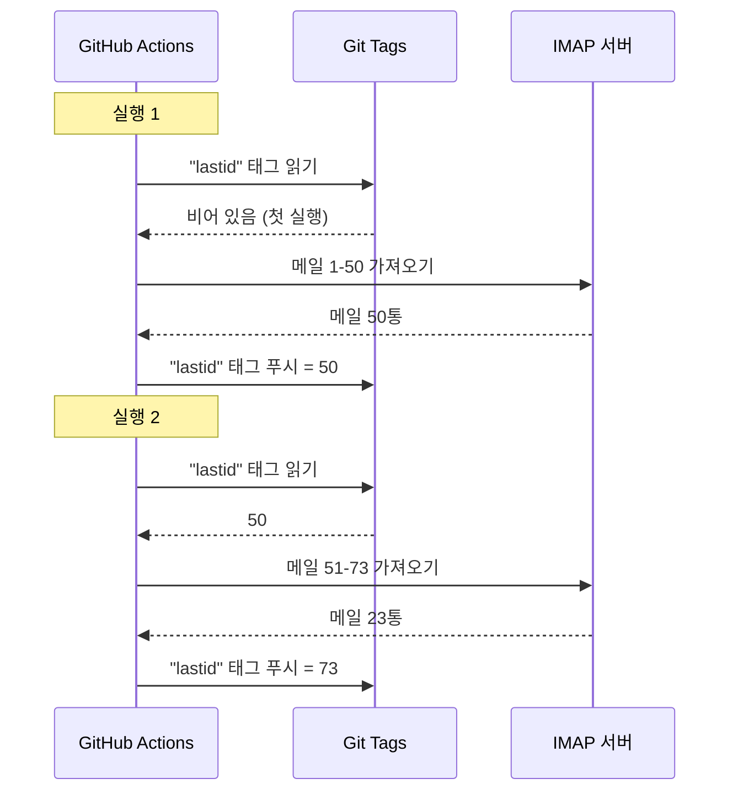

# git을 데이터베이스 삼아 GitHub Actions에서 공짜 봇 돌리기

24시간 돌아가는 자동 메일 회신기가 있어요.

메일을 읽고, 무슨 이야기인지 이해하고, AI로 혼자 답장해요. 이전 대화를 기억해요. 뉴스레터와 `noreply@`는 무시해요. 너무 뜨거우면 사람에게 넘겨요.

월 비용: **0유로**.

서버도 VPS도 데이터베이스도 없어요. GitHub Actions와 미친 핵 하나뿐이에요. **git을 데이터베이스로 쓰기**.

감 잡히시죠? 아니요? 좋아요, 정신 바짝 차리세요. 바보 같으면서도 genial해요.

---

## 문제: GitHub Actions는 무상태예요

GitHub Actions는 무료예요. 5분마다 크론을 실행하고 코드를 돌려요. 공짜로.

하지만 문제가 있어요. **무상태**예요.

매 실행은 깨끗한 기기에서 시작해요. 두 실행 사이에는 아무것도 저장되지 않아요. 이전 실행? 잊은 거예요. 지워졌어요. 존재한 적 없던 것처럼요.

메일 회신기에는 엄청난 문제예요. 예를 들면요.

> "내가 이미 처리한 마지막 메일이 뭐지?"

봇이 매 실행마다 이걸 잊으면 같은 메일에 계속 답장하거나(재앙), 메일을 놓쳐요.

영속 상태가 필요해요. 보통 영속 상태 = 데이터베이스. 하지만 데이터베이스는 서버고, 서버는 더 이상 무료가 아니에요.

바로 여기서 흥미로워져요.

---

## 해결책: 데이터베이스로서의 git 태그

여러분의 GitHub 저장소는 이미 영속 저장소예요. 무료. 버전 관리. 항상 거기 있어요.

그럼 상태를 거기에 저장하면 안 될까요?

아이디어: 매 실행마다 봇이 **git 태그**에서 처리한 마지막 이메일 UID를 읽어요. 새 메일을 처리해요. 그리고 새 UID로 태그를 다시 푸시해요.



git 태그가 곧 데이터베이스예요. 값 하나뿐이지만, 필요한 것은 그게 전부예요.

### 상태 읽기

작업 시작 때 태그에서 값을 가져와요.

```bash
git fetch origin --tags lastid || true
git show refs/tags/lastid:data/lastId > data/lastId || true
```

`git show refs/tags/lastid:data/lastId`의 뜻은 "`lastid` 태그에 있던 `data/lastId` 파일 내용을 줘"예요.

쾅. 데이터베이스 없이 값을 얻었어요.

### 상태 쓰기

끝나면 새 값으로 태그를 다시 만들어요.

```bash
git switch --orphan lastid-tmp   # 히스토리 없는 빈 브랜치
git rm -rf .                      # 전부 비워요
mkdir -p data
printf "%s\n" "${LAST_ID_CONTENT}" > data/lastId

git add data/lastId
git commit -m "lastId snapshot"
git tag -f lastid                 # 이 커밋에 태그 강제
git push --force ...origin lastid # 태그 푸시
```

히스토리 없는 **고아** 브랜치를 만들고, `lastId` 파일만 넣고, 커밋하고, 태그하고, 강제 푸시해요.

왜 고아냐고요? 저장소 히스토리에 상태 커밋 만 개가 쌓이지 않게요. 매 업데이트가 이전을 덮어써요. 태그는 항상 값 하나를 담은 커밋 하나를 가리켜요.

깔끔해요. 무료예요. 완전히 비틀렸고 동작해요.

---

## 두 번째 핵: 런타임 스냅샷

GitHub Actions에는 다른 문제도 있어요. `npm install`이요.

매 실행(5분마다)마다 `npm install`과 `npm run build`를 하면 매번 60-90초를 낭비해요. 잦은 크론에서는 아무것도 아닌 데 컴퓨트 시간을 분 단위로 낭비해요.

해결책: 코드를 딱 한 번 미리 컴파일해서 git 태그에 같이 저장해요.

빌드 워크플로(`master`에 푸시될 때 도는)가 이렇게 해요.

```bash
# 코드 컴파일
bun install
bun run build

# dist/ + node_modules/를 "runtime" 태그에 저장
git checkout --orphan temp-runtime
git rm -rf .
cp -r "$TMPDIR"/* .
git add dist node_modules package.json bun.lock data
git commit -m "runtime build"
git tag -f runtime
git push --force ...origin runtime
```

`runtime` 태그에는 컴파일된 코드와 `node_modules`가 들어 있어요. 바로 돌릴 준비가 됐어요.

그리고 크론은 이 태그를 바로 체크아웃해요.

```yaml
- name: Checkout runtime snapshot
  uses: actions/checkout@v4
  with:
    ref: refs/tags/runtime    # 소스가 아닌 미리 빌드된 코드
    fetch-depth: 1

# npm install도 build도 없어요!
- name: Process emails
  run: node dist/index.js --action
```

크론은 바로 시작해서 install도 build도 없이 `node dist/index.js`만 실행해요.

두 태그가 두 가지 일을 하는 셈이에요.

- `runtime` = 바로 돌릴 준비된 코드 (코드를 푸시하면 고쳐져요)
- `lastid` = 영속 상태 (매 실행마다 고쳐져요)

지저분할 정도로 우아해요.

---

## 봇 자체: AI 자동 회신기

좋아요, git 핵은 멋지지만 봇은 정확히 뭘 할까요?

IMAP으로 메일을 읽고, AI(Groq + Llama 3.3 70B)로 이해하고, 자동으로 답장해요.

깔끔한 서비스 아키텍처와 의존성 주입(InversifyJS)이에요.

```
App
├── ImapService      → lit les mails (IMAP)
├── SmtpService      → envoie les réponses (SMTP)
├── ParserService    → parse le contenu des mails
├── ReplyService     → génère la réponse IA
├── SummaryService   → mémoire de conversation
├── AccountsService  → gère plusieurs comptes email
└── ConfigService    → config / env vars
```

### 두 가지 동작 방식

봇은 두 가지로 돌 수 있어요.

**리스너 모드**(실시간): 지수 재접속이 있는 영속 IMAP 연결. VPS용이에요.

```typescript
this.imapService.on("exists", async (data) => {
  console.log(`[MAIL] Nouveau mail ! Total: ${data.count}`);
  // 새 메일을 바로 처리해요});
```

**액션 모드**(배치): `lastId`부터 새 메일을 처리한 뒤 종료. GitHub Actions 크론용이에요.

```bash
node dist/index.js --action
```

`--action` 모드가 git 핵을 쓰는 쪽이에요. `lastId`를 읽고, 새 것을 처리하고, 새 `lastId`를 쓰고, 끝.

### 로봇에게는 답장하지 않기

봇이 모든 메일에 답장하면 뉴스레터와 알림, `noreply@`에 답장해요. 재앙이에요. 더 나쁜 것은 두 봇이 서로 답장하면 무한 메일 루프가 생겨요. 악몽이에요.

그래서 공격적 필터링이에요.

```typescript
export function isAutomatedSender(address) {
  const automatedPatterns = [
    "noreply", "no-reply", "donotreply",
    "mailer-daemon", "postmaster", "bounce",
    "newsletter", "notification", "marketing",
    "billing", "receipt", "promo", ...
  ];
  const local = address.split("@")[0].toLowerCase();
  return automatedPatterns.some(p => local.includes(p));
}
```

그리고 이메일 헤더로도 감지해요.

```typescript
export function isAutomatedByHeaders(headers) {
  return (
    ["bulk", "list", "junk"].includes(headers.precedence) ||
    headers["auto-submitted"] !== "no" ||
    headers["list-unsubscribe"] !== "" ||   // 뉴스레터에는 이게 있어요
    /mailchimp|sendgrid|mailgun|brevo/i.test(headers["x-mailer"])
  );
}
```

헤더에 `List-Unsubscribe`? 뉴스레터예요. `Precedence: bulk`? 대량 메일이에요. `X-Mailer: Mailchimp`? 그런 느낌 아시죠. 무시해요.

나이트클럽 경비원 같아요. 로봇은 통과 못 해요.

### 마법 트리거

AI는 아예 답장하지 않거나 사람에게 넘기기로 정할 수 있어요. 어떻게요? 답 안에 특수 트리거를 넣어서요.

시스템 프롬프트가 이렇게 말해요.

> 자동 메일과 뉴스레터면 `<no_reply>`라고 답해
> 너무 중요하거나 민감하면(법률, 금융...) `<manual_reply_required>`라고 답해
> 아니면 진짜 답장을 써

그리고 코드가 읽어요.

```typescript
const aiReply = completion.choices[0].message.content.trim();
const manualTrigger = aiReply.includes(MANUAL_REPLY_TRIGGER);
const noReply = aiReply.includes(NO_REPLY_TRIGGER);

if (noReply) {
  console.log("[MAIL] L'IA a décidé d'ignorer. Skip.");
  return;
}

if (manualTrigger) {
  console.log("[MAIL] Trop chaud, je forward à un humain.");
  await this.smtpService.sendManualForward(...);
  return;
}

// 아니면 AI 답장을 보내요
await this.smtpService.sendReply(...);
```

AI가 "아니, 여기는 손대지 않을래. 진짜 사람 불러"라고 말할 권리가 있는 셈이에요. 지혜예요.

---

## 대화 기억

모든 것을 바꾸는 세부 사항 하나: 봇이 대화를 **기억**해요.

누군가에게 답장하면 교환 요약을 저장해요. 그 사람이 다음에 글을 쓰면 요약이 프롬프트에 다시 주입돼요.

저장: 연락처별 JSON 파일 하나.

```
data/customers/
├── moi%40gmail.com/
│   ├── alice%40example.com.json
│   └── bob%40client.fr.json
```

그리고 요약 자체가 AI가 만들어요. 예전 요약과 새 메시지를 합쳐요.

```typescript
const completion = await groq.chat.completions.create({
  model: "llama-3.3-70b-versatile",
  messages: [
    { role: "system", content: "Tu es un assistant de mémoire. Merge l'ancien résumé avec le nouveau message sans perdre d'info." },
    { role: "user", content: `Résumé existant:\n${existing}\n\nNouveau message:\n${incomingContent}` }
  ],
  temperature: 0.0,  // 결정적, 창의성 없음
  max_tokens: 800,
});
```

그래서 봇은 시간이 지나면서 압축된 기억을 쌓아요. 모든 메일을 저장하지 않고도 영리하게 커지는 요약 하나면 충분해요.

그리고 이 JSON 파일들은요? 음... 역시 git에, runtime 태그에 저장돼요. 도처에 git.

---

## 프롬프트 길이의 영리한 점

웃음이 났던 작은 기술 세부 사항이에요.

모델에는 토큰 한도가 있어요. 메일과 요약, 페르소나 프롬프트를 합쳐서 넘기면 API가 오류를 돌려줘요.

코드는 **계단식 자르기**와 재시도로 처리해요.

```typescript
try {
  // 정상 한도로 첫 시도
  completion = await groq.chat.completions.create({...});
} catch (error) {
  if (!this.isLengthError(error)) throw error;

  // 길이 오류였어요. 더 빡빡한 한도로 다시 시도해요
  ({ systemContent, userContent } = this.buildPromptPayload({
    ...,
    limits: {
      systemPromptChars: 2200,  // 3000 대신
      summaryChars: 1800,       // 4000 대신
      personaChars: 900,        // 1500 대신
      userContentChars: 2200,   // 8000 대신
    },
  }));
  completion = await groq.chat.completions.create({...});  // 재시도
}
```

안 되면 더 짧게 자르고 다시 시도해요. 단순하고 효과적이고, 죽지 않아요.

---

## 좋아요, 실제로는 어떻게 돌아가는데요?

크론 한 번 실행의 전체 흐름이에요.

```
1. GitHub Actions 발동 (5분마다 크론)
2. "runtime" 태그 체크아웃 (미리 빌드된 코드)
3. git show refs/tags/lastid → 처리한 마지막 UID 가져오기
4. node dist/index.js --action
   ├── IMAP 연결
   ├── lastId+1부터 메일 가져오기
   ├── 메일마다:
   │   ├── 내용 파싱
   │   ├── 로봇 필터링 (자동이면 건너뜀)
   │   ├── 수신 계정 매칭
   │   ├── 대화 기억 가져오기
   │   ├── AI 답장 만들기 (Groq)
   │   ├── <no_reply>? 건너뜀
   │   ├── <manual_reply_required>? 사람에게 전달
   │   ├── 아니면: 답장 보내기 (SMTP)
   │   └── 대화 기억 고치기
   └── 새 lastId 쓰기
5. 새 값으로 "lastid" 태그 git push --force
```

그리고 5분 뒤에 다시. 영원히. 공짜로.

---

**기억할 3가지:**

1. **Git = 무료 데이터베이스**: 고아 태그 하나가 무상태 실행 사이의 영속 상태를 저장할 수 있어요. 읽기는 `git show refs/tags/X:파일`, 쓰기는 강제 푸시. 데이터베이스 하나 통째로 아껴요.

2. **runtime 태그에 미리 컴파일**: 크론이 매번 `npm install`을 도는 대신, 컴파일된 코드와 node_modules를 git 태그에 저장해요. 크론이 바로 시작해요.

3. **AI 봇은 침묵할 줄 알아야 해요**: `<no_reply>`와 `<manual_reply_required>` 트리거로 AI가 답장하지 않거나 넘기기로 정하게 해요. 안티로봇 필터링도요. 아니면 무한 메일 루프를 만들어요.

영속 상태가 있는 서버리스 크론에 AI와 기억까지, 전부 월 0유로. 완전히 맛이 갔고 저는 이 구성이 좋아요.
